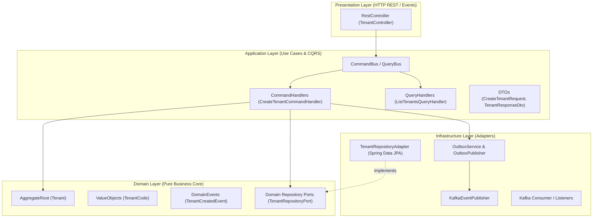
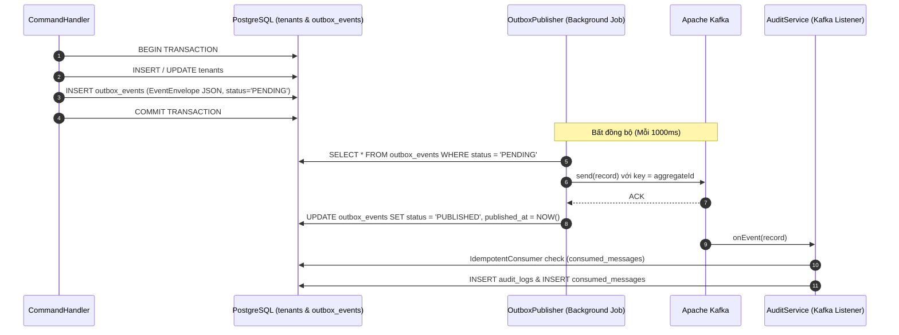

# ViShop Platform — Architecture

## 1. Multi-Module Monorepo Structure

Dự án **ViShop Platform** được tổ chức theo cấu trúc Gradle Multi-Module trên nền tảng **Java 21 LTS** và **Spring Boot 3.3.x**, áp dụng **Domain-Driven Design (DDD)**, **CQRS (Command Query Responsibility Segregation)**, **Transactional Outbox**, và **Apache Kafka** làm event bus phân tán.

```text
vishop-platform/
├── platform-common/                     # Thư viện dùng chung (Shared libraries)
│   ├── common-domain/                   # Hạt nhân Domain thuần túy (AggregateRoot, Entity, VO, Event, CQRS interfaces)
│   ├── common-web/                      # Web & CQRS Bus: SpringCommandBus, SpringQueryBus, Problem Details (RFC 9457)
│   ├── common-security/                 # Multi-Tenancy context (TenantContext, TenantContextFilter)
│   ├── common-events/                   # Kafka Backbone (EventEnvelope, KafkaEventPublisher, DLQ, RecordInterceptor)
│   ├── common-persistence/              # Transactional Outbox, OutboxPublisher, ConsumedMessage (Idempotency)
│   ├── common-observability/            # Actuator & Micrometer Prometheus
│   └── common-test/                     # Testcontainers (PostgreSQL, Kafka)
│
├── services/                            # Các Microservices độc lập (Bounded Contexts)
│   ├── tenant-service/                  # Quản lý Tenant, tổ chức, cấu hình gian hàng (DDD + CQRS + Outbox)
│   ├── identity-service/                # Quản lý User, Account, Authentication & Token
│   └── audit-service/                   # Event-driven consumer ghi nhận lịch sử audit log từ Kafka
│
├── infra/
│   └── docker-compose/                  # Môi trường chạy local: Kafka KRaft, Kafka UI, PostgreSQL 16, Redis 7
│
├── build.gradle.kts                      # Cấu hình build gốc
├── settings.gradle.kts                   # Đăng ký các modules
└── docs/                                # Tài liệu kiến trúc và hướng dẫn phát triển
```

---

## 2. Layered Architecture & Dependency Rule

Mỗi Microservice tuân thủ chặt chẽ mô hình **Hexagonal Architecture (Ports & Adapters) kết hợp DDD**:



### Quy tắc phụ thuộc (Dependency Rules):
1. **Domain Layer**:
   * Tuyệt đối không phụ thuộc vào framework (không import Spring, JPA, Hibernate, Web).
   * Chỉ sử dụng Java thuần (`java.*`) và `platform-common:common-domain`.
   * Định nghĩa các Ports (Interfaces) cho các thao tác persistence hoặc external services.
2. **Application Layer**:
   * Điều phối nghiệp vụ thông qua CQRS Commands và Queries.
   * Phụ thuộc vào `Domain Layer` (Entities, Ports, Domain Events).
   * Không phụ thuộc vào tầng Presentation hay các công nghệ hạ tầng cụ thể.
3. **Infrastructure Layer**:
   * Cung cấp các Adapters hiện thực các Ports của Domain Layer (ví dụ: `TenantRepositoryAdapter` dùng Spring Data JPA).
   * Quản lý kết nối Database, Kafka Consumer/Producer, Redis Cache, S3 Storage.
4. **Presentation Layer**:
   * REST Controllers nhận HTTP Request, validate cú pháp với Jakarta Validation (`@Valid`).
   * Chuyển tiếp tác vụ vào Application Layer thông qua `CommandBus.dispatch()` hoặc `QueryBus.dispatch()`.
   * Trả về kết quả bọc trong `ListEnvelope` hoặc RFC 9457 `ProblemDetail`.

---

## 3. CQRS Pattern (Command Query Responsibility Segregation)

Dự án phân tách triệt để luồng **Write (Command)** và luồng **Read (Query)**:

### 3.1. Luồng Ghi (Write Path)
```text
HTTP POST/PATCH
   │
   ▼
TenantController
   │ commandBus.dispatch(new CreateTenantCommand(code, name))
   ▼
SpringCommandBus (Định tuyến tự động qua Spring Context)
   │
   ▼
CreateTenantCommandHandler (@Transactional)
   ├── 1. Kiểm tra quy tắc nghiệp vụ qua domain port: tenantRepository.existsByCode(code)
   ├── 2. Khởi tạo Aggregate Root: Tenant.create(TenantCode.of(code), name)
   │      └── Aggregate nội bộ sinh TenantCreatedEvent và lưu vào memory list
   ├── 3. Lưu Aggregate: tenantRepository.save(tenant)
   ├── 4. Ghi Domain Events vào Transactional Outbox: outboxService.saveEventsFor(tenant, "tenant-service")
   └── 5. Trả về TenantResponseDto
```

### 3.2. Luồng Đọc (Read Path)
```text
HTTP GET /api/v1/tenants?limit=20&cursor=...
   │
   ▼
TenantController
   │ queryBus.dispatch(new ListTenantsQuery(limit, cursor, url))
   ▼
SpringQueryBus
   │
   ▼
ListTenantsQueryHandler (@Transactional(readOnly = true))
   ├── 1. Giải mã opaque cursor (Cursor.decode(cursor))
   ├── 2. Query trực tiếp DB tối ưu qua Spring Data JPA
   └── 3. Bọc kết quả trong ListEnvelope<TenantResponseDto> (có hasNextPage và nextCursor)
```

---

## 4. Transactional Outbox & Kafka Event Backbone

Để bảo đảm tính nhất quán dữ liệu giữa Database và Message Broker (tránh hiện tượng mất event hoặc event gửi đi nhưng DB rollback), ViShop sử dụng **Transactional Outbox Pattern**:



### 4.1. Quy tắc đặt tên Topic Kafka
* Format chuẩn: `vishop.{aggregate_kebab_case}.events` (ví dụ: `vishop.tenant.events`).
* Dead-Letter Topic: `{topic}.DLT` (ví dụ: `vishop.tenant.events.DLT`).
* Partition Key: Luôn sử dụng `aggregateId` làm message key để đảm bảo thứ tự message cho từng aggregate.

### 4.2. Consumer Idempotency & Error Handling
* **Deduplication**: Mọi consumer sử dụng `IdempotentConsumer` ghi nhận `(message_id, consumer_group)` vào bảng `consumed_messages` để ngăn chặn duplicate execution do cơ chế at-least-once của Kafka.
* **Retry Backoff**: Tự động retry theo cấp số nhân (1s, 2s, 4s). Nếu quá số lần cho phép, đẩy message lỗi sang topic `.DLT`.
* **Multi-Tenancy Propagation**: Header `X-Tenant-Id` được tự động trích xuất từ Kafka record bởi `TenantRecordInterceptor` và thiết lập vào `TenantContext`.

---

## 5. Multi-Tenancy & Context Propagation

* Mỗi request HTTP phải kèm header `X-Tenant-Id` (UUID).
* `TenantContextFilter` trích xuất `X-Tenant-Id` và lưu vào `TenantContext` (`ThreadLocal<UUID>`).
* Toàn bộ các bảng nghiệp vụ kế thừa `BaseTenantJpaEntity` chứa cột `tenant_id`.
* Khi gửi event qua Kafka, `KafkaEventPublisher` tự động đính kèm header `X-Tenant-Id`.
* `TenantRecordInterceptor` giải mã header `X-Tenant-Id` và thiết lập `TenantContext` trong thread xử lý event.
