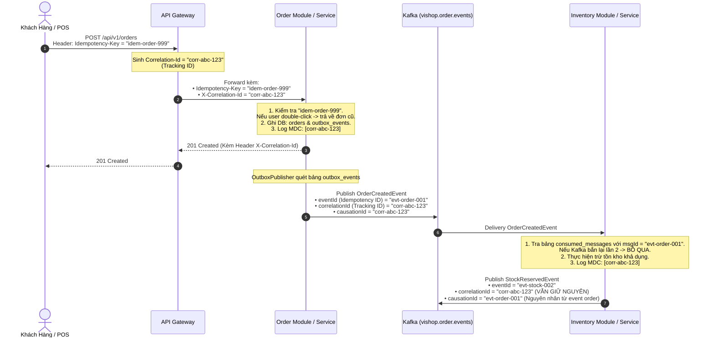

# Cơ chế Chống Trùng lặp (Idempotency) và Truy vết Phân tán (Distributed Tracing)

Tài liệu này đặc tả vai trò, cơ chế hoạt động và cách hiện thực của hai định danh quan trọng hàng đầu trong kiến trúc phân tán của **ViShop Platform**:
1. **`idempotencyId`** (hay `Idempotency-Key`, `messageId`, `eventId`): Đảm bảo tính toán idempotent và chống trùng lặp dữ liệu (Deduplication).
2. **`trackingId`** (hay `correlationId`, `traceId`, `requestId`): Truy vết phân tán (Distributed Tracing) và xâu chuỗi luồng xử lý qua nhiều service và message bus.

---

## 1. Bảng So sánh Tổng quan

| Tiêu chí | `idempotencyId` (Idempotency Key / Message ID) | `trackingId` (Correlation ID / Trace ID) |
| :--- | :--- | :--- |
| **Mục đích chính** | **Chống trùng lặp (Deduplication)**: Đảm bảo một thao tác chỉ thực thi và có hiệu lực đúng **1 lần duy nhất**, dù bị gọi lại nhiều lần do lỗi mạng, client retry, hoặc Kafka redelivery. | **Truy vết phân tán (Distributed Tracing)**: Xâu chuỗi toàn bộ hành trình của một yêu cầu đi qua API Gateway, các microservices, cơ sở dữ liệu, và Kafka topics. |
| **Phạm vi (Scope)** | **Cục bộ cho 1 hành động / command / message**: Gắn chặt với 1 transaction cụ thể. | **Toàn cục (End-to-End)**: Lan truyền xuyên suốt toàn bộ vòng đời của request và các event liên quan mà nó kích hoạt. |
| **Hậu quả nếu thiếu** | **Sai lệch dữ liệu tài chính/nghiệp vụ**: Trừ tiền 2 lần, tạo 2 đơn hàng trùng, trừ kho 2 lần khi client double-click hoặc broker gửi lại message. | **Mất khả năng giám sát & gỡ lỗi**: Khi xảy ra lỗi, không thể liên kết các dòng log từ nhiều service lại để tìm nguyên nhân gốc (Root Cause). |
| **Cơ chế lưu trữ** | Bảng `consumed_messages` (PostgreSQL) hoặc Redis Cache có TTL. | Gắn vào HTTP Header (`X-Correlation-Id`), Kafka Record Header, và đưa vào Log MDC (`[correlationId=...]`). |
| **Thay đổi qua luồng** | Mỗi hành động / event con có một `idempotencyId` riêng biệt. | **Không đổi**: Giữ nguyên vẹn giá trị gốc từ khi tiếp nhận ở API Gateway đến khi toàn bộ chuỗi event kết thúc. |

---

## 2. Cơ chế Idempotency (`idempotencyId`) trong ViShop Platform

Trong mạng phân tán, cơ chế giao nhận thông điệp của Apache Kafka là **At-Least-Once Delivery** (ít nhất một lần). Nếu Consumer xử lý xong nhưng ứng dụng crash trước khi commit offset, Kafka sẽ gửi lại đúng message đó. Bên cạnh đó, mạng chập chờn cũng khiến Client gửi lại HTTP Request nhiều lần.

ViShop Platform áp dụng `idempotencyId` tại 3 điểm trọng yếu:

### 2.1. Trong Kafka Event Consumer (`IdempotentConsumer`)
Tại [`platform-common:common-persistence`](../../platform-common/common-persistence/src/main/java/com/vishop/common/persistence/idempotency/IdempotentConsumer.java), class [`IdempotentConsumer`](../../platform-common/common-persistence/src/main/java/com/vishop/common/persistence/idempotency/IdempotentConsumer.java) sử dụng bảng `consumed_messages` làm chốt chặn:

```java
@Transactional
public boolean executeIfNotProcessed(UUID messageId, String consumerGroup, String eventType, Runnable action) {
    String msgId = messageId.toString();
    
    // 1. Kiểm tra messageId đã được consumerGroup này xử lý chưa
    if (repository.existsByMessageIdAndConsumerGroup(msgId, consumerGroup)) {
        log.info("Message [{}] already processed by [{}], skipping duplicate", msgId, consumerGroup);
        return false; // Bỏ qua an toàn, không thực thi lại
    }

    // 2. Thực thi nghiệp vụ chính
    action.run();

    // 3. Đánh dấu messageId đã xử lý trong cùng transaction
    repository.save(new ConsumedMessageEntity(msgId, consumerGroup, eventType, Instant.now()));
    return true;
}
```

*Cấu trúc bảng `consumed_messages`*:
- Khóa chính tổng hợp: `PRIMARY KEY (message_id, consumer_group)`.
- Điều này cho phép nhiều `consumer_group` khác nhau cùng tiêu thụ một `messageId` mà không bị xung đột, nhưng trong cùng một group thì không bao giờ bị xử lý 2 lần.

### 2.2. Trong REST API (Header `Idempotency-Key`)
- Với các API nhạy cảm (Tạo đơn hàng, Thanh toán, Trừ ví): Client bắt buộc gửi header `Idempotency-Key: <UUIDv7>`.
- Server lưu trạng thái xử lý vào Redis với TTL (ví dụ: 24h). Nếu request trùng khóa gửi tới trong lúc đang xử lý $\rightarrow$ trả về `409 Conflict`. Nếu đã hoàn tất $\rightarrow$ trả về kết quả đã cache của lần đầu tiên.

### 2.3. Trong Webhook Sàn Thương Mại Điện Tử (TikTok Shop)
- Mọi webhook từ TikTok đẩy về (`POST /api/v1/tiktok/webhook`) mang một mã `tts_notification_id`.
- Hệ thống lưu raw payload vào bảng `platform_webhook_events` với ràng buộc duy nhất `@@unique([eventId])` (`tts_notification_id`). Các webhook bị bắn lại sẽ lập tức bị chặn ở tầng cơ sở dữ liệu.

---

## 3. Cơ chế Distributed Tracing (`trackingId` / `correlationId`)

### 3.1. Điểm khởi tạo: API Gateway (`CorrelationIdGlobalFilter`)
Tại cổng vào của hệ thống, [`CorrelationIdGlobalFilter`](../../services/api-gateway/src/main/java/com/vishop/gateway/filter/CorrelationIdGlobalFilter.java) đảm bảo mọi request đều có định danh truy vết:

```java
String correlationId = request.getHeaders().getFirst("X-Correlation-Id");
if (correlationId == null || correlationId.isBlank()) {
    correlationId = UuidV7.nextId().toString(); // Sinh UUID v7 tăng dần theo thời gian
}

String requestId = request.getHeaders().getFirst("X-Request-Id");
if (requestId == null || requestId.isBlank()) {
    requestId = UuidV7.nextId().toString();
}

// Chuyển tiếp vào header downstream cho các microservices phía sau
// Đồng thời gán vào Response header trả về cho Client
```

### 3.2. Lan truyền qua Event Bus (`EventEnvelope`)
Khi một service phát hành Domain Event lên Kafka, [`EventEnvelope.java`](../../platform-common/common-events/src/main/java/com/vishop/common/events/EventEnvelope.java) luôn mang theo metadata truy vết:

```java
public record EventEnvelope(
    UUID eventId,        // <-- IDEMPOTENCY ID của riêng event này
    String eventType,
    int schemaVersion,
    Instant occurredAt,
    String producer,
    UUID tenantId,
    String aggregateType,
    UUID aggregateId,
    UUID correlationId,  // <-- TRACKING ID (Gốc từ API Gateway, không đổi)
    UUID causationId,    // <-- ID của Event/Command trực tiếp sinh ra event này
    JsonNode payload
)
```

- **`correlationId`**: Định danh của request khởi nguồn (Root Cause).
- **`causationId`**: Định danh của sự kiện hoặc request trực tiếp gây ra sự kiện này (Direct Cause).

### 3.3. Xuyên suốt trong Saga Orchestrator
Trong giao dịch phân tán dài hạn ([`SagaOrchestrator.java`](../../platform-common/common-saga/src/main/java/com/vishop/common/saga/SagaOrchestrator.java)), `correlationId` liên kết toàn bộ trạng thái thực thi và các bước đền bù (compensating steps) trong bảng `saga_instances`:

```java
Optional<SagaInstanceEntity> findByCorrelationId(UUID correlationId);
```

### 3.4. Cấu hình Logging (SLF4J MDC)
Mọi dòng log trong hệ thống đều tự động bổ sung `correlationId` vào MDC:
```text
2026-10-20 14:10:05.123 [INFO] [order-service] [correlationId=0192a6df-10a4-7f12-a1b2-c3d4e5f60789] [tenantId=0192a6df-...] Order created with ID: 999
```
Khi phát sinh lỗi, đội ngũ vận hành chỉ cần tra cứu mã `correlationId` trên hệ thống Log Centralized (ELK, Loki, Grafana) để nhìn thấy toàn bộ đường đi của request.

---

## 4. Sơ đồ Tuần tự Phối hợp Thực tế (Checkout & Đặt hàng)

Sơ đồ dưới đây minh họa cách `idempotencyId` và `trackingId` phối hợp nhịp nhàng trong luồng Đặt hàng:



---

## 5. Quy tắc Vàng cho Lập trình viên (Developer Guidelines)

1. **Không bao giờ dùng `trackingId` (`correlationId`) làm `idempotencyId`**:
   - `correlationId` đại diện cho một luồng nghiệp vụ dài (chứa nhiều event khác nhau). Nếu lấy `correlationId` làm khóa idempotent, các event sinh ra sau trong cùng một luồng sẽ bị coi là trùng lặp và bị bỏ qua nhầm!
2. **Khởi tạo UUID v7**:
   - Cả `idempotencyId` lẫn `trackingId` đều được khuyến nghị sử dụng chuẩn **UUID v7** (có sẵn trong `com.vishop.common.domain.UuidV7`) để đảm bảo tính tuần tự theo thời gian, tối ưu hiệu năng đánh index B-Tree trong cơ sở dữ liệu.
3. **Luôn truyền `correlationId` khi gọi API downstream hoặc publish event**:
   - Khi tạo `EventEnvelope` mới từ một sự kiện đầu vào, phải luôn truyền tiếp `correlationId` nhận được, và gán `causationId` bằng `eventId` của sự kiện trực tiếp trước đó.
