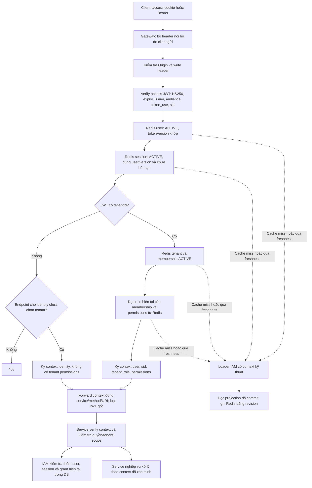
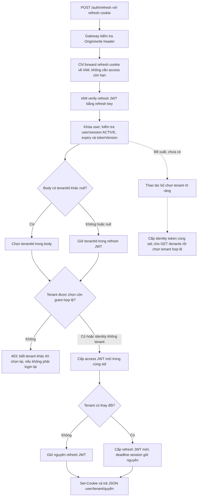

# Rà soát và sơ đồ auth hiện tại

> Signed-context diagrams below describe the previous contract. Runtime changed on 07/11/2026: [identity headers and Redis permissions](gateway-authorization.md).


Ngày rà soát: 06/11/2026. Codebase: `9380908`, nhánh `feature/auth-flow`.
Các sơ đồ hiện trạng dưới đây mô tả code đang chạy; phần đề xuất chưa được triển khai.

Luồng chính có nền tảng tốt: access/refresh dùng hai key riêng, cookie HttpOnly,
session riêng theo sid, tenant authorization lấy trạng thái hiện tại, logout riêng
phiên và Redis dùng projection có revision. Tuy vậy, cần bổ sung recovery khi tenant
bị thu hồi và giới hạn thử đăng nhập. Refresh rotation cũng chưa được triển khai.

## Các phát hiện

| Ưu tiên | Phát hiện và điều kiện xảy ra | Tác động / hướng xử lý |
| --- | --- | --- |
| Cao trước khi mở public | Chưa thấy limiter theo IP/account cho login/register/refresh trong gateway, IAM hoặc cấu hình infra trong repo. Login khóa user trước khi chạy BCrypt. Chưa kiểm chứng có WAF/limiter ngoài repo hay không. | Thử mật khẩu lặp không bị chặn ở tầng ứng dụng; có thể chiếm CPU và giữ lock trên user. Giới hạn request trước BCrypt và lock DB, có backoff và metrics. |
| Vừa | Tenant A bị khóa/thu hồi membership trong lúc user còn phiên và tenant B hợp lệ. Refresh không truyền tenantId hoặc truyền null đều dùng lại A. Gateway cũng kiểm tra membership A trước khi cho GET /tenants. | User không thể tự tải lại danh sách tenant bằng credential đang chọn A. Biết ID B thì vẫn refresh chọn B được; nếu không biết thì phải login lại. Bổ sung thao tác bỏ chọn tenant và cấp identity token cùng sid, chỉ sau khi xác thực user/session. |
| Vừa | Refresh bình thường trả lại chính refresh JWT cũ; đổi tenant phát hành JWT mới nhưng không đánh dấu JWT cũ đã dùng. | Bản sao refresh token vẫn sử dụng được đến hạn phiên, logout hoặc đổi tokenVersion. Cân nhắc rotation và phát hiện reuse theo sid/token family; không kéo dài deadline phiên. |
| Có điều kiện | Gateway context ràng buộc audience, method, path/query và thời gian, nhưng không ký request body và không ghi nhận requestId đã dùng. | Nếu context bị lộ, cùng context có thể được gửi lại trong cửa sổ 15 giây cho cùng method/URI; body có thể thay đổi. Cần bảo vệ đường truyền nội bộ; với mutation nhạy cảm cân nhắc body digest và chống replay/idempotency. Không phải bypass từ header do client tự gửi vì gateway đã loại các header đó. |

Nguồn đối chiếu:

- [LoginCommandHandler](../../services/iam-service/src/main/java/com/vishop/iam/modules/identity/application/command/auth/LoginCommandHandler.java): lock user rồi kiểm tra password, chưa có giới hạn attempts.
- [RefreshCommandHandler](../../services/iam-service/src/main/java/com/vishop/iam/modules/identity/application/command/auth/RefreshCommandHandler.java): null tenant giữ tenant cũ; refresh thường dùng lại credential.
- [SessionAuthenticationService](../../services/iam-service/src/main/java/com/vishop/iam/modules/identity/application/service/SessionAuthenticationService.java): grant của tenant đang chọn phải còn hợp lệ.
- [LocalAuthenticationVerifier](../../services/api-gateway/src/main/java/com/vishop/gateway/security/LocalAuthenticationVerifier.java): xác minh membership trước khi forward request, kể cả request lấy danh sách tenant.
- [JwtAuthTokens](../../services/iam-service/src/main/java/com/vishop/iam/modules/identity/infrastructure/security/JwtAuthTokens.java): existingRefresh được dùng nguyên trạng; không kéo dài hạn session.
- [GatewayContextCodec](../../libs/common-security/src/main/java/io/github/coreplatform/common/security/gateway/GatewayContextCodec.java): HMAC và cửa sổ thời gian, chưa có body digest hoặc lưu nonce đã dùng.

## 1. Đăng ký / đăng nhập — hiện trạng

```mermaid
sequenceDiagram
    actor U as Client
    participant G as Gateway
    participant I as IAM
    participant D as PostgreSQL
    participant R as Auth Redis
    U->>G: POST /auth/register hoặc /auth/login
    G->>G: Kiểm tra Origin và X-Requested-With
    G->>I: Public route, loại token/header định danh cũ
    alt Đăng ký
        I->>I: Validate email/password, BCrypt
        I->>D: Tạo user USER/ACTIVE
    else Đăng nhập
        I->>D: Khóa user theo email
        I->>I: Kiểm tra BCrypt và user ACTIVE
        I->>D: Chọn tenant yêu cầu, ghi nhớ hoặc duy nhất còn hợp lệ
    end
    I->>D: Tạo auth_sessions với sid mới
    Note over I,D: User/session, authorization_outbox và integration event cùng transaction
    I->>D: Commit
    I-->>G: Set-Cookie access + refresh HttpOnly; JSON không chứa JWT
    G-->>U: 201 đăng ký hoặc 200 đăng nhập
    I->>R: Publish projection sau commit, retry khi lỗi
    Note over G,I: Cache miss được loader IAM nạp lại; không bắt buộc chờ relay trước request kế tiếp
```

Access mặc định 15 phút, refresh/session 7 ngày. Access không sống quá hạn session.
Register cấp identity chưa chọn tenant. Login nhiều tenant mà chưa chọn được tenant
sẽ cấp identity token để client gọi GET /tenants, rồi chọn qua refresh.

## 2. Request cần đăng nhập — hiện trạng



Lỗi credential/session trả 401; user/tenant/membership không hoạt động hoặc thiếu
quyền trả 403; không xác nhận được trạng thái vì hạ tầng lỗi thì chặn request,
thông thường trả 503. Gateway không lấy permissions từ JWT để fallback.

IAM dùng DB để kiểm tra lại. Những service khác chỉ có thể nhận context nếu đã có
security filter và signer tương ứng; sơ đồ không ngụ ý mọi service đều đã tích hợp.

## 3. Refresh / chọn tenant — hiện trạng và điểm cần bổ sung



Hướng sửa recovery: phân biệt rõ giữ tenant hiện tại, chọn tenant mới và bỏ chọn
tenant. Không tự cấp quyền tenant cũ khi membership đã mất; identity token chỉ cho
các endpoint không yêu cầu tenant. Nếu thêm rotation cần xử lý refresh đồng thời
giữa tab và retry để tránh thu hồi nhầm phiên hợp lệ.

## 4. Logout — hiện trạng

```mermaid
sequenceDiagram
    actor U as Client
    participant G as Gateway
    participant I as IAM
    participant D as PostgreSQL
    participant R as Auth Redis
    U->>G: POST /auth/logout + cookies
    G->>I: Context nếu access hợp lệ; refresh cookie nếu có
    Note over G,I: Access thiếu/hết hạn vẫn được chuyển tới logout
    I->>I: Lấy sid từ actor hợp lệ hoặc verify refresh cookie
    I->>D: Thu hồi đúng sid có điều kiện; ghi outbox/event
    I->>D: Commit
    I->>R: Đồng bộ projection REVOKED và chờ xác nhận
    alt Redis xác nhận
        I-->>G: 204 + xóa access/refresh cookie đúng path
        G-->>U: Logout thành công
    else Redis lỗi
        I-->>G: 503; DB đã thu hồi, outbox còn để retry
        G-->>U: Retry logout
    end
    Note over I,R: Logout lặp không nhân event; sid của thiết bị khác giữ nguyên
```

Không có credential hợp lệ thì logout chỉ xóa cookie; không tạo danh tính từ token
rác. Cookies của response lỗi đồng bộ chưa được xóa để client có thể retry.

## Kiểm chứng trong lượt rà soát

```powershell
$env:JAVA_HOME = 'C:/Program Files/Java/jdk fx 21'
.\gradlew.bat :services:iam-service:test --tests 'com.vishop.iam.IamAuthenticationApplicationTest' :services:api-gateway:test :libs:common-security:test --console=plain
```

Kết quả: **174 tests pass**: IAM auth integration 30, gateway 105, common-security 39.
Các test IAM dùng PostgreSQL và Redis tạm; không chạy migration vào database vận hành.
Không phải toàn bộ test IAM hoặc kiểm thử bảo mật trên môi trường production.
Các phát hiện trên dựa vào code và phạm vi repo; chưa kiểm tra WAF, TLS hay ingress
thực tế. Luồng xử lý auth chưa bị sửa trong lượt review này.
