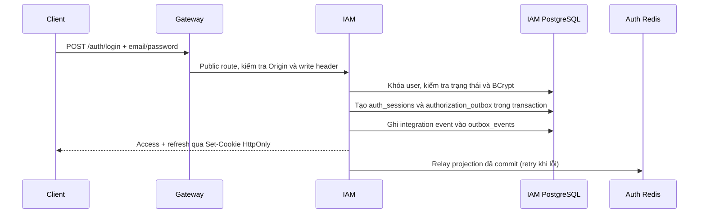
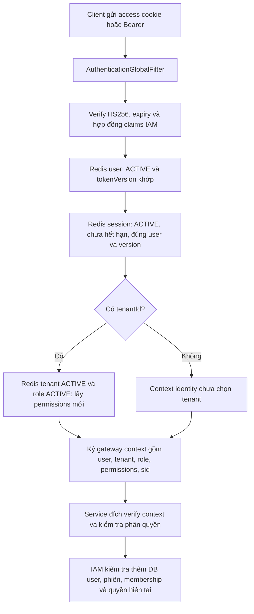

# Luồng xác thực IAM và gateway

Hệ thống dùng JWT HS256 với hai secret khác nhau cho access và refresh token. Mỗi
lần đăng nhập tạo một `sid` mới. JWT đi cùng trạng thái phiên trong PostgreSQL/Redis
để logout riêng phiên hiện tại; không dùng `HttpSession` hay sticky routing.

## Các thành phần

| Thành phần | Trách nhiệm |
| --- | --- |
| `JwtTokenService` trong common-security | Sinh và verify JWT bằng đúng key access/refresh; đặt `iat`, `exp`, `jti` |
| `JwtAuthTokens` trong IAM | Quy định claims IAM, issuer, audience, token_use và thời hạn |
| `SessionAuthenticationService` | Đối chiếu user, phiên, tokenVersion và quyền hiện tại trong DB |
| `LocalAuthenticationVerifier` trong gateway | Verify access JWT, đối chiếu user/session/tenant/role từ Auth Redis |
| `AuthorizationProjection` | Đẩy projection đã commit trong authorization_outbox sang Redis |
| `GatewayContextCodec` | Ký và kiểm tra context nội bộ, ràng buộc service đích, method, URI và thời gian |

Common JWT không quy định claims nghiệp vụ và không truy cập DB/Redis.

## Phân biệt các ID và version

| Giá trị | Ý nghĩa |
| --- | --- |
| `sid` | ID phiên đăng nhập; access và refresh của cùng phiên có cùng sid |
| `jti` | ID của một JWT, khác với sid |
| `users.token_version` | Thế hệ credential của user; tăng để thu hồi tất cả phiên cũ |
| `auth_sessions.token_version` | Bản chụp thế hệ user khi tạo phiên, không đổi khi refresh |
| `auth_sessions.version` | Optimistic-lock version của bản ghi phiên |
| `AuthorizationSnapshot.version` | Revision projection để dữ liệu cũ không ghi đè dữ liệu mới trong Redis |

`sid` nhận diện lần đăng nhập, không phải dấu vân tay phần cứng. Đăng nhập lại trên
cùng trình duyệt vẫn tạo phiên mới. Logout thu hồi sid của credential hiện tại.

## Bốn API xác thực

Các API ghi từ trình duyệt phải gửi `X-Requested-With: XMLHttpRequest` và Origin nằm trong
allowlist khi có Origin. Token trả qua cookie HttpOnly; JSON chỉ chứa user, tenant,
role, permissions và thời điểm hết hạn, không chứa chuỗi credential.

| API POST | Đầu vào | Kết quả |
| --- | --- | --- |
| `/api/v1/auth/register` | JSON email, password | Tạo USER/ACTIVE, hash BCrypt, tạo phiên, trả 201 và cookies |
| `/api/v1/auth/login` | JSON email, password, tenantId tùy chọn | Xác thực mật khẩu, tạo phiên mới, trả 200 và cookies |
| `/api/v1/auth/refresh` | Refresh cookie; JSON tenantId tùy chọn | Cấp access mới hoặc chọn tenant trong cùng phiên |
| `/api/v1/auth/logout` | Context gateway hoặc refresh/access cookie | Thu hồi đúng sid, xóa cookies, trả 204 |

Không có `/auth/me` hoặc `/auth/switch-tenant`. Chọn tenant bằng body của refresh.

## Đăng nhập và cấp token



Nếu login có tenantId thì IAM kiểm tra membership, tenant và role. Nếu không có,
IAM ưu tiên tenant ghi nhớ còn hợp lệ, rồi tenant duy nhất nếu chỉ có một lựa chọn;
còn lại cấp identity chưa chọn tenant. Register cấp identity chưa chọn tenant.
Quyền của role yêu cầu MFA chưa được cấp qua luồng login chưa hỗ trợ MFA này.

Access chứa `sub`, `sid`, `tenantId`, `systemRole`, `tenantRoleId`, `tenantRole`,
`tokenVersion` và metadata JWT. Refresh chứa metadata, `sub`, `sid`, `tenantId`,
`tokenVersion`. Permissions không nhồi vào JWT.

## Một request nghiệp vụ qua gateway



Gateway bỏ các header context do client tự gửi trước khi tạo context của mình.
Context được ký theo audience/service đích, HTTP method, URI và thời gian; downstream
không tin các header user/tenant tự khai báo. Các service vẫn kiểm tra permission và
tenant scope tại endpoint/use case của mình. IAM đối chiếu thêm DB vì sở hữu dữ liệu
bảo mật; audit/subscription không phải gọi IAM cho từng request đã có context hợp lệ.

## Auth Redis

Các key dưới đây được thêm prefix môi trường, ví dụ `vishop:dev:`.

| Key logic | Nội dung | TTL |
| --- | --- | --- |
| `auth:user:{userId}` | status, systemRole, tokenVersion | Giữ revision, kiểm tra freshness riêng |
| `auth:session:{sid}` | status, userId, tokenVersion, expiresAt | Hết hạn tuyệt đối theo refresh/session |
| `auth:tenant:{tenantId}` | status | Giữ revision, kiểm tra freshness riêng |
| `auth:role:{tenantId}:{roleId}` | status, roleKey, permissions | Giữ revision, kiểm tra freshness riêng |

Cache miss hoặc quá freshness sẽ gọi internal loader IAM có context kỹ thuật được
ký. Gateway không truy cập trực tiếp IAM DB. IAM đọc projection bền vững trong
`authorization_outbox`; không dựng lại quyền từ JWT. Lua chỉ nhận revision không
cũ hơn hiện tại, nên relay chậm không thể phục hồi phiên đã bị thu hồi.

User tokenVersion mới hơn cache làm gateway refresh projection trước khi so sánh.
Cache/loader lỗi thì request được chặn; không fallback sang quyền trong JWT. TTL
session không kéo dài khi relay hoặc refresh.

## Refresh và chọn tenant

IAM verify bằng refresh key, khóa user, đọc user và session từ DB, kiểm tra ACTIVE,
chưa hết hạn, đúng chủ sở hữu và cả ba tokenVersion (JWT, session, user) khớp nhau.
Sau đó mới đọc membership/quyền và cấp access mới.

Refresh thông thường giữ nguyên refresh token. Chọn tenant khác cấp lại refresh
với tenantId mới và giữ nguyên hạn phiên ban đầu. Đây chưa phải refresh rotation
và chưa có cơ chế phát hiện reuse. Thời hạn phiên không trượt khi refresh; access
không được sống lâu hơn phiên. Mặc định access 15 phút, phiên/refresh 7 ngày.

## Logout riêng phiên

1. Xác định user/sid từ context hợp lệ hoặc cookie JWT hợp lệ.
2. Trong transaction DB: cập nhật có điều kiện `revoked_at IS NULL`, ghi projection
   và event UserLoggedOut. Logout lặp chỉ có một lần thay đổi và một event.
3. Sau commit, đẩy projection REVOKED của đúng sid sang Redis và chờ xác nhận.
4. Sau khi Redis xác nhận, trả 204 và xóa cả hai cookie đúng path ban đầu.

Nếu Redis lỗi sau DB commit, API trả 503. Phiên đã bị thu hồi trong DB; client retry
logout để đồng bộ lại Redis. Retry không nhân event. Relay nền cũng tiếp tục thử.
Thiết bị khác có sid khác vẫn dùng được access/refresh. Request đã chạy trước thời
điểm thu hồi không bị hủy giữa chừng.

| Thay đổi | Hành vi |
| --- | --- |
| Logout | Thu hồi sid hiện tại |
| Đổi role, khóa/xóa membership | Tăng user tokenVersion, phiên cũ phải đăng nhập lại |
| Khóa/xóa tài khoản | Tăng user tokenVersion, chặn truy cập; không login khi bị khóa |
| Đổi mật khẩu hoặc systemRole | Tăng user tokenVersion, phải đăng nhập lại |
| Sửa permissions của role | Cập nhật role projection, dùng quyền mới, không tăng tokenVersion |

Các thay đổi toàn user/tenant/role đồng bộ qua outbox; gateway có freshness check để
giới hạn việc dùng projection cũ. Logout thành công có thêm bước chờ Redis nêu trên.
Các hàng `auth_sessions` hết hạn hiện chưa có job dọn tự động; TTL chỉ dọn Redis,
không dọn PostgreSQL. Không xóa hàng phiên còn hiệu lực khi bổ sung retention.

## Cấu hình và triển khai

- IAM và gateway dùng chung `JWT_ACCESS_SECRET`; mỗi key tối thiểu 32 byte UTF-8.
- `JWT_REFRESH_SECRET` khác access secret. IAM dùng key này để cấp/verify refresh.
- `GATEWAY_IAM_CONTEXT_SECRET` giống nhau ở gateway và IAM; là key riêng cho context.
- `AUTH_CACHE_PREFIX`, Redis host/port/password/database phải khớp giữa IAM/gateway.
- Production bắt buộc cấu hình secrets và `ALLOWED_ORIGINS`; cookies Secure,
  frontend gửi credentials. SameSite=None yêu cầu Secure và HTTPS.
- JPA chỉ validate. Áp dụng V12 trước khi chạy bản mới; không tự migrate khi startup.
- JWT cũ thiếu sid không được chấp nhận; rollout issuer và gateway cùng đợt, người
  dùng đăng nhập lại. Không có chuyển đổi ngầm credential cũ sang phiên mới.

```powershell
# Đặt IAM_DB_URL, IAM_DB_USER, IAM_DB_PASSWORD trỏ đúng database trước khi chạy.
.\gradlew.bat :services:iam-service:migrateIamDb
.\gradlew.bat :services:iam-service:dev
```

V12 thêm bảng auth_sessions và projection/trigger phiên, giữ schema/data cũ.
Các test HTTP dùng PostgreSQL/Redis tạm: cookies, phân quyền, refresh, logout lặp và
đồng thời, Redis lỗi rồi retry, thu hồi toàn user và tenant isolation. Kiểm tra toàn
dự án bằng `.\gradlew.bat test packageAll`; test không migrate database vận hành.
