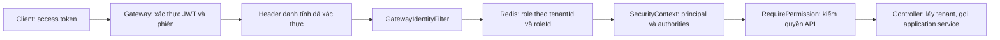

# Luồng xác thực IAM và gateway

Cập nhật 07/11/2026: gateway truyền header danh tính trên ingress private; backend
lấy permissions từ Auth Redis. Không còn Base64/HMAC gateway context. JWT access
và refresh vẫn được ký bằng hai key khác nhau.

## Thành phần và trách nhiệm

| Thành phần | Trách nhiệm |
| --- | --- |
| JwtTokenService / JwtAuthTokens | Ký/verify JWT, issuer/audience/token_use, sid và lifetime |
| SessionAuthenticationService | Kiểm tra user/session/grant hiện tại trong DB IAM |
| LocalAuthenticationVerifier | Gateway xác nhận JWT, user/session/tenant/membership và role cache |
| GatewayRequestForwarder | Loại header client giả, credential và ghi header danh tính đã xác thực |
| GatewayIdentityHeaders | Validate/đọc/ghi 5 header định danh, không permissions |
| GatewayIdentityFilter | Filter dùng chung của Audit/Subscription, tạo principal từ header và Redis |
| RedisGatewayRolePermissions | Đọc role permissions theo tenantId/roleId và freshness |
| AuthorizationProjection | Đồng bộ projection đã commit qua authorization_outbox sang Redis |

## Bốn API auth

| API POST | Đầu vào | Kết quả |
| --- | --- | --- |
| `/api/v1/auth/register` | email/password | Tạo user USER/ACTIVE, sid mới, 201 + cookies |
| `/api/v1/auth/login` | email/password, tenantId tùy chọn | Xác thực BCrypt/status, sid mới, 200 + cookies |
| `/api/v1/auth/refresh` | Refresh cookie, tenantId tùy chọn | Access mới trong cùng sid, có thể chọn tenant |
| `/api/v1/auth/logout` | Header identity từ gateway hoặc refresh cookie | Thu hồi đúng sid, xóa cookies, 204 |

Browser writes gửi `X-Requested-With: XMLHttpRequest` và Origin thuộc allowlist.
Access/refresh ở cookie HttpOnly, JSON không chứa credential. Access mặc định 15
phút, session/refresh 7 ngày; access không được sống lâu hơn session. Không có
`/auth/me` hoặc `/auth/switch-tenant`; chọn tenant qua refresh.

## Phân quyền API ở service



Gateway xóa header danh tính do client tự gửi rồi ghi lại danh tính đã xác thực.
Service không xác thực lại access JWT. `GatewayIdentityFilter` đọc header,
gọi `RedisGatewayRolePermissions.resolve(tenantId, roleId)` và đưa permissions
vào authorities. `@RequirePermission(Notification.SETTINGS_MANAGE)` kiểm tra
authority tương ứng trước khi chạy controller. Controller không kiểm quyền lần nữa.

Gateway vẫn hỗ trợ phiên chưa chọn tenant cho API auth, tenant, lời mời và CMS.
API nghiệp vụ như notification-settings bắt buộc có tenant ngay tại gateway;
thiếu tenant trả 403 trước khi forward. Gateway lấy tenant từ danh tính đã xác thực,
không lấy từ header tenant do client gửi, rồi truyền `X-Tenant-Id` và `X-Role-Id` xuống service.
Với request hợp lệ không có tenant, filter tạo principal với permissions rỗng.
Các API `/api/v1/cms/**` yêu cầu system role `PLATFORM_ADMIN` tại gateway;
role OWNER/ADMIN của tenant không thay thế quyền admin hệ thống. CMS có thể không chọn
tenant; nếu đã chọn tenant, gateway vẫn truyền tenant/role tương ứng. Backend CMS tiếp tục
kiểm tra system role của principal.
Controller lấy tenant trực tiếp bằng `actor.tenantId()` từ principal;
gateway đã yêu cầu tenant cho API nghiệp vụ và annotation kiểm quyền tại service.

Audit và Subscription đã gắn filter vào security chain. Notification hiện có controller
và kiểm thử HTTP riêng, nhưng chưa có application HTTP, security chain và route gateway
để chạy toàn bộ luồng này. Không coi kiểm thử controller là kiểm thử tích hợp gateway.
IAM dùng filter riêng và kiểm tra dữ liệu xác thực trong DB; không thuộc luồng filter
chung của các service nghiệp vụ ở sơ đồ trên.

## Header gateway chuyển xuống service

```http
X-User-Id: <user UUID>
X-Session-Id: <sid UUID>
X-Tenant-Id: <tenant UUID>
X-Role-Id: <role UUID>
X-System-Role: USER hoặc PLATFORM_ADMIN
```

User chưa chọn tenant không có hai header tenant/role. RoleId lấy từ membership hiện tại,
không dùng role cũ trong JWT làm nguồn cấp quyền. Không gửi X-Permissions hay JWT
gốc xuống backend. Gateway bỏ tất cả header định danh do client gửi và tự tạo lại.
Header phải đơn trị, UUID đúng dạng, đủ sid và role khi có tenant.

Chi tiết contract và ranh giới mạng: [gateway authorization](gateway-authorization.md).
Các HTTP backend chỉ được truy cập qua ingress tin cậy của gateway. Plain header
không chứng minh người gửi nếu backend bị mở trực tiếp ra mạng không tin cậy.

## Đăng nhập / đăng ký

```mermaid
sequenceDiagram
    participant C as Client
    participant G as Gateway
    participant I as IAM
    participant D as PostgreSQL
    participant R as Auth Redis
    C->>G: POST login/register + write header
    G->>G: Origin/CSRF header, xóa header định danh và credential cũ
    G->>I: Public route, email/password
    I->>D: Login khóa user và kiểm tra BCrypt/status; register tạo user
    I->>D: Tạo auth_sessions, authorization_outbox và integration event
    I->>D: Commit
    I-->>G: Access/refresh HttpOnly cookies + JSON user/tenant/quyền
    G-->>C: 200 hoặc 201
    I->>R: Publish projection sau commit, retry khi lỗi
```

Mỗi login sinh sid riêng. Login có tenantId phải có grant hợp lệ; nếu không, ưu
 tiên tenant ghi nhớ còn hợp lệ hoặc tenant duy nhất. Nhiều tenant chưa chọn thì
cấp identity token để GET /tenants rồi chọn bằng refresh. Register không chọn tenant.
Role yêu cầu MFA không được cấp quyền khi chưa có luồng MFA tương ứng.

## Request nghiệp vụ

```mermaid
sequenceDiagram
    participant C as Client
    participant G as Gateway
    participant R as Auth Redis
    participant S as Audit / Subscription
    C->>G: Access cookie hoặc Bearer + request
    G->>G: Verify HS256, expiry, issuer/audience/token_use, sid
    G->>R: User ACTIVE + tokenVersion; session ACTIVE + expiry
    G->>R: Tenant/membership ACTIVE; roleId/roleKey hiện tại
    Note over G,R: Cache miss/stale: gateway nạp projection từ internal loader IAM
    G->>S: Request + 5 identity headers, không JWT/permissions/HMAC
    S->>R: Đọc roleKey/permissions theo tenantId + roleId
    S->>S: Tạo GatewayPrincipal, kiểm tra permission và tenant scope
    S-->>G: Response
    G-->>C: Response
```

Gateway vẫn đọc role snapshot để xác nhận ACTIVE/roleKey và bảo đảm dữ liệu cache
được nạp mới trước khi forward; actor của gateway không chứa permissions. Service dùng X-System-Role đã được gateway xác thực; tenantRole và permissions lấy từ role cache. Service
không giữ local permission cache và không gọi IAM mỗi request. IAM dùng header
identity nhưng đối chiếu user/session/membership/permissions trong DB của mình.

Role inactive trả 403. Role Redis thiếu, stale, lỗi hoặc sai tenant/role trả 503;
không fallback sang permissions từ header/JWT. Header thiếu/sai/trùng trả 401.
Lỗi nghiệp vụ phía sau filter không bị đổi thành lỗi authentication. Dọn
SecurityContext/TenantContext khi request kết thúc.

## Auth Redis

CacheKeyBuilder thêm CACHE_KEY_PREFIX; AUTH_CACHE_PREFIX là fallback. Tất cả runtime
phải cùng host/port/password/database/prefix và AUTH_CACHE_MAX_AGE_SECONDS (mặc định 30).

| Key logic | Dữ liệu |
| --- | --- |
| `auth:user:{userId}` | status, systemRole, tokenVersion |
| `auth:session:{sid}` | status, userId, tokenVersion, expiresAt |
| `auth:tenant:{tenantId}` | status |
| `auth:member:{tenantId}:{userId}` | status, userId, roleId |
| `auth:role:{tenantId}:{roleId}` | status, roleId, roleKey, permissions |

Session TTL theo deadline tuyệt đối. Các key còn lại giữ revision watermark và
có freshness. Lua WRITE ngăn revision cũ ghi đè revision mới. Gateway cache loader
đọc projection bền vững trong authorization_outbox của IAM bằng header user ID
kỹ thuật trên ingress private; không dùng shared HMAC secret. Các service nghiệp
vụ chỉ đọc role cache, không gọi loader.

## Refresh và chọn tenant

IAM verify refresh bằng refresh key, khóa user, đọc DB và yêu cầu user/session
ACTIVE, session chưa hết hạn, đúng chủ sở hữu, tokenVersion JWT/session/user khớp.
Sau đó mới kiểm tra grant tenant và cấp access mới.

Refresh bình thường giữ nguyên refresh token. Chọn tenant khác cấp refresh mới
nhưng giữ nguyên deadline phiên. Chưa có rotation/reuse detection. Body tenantId
bỏ qua hoặc null vẫn giữ tenant hiện tại; chưa có thao tác bỏ chọn tenant. Khi
membership tenant hiện tại bị thu hồi, refresh thường trả 403; có thể chọn tenant
khác nếu biết ID hoặc login lại để chọn lại.

## Logout riêng phiên

1. Gateway xác thực access và gửi identity headers nếu có; vẫn chuyển refresh cookie
   tới IAM khi access thiếu/hết hạn.
2. IAM lấy user/sid từ header hợp lệ đã đối chiếu DB hoặc verify refresh cookie.
3. Transaction thu hồi sid có điều kiện, ghi projection/event rồi commit.
4. Chờ Redis xác nhận REVOKED trước khi trả 204 và xóa hai cookie đúng path.

Redis lỗi sau DB commit trả 503: DB đã thu hồi, outbox còn để retry; client giữ
cookie để retry logout. Logout lặp không nhân event. Không có credential hợp lệ
thì chỉ xóa cookie. Sid thiết bị khác không bị ảnh hưởng.

Đổi password/systemRole, khóa/xóa user tăng tokenVersion để chặn credential cũ.
Đổi role/status hoặc xóa membership chỉ ảnh hưởng đúng tenant từ V13; sửa permissions
role cập nhật projection, không cần phát hành JWT lại. Chưa có job dọn auth_sessions
hết hạn trong PostgreSQL.

## Triển khai và kiểm thử

- Gateway/IAM cùng JWT_ACCESS_SECRET; JWT_REFRESH_SECRET chỉ có ở IAM và khác access key.
- Không còn GATEWAY_*_CONTEXT_SECRET. Audit/Subscription không cần JWT người dùng.
- Gateway, IAM, Audit, Subscription dùng cùng Auth Redis và prefix/freshness.
- Rollout gateway và backend đồng thời; không chạy lẫn signed-context và header-only.
- Production chặn HTTP backend ngoài ingress gateway; không publish port backend.
- Compose dev chỉ bind HTTP backend/debug vào loopback. Docker bridge dùng chung
  không phải ACL chỉ cho gateway; môi trường cần firewall/NetworkPolicy phù hợp.
- JPA validate-only; migrate IAM đến V13 trước runtime. Không tự migrate khi startup.
- Test HTTP dùng PostgreSQL/Redis tạm, không migrate database vận hành.

Bản [review ngày 06/11](auth-flow-review.md) là snapshot trước khi đổi contract;
các sơ đồ HMAC trong bản review không còn là luồng runtime hiện tại.
