# Database và luồng auth đi qua từng hàm

Đối chiếu mã nguồn ngày 30/10/2026, IAM migration **V1–V12**, Subscription **V1–V2**, Audit **V1–V2**. Đây là sơ đồ theo source code và migration, không phải introspection database đang chạy. Các sơ đồ dùng Mermaid; cột được chọn lọc để dễ đọc, SQL migration giữ định nghĩa đầy đủ.

Runtime hiện tại: **gateway verify access JWT → đọc trạng thái/quyền trong Auth Redis → ký context cho service**. IAM kiểm tra lại dữ liệu bảo mật trong DB; Audit/Subscription xác minh context và phân quyền tại chỗ. Tài liệu này mô tả code hiện tại.

## 1. Database theo service

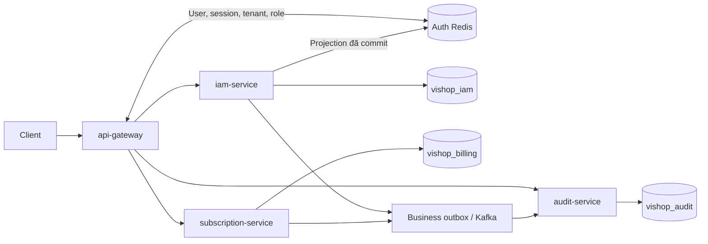

Gateway không có database riêng. PostgreSQL tách theo service; `tenant_id`/`actor_id` tham chiếu sang IAM từ database khác chỉ là liên kết nghiệp vụ, không có FK xuyên database.

| Database | Bảng hiện hành |
| --- | --- |
| `vishop_iam` | `users`, `auth_sessions`, `tenants`, `roles`, `role_permissions`, `tenant_members`, `tenant_invitations`, `authorization_outbox`, `outbox_events`, `consumed_messages` |
| `vishop_billing` | `subscription_plans`, `subscription_prices`, `subscriptions`, `subscription_orders`, `subscription_terms`, `payment_transactions`, `payment_allocations`, `sepay_webhook_inbox`, `outbox_events` |
| `vishop_audit` | `audit_logs`, `consumed_messages` |

Lịch sử cần phân biệt: `sessions` và `security_states` cũ bị xóa tại V4; V12 tạo **`auth_sessions` mới** để thu hồi phiên theo `sid`. V11 bỏ projection `auth:member:*`, nhưng **không xóa** bảng `tenant_members` hoặc trigger thu hồi token khi membership thay đổi.

## 2. ERD IAM: user, phiên và quyền tenant

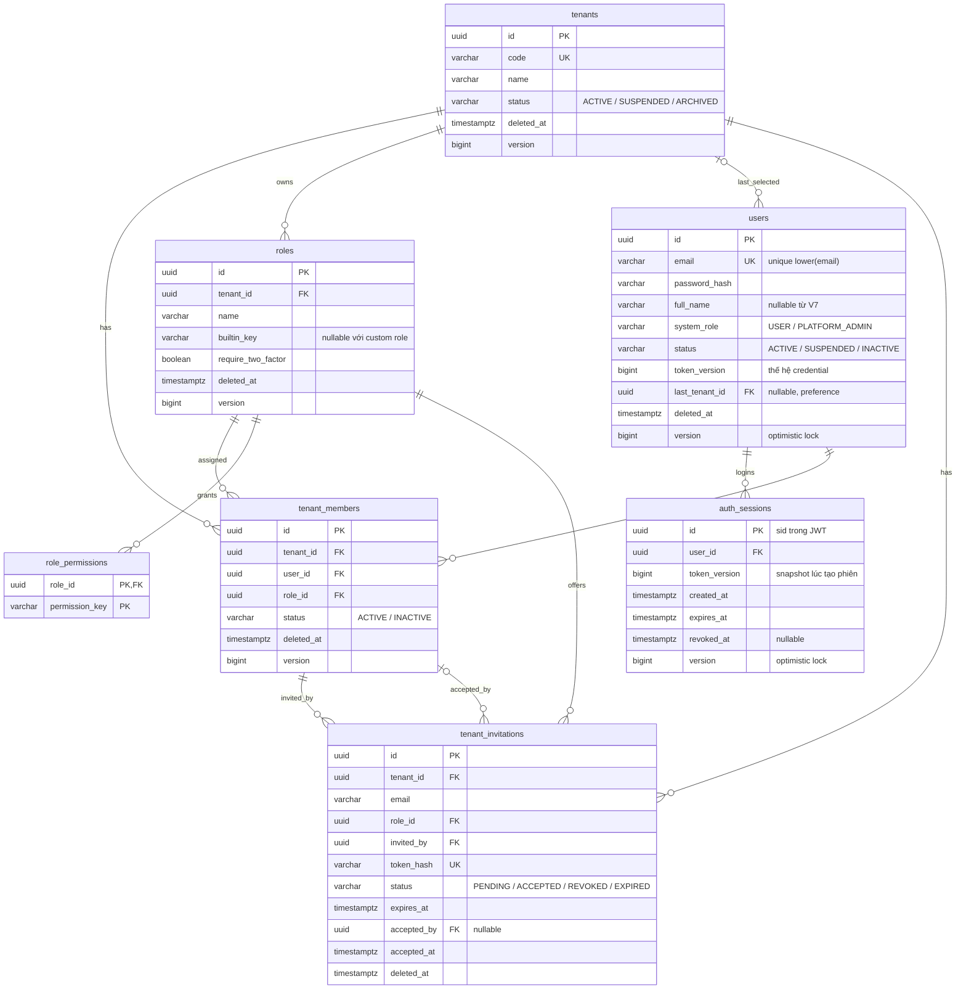

| Ràng buộc | Ý nghĩa |
| --- | --- |
| Unique `(tenant_id, user_id)` | Một user chỉ có một membership trong một tenant |
| FK `(tenant_id, role_id)` → `roles(tenant_id, id)` | Member/invitation không được dùng role của tenant khác |
| FK `(tenant_id, invited_by/accepted_by)` → `tenant_members(tenant_id, user_id)` | Người mời/nhận lời phải thuộc tenant tương ứng; `accepted_by` còn có FK tới `users.id` |
| Unique role name theo `(tenant_id, lower(name))` | Cùng tên ở tenant khác vẫn là role khác |
| Unique pending invitation theo tenant và lower(email) | Tránh nhiều lời mời PENDING cùng email trong tenant |
| `auth_sessions.expires_at > created_at` | Phiên có hạn tuyệt đối; một user có nhiều phiên |

`system_role` phục vụ quyền toàn hệ thống/CMS. Tenant role cùng permission chỉ áp dụng trong tenant. OWNER không tự có quyền CMS. Trigger `create_builtin_tenant_roles()` tạo OWNER, OPERATIONS, WAREHOUSE, ACCOUNTING khi tạo tenant. Role yêu cầu MFA chưa được cấp quyền qua luồng login chưa hỗ trợ MFA hiện tại.

`last_tenant_id` chỉ là lựa chọn được nhớ; mọi lần chọn tenant vẫn phải kiểm tra grant hợp lệ. JWT không lưu permissions. `sid` là ID của lần đăng nhập, không phải ID phần cứng; đăng nhập lại tạo `sid` mới.

### Chi tiết bảng lưu sid: `auth_sessions`

Bảng đã được định nghĩa trong [migration V12](../../services/iam-service/src/main/resources/db/migration/V12__device_auth_sessions.sql). Mỗi hàng tương ứng một lần đăng nhập; claim `sid` trong access/refresh JWT trỏ đến `auth_sessions.id`.

| Cột | Kiểu PostgreSQL | Bắt buộc / mặc định | Ý nghĩa |
| --- | --- | --- | --- |
| `id` | `UUID` | PK, NOT NULL; ứng dụng sinh UUID v7 | ID phiên, chính là `sid` |
| `user_id` | `UUID` | NOT NULL; FK `users(id)`, ON DELETE CASCADE | User sở hữu phiên |
| `token_version` | `BIGINT` | NOT NULL; CHECK > 0 | Bản chụp `users.token_version` khi tạo phiên |
| `created_at` | `TIMESTAMPTZ` | NOT NULL; DEFAULT `clock_timestamp()` | Thời điểm tạo phiên |
| `expires_at` | `TIMESTAMPTZ` | NOT NULL; CHECK > `created_at` | Hạn tuyệt đối của phiên, không kéo dài khi refresh |
| `revoked_at` | `TIMESTAMPTZ` | Nullable | Thời điểm thu hồi phiên; NULL nghĩa là chưa bị revoke, vẫn cần kiểm tra hạn và tokenVersion |
| `version` | `BIGINT` | NOT NULL; DEFAULT 0 | Optimistic-lock version của hàng, khác token_version |

Index có sẵn: `idx_auth_sessions_user(user_id)` và `idx_auth_sessions_expiry(expires_at)`. Bảng không lưu JWT, password, IP hay user-agent. Các session hết hạn hiện chưa có job dọn PostgreSQL tự động.

`AuthSessionJpaEntity.createdAt` đọc giá trị DB sinh bằng `clock_timestamp()` ngay sau INSERT và chuyển vào `AuthSession.createdAt`. Mapping JPA không cho sửa id, user_id, token_version, created_at hoặc expires_at; refresh giữ nguyên thông tin phiên, logout chỉ cập nhật revoked_at/version. Không cần migration bổ sung vì created_at đã có từ V12.

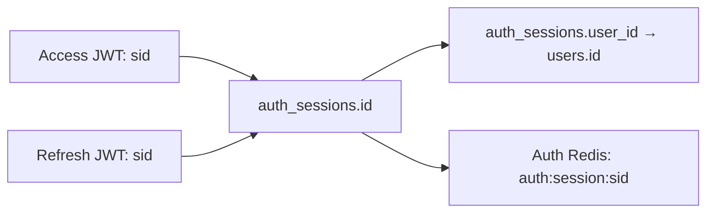

| Thao tác | Ảnh hưởng lên bảng |
| --- | --- |
| Register / login | INSERT một phiên mới với sid mới |
| Refresh / chọn tenant | Đọc và kiểm tra phiên; giữ sid, token_version và deadline |
| Logout | UPDATE `revoked_at`, tăng optimistic-lock `version` của đúng phiên; trigger tạo projection REVOKED |
| Thu hồi toàn user | Tăng `users.token_version`; mọi phiên lưu token_version cũ bị từ chối mà không cần cập nhật từng hàng phiên |

Nếu database chưa có bảng, chạy migration IAM với cấu hình database đích đã xác định. Lệnh áp dụng các migration còn thiếu theo Flyway, không chỉ tạo riêng bảng này:

```powershell
# Cấu hình IAM_DB_URL, IAM_DB_USER, IAM_DB_PASSWORD cho database đích.
.\gradlew.bat :services:iam-service:migrateIamDb
```

## 3. ERD Subscription / Payment

Các tên `billing_prices`, `billing_accounts`, `billing_orders`, `sepay_inbox`, `bank_payments` của V1 đã đổi tên trong V2.

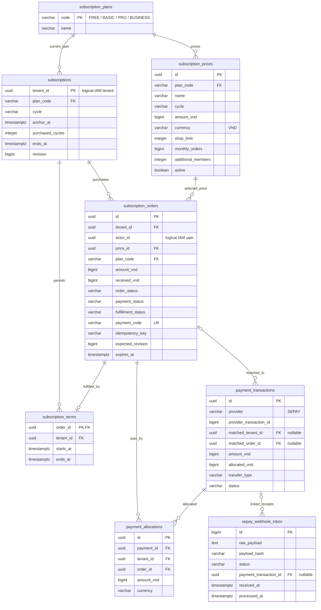

Order dùng FK `(price_id, plan_code)` tới price; term/payment/allocation liên kết order theo tenant bằng FK ghép. Mỗi order tối đa một term. Trigger kiểm tra term khớp fulfillment và tổng allocation không vượt tiền nhận.

| Nhóm trạng thái order | Giá trị |
| --- | --- |
| `order_status` | OPEN / COMPLETED / EXPIRED / CANCELLED |
| `payment_status` | UNPAID / PARTIAL / PAID / OVERPAID |
| `fulfillment_status` | PENDING / APPLIED / REVIEW |

Unique `(tenant_id, actor_id, idempotency_key)` chống lặp checkout; mỗi tenant chỉ có một order OPEN + PENDING. Chi tiết đầy đủ: [Subscription database design](../../services/subscription-service/docs/database-design.md).

## 4. Audit và các bảng hạ tầng

Các bảng trong sơ đồ này không có FK nối với nhau; `aggregate_id`, `event_id`, `tenant_id` là tham chiếu nghiệp vụ.

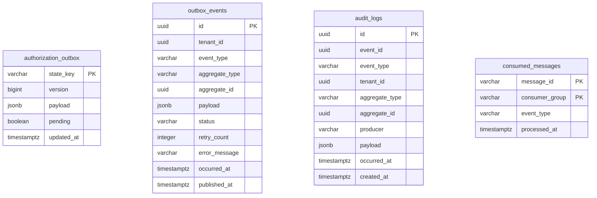

`authorization_outbox` chỉ có trong IAM, giữ snapshot mới nhất theo key để đẩy Redis. `outbox_events` trong IAM/Billing phục vụ sự kiện nghiệp vụ/Kafka; không thay thế projection quyền. `consumed_messages` trong IAM/Audit chống xử lý lại message. Audit V2 đổi `recorded_at` thành `created_at`.

## 5. Endpoint → controller → handler

Cả bốn endpoint là **POST** dưới `/api/v1/auth`. Browser write phải có `X-Requested-With: XMLHttpRequest`; Origin nếu có phải nằm trong allowlist. Gateway và IAM đều kiểm tra trước khi chạy controller.

| API | Hàm đi qua sau HTTP filter |
| --- | --- |
| `/register` | `AuthController.register()` → `SpringCommandBus.dispatch(RegisterCommand)` → `RegisterCommandHandler.handle()` |
| `/login` | `AuthController.login()` → `SpringCommandBus.dispatch(LoginCommand)` → `LoginCommandHandler.handle()` |
| `/refresh` | `AuthController.refresh()` → `AuthenticationCookies.read(..., true)` → `SpringCommandBus.dispatch(RefreshCommand)` → `RefreshCommandHandler.handle()` |
| `/logout` | `AuthController.logout()` → `AuthenticationCookies.read(..., false)` → `SpringCommandBus.dispatch(LogoutCommand)` → `LogoutCommandHandler.handle()` |

Login/register/refresh không cần access JWT. Refresh cần refresh cookie và nhận JSON `tenantId` tùy chọn để chọn tenant. **Không có `/auth/me` hay `/auth/switch-tenant`** trong `AuthController` hiện tại.

## 6. Login và register đi qua hàm nào

```mermaid
sequenceDiagram
    participant C as Client
    participant G as AuthenticationGlobalFilter
    participant F as IamAuthenticationFilter
    participant A as AuthController
    participant H as LoginCommandHandler
    participant S as SessionAuthenticationService
    participant DB as IAM DB
    participant T as JwtAuthTokens
    C->>G: POST /api/v1/auth/login: email, password, tenantId tùy chọn
    G->>G: filter → removeUntrustedHeaders → allowedOrigin → validCsrfHeader
    G->>G: allowsAnonymous → forwardWithoutContext
    G->>F: Chuyển request login
    F->>A: doFilterInternal → publicPath → login
    A->>H: SpringCommandBus.dispatch → handle
    H->>DB: UserRepositoryAdapter.lockByEmail
    H->>H: PasswordHasherAdapter.matches → user.requireActive
    H->>S: selectAtLogin(user, requestedTenant)
    S->>DB: activeGrant hoặc activeTenantIds qua TenantAccessPort
    H->>DB: rememberTenant nếu đã chọn tenant
    H->>DB: AuthSessionRepositoryAdapter.create → saveAndFlush
    Note over DB: INSERT auth_sessions tạo sid; trigger ghi authorization_outbox
    H->>DB: events.append(UserLoggedIn)
    H->>S: issue(user, session, tenant, null)
    S->>S: grant → tạo AuthenticatedUser
    S->>T: issue(user, tenant, grant, session, existingRefresh)
    T->>T: base → JwtTokenService.generateAccessToken / generateRefreshToken
    T-->>A: AuthResult qua service và handler
    Note over H,DB: Transaction commit trước khi dispatch trả về controller
    A->>A: authenticated → AuthenticationCookies.issue → AuthenticationView.from
    A-->>C: 200 + Set-Cookie access/refresh; JSON không có token
```

Đăng ký đi qua nhánh riêng, sau đó dùng chung phần `SessionAuthenticationService.issue()`:

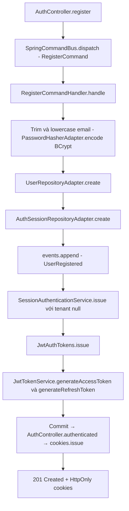

Register chỉ nhận email/password, tạo USER/ACTIVE và identity chưa chọn tenant. Login có tenantId thì kiểm tra grant; không có thì ưu tiên tenant ghi nhớ còn hợp lệ, sau đó tenant duy nhất, còn lại không chọn tenant.

Chuỗi đọc grant trong IAM: `SessionAuthenticationService.grant()` → `IdentityTenantAccessAdapter.activeGrant()` → `TenantApplicationApi.authenticationGrant()` → dữ liệu membership/tenant/role/permissions trong DB. Đây là gọi module nội bộ cùng IAM, không phải HTTP sang service khác.

## 7. Refresh và chọn tenant

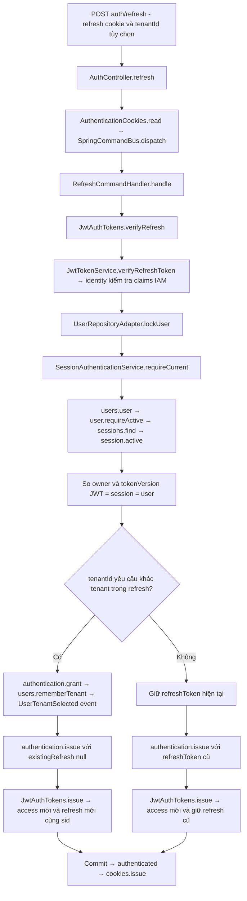

Phiên giữ nguyên `sid`, `token_version`, `expires_at`. Chọn tenant khác không kéo dài deadline. Access mới có hạn tối đa bằng deadline phiên. Refresh thường giữ nguyên chuỗi refresh; chưa có rotation/reuse tracking. Không có bước cập nhật tenant vào `auth_sessions`; tenant nằm trong JWT và preference của user.

## 8. Request bảo vệ: gateway → Redis → service

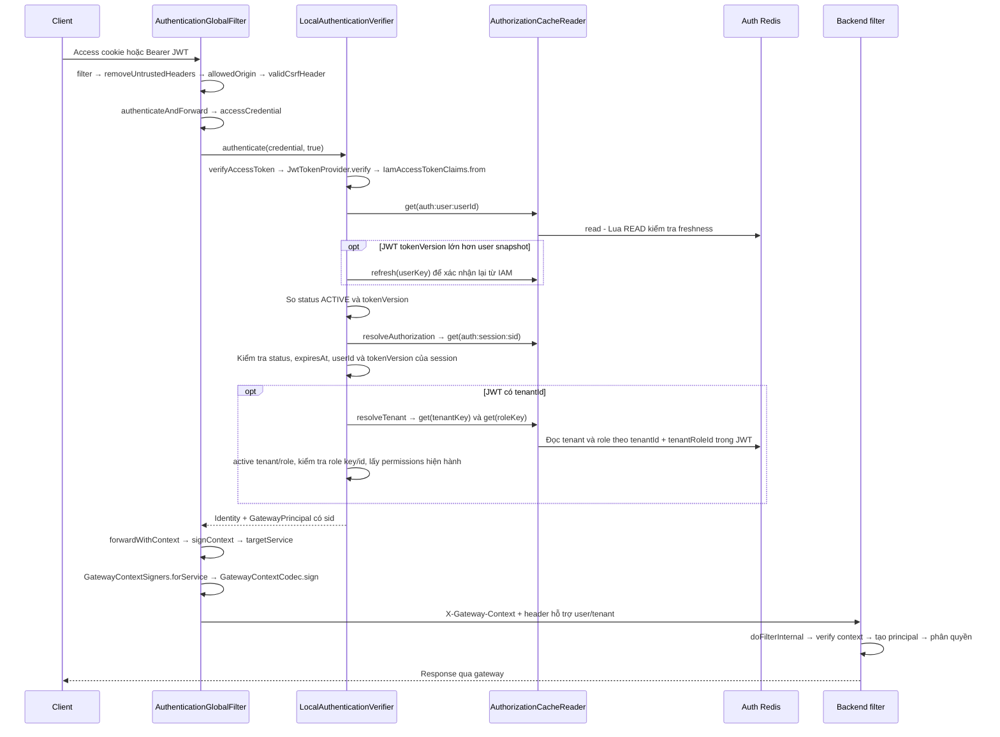

`roleId` lấy từ claim **`tenantRoleId`**, không tra member key trong Redis. Khi membership đổi, V10 tăng `users.token_version` để access/refresh cũ bị thu hồi. Permissions lấy từ role snapshot, không lấy từ JWT.

Cache thiếu/quá hạn áp dụng cho từng key qua chuỗi:

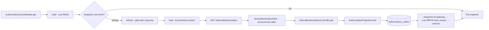

Gateway không đọc trực tiếp IAM DB; loader có timeout 3 giây, tối đa 32 lượt load đồng thời mỗi gateway instance. Redis/IAM cần thiết nhưng lỗi thì chặn request, không fallback quyền từ JWT.

## 9. Backend kiểm tra gì và qua hàm nào

| Backend | Chuỗi gọi |
| --- | --- |
| IAM | `IamAuthenticationFilter.doFilterInternal()` → `GatewayContextCodec.verifyContext()` → `IdentityApplicationApi.resolveContext()` → `SessionAuthenticationService.resolveContext()` → DB user/session/grant → `AuthenticatedUser` |
| Subscription | `SubscriptionAccessTokenFilter.doFilterInternal()` → `GatewayContextCodec.verify()` → `GatewayPrincipal` → Spring Security/endpoint/use case |
| Audit | `AuditAccessTokenFilter.doFilterInternal()` → `GatewayContextCodec.verify()` → `GatewayPrincipal` → Spring Security/endpoint/use case |

IAM `resolveContext()` đọc session, gọi `requireCurrent()`, đối chiếu systemRole và roleId/roleKey với DB, lấy lại permissions hiện tại. Audit/Subscription dùng context đã xác minh, không gọi IAM/Redis cho mỗi request thông thường.

Phân quyền tenant tại IAM: `TenantAuthorizationService.access()` → `AuthenticatedUser.requireTenantAccess(tenant, permission)`. CMS dùng `AuthenticatedUser.requireCms()`; các security matcher/authorization helper có thể kiểm tra trước controller.

`GatewayContextCodec` dùng chữ ký HMAC, **không mã hóa** nội dung. Chữ ký gắn với audience, method, raw path/query và thời gian. Header `X-User-Id`, `X-Tenant-Id` riêng lẻ không chứng minh quyền. Gateway xóa header do client tự gửi, bỏ Authorization/browser cookies; chỉ chuyển tiếp các cookie auth cần cho refresh/logout.

## 10. Logout riêng phiên: DB commit rồi xác nhận Redis

```mermaid
sequenceDiagram
    participant C as Client
    participant A as AuthController
    participant H as LogoutCommandHandler
    participant DB as IAM DB
    participant P as AuthorizationProjection
    participant R as Auth Redis
    C->>A: POST auth/logout qua gateway và IAM filter
    Note over C,A: Thiếu/sai access vẫn có thể đến controller để logout bằng cookie
    A->>H: dispatch(LogoutCommand) → handle
    H->>H: identity: ưu tiên actor sid, rồi verifyRefresh, rồi verifyAccess
    alt Không có identity hợp lệ
        H-->>A: Không revoke hoặc ghi event
        A-->>C: 204 + cookies.clear
    else Có identity hợp lệ
        H->>DB: TransactionTemplate.execute - REQUIRES_NEW
        H->>DB: sessions.find - đúng user sở hữu sid
        H->>DB: sessions.revoke - chỉ khi revoked_at IS NULL
        opt Revoke thay đổi đúng một hàng
            H->>DB: events.append(UserLoggedOut)
        end
        Note over DB: Trigger iam_session_changed ghi session projection cùng transaction
        H->>DB: COMMIT
        H->>P: delivery.deliverSession(sessionId)
        P->>DB: SELECT session projection FOR UPDATE
        P->>R: write - Lua WRITE với version và deadline phiên
        alt Redis xác nhận
            P->>DB: pending=false
            P-->>A: Hoàn tất qua handler
            A-->>C: 204 + AuthenticationCookies.clear
        else Redis lỗi
            P-->>C: 503; DB đã revoke, retry không nhân event
        end
    end
```

Nếu không tìm thấy phiên thuộc user thì không có phiên để deliver. Logout thành công chỉ thu hồi sid tương ứng; thiết bị khác có sid khác tiếp tục dùng được. Phiên đã revoke vẫn có thể được deliver lại khi retry. Cookie chỉ được xóa ở response thành công; DB đã commit không rollback nếu bước Redis sau đó lỗi.

## 11. Trigger và đường đồng bộ quyền

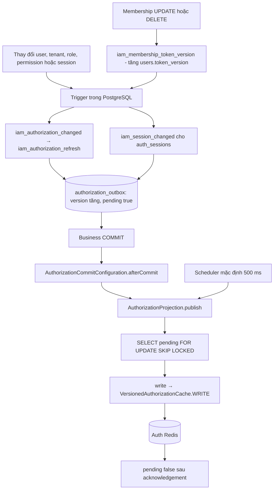

Trigger user tăng tokenVersion khi password/status/systemRole/deleted_at đổi. Membership đổi role/status/identity/deleted_at hoặc bị xóa tăng tokenVersion toàn user. Role permission edit chỉ cập nhật role snapshot. Các nhánh trigger trong sơ đồ tùy loại bảng, không phải mọi thay đổi đều gọi cả hai hàm projection.

| Redis logical key, thêm prefix môi trường | Nội dung |
| --- | --- |
| `auth:user:{userId}` | status, systemRole, tokenVersion |
| `auth:session:{sid}` | status, userId, tokenVersion, expiresAt; TTL theo deadline phiên |
| `auth:tenant:{tenantId}` | status |
| `auth:role:{tenantId}:{roleId}` | status, roleId, roleKey, permissions |

User/tenant/role giữ watermark revision không TTL; freshness mặc định 30 giây. Session TTL tuyệt đối không trượt khi refresh/relay. `authorization_outbox.version` khác `users.token_version` và khác optimistic-lock `version` của entity. Relay chỉ xử lý dữ liệu đã commit; Lua ngăn revision cũ ghi đè mới. Đồng bộ thay đổi quyền là bất đồng bộ; request đang chạy không bị hủy giữa chừng.

## 12. Cookie, token và nhánh lỗi

| Thành phần | Hiện tại |
| --- | --- |
| Access cookie | `vishop_access_token`, path `/`, HttpOnly; mặc định 15 phút và không vượt hạn phiên |
| Refresh cookie | `vishop_refresh_token`, path `/api/v1/auth`, HttpOnly; mặc định 7 ngày từ lúc tạo phiên |
| Keys JWT | HS256, access/refresh dùng secret riêng; không dùng refresh key để xác thực access |
| Access claims | `sub`, `sid`, `tenantId`, `systemRole`, `tenantRoleId`, `tenantRole`, `tokenVersion`, `iss`, `aud`, `token_use`, `iat`, `exp`, `jti` |
| Refresh claims | Metadata JWT và `sub`, `sid`, `tenantId`, `tokenVersion`; không có danh sách permissions |
| `jti` | ID một JWT; khác sid của phiên |
| Frontend | `credentials: 'include'`; write header và Origin hợp lệ |

| Nhánh | Kết quả chính |
| --- | --- |
| Sai password, access/refresh không hợp lệ, user tokenVersion không khớp | 401 |
| Phiên revoked/expired hoặc sai owner/version ở gateway | 401 |
| User/tenant/role snapshot không ACTIVE ở gateway | 403 |
| Không có grant tenant hoặc thiếu permission | 403 |
| Origin/write header bị từ chối | 403 |
| Cache miss/expired gọi loader nhưng không có projection | Gateway loader trả lỗi 403 khi IAM trả 404 |
| Redis/IAM cần thiết nhưng lỗi, snapshot không nhất quán | 503 |
| Logout DB đã commit nhưng deliverSession lỗi | 503, retry và relay tiếp tục đồng bộ |

## 13. Luồng role và các điều kiện đã rà soát

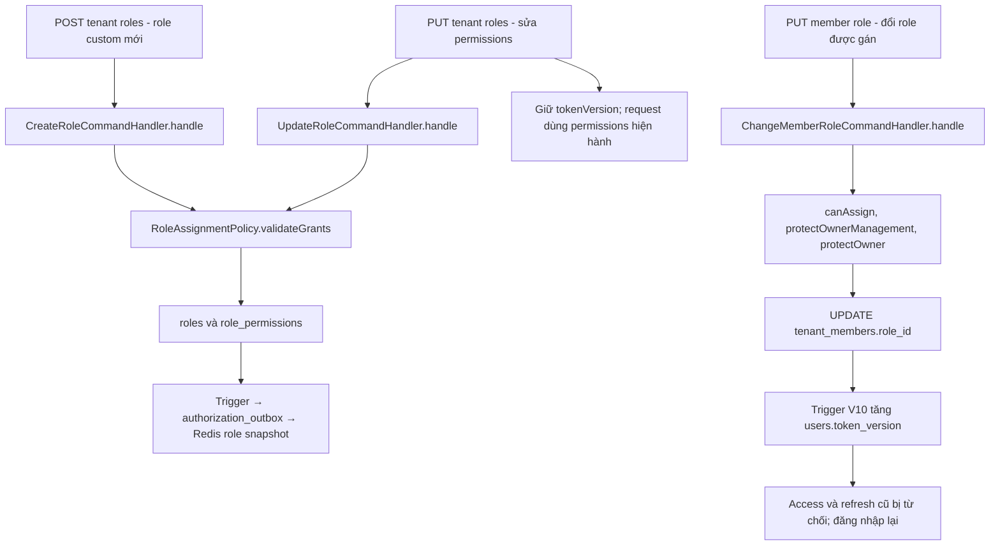

Danh mục permission hợp lệ lấy từ `CommonPermissions`; `role_permissions` lưu các quyền được gán thực tế cho từng role. Role mới dùng các permission đã tồn tại thì không cần constant/migration mới. Thêm permission mới cần đồng thời cập nhật constant, migration CHECK constraint, mặc định role cho tenant mới và dữ liệu role hiện có theo chính sách. Test schema đối chiếu constant với quyền OWNER và constraint DB; không có job tự đồng bộ constant vào DB lúc startup.

Các điều kiện bảo vệ sau được kiểm tra bằng regression test HTTP dùng PostgreSQL/Redis tạm trong `IamAuthenticationApplicationTest`:

- Tạo custom role, sửa quyền và đổi role của member đi qua API thật; quyền mới xuất hiện trong projection Redis. Sửa permissions giữ credential hợp lệ, gán role khác thu hồi access/refresh cũ.
- Không tạo role chứa permission lạ hoặc cấp quyền mà người thao tác không sở hữu. Người quản lý custom có thể mời role trong phạm vi quyền của mình, không thể mời OWNER vượt quyền.
- Đếm OWNER/admin còn sử dụng được phải loại user đã soft-delete; OWNER còn phải loại membership/role soft-delete và role yêu cầu MFA chưa hỗ trợ. Người đã bị xóa không được tính là người quản trị dự phòng để cho phép vô hiệu hóa người cuối cùng.
- Khi nhận lời mời, `AcceptInvitationCommandHandler.handle()` xác nhận tài khoản người mời còn active, rồi dùng `TenantApi.authenticationGrant()` với cùng quy tắc grant khi login. Người mời bị khóa, soft-delete, hoặc mất membership/role hợp lệ không còn quyền cấp access qua invitation cũ.
- Lời mời hợp lệ được nhận một lần; nhận lại không sinh thêm membership/event.

Các giới hạn hiện tại vẫn cần tính khi phát triển tiếp: cập nhật permission qua Redis là bất đồng bộ; refresh chưa có rotation/reuse tracking; session hết hạn chưa có job retention trong PostgreSQL. Phần kiểm tra này không thay đổi giao thức signed context hiện tại hoặc triển khai cơ chế MFA.

## 14. Liên kết mã nguồn

- Schema: [IAM migrations](../../services/iam-service/src/main/resources/db/migration/), [Subscription migrations](../../services/subscription-service/src/main/resources/db/migration/), [Audit migrations](../../services/audit-service/src/main/resources/db/migration/), [khởi tạo database](../../infra/postgres/init-db.sql).
- HTTP: [AuthController.java](../../services/iam-service/src/main/java/com/vishop/iam/modules/identity/presentation/rest/AuthController.java), [AuthenticationCookies.java](../../services/iam-service/src/main/java/com/vishop/iam/modules/identity/presentation/rest/AuthenticationCookies.java), [SpringCommandBus.java](../../libs/common-web/src/main/java/io/github/coreplatform/common/web/cqrs/SpringCommandBus.java).
- Handler: [RegisterCommandHandler.java](../../services/iam-service/src/main/java/com/vishop/iam/modules/identity/application/command/auth/RegisterCommandHandler.java), [LoginCommandHandler.java](../../services/iam-service/src/main/java/com/vishop/iam/modules/identity/application/command/auth/LoginCommandHandler.java), [RefreshCommandHandler.java](../../services/iam-service/src/main/java/com/vishop/iam/modules/identity/application/command/auth/RefreshCommandHandler.java), [LogoutCommandHandler.java](../../services/iam-service/src/main/java/com/vishop/iam/modules/identity/application/command/auth/LogoutCommandHandler.java).
- Phiên và token: [SessionAuthenticationService.java](../../services/iam-service/src/main/java/com/vishop/iam/modules/identity/application/service/SessionAuthenticationService.java), [JwtAuthTokens.java](../../services/iam-service/src/main/java/com/vishop/iam/modules/identity/infrastructure/security/JwtAuthTokens.java), [JwtTokenService.java](../../libs/common-security/src/main/java/io/github/coreplatform/common/security/jwt/JwtTokenService.java), [AuthSessionRepositoryAdapter.java](../../services/iam-service/src/main/java/com/vishop/iam/modules/identity/infrastructure/persistence/adapters/AuthSessionRepositoryAdapter.java).
- Gateway: [AuthenticationGlobalFilter.java](../../services/api-gateway/src/main/java/com/vishop/gateway/filter/AuthenticationGlobalFilter.java), [LocalAuthenticationVerifier.java](../../services/api-gateway/src/main/java/com/vishop/gateway/security/LocalAuthenticationVerifier.java), [AuthorizationCacheReader.java](../../services/api-gateway/src/main/java/com/vishop/gateway/security/AuthorizationCacheReader.java).
- Backend: [IamAuthenticationFilter.java](../../services/iam-service/src/main/java/com/vishop/iam/infra/security/IamAuthenticationFilter.java), [IdentityApplicationApi.java](../../services/iam-service/src/main/java/com/vishop/iam/modules/identity/application/api/IdentityApplicationApi.java), [IdentityTenantAccessAdapter.java](../../services/iam-service/src/main/java/com/vishop/iam/composition/authentication/IdentityTenantAccessAdapter.java), [TenantApplicationApi.java](../../services/iam-service/src/main/java/com/vishop/iam/modules/tenant/application/api/TenantApplicationApi.java), [SubscriptionAccessTokenFilter.java](../../services/subscription-service/src/main/java/com/vishop/subscription/infra/security/SubscriptionAccessTokenFilter.java), [AuditAccessTokenFilter.java](../../services/audit-service/src/main/java/com/vishop/audit/infra/security/AuditAccessTokenFilter.java), [GatewayContextCodec.java](../../libs/common-security/src/main/java/io/github/coreplatform/common/security/gateway/GatewayContextCodec.java).
- Projection: [AuthorizationProjection.java](../../services/iam-service/src/main/java/com/vishop/iam/infra/authorization/AuthorizationProjection.java), [InternalAuthorizationController.java](../../services/iam-service/src/main/java/com/vishop/iam/infra/authorization/InternalAuthorizationController.java), [AuthorizationCommitConfiguration.java](../../services/iam-service/src/main/java/com/vishop/iam/infra/authorization/AuthorizationCommitConfiguration.java), [V12 sessions](../../services/iam-service/src/main/resources/db/migration/V12__device_auth_sessions.sql).
- Hướng dẫn vận hành auth: [authentication-flow.md](./authentication-flow.md).
