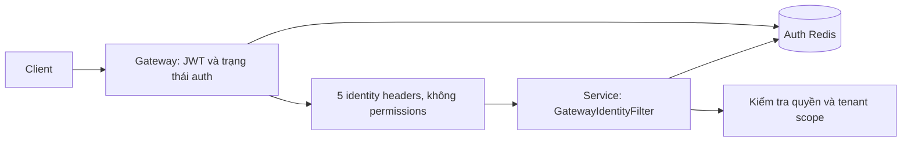

# Gateway identity headers và phân quyền Redis

Cập nhật 07/11/2026. Contract này thay thế HMAC gateway context.



## HTTP contract

| Header | Nội dung |
| --- | --- |
| X-User-Id | UUID user, bắt buộc |
| X-Session-Id | UUID sid, bắt buộc với request user |
| X-Tenant-Id | UUID tenant, chỉ có khi đã chọn tenant |
| X-Role-Id | UUID role hiện tại, bắt buộc nếu có tenant |
| X-System-Role | USER hoặc PLATFORM_ADMIN, do gateway xác thực |

Gateway kiểm tra JWT và user/session/tenant/membership/role hiện tại từ Auth Redis.
RoleId lấy từ membership, không dùng role cũ trong JWT để cấp quyền. Gateway giữ
actor permissions rỗng và xóa mọi header định danh, X-Permissions, X-User-Permissions,
X-Gateway-Context do client gửi trước khi ghi header mới.

Header phải đơn trị, UUID đúng dạng và đủ sid/role; sai hoặc thiếu một phần trả
401. Thiếu toàn bộ header thì không tạo principal; Spring Security chỉ cho các
endpoint public đi tiếp. Identity không tenant có permissions rỗng và dùng systemRole đã được gateway xác thực; không đọc role cache.

## Service resolve quyền

Audit và Subscription dùng GatewayIdentityFilter trong common-security. Filter
đọc danh tính, gọi GatewayRolePermissions.resolve(tenantId, roleId), tạo
GatewayPrincipal và Spring authorities. Endpoint/use case kiểm tra permission và
tenant/resource scope. SecurityContext và TenantContext được dọn sau request.

RedisGatewayRolePermissions là implementation tự cấu hình khi có StringRedisTemplate,
ObjectMapper và CacheKeyBuilder. Nó đọc key `auth:role:{tenantId}:{roleId}` bằng
Lua freshness READ, kiểm tra payload đúng key/roleId và trạng thái ACTIVE; tên role lấy từ chính payload Redis.
Không lấy permissions từ header/JWT, không có cache cục bộ.

Role inactive trả 403. Redis lỗi, projection thiếu/stale/hỏng hoặc sai scope trả
503. Lỗi nghiệp vụ phía sau filter được giữ nguyên. IAM nhận identity headers
nhưng kiểm tra user/session/grant hiện tại từ DB của mình.

Gateway vẫn đọc role snapshot để xác nhận ACTIVE/roleKey và refresh projection
trước khi forward. Backend đọc role từ Redis, không gọi IAM mỗi request. System role lấy từ X-System-Role do gateway ghi. Không nhận X-Tenant-Role hoặc permissions từ header. Role cache
đổi quyền áp dụng trên request kế tiếp khi projection đã tới Redis; revision và
freshness giới hạn dữ liệu cũ. Gateway/backend phải cùng AUTH_REDIS_HOST/PORT/
PASSWORD/DATABASE, CACHE_KEY_PREFIX và AUTH_CACHE_MAX_AGE_SECONDS (mặc định 30 giây).

## Annotation trước API

Các controller dùng Spring Security `@PreAuthorize`. Permissions đã được filter
lấy từ Redis và đưa vào Spring authorities trước khi gọi controller; annotation
chỉ kiểm tra authorities trong request, không đọc Redis thêm lần nữa.

```java
@GetMapping("/channels")
@PreAuthorize("hasAuthority('notifications.settings.view')")
public List<ChannelView> channels(...) { ... }

@PutMapping("/channels/{channel}")
@PreAuthorize("hasAuthority('notifications.settings.manage')")
public ChannelView changeChannel(...) { ... }
```

Code dùng `CommonPermissions` để tránh lặp mã quyền. API CMS kiểm tra system role
PLATFORM_ADMIN; API danh sách tenant/tạo tenant/nhận lời mời yêu cầu đăng nhập.
Login/register/refresh/logout và webhook có `permitAll()` vì dùng password,
refresh cookie hoặc chữ ký webhook riêng. Internal loader chỉ cho identity kỹ thuật.
`@EnableMethodSecurity` kích hoạt kiểm tra ở controller proxy. Các kiểm tra tenant
scope, ownership và quy tắc nghiệp vụ trong use case vẫn giữ nguyên.

## Credential forwarding và internal loader

JWT access/Authorization dừng ở gateway. Refresh cookie chỉ chuyển tới POST
/api/v1/auth/refresh hoặc /logout trên route iam-service. Login/register không
nhận cookie cũ. Method, path/query và body được proxy bình thường.

Gateway loader gọi /internal/authorization bằng X-User-Id=UUID zero,
X-System-Role=USER, không tenant/sid/role. Đây là nhãn kỹ thuật trên ingress tin cậy,
không phải credential. IAM chỉ cho identity này vào /internal; business filter
không cho nó thành user. Không có public gateway route tới /internal.

## Ranh giới tin cậy khi truyền danh tính qua header

HTTP backend chỉ nhận caller tin cậy qua ingress gateway, bằng firewall/NetworkPolicy
hoặc policy mạng tương đương. Plain headers không chứng minh người gửi trên mạng
công khai. Rollout gateway và backend cùng đợt; không chạy lẫn contract HMAC cũ.

Compose production không publish port HTTP backend. Dev bind HTTP backend và
debug ports vào loopback. Một Docker network chung vẫn cho container khác gọi
backend; nếu container không cùng trust boundary cần ACL/NetworkPolicy tách riêng.
Endpoint monitoring nội bộ cần được đưa vào ingress policy tương ứng.

Không còn GatewayContextCodec, GatewayContextSigners và GATEWAY_*_CONTEXT_SECRET.
Access/refresh JWT vẫn ký bình thường với hai key riêng; refresh key chỉ có ở IAM.
Notification chưa có application runtime/gateway route trong codebase; khi thêm
runtime cần dùng cùng filter/resolver và cấu hình Auth Redis trước khi mở route.
