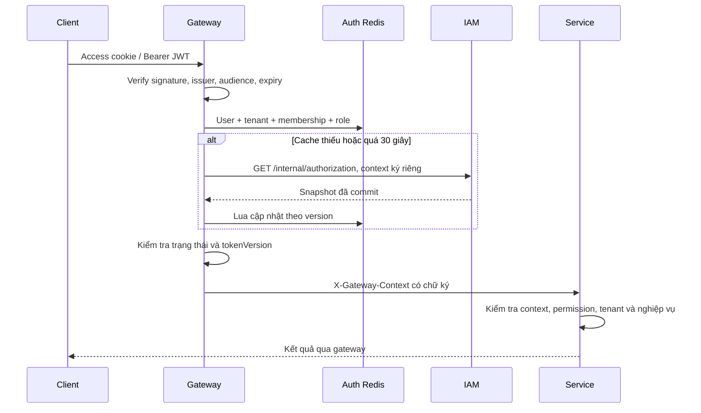

# Gateway authentication và phân quyền Redis

Gateway xác minh access JWT. IAM, audit và subscription nhận context có chữ ký từ
gateway; không xác minh lại JWT người dùng và không gọi IAM/Redis cho request thông
thường. Service vẫn kiểm tra permission, tenant của tài nguyên và điều kiện nghiệp vụ.

Thư viện `common-security/jwt` chỉ ký và xác minh JWT tổng quát. IAM sở hữu cấu trúc
claims và policy phát hành; gateway sở hữu hợp đồng credential được chấp nhận.
`GatewayPrincipal` là principal context nội bộ, không phải DTO claims của JWT.

## Role theo tenant

Role được nhận diện bằng `(tenantId, roleId)`. Trùng tên hoặc `builtin_key` không có
nghĩa có cùng quyền. `systemRole` độc lập với role tenant; `PLATFORM_ADMIN` dùng cho
CMS, không tự cấp quyền trên tài nguyên tenant.

| Key, thêm prefix mặc định `vishop:` | Nội dung |
|---|---|
| `auth:user:{userId}` | status, systemRole, tokenVersion |
| `auth:tenant:{tenantId}` | Trạng thái tenant |
| `auth:member:{tenantId}:{userId}` | status, roleId |
| `auth:role:{tenantId}:{roleId}` | Role key và permissions |

Mỗi key là hash có `version`, `payload`, `checkedAt`. Sửa role chỉ cập nhật snapshot
role đó; đổi role user chỉ cập nhật membership. Version và permission nằm trong cùng
payload. JWT có thể còn chứa grant lúc phát hành để giữ tương thích; gateway bỏ qua
grant đó khi cấp quyền.

## Outbox và version

Migration IAM V9 thêm `users.token_version` và `authorization_outbox`. Đây là outbox
gộp theo key, giữ snapshot mới nhất, version tăng và cờ pending. Không phải lịch sử
sự kiện và không thay thế outbox Kafka/audit.

Trigger DB cập nhật snapshot cùng transaction với nghiệp vụ. Rollback nghiệp vụ cũng
rollback snapshot. Khóa hàng theo key tuần tự hóa người ghi. Xóa membership/role tạo
snapshot INACTIVE để quyền cũ không sống lại.

Sau business commit, IAM đánh thức relay để thử đồng bộ Redis. Relay lịch 500 ms là
đường retry bền vững, dùng `FOR UPDATE SKIP LOCKED` cho nhiều IAM replica. Redis lỗi
giữ pending, không bỏ bản ghi sau vài lần retry. Kafka không tham gia đường này.

Lua so sánh version dạng chuỗi số nguyên, tránh sai số BIGINT. Bản cũ không ghi đè
bản mới. Watermark không expire; freshness dựa vào checkedAt. Bản cũ bị từ chối không
gia hạn freshness. Auth Redis dùng riêng, AOF và noeviction.

## Thu hồi quyền và lỗi

- Khi Redis nhận bản mới, request mới dùng quyền mới mà không refresh JWT.
- Snapshot quá 30 giây phải được IAM xác nhận lại; không cache quyền trong RAM gateway.
- Miss cùng key được gộp trong mỗi gateway instance. Mỗi instance tối đa 32 lượt load
  IAM đồng thời, timeout toàn lượt load 3 giây.
- Redis/IAM cần thiết nhưng không khả dụng: 503; không fallback quyền trong JWT.
- Token sai/cũ: 401. Tenant/membership không hoạt động: 403.
- Chu kỳ relay 500 ms là mục tiêu vận hành, không phải SLA thu hồi. Độ trễ còn gồm
  thời gian load, Redis, context đang bay và request đang thực thi. Freshness 30 giây
  không phải giới hạn end-to-end tuyệt đối.
- Tác vụ nhạy cảm chạy trễ phải lấy quyết định quyền mới lúc thực thi; không dùng
  context HTTP làm credential trong Kafka.

Thay mật khẩu, status user hoặc systemRole tăng tokenVersion: access và refresh cũ
bị từ chối khi trạng thái mới được nhìn thấy. Thay membership/role không thu hồi token
toàn user. Access JWT trước V9 thiếu tokenVersion cần đăng nhập lại.

## Context nội bộ

Header `X-Gateway-Context` chứa userId, tenantId, roleId, systemRole, tenantRole,
permissions, issuedAt, requestId. HMAC-SHA256 gắn context với audience, HTTP method,
raw path và raw query. Thời hạn nhận 15 giây, cho phép lệch đồng hồ tương lai 2 giây.
Đây là xác thực context gateway, không phải verify lại access JWT.

Mỗi backend có một secret riêng; gateway giữ ba secret. Audit/subscription không thể
dùng key của mình để ký context hợp lệ cho IAM. HMAC là khóa đối xứng: backend sở hữu
key có thể ký context cho chính nó.

Gateway xóa context/identity header từ client, bỏ Authorization và browser cookie
trước khi chuyển đến service nghiệp vụ. Backend không fallback Bearer/cookie.
`/internal/authorization` không có public gateway route, chỉ nhận context IAM của
caller kỹ thuật đặc biệt. Login/register/refresh, health/OpenAPI và webhook SePay
có cơ chế public riêng; webhook vẫn xác minh chữ ký SePay.

Chữ ký không mã hóa, không ký request body và không lưu nonce chống replay. Context
bị đánh cắp có thể phát lại trên cùng method/URL trong 15 giây; ghi nghiệp vụ vẫn cần
idempotency. Production cần HTTPS ở ingress, mạng riêng và TLS/mTLS đến backend.
Compose cung cấp mạng riêng và chữ ký context, chưa triển khai certificate/mesh TLS.

## Cookie

Access/refresh nằm trong host-only HttpOnly cookie; JSON không trả JWT. Access mặc
định 15 phút, refresh 7 ngày; refresh giữ hạn tuyệt đối ban đầu, chưa có rotation/reuse
tracking. Logout xóa cookie và trả 204 kể cả access hết hạn; caller hợp lệ được audit.
Logout chưa thu hồi toàn bộ token đã phát.

Browser write yêu cầu `X-Requested-With: XMLHttpRequest`, Origin khớp ALLOWED_ORIGINS.
Frontend dùng `credentials: 'include'`. Production dùng Secure; SameSite=None cần
Secure. Những kiểm tra này vẫn giữ ở gateway và IAM.

## Triển khai

1. Dừng bản cũ, chạy `./gradlew.bat migrateIam` với IAM_DB_URL/USER/PASSWORD theo
   runbook. V9 không sửa V1–V8; ứng dụng chỉ validate JPA, không tự migrate khi startup.
2. Bật auth-redis riêng. Local mặc định localhost:6380, database 0; Compose dùng
   auth-redis:6379. AOF và volume phải bền vững.
3. Cấp ba secret ngẫu nhiên khác nhau, tối thiểu 32 byte:
   GATEWAY_IAM_CONTEXT_SECRET, GATEWAY_AUDIT_CONTEXT_SECRET,
   GATEWAY_SUBSCRIPTION_CONTEXT_SECRET. Prod không fallback secret dev.
4. Compose prod yêu cầu AUTH_REDIS_PASSWORD. IAM và gateway dùng cùng AUTH_CACHE_PREFIX,
   mặc định vishop:. AUTH_CACHE_MAX_AGE_SECONDS mặc định 30.
5. Triển khai gateway và cả ba backend cùng hợp đồng context; không trộn backend cũ
   nhận JWT với backend mới chỉ nhận context.
6. Theo dõi authorization_outbox WHERE pending, lỗi relay, cache miss, thời gian thu
   hồi thực tế và memory Redis. Noeviction từ chối ghi khi đầy.
7. Khi restore IAM DB về version cũ, đổi namespace hoặc xóa riêng auth Redis theo
   quy trình bảo trì để watermark cùng thế hệ với DB.

Không log context, cookie, JWT hoặc secret; không đưa chúng vào audit/Kafka.
