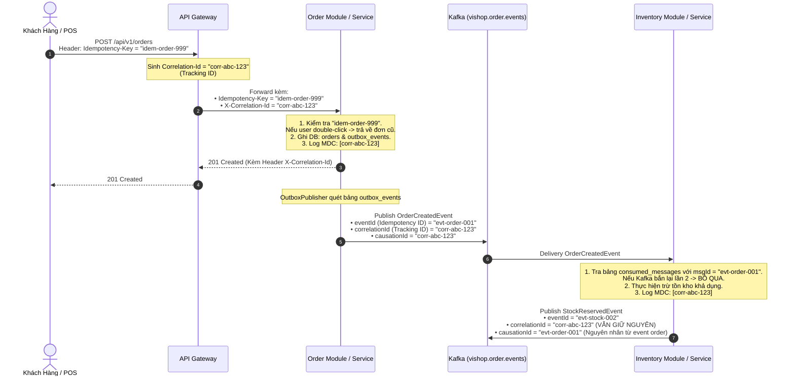

# Cơ chế Chống Trùng lặp (Idempotency) và Truy vết Phân tán (Distributed Tracing)

Tài liệu này đặc tả vai trò, cơ chế hoạt động và cách hiện thực của hai định danh quan trọng hàng đầu trong kiến trúc phân tán của **ViShop Platform**:
1. **`idempotencyId`** (hay `Idempotency-Key`, `messageId`, `eventId`): Đảm bảo tính toán idempotent và chống trùng lặp dữ liệu (Deduplication).
2. **`trackingId`** (hay `correlationId`, `traceId`, `requestId`): Truy vết phân tán (Distributed Tracing) và xâu chuỗi luồng xử lý qua nhiều service và message bus.

---

## 1. Bảng So sánh Tổng quan

| Tiêu chí | `idempotencyId` (Idempotency Key / Message ID) | `trackingId` (Correlation ID / Trace ID) |
| :--- | :--- | :--- |
| **Mục đích chính** | **Chống trùng lặp (Deduplication)**: Đảm bảo một thao tác chỉ thực thi và có hiệu lực đúng **1 lần duy nhất**, dù bị gọi lại nhiều lần do lỗi mạng, client retry, hoặc Kafka redelivery. | **Truy vết phân tán (Distributed Tracing)**: Xâu chuỗi toàn bộ hành trình của một yêu cầu đi qua API Gateway, các microservices, cơ sở dữ liệu, và Kafka topics. |
| **Phạm vi (Scope)** | **Cục bộ cho 1 hành động / command / message**: Gắn chặt với 1 transaction cụ thể. | **Toàn cục (End-to-End)**: Lan truyền xuyên suốt toàn bộ vòng đời của request và các event liên quan mà nó kích hoạt. |
| **Hậu quả nếu thiếu** | **Sai lệch dữ liệu tài chính/nghiệp vụ**: Trừ tiền 2 lần, tạo 2 đơn hàng trùng, trừ kho 2 lần khi client double-click hoặc broker gửi lại message. | **Mất khả năng giám sát & gỡ lỗi**: Khi xảy ra lỗi, không thể liên kết các dòng log từ nhiều service lại để tìm nguyên nhân gốc (Root Cause). |
| **Cơ chế lưu trữ** | Khóa unique trên dữ liệu đích, bảng `consumed_messages`, hoặc cơ chế idempotency của API bên nhận, tùy phạm vi thao tác. | Gắn vào HTTP Header (`X-Correlation-Id`), Kafka Record Header, và đưa vào Log MDC (`[correlationId=...]`). |
| **Thay đổi qua luồng** | Mỗi hành động / event con có một `idempotencyId` riêng biệt. | **Không đổi**: Giữ nguyên vẹn giá trị gốc từ khi tiếp nhận ở API Gateway đến khi toàn bộ chuỗi event kết thúc. |

---

## 2. Cơ chế Idempotency (`idempotencyId`) trong ViShop Platform

Trong mạng phân tán, cơ chế giao nhận thông điệp của Apache Kafka là **At-Least-Once Delivery** (ít nhất một lần). Nếu Consumer xử lý xong nhưng ứng dụng crash trước khi commit offset, Kafka sẽ gửi lại đúng message đó. Bên cạnh đó, mạng chập chờn cũng khiến Client gửi lại HTTP Request nhiều lần.

ViShop Platform áp dụng `idempotencyId` tại 3 điểm trọng yếu:

### 2.1. Trong Kafka Event Consumer (`IdempotentConsumer`)
Trong `libs/common-persistence`, class [`IdempotentConsumer`](../../libs/common-persistence/src/main/java/io/github/coreplatform/common/persistence/idempotency/IdempotentConsumer.java) sử dụng bảng `consumed_messages` làm dấu đã xử lý:

```java
@Transactional
public boolean executeIfNotProcessed(UUID messageId, String consumerGroup, String eventType, Runnable action) {
    String msgId = messageId.toString();
    
    // 1. Kiểm tra messageId đã được consumerGroup này xử lý chưa
    if (repository.existsByMessageIdAndConsumerGroup(msgId, consumerGroup)) {
        log.info("Message [{}] already processed by [{}], skipping duplicate", msgId, consumerGroup);
        return false; // Bỏ qua an toàn, không thực thi lại
    }

    // 2. Thực thi nghiệp vụ chính
    action.run();

    // 3. Đánh dấu messageId đã xử lý trong cùng transaction
    repository.save(new ConsumedMessageEntity(msgId, consumerGroup, eventType, Instant.now()));
    return true;
}
```

*Cấu trúc bảng `consumed_messages`*:
- Khóa chính tổng hợp: `PRIMARY KEY (message_id, consumer_group)`.
- Điều này cho phép nhiều `consumer_group` khác nhau cùng xử lý một `messageId` độc lập. Trong cùng một group, khóa chính ngăn hai dấu trùng được commit.
- Kiểm tra tồn tại rồi ghi không phải khóa độc quyền: hai transaction có thể cùng chạy callback, nhưng một transaction sẽ lỗi khi ghi dấu trùng và phải rollback. Chỉ các thay đổi DB trong cùng transaction được rollback; lời gọi API bên ngoài không được hoàn tác.

### 2.2. Trong REST API (Header `Idempotency-Key`)
- Với các API nhạy cảm (Tạo đơn hàng, Thanh toán, Trừ ví): Client bắt buộc gửi header `Idempotency-Key: <UUIDv7>`.
- Server lưu trạng thái xử lý vào Redis với TTL (ví dụ: 24h). Nếu request trùng khóa gửi tới trong lúc đang xử lý $\rightarrow$ trả về `409 Conflict`. Nếu đã hoàn tất $\rightarrow$ trả về kết quả đã cache của lần đầu tiên.

### 2.3. Trong Webhook Sàn Thương Mại Điện Tử (TikTok Shop)
- Mọi webhook từ TikTok đẩy về (`POST /api/v1/tiktok/webhook`) mang một mã `tts_notification_id`.
- Hệ thống lưu raw payload vào bảng `platform_webhook_events` với ràng buộc duy nhất `@@unique([eventId])` (`tts_notification_id`). Các webhook bị bắn lại sẽ lập tức bị chặn ở tầng cơ sở dữ liệu.

---

### 2.4. Chọn bảng riêng hay khóa unique trên dữ liệu đích

Mặc định thiết kế consumer chịu được message trùng. Điều này không đồng nghĩa mọi
service nhận Kafka đều phải có bảng `consumed_messages`.

| Tình huống | Cách chống trùng phù hợp |
| --- | --- |
| Service chỉ publish event | Không cần bảng consumed cho việc publish; dùng outbox khi cần gắn việc phát event với transaction nghiệp vụ |
| Một event tạo một bản ghi, như một audit log | Có thể dùng `UNIQUE(event_id)` ngay trên bảng đích và bỏ qua insert trùng |
| Một event thay đổi nhiều bảng, không có khóa nghiệp vụ phù hợp để chống trùng | Dùng `consumed_messages`; ghi dấu và thay đổi nghiệp vụ trong cùng transaction DB |
| Xử lý lại vẫn cho kết quả đúng, kể cả các tác động đi kèm | Có thể dựa vào tính idempotent của chính thao tác; vẫn phải xét thứ tự event cũ/mới |
| Consumer gọi API bên ngoài | Cần thêm cơ chế phía API bên nhận; bảng consumed trong DB cục bộ không đủ, xem mục 2.5 |

**So sánh hai cách lưu dấu:**

| Tiêu chí | Tách `consumed_messages` | Gộp vào khóa unique của bảng đích |
| --- | --- | --- |
| Khóa nhận diện | `(message_id, consumer_group)` | Ví dụ `audit_logs.event_id` |
| Với một event tạo một audit log | Ghi audit và dấu ở hai bảng | Chỉ ghi audit |
| Nhiều luồng xử lý độc lập | Mỗi luồng dùng định danh consumer riêng và ổn định | Mỗi đích tự có khóa phù hợp |
| Một event tạo nhiều dòng | Một dấu có thể bảo vệ toàn bộ transaction | Cần khóa theo từng kết quả, ví dụ `(event_id, item_id)`, và transaction phù hợp |
| Xóa/archive dữ liệu đích | Có thể giữ dấu độc lập | Xóa dòng đích cũng mất dấu chống trùng ở DB đang ghi |
| Vận hành | Quản lý retention của hai loại dữ liệu | Đơn giản hơn nhưng retention dữ liệu đích cũng quyết định thời gian nhớ event |

Khóa unique phải do DB thực thi; chỉ `SELECT` kiểm tra trước khi `INSERT` không
ngăn được hai transaction ghi đồng thời. Với PostgreSQL, phương án gộp có thể dùng:

```sql
-- Yêu cầu đã có UNIQUE(event_id) trên audit_logs.
INSERT INTO audit_logs (...)
VALUES (...)
ON CONFLICT (event_id) DO NOTHING;
```

Đây là minh họa, không phải migration đã áp dụng. Chỉ bỏ qua xung đột `event_id`;
các lỗi DB khác phải tiếp tục báo lỗi để cơ chế retry xử lý.

**Trạng thái audit hiện tại:** mỗi event tạo một audit log, nhưng code vẫn dùng
`AuditMessageProcessingAdapter` và `consumed_messages`. `audit_logs.event_id` mới
có index thường, chưa có unique constraint. Vì vậy chưa thể bỏ bảng consumed mà
không đổi schema và cách insert. Phương án đơn giản hóa đã thống nhất về nguyên tắc
là dùng `UNIQUE(event_id)` trên audit; tài liệu này không thay đổi implementation.

Nếu audit A đã bị xóa mà event A được replay, phương án gộp sẽ tạo lại audit đó.
Phương án tách chỉ tiếp tục chặn nếu dấu A còn được giữ. Retention phải xét cả Kafka,
DLT, backup và khoảng thời gian có thể replay. Commit offset không thay thế khóa
chống trùng trong DB: service có thể chết sau commit DB nhưng trước commit offset.

### 2.5. Gọi API bên ngoài: giới hạn của transaction DB

Ví dụ consumer nhận event yêu cầu thanh toán:

```text
1. Consumer gọi API ngoài; bên nhận xử lý thành công.
2. Consumer chết trước khi commit consumed_messages trong DB của mình.
3. Event được nhận lại; DB chưa có dấu đã xử lý.
4. Consumer gọi lại API; hành động có thể bị thực hiện lần hai.
```

`@Transactional` chỉ bảo vệ các thao tác thuộc transaction DB cục bộ; rollback DB
không hoàn tác lời gọi HTTP đã thành công. Ghi dấu thành công trước khi gọi HTTP
cũng không giải quyết được: nếu chết sau khi ghi dấu nhưng trước khi gọi, hành động
sẽ bị bỏ sót. Không giữ một transaction DB mở rồi coi đó là transaction xuyên hai hệ thống.

Nếu API bên nhận hỗ trợ idempotency, gửi cùng key cho cùng một hành động:

```http
POST /payments
Idempotency-Key: payment-order-123-attempt-1
```

- Bên nhận bảo đảm chống trùng theo hợp đồng của API; lần gọi lại cùng key không
  thực hiện thêm hành động và có thể trả lại kết quả đã lưu.
- Lưu key ổn định trước khi gọi. Retry sau timeout/restart phải dùng lại key và
  cùng nội dung yêu cầu; không sinh UUID mới cho mỗi lần thử lại.
- Key đại diện cho một hành động nghiệp vụ cụ thể. Một lần thanh toán mới được
  chủ động tạo sau đó có key mới; `correlationId` không phù hợp làm key chống trùng.
- Chỉ dùng `eventId` nếu một event tương ứng đúng một hành động đó. Nếu một event
  gây nhiều lời gọi độc lập, phân biệt bằng loại thao tác/đối tượng hoặc ID operation.
- Xác minh phạm vi key, thời gian bên nhận giữ key, xử lý yêu cầu đồng thời và
  hành vi khi cùng key nhưng khác payload. Không mặc định mọi API đều hỗ trợ header này.

Có thể lưu operation/job cùng transaction nghiệp vụ rồi để worker gọi API và retry
bằng key đã lưu. Outbox/job giúp không bỏ sót yêu cầu, nhưng tự nó không ngăn bên
ngoài thực hiện trùng nếu bên nhận không có cơ chế idempotency.

Nếu API không hỗ trợ key, dùng mã tham chiếu giao dịch ổn định và API tra cứu trạng
thái nếu có để đối soát khi kết quả chưa rõ. Tra cứu trước khi gọi không tự bảo đảm
chống trùng nếu bên nhận không bảo đảm tính duy nhất của mã tham chiếu. Khi không
có cơ chế xác nhận phù hợp, cần luồng xử lý thủ công/đối soát; không retry mù và
không tuyên bố đã bảo đảm exactly-once chỉ nhờ `consumed_messages`.

---

## 3. Cơ chế Distributed Tracing (`trackingId` / `correlationId`)

### 3.1. Điểm khởi tạo: API Gateway (`CorrelationIdGlobalFilter`)
Tại cổng vào của hệ thống, [`CorrelationIdGlobalFilter`](../../services/api-gateway/src/main/java/com/vishop/gateway/filter/CorrelationIdGlobalFilter.java) đảm bảo mọi request đều có định danh truy vết:

```java
String correlationId = request.getHeaders().getFirst("X-Correlation-Id");
if (correlationId == null || correlationId.isBlank()) {
    correlationId = UuidV7.nextId().toString(); // Sinh UUID v7 tăng dần theo thời gian
}

String requestId = request.getHeaders().getFirst("X-Request-Id");
if (requestId == null || requestId.isBlank()) {
    requestId = UuidV7.nextId().toString();
}

// Chuyển tiếp vào header downstream cho các microservices phía sau
// Đồng thời gán vào Response header trả về cho Client
```

### 3.2. Điểm tiếp nhận tại từng Microservice (`RequestIdFilter`)
Tại mỗi service sử dụng thư viện `common-web`, [`RequestIdFilter`](../../libs/common-web/src/main/java/io/github/coreplatform/common/web/filter/RequestIdFilter.java) đảm bảo mọi request HTTP đều có định danh truy vết cục bộ:
- Đọc header `X-Request-Id` được chuyển tiếp từ API Gateway (hoặc tự động sinh UUID mới nếu request gọi trực tiếp).
- Lưu vào request attribute `request.setAttribute(RequestIdFilter.REQUEST_ID_ATTRIBUTE, requestId)` để các Exception Handler (`GlobalExceptionHandler`, `SecurityExceptionHandler`, `DatabaseExceptionHandler`) trích xuất và đính kèm vào RFC 7807 Problem Details khi có lỗi.
- Đặt header `X-Request-Id` vào HTTP Response Header gửi ngược lại cho client.

### 3.3. Lan truyền qua Event Bus (`EventEnvelope`)
Khi một service phát hành Domain Event lên Kafka, [`EventEnvelope.java`](../../libs/common-events/src/main/java/io/github/coreplatform/common/events/EventEnvelope.java) luôn mang theo metadata truy vết:

```java
public record EventEnvelope(
    UUID eventId,        // <-- IDEMPOTENCY ID của riêng event này
    String eventType,
    int schemaVersion,
    Instant occurredAt,
    String producer,
    UUID tenantId,
    String aggregateType,
    UUID aggregateId,
    UUID correlationId,  // <-- TRACKING ID (Gốc từ API Gateway, không đổi)
    UUID causationId,    // <-- ID của Event/Command trực tiếp sinh ra event này
    JsonNode payload
)
```

- **`correlationId`**: Định danh của request khởi nguồn (Root Cause).
- **`causationId`**: Định danh của sự kiện hoặc request trực tiếp gây ra sự kiện này (Direct Cause).

### 3.4. Xuyên suốt trong Saga Orchestrator
Trong giao dịch phân tán dài hạn ([`SagaOrchestrator.java`](../../libs/common-saga/src/main/java/io/github/coreplatform/common/saga/SagaOrchestrator.java)), `correlationId` liên kết toàn bộ trạng thái thực thi và các bước đền bù (compensating steps) trong bảng `saga_instances`:

```java
Optional<SagaInstanceEntity> findByCorrelationId(UUID correlationId);
```

### 3.5. Cấu hình Logging (SLF4J MDC)
Mọi dòng log trong hệ thống đều tự động bổ sung `correlationId` vào MDC:
```text
2026-10-20 14:10:05.123 [INFO] [order-service] [correlationId=0192a6df-10a4-7f12-a1b2-c3d4e5f60789] [tenantId=0192a6df-...] Order created with ID: 999
```
Khi phát sinh lỗi, đội ngũ vận hành chỉ cần tra cứu mã `correlationId` trên hệ thống Log Centralized (ELK, Loki, Grafana) để nhìn thấy toàn bộ đường đi của request.

---

## 4. Sơ đồ Tuần tự Phối hợp Thực tế (Checkout & Đặt hàng)

Sơ đồ dưới đây minh họa cách `idempotencyId` và `trackingId` phối hợp nhịp nhàng trong luồng Đặt hàng:



---

## 5. Quy tắc Vàng cho Lập trình viên (Developer Guidelines)

1. **Không bao giờ dùng `trackingId` (`correlationId`) làm `idempotencyId`**:
   - `correlationId` đại diện cho một luồng nghiệp vụ dài (chứa nhiều event khác nhau). Nếu lấy `correlationId` làm khóa idempotent, các event sinh ra sau trong cùng một luồng sẽ bị coi là trùng lặp và bị bỏ qua nhầm!
2. **Khởi tạo UUID v7**:
   - Cả `idempotencyId` lẫn `trackingId` đều được khuyến nghị sử dụng chuẩn **UUID v7** (có sẵn trong `io.github.coreplatform.common.domain.UuidV7`) để đảm bảo tính tuần tự theo thời gian, tối ưu hiệu năng đánh index B-Tree trong cơ sở dữ liệu.
3. **Luôn truyền `correlationId` khi gọi API downstream hoặc publish event**:
   - Khi tạo `EventEnvelope` mới từ một sự kiện đầu vào, phải luôn truyền tiếp `correlationId` nhận được, và gán `causationId` bằng `eventId` của sự kiện trực tiếp trước đó.
