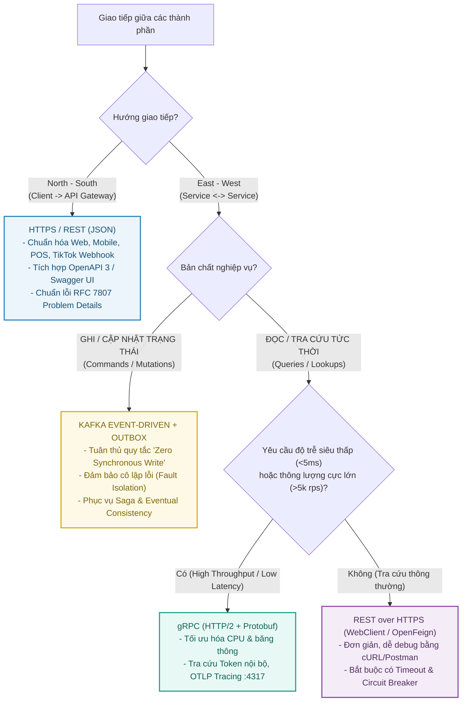

# Chiến Lược Giao Tiếp Liên Dịch Vụ (Inter-Service Communication Strategy)

Tài liệu này đặc tả toàn bộ chiến lược, nguyên tắc kỹ thuật và khung quyết định (Decision Framework) khi giao tiếp giữa các dịch vụ trong **ViShop Platform**: lựa chọn giữa **Kafka (Bất đồng bộ - Event-driven)**, **HTTPS / REST (Đồng bộ)**, và **gRPC (RPC hiệu năng cao)**.

---

## 1. Khung Quyết Định Lựa Chọn Giao Thức (Decision Framework)

Không sử dụng một giao thức duy nhất cho toàn bộ hệ thống. Việc lựa chọn phụ thuộc vào **hướng giao tiếp** (North-South vs East-West) và **bản chất hành động** (Ghi/Đột biến trạng thái vs Đọc/Tra cứu dữ liệu):

---

## 2. Bảng So Sánh Chi Tiết Kỹ Thuật

| Tiêu chí | **Kafka (Event-Driven Messaging)** | **HTTPS / REST (JSON)** | **gRPC (Protocol Buffers)** |
| :--- | :--- | :--- | :--- |
| **Mô hình giao tiếp** | Bất đồng bộ (Pub/Sub, Event Streams) | Đồng bộ (Request / Response) | Đồng bộ RPC hoặc Streaming hai chiều |
| **Giao thức mạng** | TCP (Kafka Binary Protocol) | HTTP/1.1 hoặc HTTP/2 | HTTP/2 (Multiplexing trên 1 kết nối TCP) |
| **Định dạng dữ liệu** | JSON / Avro / Protobuf (nhị phân) | JSON (Văn bản thuần túy) | Protocol Buffers (Nhị phân nén) |
| **Độ trễ (Latency)** | 20ms – 100ms (Eventual Consistency) | 10ms – 50ms | Siêu thấp (1ms – 5ms) |
| **Mức độ phụ thuộc (Coupling)** | **Rất lỏng (Loose)**: Producer không cần biết Consumer có đang chạy hay không | **Chặt (Tight)**: Caller bị khóa luồng chờ Callee phản hồi | **Chặt (Tight)**: Caller bị khóa luồng chờ Callee phản hồi |
| **Khả năng chịu lỗi (Resilience)** | **Tuyệt đối**: Nếu service nhận gặp sự cố, message lưu trên broker chờ xử lý lại | **Kém**: Dễ gây lỗi dây chuyền (Cascading Failure) nếu callee chậm/sập | **Kém**: Dễ gây lỗi dây chuyền nếu callee chậm/sập |
| **Cơ chế chống lỗi** | `Transactional Outbox` + `IdempotentConsumer` | `Circuit Breaker` (Resilience4j) + Timeout | Deadlines, Circuit Breaker, Retries |
| **Khả năng gỡ lỗi (Debugging)** | Cần Kafka UI, log tracking qua `correlationId` | Dễ dàng bằng Swagger UI, cURL, Postman | Cần file `.proto` và tool chuyên dụng (`grpcurl`) |

---

## 3. Các Tình Huống Ứng Dụng Cụ Thể Trong ViShop Platform

### 3.1. Khi Nào Bắt Buộc Dùng Kafka? (Quy tắc "Zero Synchronous Write")

Tất cả các thao tác làm **thay đổi trạng thái dữ liệu (State Mutation)** giữa các Bounded Contexts khác nhau **tuyệt đối không được gọi HTTP chéo** (không dùng `POST / PUT / PATCH / DELETE`).

*Ví dụ thực tế trong ViShop:*
1. **Tạo Đơn Hàng & Xử Lý Kho**:
   - `order-module` ghi đơn hàng vào DB và ghi event vào bảng `outbox_events` trong **1 transaction ACID cục bộ**.
   - Outbox Relay đẩy `OrderCreatedEvent` lên Kafka topic `vishop.order.events`.
   - `inventory-module` lắng nghe để trừ tồn kho; `audit-service` lắng nghe để lưu vết kiểm toán; `notification-service` lắng nghe để gửi thông báo.
2. **Webhook Sàn TMĐT (TikTok Shop)**:
   - `tiktok-integration` tiếp nhận webhook từ TikTok và phản hồi nhanh `< 50ms`.
   - Đẩy raw event lên Kafka để các service downstream xử lý đồng bộ trạng thái đơn và kho sau.

*Yêu cầu bắt buộc khi dùng Kafka:*
- **Phía phát hành (Producer)**: Dùng **Transactional Outbox Pattern** để đảm bảo dữ liệu ghi vào DB và Event đưa vào Kafka không bao giờ bị lệch nhau.
- **Phía nhận (Consumer)**: Dùng [`IdempotentConsumer`](../../libs/common-persistence/src/main/java/io/github/coreplatform/common/persistence/idempotency/IdempotentConsumer.java) và bảng `consumed_messages` để loại bỏ duplicate message khi Kafka redeliver.

---

### 3.2. Khi Nào Dùng HTTPS / REST?

1. **Tầng Biên (North-South Edge Traffic)**:
   - Mọi ứng dụng ngoài (Web Admin, POS App, Mobile App) và Webhook sàn đều đi qua [`api-gateway`](../../services/api-gateway) bằng HTTPS/REST.
   - Sử dụng chuẩn JSON, định dạng lỗi RFC 7807 Problem Details (`GlobalExceptionHandler`), và tài liệu OpenAPI 3 qua [`OpenApiAutoConfiguration`](../../libs/common-web/src/main/java/io/github/coreplatform/common/web/openapi/OpenApiAutoConfiguration.java).
2. **Truy vấn Tra cứu Nội bộ (East-West Read-Only Queries - Giai đoạn hiện tại)**:
   - Khi Service A cần lấy thông tin tra cứu đơn giản từ Service B mà dữ liệu đó không thể cache hoặc chưa có trong Read Model (ví dụ: Gateway gọi `iam-service` để kiểm tra trạng thái hoạt động của Tenant).
   - Ưu điểm: Tận dụng trực tiếp cấu trúc Spring Boot hiện có, không phát sinh chi phí duy trì file protobuf.

---

### 3.3. Khi Nào Nên Sử Dụng gRPC?

gRPC được áp dụng khi giao tiếp nội bộ (East-West) đạt tới các tiêu chí:
1. **Độ trễ yêu cầu dưới 5ms (Hot-path Latency Sensitive)**:
   - Phân giải Token và kiểm tra quyền hạn: API Gateway xác thực tính hợp lệ của JWT token hoặc phân quyền RBAC bằng cách gọi HTTP introspection sang `iam-service` cho hàng nghìn request/giây.
2. **Thu thập Dữ liệu Viễn thám & Giám sát (Telemetry Streaming)**:
   - Các service đẩy log, metrics, traces tới OpenTelemetry Collector qua giao thức OTLP gRPC (cổng `4317` đã cấu hình trong `docker-compose.infra.yml`).
3. **Tiết kiệm tài nguyên mạng và CPU**:
   - Khi khối lượng dữ liệu trao đổi giữa các service nội bộ quá lớn, mã hóa nhị phân Protobuf giảm 70-80% kích thước payload so với JSON.

---

## 4. Bốn Quy Tắc Bất Biến Khi Triển Khai (Golden Rules)

1. **Zero Synchronous Write**: Không dùng HTTP/gRPC để ghi/sửa dữ liệu chéo service. Luôn dùng Kafka Event qua Transactional Outbox.
2. **Propagate Context Xuyên Suốt**:
   - Mọi lời gọi HTTP/REST phải truyền header `X-Correlation-Id` và `X-Request-Id` (được đảm bảo bởi [`RequestIdFilter`](../../libs/common-web/src/main/java/io/github/coreplatform/common/web/filter/RequestIdFilter.java)).
   - Mọi message Kafka phải đóng gói `correlationId` và `causationId` trong metadata record headers.
   - Mọi lời gọi gRPC phải mang theo gRPC Metadata (Context propagation).
3. **Cô Lập Lỗi Đồng Bộ (Fail-Fast & Circuit Breaking)**:
   - Bất kỳ lời gọi đồng bộ nào (REST/gRPC) giữa các service đều phải có:
     - **Timeout ngắn**: Connect timeout $\le 1\text{s}$, Read timeout $\le 3\text{s}$.
     - **Circuit Breaker**: Tự động ngắt khi service đích gặp sự cố để tránh cạn kiệt tài nguyên thread pool của service gọi.
4. **Idempotency ở Tầng Consumer**:
   - Do tính chất phân tán và mạng không tin cậy, mọi consumer hoặc endpoint tiếp nhận dữ liệu quan trọng đều phải có cơ chế kiểm tra trùng lặp (`Idempotency-Key` hoặc `messageId`).
