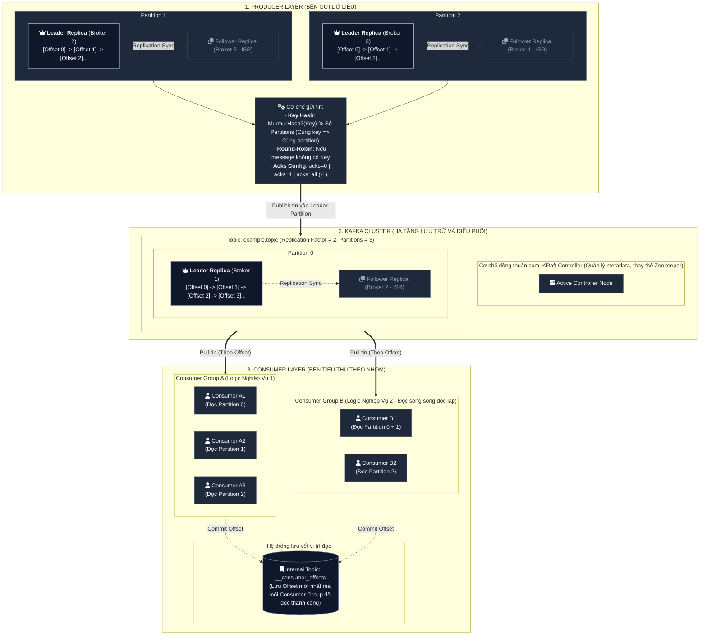
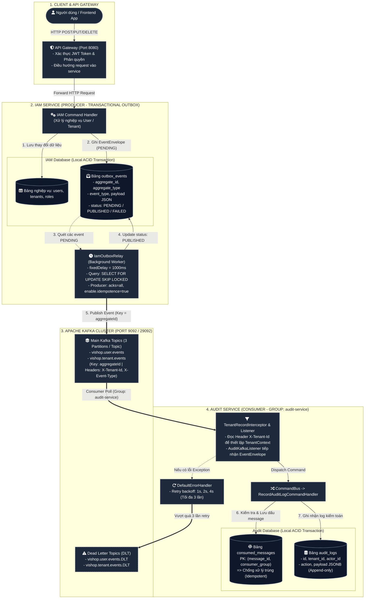

# Kiến trúc Kafka và lưu ý triển khai

Tài liệu đối chiếu với mã nguồn ngày 27/10/2026, sau khi tổ chức audit theo DDD/CQRS. Tài liệu gồm 2 phần:
- **Phần I: Kiến trúc tổng quan Apache Kafka**: Nền tảng kiến trúc chuẩn của Kafka (Broker, KRaft, Topic, Partition, Leader/Follower, Consumer Group, Offset).
- **Phần II: Thiết kế áp dụng vào dự án Vishop Platform**: Chi tiết triển khai thực tế (Transactional Outbox, Topic Naming, Idempotent Consumer, Retry/DLT).

---

# PHẦN I: KIẾN TRÚC TỔNG QUAN APACHE KAFKA (NỀN TẢNG)

Apache Kafka là một **Distributed Event Streaming Platform** (nền tảng nhật ký sự kiện phân tán dạng append-only log), được thiết kế tối ưu cho thông lượng cao, độ trễ thấp và khả năng mở rộng theo chiều ngang.

## 1. Sơ đồ kiến trúc tổng quan chuẩn của Apache Kafka



## 2. Các khái niệm cốt lõi của Kafka

1. **Broker & Cluster**:
   - Máy chủ cài đặt Kafka gọi là **Broker**. Cụm nhiều Broker hợp lại thành **Kafka Cluster**.
   - Quản trị cụm qua giao thức **KRaft (Kafka Raft Metadata)** không phụ thuộc vào Apache ZooKeeper.
2. **Topic & Partition**:
   - **Topic**: Kênh phân loại dữ liệu logic (giống như tên bảng trong CSDL).
   - **Partition**: Phân vùng vật lý lưu trên đĩa của Broker. Dữ liệu trong partition là **Append-only** (chỉ ghi nối tiếp) và **Immutable** (không sửa đổi).
   - **Thứ tự (Ordering)**: Kafka chỉ cam kết thứ tự tuyệt đối **bên trong cùng 1 partition** theo Offset. Giữa các partition khác nhau không có cam kết thứ tự.
3. **Message Key & Định tuyến Partition**:
   - **Có Key**: Kafka hash key bằng `MurmurHash2(key) % num_partitions`. Tất cả message có cùng Key luôn vào **cùng một partition duy nhất**.
   - **Không có Key**: Phân bổ xoay vòng (Round-Robin) hoặc Sticky Partitioning để cân bằng tải.
4. **Replication Factor (RF) & In-Sync Replicas (ISR)**:
   - Mỗi Partition gồm 1 **Leader** (xử lý trực tiếp đọc/ghi) và nhiều **Follower** (sao chép thụ động).
   - Tập hợp các bản sao bám sát dữ liệu với Leader gọi là **ISR**. Khi Leader gặp sự cố, một bản sao trong ISR sẽ tự động được bầu lên làm Leader mới.
5. **Consumer Group & Offset**:
   - **Pull Model**: Consumer chủ động kéo tin theo nhịp độ xử lý của ứng dụng.
   - **Quy tắc chia tải**: Trong cùng 1 Consumer Group, mỗi partition chỉ được đọc bởi đúng 1 consumer tại 1 thời điểm.
   - **Commit Offset**: Vị trí đã xử lý được lưu vào topic nội bộ `__consumer_offsets`. Khi consumer restart sẽ đọc tiếp từ offset này.

| Cấp độ bảo đảm | Đặc điểm | Cách thiết kế ứng dụng |
| :--- | :--- | :--- |
| **At-most-once** | Commit offset trước khi xử lý, có thể mất message nếu lỗi | Phù hợp log đo lường, tracking không quan trọng |
| **At-least-once** | Xử lý xong mới commit offset, có thể trùng lặp khi mạng lỗi | **Chuẩn mặc định của Kafka**; Consumer cần có Idempotency |
| **Exactly-once** | Không mất tin, không trùng lặp | Cần Transactional Producer và Consumer Idempotent |

---

# PHẦN II: THIẾT KẾ ÁP DỤNG VÀO DỰ ÁN VISHOP PLATFORM

## 1. Vai trò của Kafka trong Vishop Platform

Hệ thống kết hợp REST đồng bộ với xử lý sự kiện bất đồng bộ. Gateway chuyển HTTP request tới IAM; IAM xử lý nghiệp vụ và trả kết quả mà không đợi Audit ghi lịch sử. Kafka vận chuyển sự kiện từ IAM sang Audit.

Kafka không thay thế database, access log hay error log. Event nghiệp vụ mô tả việc đã xảy ra; audit lưu lịch sử nghiệp vụ; log kỹ thuật phục vụ debug và vận hành. Không cần đưa mọi HTTP request lên Kafka.



## 2. Thành phần và trách nhiệm

| Thành phần | Trách nhiệm hiện tại |
| --- | --- |
| IAM command handler | Thay đổi dữ liệu nghiệp vụ và yêu cầu ghi event trong transaction |
| `IamOutbox` | Đóng gói `EventEnvelope`, lưu vào `outbox_events`; yêu cầu transaction đang tồn tại bằng `Propagation.MANDATORY` |
| `IamOutboxRelay` | Đọc event pending, gửi Kafka, cập nhật trạng thái gửi |
| `common-events` | Envelope, đặt tên topic, Kafka headers, interceptor tenant, retry/DLT |
| Audit presentation | Deserialize event, chuyển thành `RecordAuditLogCommand` qua CommandBus |
| Audit application | Điều phối ghi audit và chống xử lý trùng trong transaction |
| Audit domain | `AuditLog` bất biến, repository port chỉ ghi thêm |
| Audit infrastructure | Triển khai persistence và idempotency bằng JPA |
| Audit query | QueryBus → read-only handler → read port → DTO; phân trang và lọc tenant |

Audit không sở hữu outbox và không cần `@EnableScheduling`. IAM cần scheduling cho relay. CommandBus/QueryBus là dispatcher trong cùng tiến trình, không phải Kafka topic.

## 3. Luồng ghi và phát sự kiện

1. IAM bắt đầu transaction nghiệp vụ.
2. Handler lưu dữ liệu và ghi event vào `outbox_events` trong cùng transaction.
3. Commit thành công thì dữ liệu và outbox cùng tồn tại; rollback thì cả hai cùng bị hủy.
4. Relay chạy định kỳ, khóa tối đa 50 dòng `PENDING` bằng `FOR UPDATE SKIP LOCKED`, sắp xếp theo `occurred_at, id`.
5. Relay gửi từng record, chờ kết quả tối đa 10 giây mỗi record.
6. Gửi thành công: đổi thành `PUBLISHED`; lỗi: tăng `retry_count`, sau 5 lần lỗi đổi thành `FAILED`.

`fixedDelay` mặc định là 1.000 ms: khoảng chờ tính **sau khi lần chạy trước hoàn tất**, không phải cam kết event tới consumer trong một giây. Khi Kafka chậm, thời gian chờ gửi và transaction giữ khóa có thể kéo dài.

| Cấu hình | Hiện tại |
| --- | --- |
| `vishop.outbox.enabled` | Relay bật mặc định khi không khai báo; đặt `false` để dừng relay, outbox vẫn có thể tiếp tục tăng |
| `vishop.outbox.publish-delay-ms` | Mặc định `1000`, khai báo trong annotation |
| IAM producer `acks` | `all` |
| IAM producer `enable.idempotence` | `true` |

**Cần lưu ý:** `FAILED` không được relay tự chọn lại vì truy vấn chỉ lấy `PENDING`. Chưa thấy backoff riêng cho từng dòng hay luồng tự phục hồi event `FAILED` trong IAM relay. Cần theo dõi, xử lý nguyên nhân và có quy trình retry có kiểm soát.

## 4. Topic, key và consumer group

Tên topic thực tế do `KafkaTopicNaming.topicFor()` tạo:

```text
vishop.{aggregateType chuyển thành kebab-case}.events
Tenant → vishop.tenant.events
User   → vishop.user.events
DLT    → {topic nguồn}.DLT
```

| Topic | Producer/consumer hiện tại |
| --- | --- |
| `vishop.tenant.events` | IAM phát; Audit nhận |
| `vishop.user.events` | IAM phát; Audit nhận |
| `vishop.audit.events` | Có trong script khởi tạo; Audit hiện không phát hoặc nghe topic này |

**Event role và thành viên hiện cũng có thể nằm trên topic tenant.** Ví dụ `RoleCreated` và `MemberInvited` dùng `aggregateType = Tenant`, `aggregateId = tenantId`; đối tượng chi tiết nằm trong payload `subjectId`. Không suy tên topic trực tiếp từ tên event.

Record key là `aggregateId.toString()`. Audit dùng group `audit-service`. Các instance cùng group chia nhau xử lý partition; service mới cần nhận độc lập cùng luồng event thì dùng group riêng. Tăng số consumer vượt số partition không làm tăng số consumer xử lý song song cho topic đó.

Script `infra/kafka/init-topics.sh` khai báo 3 partition và replication factor 1 cho mỗi topic nói trên. Chưa thấy Compose gọi script này tự động; cần kiểm tra bước provisioning thực tế. Script chưa tạo sẵn các topic `.DLT`.

**Cần lưu ý về thứ tự:** key giúp các event cùng aggregate đi cùng partition khi cách phân partition ổn định. Tuy nhiên, nhiều relay dùng `SKIP LOCKED` vẫn có thể gửi các batch của cùng aggregate lệch thứ tự nghiệp vụ. Retry, DLT và replay cũng ảnh hưởng thứ tự xử lý. Nếu nghiệp vụ cần thứ tự nghiêm ngặt, cần thêm cơ chế serialize theo aggregate hoặc kiểm tra version/sequence; không chỉ dựa vào key.

## 5. Hợp đồng sự kiện

`EventEnvelope` là JSON có các trường:

| Trường | Ý nghĩa |
| --- | --- |
| `eventId` | Định danh event; giữ nguyên khi retry hoặc replay cùng sự kiện |
| `eventType` | Tên việc đã xảy ra, ví dụ `UserRegistered`, `TenantRenamed` |
| `schemaVersion` | Phiên bản hợp đồng; factory hiện tạo giá trị `1` |
| `occurredAt` | Thời điểm xảy ra sự kiện |
| `producer` | Service phát event |
| `tenantId` | Phạm vi tenant; có thể null với sự kiện tài khoản toàn cục |
| `aggregateType`, `aggregateId` | Đối tượng aggregate, dùng để định tuyến và đặt key |
| `correlationId`, `causationId` | Liên kết luồng xử lý và nguyên nhân |
| `payload` | Dữ liệu nghiệp vụ cần cho consumer |

IAM relay hiện gửi headers `X-Tenant-Id` nếu có tenant và `X-Event-Type`. Envelope IAM hiện đặt `correlationId`, `causationId` là null; chưa nên coi việc truyền trace xuyên HTTP → outbox → Kafka là đã đầy đủ chỉ vì thư viện có các hằng header.

**Quy tắc phát triển:**

- Tên event mô tả việc đã xảy ra. Không dùng event như lời gọi hàm từ xa trá hình.
- Chỉ đưa dữ liệu cần thiết, có hợp đồng rõ ràng; không serialize nguyên JPA entity.
- Với audit, thống nhất `actorId`, `subjectId`, dữ liệu thay đổi và kết quả khi phù hợp. Các trường này chưa phải metadata bắt buộc của envelope hiện tại.
- Không đưa mật khẩu, access/refresh token, cookie, invitation/reset token hay secret vào event hoặc DLT.
- Thêm trường theo hướng tương thích; khi đổi nghĩa/xóa trường cần kế hoạch version và phối hợp consumer. Hiện chưa có kiểm tra tương thích schema tập trung trong luồng này.

## 6. Chống trùng và transaction phía consumer

Audit kiểm tra `(message_id, consumer_group)` trong `consumed_messages`, thực hiện ghi audit, rồi lưu dấu đã xử lý. Hai thao tác ghi nằm trong cùng transaction database.

- Xử lý thành công: lưu audit và dấu đã xử lý.
- Xử lý lỗi: rollback, cho phép thử lại event đó.
- Nhận lại event đã xử lý: bỏ qua.

**Không có bảo đảm exactly-once xuyên database và Kafka trong thiết kế này.** Ví dụ Kafka đã nhận record nhưng relay chết trước khi commit `PUBLISHED`; lần sau relay có thể gửi lại. Producer idempotence không loại bỏ mọi lần gửi lại do ứng dụng hoặc replay. Consumer vẫn phải idempotent.

Primary key của `consumed_messages` bảo vệ việc ghi dấu trùng; thao tác kiểm tra rồi ghi không phải khóa độc quyền. Nếu cùng event bị xử lý đồng thời, một transaction có thể lỗi và cần retry. Không thực hiện side effect bên ngoài transaction như gửi email hay gọi API thanh toán trong callback rồi giả định rollback DB sẽ hoàn tác chúng.

## 7. Retry, DLT và replay

`KafkaConsumerConfig` dùng `DefaultErrorHandler`, backoff bắt đầu 1 giây, nhân 2, tối đa 3 lần chờ theo cấu hình backoff. Những lỗi được handler cho phép retry có các khoảng chờ 1/2/4 giây. Không nên coi mọi loại lỗi đều bắt buộc đi qua đủ các lần retry; cần kiểm thử phân loại exception thực tế.

Khi recovery được thực hiện, record được chuyển tới `{topic}.DLT`, cùng số partition với record nguồn. Cần tạo DLT đủ partition để nhận record từ mọi partition nguồn và cấu hình producer/serializer phù hợp. Không nuốt exception trong listener hoặc handler vì hạ tầng sẽ không biết cần retry.

Quy trình xử lý DLT:

1. Xác định event, lỗi và phạm vi ảnh hưởng; kiểm tra payload theo quyền truy cập.
2. Sửa nguyên nhân: dữ liệu, code, hợp đồng hoặc hạ tầng.
3. Replay có kiểm soát, giữ `eventId`, key và tenant của sự kiện gốc.
4. Theo dõi kết quả, kiểm tra idempotency, tránh vòng lặp topic nguồn → DLT → nguồn.

Replay event đã có dấu trong `consumed_messages` sẽ bị bỏ qua. Nếu cần dựng lại read model, thiết kế một projection/consumer group riêng và đích dữ liệu phù hợp; không xóa hàng loạt dấu đã xử lý trên production.

Audit cấu hình `auto-offset-reset: earliest`. Điều này áp dụng khi group không có offset hợp lệ, không tự động đọc lại toàn bộ lịch sử mỗi lần restart. Việc dọn `consumed_messages` phải xét thời gian lưu Kafka, DLT và khoảng replay, nếu không event cũ có thể tạo hiệu ứng trùng.

## 8. Tenant, bảo mật và audit

`TenantRecordInterceptor` đọc `X-Tenant-Id`, thiết lập `TenantContext` và dọn context sau record. Header thiếu hoặc không hợp lệ làm context bị xóa; interceptor hiện không tự từ chối record đó.

Audit lấy tenant từ envelope khi tạo command, trong khi interceptor lấy từ header. Với consumer mới, cần kiểm tra tenant theo hợp đồng và tránh tin rằng hai nguồn luôn khớp. Không dùng tenant header để thay thế kiểm tra quyền cho HTTP API.

Query audit nội bộ hiện bắt buộc tenant và giới hạn 1–100 bản ghi/trang; caller phải kiểm tra quyền trước khi dispatch. Event toàn cục có tenant null vẫn được lưu nhưng nằm ngoài query tenant này. CMS có endpoint riêng `GET /api/v1/cms/audit-logs`, yêu cầu system role `PLATFORM_ADMIN`; query CMS có thể bao gồm event toàn cục và nhiều tenant. Xem hợp đồng API trong README của audit-service.

Các Compose hiện dùng một broker KRaft, kết nối `PLAINTEXT`, cấu hình replication nội bộ là 1. Đây không phải cấu hình Kafka HA hay xác thực/mã hóa hoàn chỉnh. Nếu triển khai cần khả năng chịu lỗi hoặc có yêu cầu bảo mật, phải thiết kế thêm broker, replication/min ISR, TLS/SASL và ACL phù hợp. `acks=all` trên một replica không tạo thêm bản sao dự phòng.

## 9. Kết nối và vận hành

| Nơi chạy ứng dụng | Bootstrap server theo cấu hình repo |
| --- | --- |
| Trên máy host với Compose dev/infra | `localhost:29092` |
| Trong mạng Compose | `kafka:9092` |
| Biến môi trường của ứng dụng | `SPRING_KAFKA_BOOTSTRAP_SERVERS` |

Nếu bootstrap kết nối được nhưng producer/consumer vẫn lỗi, kiểm tra cả `advertised.listeners`: địa chỉ broker trả về phải truy cập được từ nơi ứng dụng chạy.

Các tín hiệu cần theo dõi:

- Số lượng và tuổi event `PENDING`; số event `FAILED`; độ trễ từ nghiệp vụ tới audit.
- Consumer lag theo group/topic/partition, rebalance, retry và số record DLT.
- Lỗi producer, thời gian ACK, thời gian relay giữ transaction, dung lượng database/Kafka.
- Tỷ lệ event trùng và lỗi constraint/schema; không chỉ kiểm tra service còn sống.

Repo có hạ tầng observability, nhưng không nên mặc định mọi chỉ số trên đã có exporter/dashboard/cảnh báo. Chưa thấy chính sách cleanup outbox, audit và consumed messages hoàn chỉnh trong luồng hiện tại; cần quy định retention, backup và phân quyền truy cập trước khi dữ liệu tăng lớn.

## 10. Checklist khi thêm luồng Kafka

- [ ] Xác định event, producer, consumer, tenant và hợp đồng payload.
- [ ] Ghi outbox cùng transaction nghiệp vụ; không publish trực tiếp để thay thế outbox.
- [ ] Tạo topic/DLT, chọn partition, replication và retention theo nhu cầu.
- [ ] Chọn key và group; đánh giá yêu cầu thứ tự, concurrency và replay.
- [ ] Listener chỉ chuyển dữ liệu sang command; domain/application không phụ thuộc Kafka hoặc JPA entity.
- [ ] Side effect database và dấu đã xử lý commit cùng transaction.
- [ ] Kiểm thử event trùng, rollback, lỗi payload, broker ngắt kết nối, retry/DLT và tenant khác nhau.
- [ ] Có người chịu trách nhiệm theo dõi backlog/FAILED/DLT và quy trình phục hồi.

Test audit hiện kiểm tra dispatcher, persistence PostgreSQL/JSONB, chống trùng, rollback/retry ở tầng ứng dụng, tenant và dependency giữa các lớp. Kafka listener bị tắt auto-start trong test ứng dụng; các test đó chưa chứng minh luồng broker thật, commit offset hoặc DLT hoạt động end-to-end.

## 11. Mã nguồn tham chiếu

- [IAM outbox](../../services/iam-service/src/main/java/com/vishop/iam/infra/messaging/IamOutbox.java)
- [IAM relay](../../services/iam-service/src/main/java/com/vishop/iam/infra/messaging/IamOutboxRelay.java)
- [Khóa batch outbox](../../libs/common-persistence/src/main/java/io/github/coreplatform/common/persistence/OutboxEventRepository.java)
- [EventEnvelope](../../libs/common-events/src/main/java/io/github/coreplatform/common/events/EventEnvelope.java)
- [Đặt tên topic](../../libs/common-events/src/main/java/io/github/coreplatform/common/events/KafkaTopicNaming.java)
- [Retry và DLT](../../libs/common-events/src/main/java/io/github/coreplatform/common/events/consumer/KafkaConsumerConfig.java)
- [Idempotent consumer](../../libs/common-persistence/src/main/java/io/github/coreplatform/common/persistence/idempotency/IdempotentConsumer.java)
- [Cấu trúc Audit DDD/CQRS](../../services/audit-service/README.md)
- [Script khởi tạo topic](../../infra/kafka/init-topics.sh)
- [Compose production](../../infra/compose/docker-compose.prod.yml)
