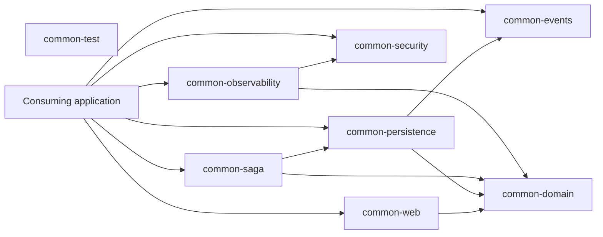

# Module Boundaries

## Ownership

All database-backed services and persistence libraries follow the [JPA and SQL migration standard](./persistence.md). Entity mappings belong to infrastructure; Flyway SQL belongs to the owning service.

- `common-domain` must not depend on Spring, Kafka, servlet APIs, or application policy.
- `common-web` owns Spring MVC/WebFlux adapters and HTTP response conventions, not endpoint/business behavior.
- `common-security` provides context primitives; consuming applications choose identity providers, authorization rules, and tenant resolution.
- `common-events` provides transport integration; applications own event schemas, topics, and consumer business logic.
- `common-persistence` and `common-saga` provide reusable reliability primitives; applications own their domain entities, transactions, and workflow definitions.
- `common-observability` provides instrumentation/export integration; applications choose sampling, retention, backend, and sensitive-data policy.
- `common-test` is test-scoped and must not become a production dependency.

Applications can use modules individually. No module requires a particular product, organization, marketplace, or deployment environment.
