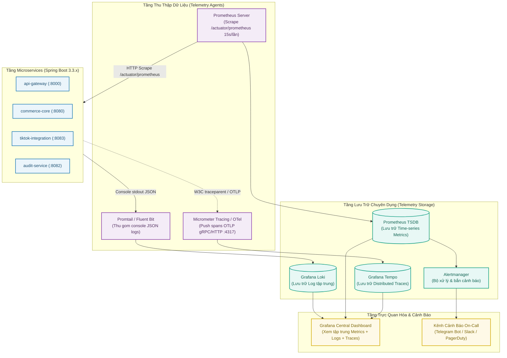
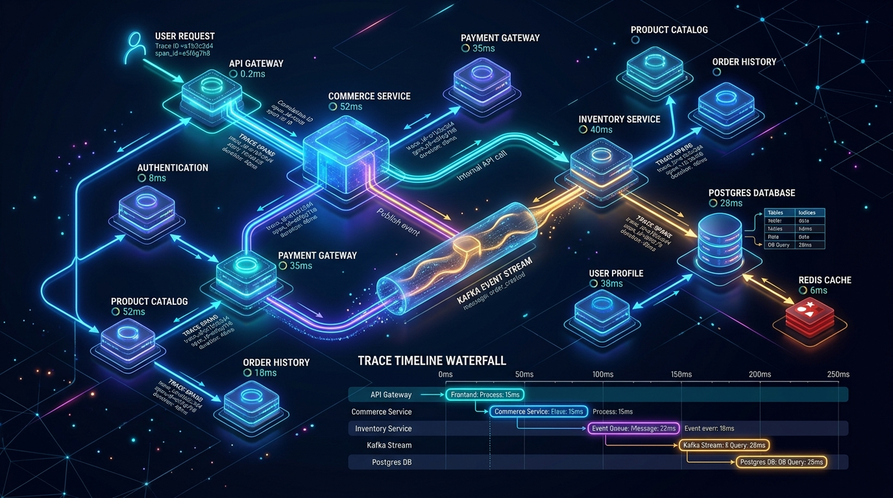

# Kiến trúc Giám sát & Quan sát Hệ thống (Observability: Logs, Metrics, Traces)

Tài liệu này đặc tả toàn bộ kiến trúc giám sát, quan sát (Observability), ghi nhật ký tập trung và cảnh báo sự cố cho các dịch vụ phân tán trong **ViShop Platform** dựa trên bộ 3 trụ cột: **Logs** (Grafana Loki), **Metrics** (Prometheus & Actuator), và **Traces** (OpenTelemetry & Grafana Tempo).

---

## 1. Sơ đồ Kiến trúc Observability Tổng thể



---

## 2. Trụ cột 1: Distributed Logging (Ghi Log Có Cấu Trúc & Tập Trung)

### 2.1. Nguyên tắc Ghi Log trong Microservices
1. **Không ghi ra file cục bộ trong container**: Mọi service phải xuất log ra `stdout` (Console). Promtail hoặc DaemonSet của Kubernetes sẽ tự động cào log từ container runtime.
2. **Định dạng chuẩn JSON**: Mọi log line phải ở dạng JSON có cấu trúc để hệ thống log (Loki/Elasticsearch) parse được các trường mà không cần dùng regex tốn CPU.
3. **Chính sách bảo mật (Zero-PII)**: Tuyệt đối không log thông tin nhạy cảm: Mật khẩu, JWT token thô, Secret key sàn TikTok, số thẻ ngân hàng.

### 2.2. Metadata Bắt buộc trong SLF4J MDC (Mapped Diagnostic Context)
Mọi dòng log trong hệ thống phải tự động mang các trường ngữ cảnh sau:

| Trường | Ý nghĩa | Nguồn khởi tạo |
| :--- | :--- | :--- |
| `timestamp` | Thời gian UTC chuẩn ISO-8601 | Logback framework |
| `service` | Tên của Microservice | `${spring.application.name}` |
| `traceId` | ID truy vết toàn luồng phân tán | Micrometer Tracing / W3C TraceContext |
| `spanId` | ID của bước thực thi hiện tại | Micrometer Tracing |
| `correlationId` | ID luồng nghiệp vụ người dùng | API Gateway (`X-Correlation-Id`) |
| `tenantId` | ID tổ chức đang thực hiện thao tác | `TenantContext` (`ThreadLocal<UUID>`) |
| `level` | Cấp độ log (`INFO`, `WARN`, `ERROR`, `DEBUG`) | Developer quy định |
| `message` | Nội dung mô tả sự kiện | Developer quy định |

### 2.3. Cấu hình Mẫu: `logback-spring.xml`
File cấu hình chuẩn đặt trong `src/main/resources/logback-spring.xml` của từng service:

```xml
<?xml version="1.0" encoding="UTF-8"?>
<configuration>
    <springProperty scope="context" name="springAppName" source="spring.application.name"/>

    <appender name="JSON_CONSOLE" class="ch.qos.logback.core.ConsoleAppender">
        <encoder class="net.logstash.logback.encoder.LoggingEventCompositeJsonEncoder">
            <providers>
                <timestamp>
                    <timeZone>UTC</timeZone>
                </timestamp>
                <pattern>
                    <pattern>
                        {
                          "timestamp": "%date{ISO8601}",
                          "level": "%level",
                          "service": "${springAppName:-unknown}",
                          "traceId": "%X{traceId:-}",
                          "spanId": "%X{spanId:-}",
                          "correlationId": "%X{X-Correlation-Id:-}",
                          "tenantId": "%X{X-Tenant-Id:-}",
                          "thread": "%thread",
                          "logger": "%logger{40}",
                          "message": "%message",
                          "exception": "%ex"
                        }
                    </pattern>
                </pattern>
            </providers>
        </encoder>
    </appender>

    <root level="INFO">
        <appender-ref ref="JSON_CONSOLE" />
    </root>
</configuration>
```

---

## 3. Trụ cột 2: Metrics & Health Monitoring (Chỉ số Giám sát)

### 3.1. Thiết lập Spring Boot Actuator & Micrometer
Các service sử dụng module [`platform-common:common-observability`](../../platform-common/common-observability) để tích hợp Prometheus endpoint tại `GET /actuator/prometheus`.

#### Cấu hình `application.yml`:
```yaml
management:
  endpoints:
    web:
      exposure:
        include: health,info,prometheus,metrics
  endpoint:
    health:
      show-details: when_authorized
      probes:
        enabled: true # Kích hoạt Liveness & Readiness Probes cho Kubernetes
  metrics:
    tags:
      application: ${spring.application.name} # Gắn tag tên service vào mọi metric
    distribution:
      percentiles-histogram:
        http.server.requests: true # Tính toán histogram cho p50, p95, p99
```

### 3.2. Bốn Chỉ Số Vàng (The 4 Golden Signals)
Dashboard Grafana của ViShop theo dõi 4 tín hiệu sống còn theo chuẩn SRE của Google:

1. **Traffic (Lưu lượng - Throughput)**:
   - Đo số lượng Request mỗi giây (RPS):
     ```promql
     sum(rate(http_server_requests_seconds_count[5m])) by (application, uri)
     ```
2. **Errors (Tỷ lệ lỗi)**:
   - Tỷ lệ HTTP 5xx trên tổng số requests:
     ```promql
     sum(rate(http_server_requests_seconds_count{status=~"5.."}[5m])) 
     / sum(rate(http_server_requests_seconds_count[5m])) * 100
     ```
3. **Latency (Độ trễ phản hồi)**:
   - Đo thời gian phản hồi ở phân vị p95 và p99:
     ```promql
     histogram_quantile(0.99, sum(rate(http_server_requests_seconds_bucket[5m])) by (le, uri))
     ```
4. **Saturation (Độ bão hòa tài nguyên)**:
   - **Postgres Connection Pool**:
     ```promql
     hikaricp_connections_active / hikaricp_connections_max * 100
     ```
   - **JVM Heap Memory Usage**:
     ```promql
     jvm_memory_used_bytes{area="heap"} / jvm_memory_max_bytes{area="heap"} * 100
     ```

### 3.3. Các Metrics Đặc thù của ViShop Platform
- **Kafka Consumer Lag** (Rất quan trọng cho `tiktok-integration` và `audit-service`):
  ```promql
  kafka_consumergroup_lag{topic=~"vishop.*"}
  ```
- **Outbox Pending Backlog** (Số lượng bản ghi chưa kịp đẩy lên Kafka):
  Đo từ bảng `outbox_events` có `status = 'PENDING'`.

---

## 4. Trụ cột 3: Distributed Tracing (Truy Vết Phân Tán)



### 4.1. Chuẩn W3C Trace Context (`traceparent`)
Khi một request di chuyển qua các ranh giới mạng (từ Gateway $\rightarrow$ Commerce Core $\rightarrow$ Kafka $\rightarrow$ Audit Service), header chuẩn W3C `traceparent` tự động được đính kèm:

```text
traceparent: 00-4bf92f3577b34da6a3ce929d0e0e4736-00f067aa0ba902b7-01
              │  └───────────────┬────────────────┘  └──────┬───────┘  └─┬┘
              │                  │                          │            └─ Flags
              │                  │                          └─ Span ID (Bước này)
              │                  └─ Trace ID (Xuyên suốt cả luồng)
              └─ Version
```

### 4.2. Khả năng Liên kết Trace $\leftrightarrow$ Logs trong Grafana
Sức mạnh lớn nhất của stack **Loki + Tempo + Grafana** là khả năng tương hỗ:
1. Xem Dashboard thấy API Tạo đơn hàng bị chậm (3.5 giây).
2. Click vào điểm trễ $\rightarrow$ Grafana mở ngay **Trace tree trong Tempo**, hiển thị chi tiết:
   - `api-gateway`: 10ms
   - `commerce-core`: 3450ms (Chặng gọi database `SELECT ... FOR UPDATE` mất 3200ms)
   - `outbox-publisher`: 20ms
3. Nhấp vào nút **"Explore Logs with traceId"** $\rightarrow$ Hệ thống tự động lọc toàn bộ các dòng log trong **Loki** có cùng `traceId` đó, tìm ngay ra nguyên nhân bị lock bảng hoặc thiếu Index.

---

## 5. Ma trận Cảnh báo Sự cố (Alerting Matrix)

Bộ quy tắc cấu hình trong Prometheus Alertmanager gửi thông báo trực tiếp về kênh On-call:

| Mức độ | Điều kiện kích hoạt | Nguyên nhân dự đoán | Hành động khắc phục |
| :--- | :--- | :--- | :--- |
| 🔴 **P1 (Critical)** | Service Liveness Probe = 0 (> 1 phút) | Service bị Crash / OOMKilled | Kiểm tra container restart, xem log crash |
| 🔴 **P1 (Critical)** | Tỷ lệ HTTP 5xx > 5% trong 3 phút liên tục | Lỗi logic nghiêm trọng, DB sập | Kiểm tra lỗi ngoại lệ gần nhất trong Loki |
| 🟡 **P2 (High)** | Kafka Consumer Lag > 5.000 messages | Worker quá tải hoặc deadlock | KEDA tự động scale pod worker |
| 🟡 **P2 (High)** | HikariCP Active Pool > 90% trong 2 phút | Leak connection hoặc slow queries | Kiểm tra giao dịch DB chưa commit |
| 🔵 **P3 (Warning)** | Disk usage > 85% hoặc JVM Heap > 85% | Rác tích tụ, traffic tăng dần | Dọn dẹp log, chuẩn bị scale RAM/Disk |

---

## 6. Danh mục Kiểm tra Triển khai (Checklist)

- [ ] Mọi Microservice đều tích hợp thư viện `platform-common:common-observability`.
- [ ] Log định dạng chuẩn JSON và tiêm đầy đủ `correlationId`, `tenantId`, `traceId` vào MDC.
- [ ] Endpoint `/actuator/prometheus` hoạt động và được Prometheus Server scrape định kỳ.
- [ ] Endpoint `/actuator/health` trả về chi tiết trạng thái của DB và Kafka.
- [ ] Alertmanager đã được cấu hình Webhook bắn thông báo tới Telegram/Slack.
