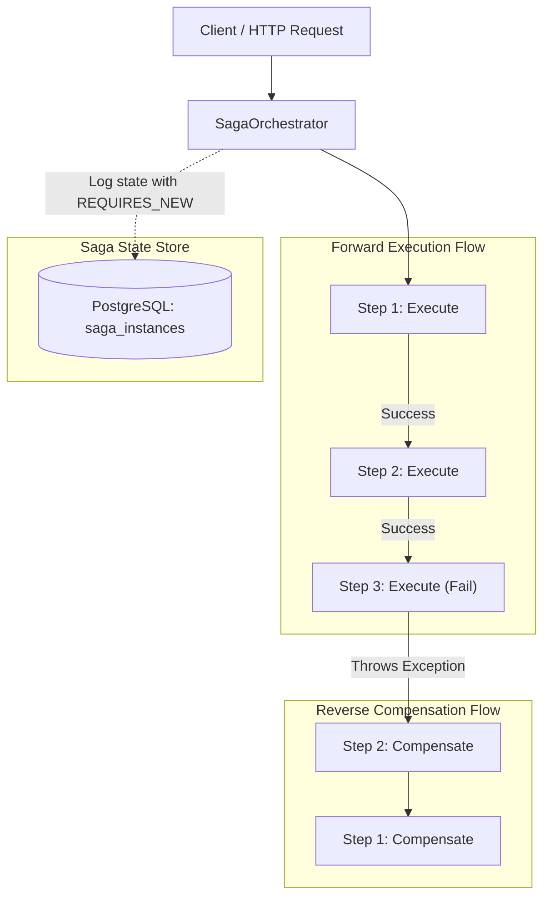

# Saga Pattern — Distributed Transactions in ViShop

## 1. Giới thiệu

Trong kiến trúc Microservices của ViShop Platform, mỗi service sở hữu cơ sở dữ liệu riêng biệt (Database-per-Service). Để xử lý các giao dịch kinh doanh kéo dài qua nhiều service (ví dụ: Tạo Tenant kèm tạo Admin Account, thanh toán đơn hàng kèm giữ kho), chúng ta áp dụng **Saga Pattern** theo mô hình **Orchestration-based** thông qua module [`platform-common:common-saga`](../../platform-common/common-saga).

---

## 2. Mô hình Saga Orchestration



### Các thành phần chính:
1. **[`SagaStep<TContext>`](../../platform-common/common-saga/src/main/java/io/github/coreplatform/common/saga/SagaStep.java)**:
   * Interface định nghĩa một bước trong quy trình.
   * `getName()`: Tên định danh của bước (ví dụ: `CreateTenantStep`, `ProvisionIdentityStep`).
   * `execute(TContext context)`: Thực hiện hành động chính.
   * `compensate(TContext context)`: Thực hiện rollback bù trừ khi có bước phía sau bị lỗi (idempotent, không được throw exception unhandled).

2. **[`SagaDefinition<TContext>`](../../platform-common/common-saga/src/main/java/io/github/coreplatform/common/saga/SagaDefinition.java)**:
   * Danh sách tuần tự các `SagaStep`.
   * Khởi tạo linh hoạt thông qua Fluent Builder: `SagaDefinition.<MyContext>builder("MySaga").step(step1).step(step2).build()`.

3. **[`SagaOrchestrator`](../../platform-common/common-saga/src/main/java/io/github/coreplatform/common/saga/SagaOrchestrator.java)**:
   * Engine thực thi tuần tự các bước.
   * Quản lý trạng thái vòng đời của Saga Instance (`STARTED` -> `EXECUTING` -> `COMPLETED` hoặc `COMPENSATING` -> `COMPENSATED` / `FAILED`).
   * Tự động kích hoạt bù trừ ngược chiều (LIFO - Last In First Out) khi bất kỳ bước nào gặp lỗi.
   * Sử dụng transaction độc lập `REQUIRES_NEW` khi lưu log trạng thái vào bảng `saga_instances` để đảm bảo không bị rollback khi business transaction gặp ngoại lệ.

4. **[`SagaInstanceEntity`](../../platform-common/common-saga/src/main/java/io/github/coreplatform/common/saga/SagaInstanceEntity.java)**:
   * Bảng lưu trữ trạng thái của từng instance để phục vụ tracing, audit và phục hồi lỗi.

---

## 3. Cấu trúc bảng `saga_instances`

```sql
CREATE TABLE saga_instances (
    id UUID PRIMARY KEY,
    saga_name VARCHAR(100) NOT NULL,
    status VARCHAR(50) NOT NULL,
    current_step VARCHAR(100),
    error_message TEXT,
    started_at TIMESTAMP WITH TIME ZONE NOT NULL,
    completed_at TIMESTAMP WITH TIME ZONE
);

CREATE INDEX idx_saga_instances_status ON saga_instances(status);
CREATE INDEX idx_saga_instances_name ON saga_instances(saga_name);
```

---

## 4. Hướng dẫn sử dụng

### 4.1. Định nghĩa Context dữ liệu
```java
public class OnboardingContext {
    private final UUID tenantId;
    private final String tenantName;
    private UUID userId;

    public OnboardingContext(UUID tenantId, String tenantName) {
        this.tenantId = tenantId;
        this.tenantName = tenantName;
    }
    // Getters and Setters
}
```

### 4.2. Triển khai các SagaStep
```java
@Component
public class ProvisionTenantStep implements SagaStep<OnboardingContext> {
    private final TenantRepositoryPort tenantRepo;

    public ProvisionTenantStep(TenantRepositoryPort tenantRepo) {
        this.tenantRepo = tenantRepo;
    }

    @Override
    public String getName() {
        return "ProvisionTenant";
    }

    @Override
    public void execute(OnboardingContext ctx) {
        tenantRepo.save(Tenant.create(ctx.getTenantId(), ctx.getTenantName()));
    }

    @Override
    public void compensate(OnboardingContext ctx) {
        tenantRepo.deleteById(ctx.getTenantId());
    }
}
```

### 4.3. Khởi chạy Saga qua Orchestrator
```java
@Service
public class TenantOnboardingWorkflow {
    private final SagaOrchestrator orchestrator;
    private final ProvisionTenantStep provisionTenantStep;
    private final CreateAdminUserStep createAdminUserStep;

    public void startOnboarding(UUID tenantId, String name, String email) {
        OnboardingContext ctx = new OnboardingContext(tenantId, name);

        SagaDefinition<OnboardingContext> saga = SagaDefinition.<OnboardingContext>builder("TenantOnboardingSaga")
            .step(provisionTenantStep)
            .step(createAdminUserStep)
            .build();

        orchestrator.execute(saga, ctx);
    }
}
```

---

## 5. Nguyên tắc bồi hoàn (Compensation Rules)
* **Tính lũy kế (Idempotency)**: Hàm `compensate` có thể được gọi lại nhiều lần nếu mạng chập chờn; do đó nó phải là idempotent.
* **Không làm vỡ luồng bù trừ**: Mọi exception trong `compensate` phải được log chi tiết và chuyển trạng thái Saga thành `FAILED` để đội vận hành xử lý can thiệp thủ công (Manual Intervention Alert).
