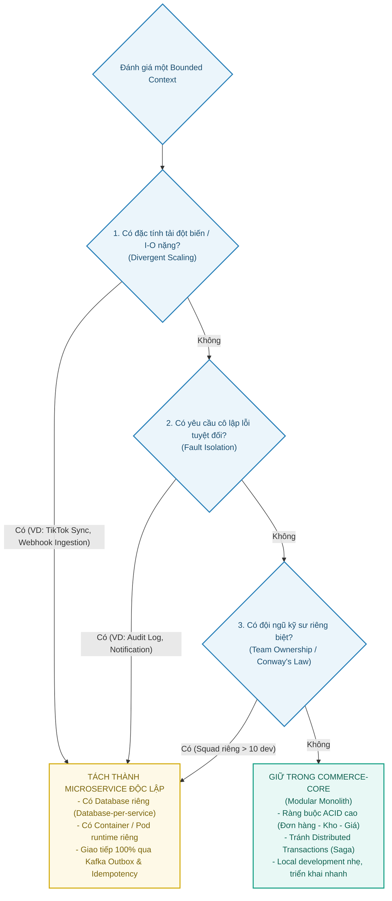
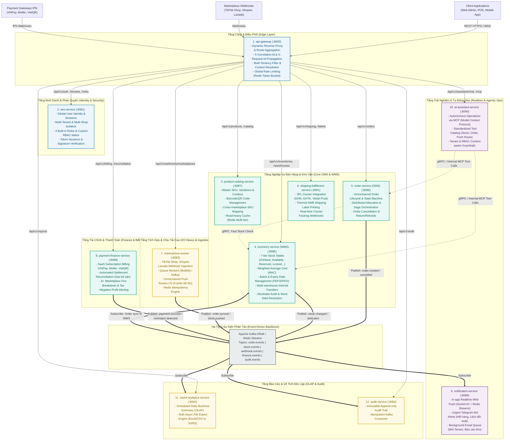

# Chiến lược & Kiến trúc Phân tách Dịch vụ (Service Decomposition & Splitting Strategy)

Tài liệu này đặc tả toàn bộ chiến lược phân tách dịch vụ, ranh giới các Bounded Contexts, các quy tắc bất biến khi chia nhỏ hệ thống, và quy trình từng bước để tách một module nghiệp vụ thành một microservice độc lập trong **ViShop Platform**.

---

## 1. Khung Tiêu chí Quyết định Tách Service (Decision Framework)

Không phân tách service theo cảm tính, theo từng màn hình hoặc theo từng bảng đơn lẻ trong cơ sở dữ liệu. Một Bounded Context chỉ được xem xét tách ra thành một Microservice độc lập khi thỏa mãn ít nhất **1 trong 3 động lực kiến trúc cốt lõi**:



---

## 2. Sơ đồ Phân tách Dịch vụ Tổng thể (Target Microservices Decomposition Map)

Hệ thống **ViShop Platform** áp dụng chiến lược tiến hóa kiến trúc theo mô hình **Pragmatic Microservices (Strangler Fig Pattern)**: chuyển dịch từ lõi Bounded Contexts sang **10 Microservices chuyên biệt + 2 Service vệ tinh hỗ trợ**:



---

## 3. Ranh giới Bounded Contexts, Cơ sở Dữ liệu & Giao thức

Hệ thống tuân thủ nghiêm ngặt nguyên tắc **Database-per-Service** và phân chia ranh giới theo Bounded Context:

| STT | Tên Microservice | Bounded Context | Trách nhiệm chính | Database Schema | Giao tiếp đối ngoại / đối nội |
| :---: | :--- | :--- | :--- | :--- | :--- |
| **1** | **`api-gateway`** | Edge / Gateway | Reverse proxy, cân bằng tải, Rate Limiting, xác thực JWT, phân giải Tenant/Shop context, inject Correlation ID. | *Không có DB* | REST (HTTP/2), WebSocket |
| **2** | **`iam-service`** | Identity, Tenancy & RBAC | Quản lý User toàn cầu, Tenant/Shop Scope, phân quyền RBAC đa cấp, cấp phát và verify Access/Refresh JWT. | `vishop_iam` (PostgreSQL) + Redis Session | REST (Downstream), Kafka Outbox |
| **3** | **`product-catalog-service`** | Catalog & Products | Master SKU, sản phẩm nhiều biến thể, Combo/Bundle, Barcode, ánh xạ SKU đa sàn (TikTok/Shopee mapping). | `vishop_catalog` (PostgreSQL) + Redis Read Cache | REST, gRPC (Product Query) |
| **4** | **`inventory-service` (WMS)** | Warehouse & Inventory | Vòng đời tồn kho 7 trạng thái, FIFO/FEFO, Giá vốn MAC, Nhập/Xuất kho, Chuyển kho nội bộ, Kiểm kê, Nợ kho. | `vishop_inventory` (PostgreSQL) + Redis Lock | REST, gRPC (Stock Reserve), Kafka |
| **5** | **`order-service` (OMS)** | Orders & Checkout | Quản lý vòng đời đơn hàng đa kênh, State Machine, điều phối trừ kho, Saga Pattern cho giao dịch bù trừ, xử lý trả hàng. | `vishop_order` (PostgreSQL) | REST, gRPC, Kafka Events |
| **6** | **`shipping-fulfillment-service`** | Logistics & Shipping | Tích hợp cổng vận chuyển (GHN, GHTK, Viettel Post), sinh mã AWB, in tem vận đơn nhiệt, Webhook tracking bưu tá. | `vishop_shipping` (PostgreSQL) | REST, 3PL Webhooks, Kafka |
| **7** | **`marketplace-worker`** | Omnichannel Integrations | Ingestion Webhook từ TikTok Shop / Shopee / Lazada, Worker nền (BullMQ), cơ chế phân luồng đẩy tồn (**Push Routes**), Idempotency. | `vishop_worker` (PostgreSQL) + Redis Queue | Inbound Webhooks, Kafka Outbox |
| **8** | **`payment-finance-service`** | Billing & Finance | Thanh toán gói cước SaaS (VNPay, MoMo, VietQR IPN), tự động đối soát sao kê tiền về từ sàn TMĐT, bóc tách 6+ loại phí, cảnh báo đơn lỗ. | `vishop_finance` (PostgreSQL) | IPN Webhooks, Kafka Events |
| **9** | **`notification-service`** | Realtime & Notifications | Bắn thông báo In-app realtime cho Dashboard (Socket.IO), gửi cảnh báo khẩn cấp qua **Telegram Bot**, gửi Email hàng đợi (BullMQ). | `vishop_notification` (PostgreSQL) + Redis Pub/Sub | Socket.IO (WSS), Telegram API, SMTP |
| **10** | **`ai-assistant-service`** | Agentic AI & Ops | Chatbot vận hành tự động qua chuẩn **Model Context Protocol (MCP)**, Tool Catalog cho WMS/OMS, Context-aware RBAC guardrails. | *Stateless / Vector DB (nếu có)* | MCP Protocol, gRPC sang Core |
| **11** | **`report-analytics-service`** | Reporting & OLAP | Tổng hợp số liệu kinh doanh định kỳ, báo cáo tồn kho & quay vòng vốn, xử lý ngầm xuất file Excel/CSV dung lượng lớn. | `vishop_analytics` (PostgreSQL Read-replica) | REST, Kafka Consumer, S3/R2 |
| **12** | **`audit-service`** | Audit & Compliance | Ghi nhận nhật ký kiểm toán (Audit Trail) bất biến cho mọi sự kiện thay đổi dữ liệu trên toàn hệ thống. | `vishop_audit` (PostgreSQL Append-only) | Kafka Consumer thuần túy |

---

## 4. Ba Quy tắc Vàng khi Tách Dịch vụ (The Golden Rules)

### Quy tắc 1: Cơ sở dữ liệu hoàn toàn độc lập (Database-per-Service)
1. **Tuyệt đối không có Foreign Key giữa các Database khác nhau**:
   - Khóa ngoại chéo (`tenantId`, `userId`, `orderId`, `productId`) chỉ được lưu dưới dạng giá trị tham chiếu `UUID v7`.
2. **Tuyệt đối không JOIN bảng xuyên Database**:
   - Dữ liệu cần tổng hợp từ nhiều context được thực hiện thông qua:
     * **CQRS Read Model / Materialized Views** đồng bộ bất đồng bộ qua Kafka.
     * Hoặc tổng hợp ở tầng API Gateway / BFF qua các lời gọi query song song.

### Quy tắc 2: Zero Synchronous Write (Không gọi HTTP chéo để ghi dữ liệu)
- Không dùng HTTP `POST / PUT / DELETE` gọi trực tiếp từ Service A sang Service B để cập nhật dữ liệu.
- Mọi thao tác ghi dữ liệu liên service **bắt buộc sử dụng Transactional Outbox Pattern + Kafka Event**.
- *Chỉ cho phép HTTP GET hoặc gRPC*: Áp dụng cho các truy vấn tra cứu thông tin tức thời (Read-only lookup) hoặc kiểm tra validation khẩn cấp mà cache chưa kịp có. Chi tiết xem tại [Chiến lược giao tiếp liên dịch vụ (Kafka vs REST vs gRPC)](./inter-service-communication.md).

### Quy tắc 3: Idempotent Consumer ở mọi đầu nhận
- Do cơ chế của Kafka là *At-Least-Once Delivery*, mọi consumer nhận sự kiện bắt buộc phải kiểm tra trùng lặp thông qua [`IdempotentConsumer`](../../platform-common/common-persistence/src/main/java/io/github/coreplatform/common/persistence/idempotency/IdempotentConsumer.java) và bảng `consumed_messages`.

---

## 5. Quy trình 5 Bước để "Xé" một Module thành Microservice Độc lập

Khi hệ thống phát triển, nếu một module trong `commerce-core` (ví dụ: `inventory` hoặc `finance`) đủ lớn và cần tách riêng thành `inventory-service`, hãy thực hiện theo đúng **Playbook 5 bước** sau để đảm bảo không downtime và không vỡ dữ liệu:

```text
[Bước 1: Khóa Ranh Giới Code] ──> [Bước 2: Tách DB Schema] ──> [Bước 3: Chuyển sang Event Outbox]
                                                                             │
[Bước 5: Trỏ Route tại Gateway] <── [Bước 4: Tạo Module Gradle & Pod Mới] <──┘
```

### Bước 1: Khóa ranh giới code (Code Boundary Enforcement)
- Đảm bảo module mục tiêu (ví dụ: `inventory`) chỉ tương tác với các module khác thông qua Java Interface (`Ports`) hoặc Domain Event nội bộ.
- Cấm triệt để việc các module khác import trực tiếp JPA Entity hoặc Repository của module này.

### Bước 2: Tách Database Schema (Database Decoupling)
- Gỡ bỏ mọi ràng buộc Foreign Key cứng trỏ vào bảng của module (thay bằng cột `UUID`).
- Chuyển các bảng sang schema riêng (`inventory.*`) hoặc Database PostgreSQL mới (`vishop_inventory`).
- Chạy batch backfill dữ liệu cũ sang database mới nếu cần.

### Bước 3: Chuyển đổi giao tiếp sang Kafka Event (Event Decoupling)
- Thay thế lời gọi hàm in-memory giữa `order` và `inventory` bằng luồng sự kiện bất đồng bộ:
  * `OrderCreatedEvent` $\rightarrow$ Kafka $\rightarrow$ `inventory` lắng nghe và trừ kho.
  * `StockReservedEvent` hoặc `StockExhaustedEvent` $\rightarrow$ Kafka $\rightarrow$ `order` nhận để xác nhận đơn hoặc kích hoạt Saga hủy đơn.

### Bước 4: Tạo Module Gradle mới trong `services/`
- Tạo thư mục `services/inventory-service` với file `build.gradle.kts`.
- Khai báo subproject vào [settings.gradle.kts](../../settings.gradle.kts).
- Cấu hình port riêng (ví dụ: `:8084`) và Dockerfile container riêng.

### Bước 5: Cấu hình định tuyến tại API Gateway
- Bổ sung cấu hình route trong [services/api-gateway/src/main/resources/application.yml](../../services/api-gateway/src/main/resources/application.yml):
  ```yaml
  - id: inventory-service
    uri: ${INVENTORY_SERVICE_URL:http://localhost:8084}
    predicates:
      - Path=/api/v1/inventory/**, /api/v1/warehouses/**
  ```
- Kiểm thử luồng dữ liệu song song (Canary / Dual-run) trước khi chuyển đổi 100% traffic sang service mới.
