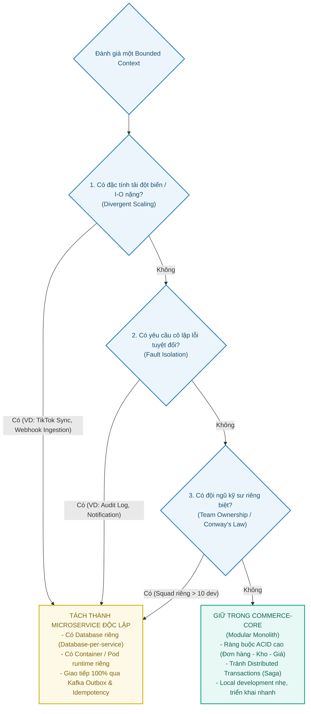
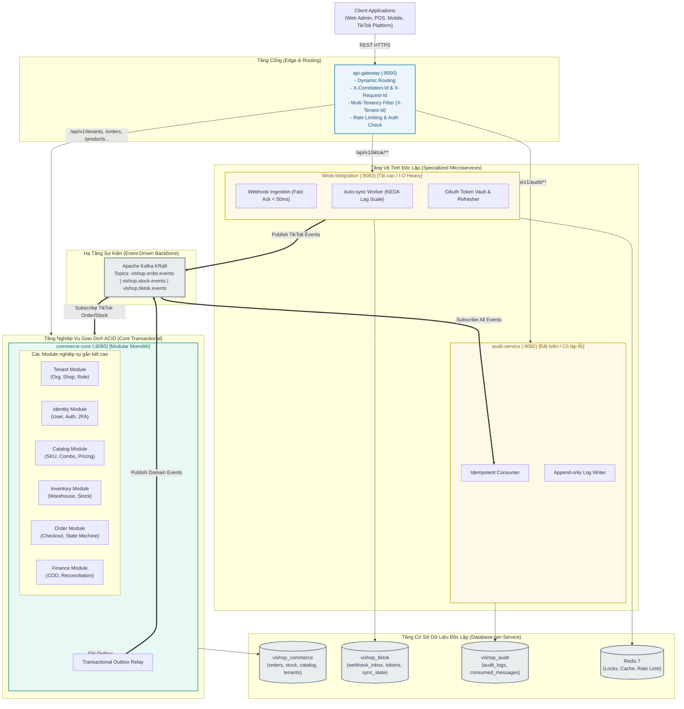

# Chiến lược & Kiến trúc Phân tách Dịch vụ (Service Decomposition & Splitting Strategy)

Tài liệu này đặc tả toàn bộ chiến lược phân tách dịch vụ, ranh giới các Bounded Contexts, các quy tắc bất biến khi chia nhỏ hệ thống, và quy trình từng bước để tách một module nghiệp vụ thành một microservice độc lập trong **ViShop Platform**.

---

## 1. Khung Tiêu chí Quyết định Tách Service (Decision Framework)

Không phân tách service theo cảm tính, theo từng màn hình hoặc theo từng bảng đơn lẻ trong cơ sở dữ liệu. Một Bounded Context chỉ được xem xét tách ra thành một Microservice độc lập khi thỏa mãn ít nhất **1 trong 3 động lực kiến trúc cốt lõi**:



---

## 2. Sơ đồ Phân tách Dịch vụ Tổng thể (Service Decomposition Map)

Dựa trên khung tiêu chí trên, hệ thống ViShop Platform áp dụng mô hình **Pragmatic Modular Microservices** gồm **1 API Gateway + 1 Core Modular Monolith + 2 Satellite Microservices**:



---

## 3. Ranh giới Bounded Contexts & Cơ sở Dữ liệu

Mỗi Service sở hữu hoàn toàn Bounded Context và Database riêng của mình:

| Dịch vụ / Module | Bounded Context | Trách nhiệm chính | Database Schema |
| :--- | :--- | :--- | :--- |
| **`api-gateway`** | Edge / Gateway | Routing, xác thực token thô, phân giải `X-Tenant-Id`, tạo `X-Correlation-Id`, chuẩn hóa RFC 9457 | *Không có DB* |
| **`commerce-core`** *(Modular Monolith)* | Tenants, Users, Catalog, Inventory, Orders, Finance | Quản lý toàn bộ vòng đời sản phẩm, tồn kho, đơn hàng, thanh toán và tổ chức trong cùng 1 đơn vị transaction ACID | `vishop_commerce` (PostgreSQL) |
| **`tiktok-integration`** *(Specialized Microservice)* | TikTok Marketplace, Webhooks, OAuth | Nhận webhook TikTok cực nhanh, quản lý OAuth Token, đồng bộ đơn hàng và tồn kho 2 chiều theo rate limit của sàn | `vishop_tiktok` (PostgreSQL) + Redis |
| **`audit-service`** *(Isolated Consumer)* | Audit Trails | Lắng nghe toàn bộ event từ Kafka để ghi nhận nhật ký kiểm toán bất biến (append-only) | `vishop_audit` (PostgreSQL) |

---

## 4. Ba Quy tắc Vàng khi Tách Dịch vụ (The Golden Rules)

### Quy tắc 1: Cơ sở dữ liệu hoàn toàn độc lập (Database-per-Service)
1. **Tuyệt đối không có Foreign Key giữa các Database khác nhau**:
   - Khóa ngoại chéo (`tenantId`, `userId`, `orderId`, `productId`) chỉ được lưu dưới dạng giá trị tham chiếu `UUID v7`.
2. **Tuyệt đối không JOIN bảng xuyên Database**:
   - Dữ liệu cần tổng hợp từ nhiều context được thực hiện thông qua:
     * **CQRS Read Model / Materialized Views** đồng bộ bất đồng bộ qua Kafka.
     * Hoặc tổng hợp ở tầng API Gateway / BFF qua các lời gọi query song song.

### Quy tắc 2: Zero Synchronous Write (Không gọi HTTP chéo để ghi dữ liệu)
- Không dùng HTTP `POST / PUT / DELETE` gọi trực tiếp từ Service A sang Service B để cập nhật dữ liệu.
- Mọi thao tác ghi dữ liệu liên service **bắt buộc sử dụng Transactional Outbox Pattern + Kafka Event**.
- *Chỉ cho phép HTTP GET hoặc gRPC*: Áp dụng cho các truy vấn tra cứu thông tin tức thời (Read-only lookup) hoặc kiểm tra validation khẩn cấp mà cache chưa kịp có. Chi tiết xem tại [Chiến lược giao tiếp liên dịch vụ (Kafka vs REST vs gRPC)](./inter-service-communication.md).

### Quy tắc 3: Idempotent Consumer ở mọi đầu nhận
- Do cơ chế của Kafka là *At-Least-Once Delivery*, mọi consumer nhận sự kiện bắt buộc phải kiểm tra trùng lặp thông qua [`IdempotentConsumer`](../../platform-common/common-persistence/src/main/java/io/github/coreplatform/common/persistence/idempotency/IdempotentConsumer.java) và bảng `consumed_messages`.

---

## 5. Quy trình 5 Bước để "Xé" một Module thành Microservice Độc lập

Khi hệ thống phát triển, nếu một module trong `commerce-core` (ví dụ: `inventory` hoặc `finance`) đủ lớn và cần tách riêng thành `inventory-service`, hãy thực hiện theo đúng **Playbook 5 bước** sau để đảm bảo không downtime và không vỡ dữ liệu:

```text
[Bước 1: Khóa Ranh Giới Code] ──> [Bước 2: Tách DB Schema] ──> [Bước 3: Chuyển sang Event Outbox]
                                                                             │
[Bước 5: Trỏ Route tại Gateway] <── [Bước 4: Tạo Module Gradle & Pod Mới] <──┘
```

### Bước 1: Khóa ranh giới code (Code Boundary Enforcement)
- Đảm bảo module mục tiêu (ví dụ: `inventory`) chỉ tương tác với các module khác thông qua Java Interface (`Ports`) hoặc Domain Event nội bộ.
- Cấm triệt để việc các module khác import trực tiếp JPA Entity hoặc Repository của module này.

### Bước 2: Tách Database Schema (Database Decoupling)
- Gỡ bỏ mọi ràng buộc Foreign Key cứng trỏ vào bảng của module (thay bằng cột `UUID`).
- Chuyển các bảng sang schema riêng (`inventory.*`) hoặc Database PostgreSQL mới (`vishop_inventory`).
- Chạy batch backfill dữ liệu cũ sang database mới nếu cần.

### Bước 3: Chuyển đổi giao tiếp sang Kafka Event (Event Decoupling)
- Thay thế lời gọi hàm in-memory giữa `order` và `inventory` bằng luồng sự kiện bất đồng bộ:
  * `OrderCreatedEvent` $\rightarrow$ Kafka $\rightarrow$ `inventory` lắng nghe và trừ kho.
  * `StockReservedEvent` hoặc `StockExhaustedEvent` $\rightarrow$ Kafka $\rightarrow$ `order` nhận để xác nhận đơn hoặc kích hoạt Saga hủy đơn.

### Bước 4: Tạo Module Gradle mới trong `services/`
- Tạo thư mục `services/inventory-service` với file `build.gradle.kts`.
- Khai báo subproject vào [settings.gradle.kts](../../settings.gradle.kts).
- Cấu hình port riêng (ví dụ: `:8084`) và Dockerfile container riêng.

### Bước 5: Cấu hình định tuyến tại API Gateway
- Bổ sung cấu hình route trong [services/api-gateway/src/main/resources/application.yml](../../services/api-gateway/src/main/resources/application.yml):
  ```yaml
  - id: inventory-service
    uri: ${INVENTORY_SERVICE_URL:http://localhost:8084}
    predicates:
      - Path=/api/v1/inventory/**, /api/v1/warehouses/**
  ```
- Kiểm thử luồng dữ liệu song song (Canary / Dual-run) trước khi chuyển đổi 100% traffic sang service mới.
