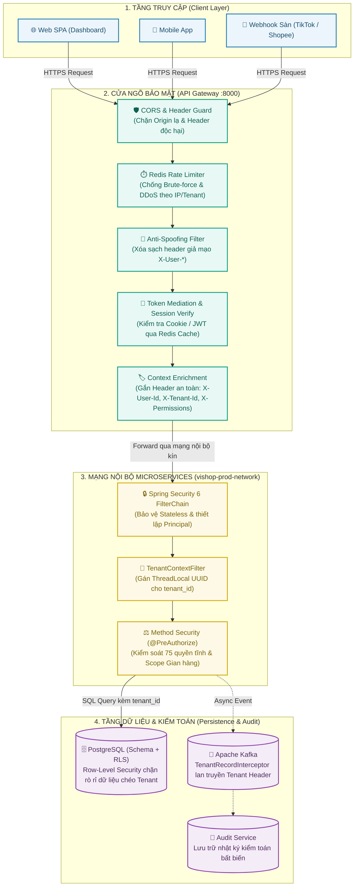

# Kiến trúc Bảo mật Hệ thống (Security Architecture)

Tài liệu này đặc tả toàn bộ kiến trúc an ninh, bảo mật thông tin và phân quyền kiểm soát truy cập trong hệ thống microservices của **ViShop Platform** dựa trên các công nghệ: **Spring Security 6**, **Spring Cloud Gateway**, **PostgreSQL Row-Level Security**, **Docker Hardening** và bộ công cụ **DevSecOps**.

---

## 1. Nguyên tắc Thiết kế Cốt lõi (Core Principles)

Kiến trúc bảo mật của ViShop Platform tuân thủ 5 nguyên tắc bắt buộc:

1. **Phòng thủ Đa lớp (Defense in Depth)**: Không phó mặc an ninh cho một chốt chặn duy nhất. Ví dụ: Nếu một truy vấn ở tầng ứng dụng bỏ sót điều kiện `tenant_id`, tầng Database (Row-Level Security) vẫn phải chốt chặn để chống rò rỉ dữ liệu.
2. **Mạng Zero Trust (Zero-Trust Architecture)**: Mọi yêu cầu (request) đi qua API Gateway đều phải được xác thực danh tính, chuẩn hóa và đóng gói thành ngữ cảnh nội bộ (Internal Context). Các microservice hạ nguồn (downstream) không tin tưởng mù quáng vào các header do client trực tiếp gửi lên.
3. **Cô lập Đa người thuê Tuyệt đối (Strict Multi-Tenancy)**: Mọi dữ liệu nghiệp vụ đều thuộc về một Tổ chức (`tenant`). Định danh tenant bắt buộc phải được giải quyết từ ngữ cảnh an toàn, không bao giờ tin cậy `tenant_id` từ request body của người dùng.
4. **Quyền tối thiểu (Least Privilege & Explicit RBAC)**: Phân quyền theo vai trò 2 cấp (Tổ chức & Gian hàng) dựa trên danh mục 75 quyền tĩnh. Không sử dụng ABAC điều kiện tự do để đảm bảo hiệu năng và tính giải trình trong kiểm toán.
5. **Dịch chuyển Bảo mật về sớm (Shift-Left DevSecOps)**: Quét lỗ hổng dependencies, mã nguồn tĩnh (SAST) và container CVEs ngay trong chu trình phát triển và CI pipeline.

---

## 2. Sơ đồ Kiến trúc Bảo mật Tổng thể

Hệ thống bảo vệ dữ liệu và ứng dụng theo mô hình **Phòng thủ Đa lớp (Defense-in-Depth)** từ cửa ngõ Ingress đến tầng lưu trữ dữ liệu:



### Bảng đối chiếu 4 Chốt chặn An ninh (The 4 Security Checkpoints)

| Chặng | Thành phần | Trách nhiệm an ninh cốt lõi |
| :---: | :--- | :--- |
| **1** | **API Gateway Biên** | Chặn request từ Origin lạ (CORS), giới hạn tần suất gọi (Rate Limiting chống dò mật khẩu), và xóa sạch mọi header giả mạo `X-User-*` do client tự gửi. |
| **2** | **Xác thực & Gán Context** | Gateway kiểm tra Session/JWT qua Redis cache. Nếu hợp lệ, tự động sinh các header nội bộ sạch (`X-User-Id`, `X-Tenant-Id`, `X-User-Permissions`) trước khi chuyển tiếp. |
| **3** | **Ủy quyền Microservice** | Microservice nhận request trong mạng kín, kích hoạt Spring Security 6 để tái tạo `CommonUserDetails` (`UserDetails`) in-memory, kiểm tra quyền hạn `@PreAuthorize` và lưu `tenant_id` vào `TenantContext` (`ThreadLocal`). |
| **4** | **Cô lập Dữ liệu & Kiểm toán** | Tầng Persistence gán điều kiện `tenant_id` cho mọi query; PostgreSQL Row-Level Security làm chốt chặn vật lý; Kafka tự động truyền context; Audit Service lưu vết kiểm toán bất biến. |

---

## 3. Tầng Cửa ngõ (API Gateway) & Xác thực (Authentication)

API Gateway là điểm tiếp nhận duy nhất cho toàn bộ traffic bên ngoài, chịu trách nhiệm thực thi các chính sách bảo mật biên (Edge Security):

### 3.1. Cơ chế Xác thực Kép (Dual-Mode Authentication)
* **Web Dashboard**: Sử dụng **Opaque Session Cookie** (`HttpOnly`, `SameSite=Lax/Strict`, `Secure`). Cookie được mã hóa và xác thực phiên qua Redis hoặc `identity-service`, tương thích với kiến trúc Better Auth.
* **Mobile App / Public Integration API**: Sử dụng **Stateless Bearer Token** (hoặc JWT) có thời hạn sống ngắn (15–30 phút) kèm cơ chế Refresh Token Rotation (lưu băm SHA-256).

### 3.2. Token Mediation & Context Enrichment
API Gateway đóng vai trò làm trung gian biến đổi danh tính:
1. Nhận Session/Token từ Client.
2. Kiểm tra tính hợp lệ và truy xuất thông tin người dùng (`userId`, `status`, danh sách `roles`, danh sách `permissions`).
3. **Chống giả mạo (Anti-Spoofing)**: Gateway chủ động loại bỏ (strip) tất cả các header bắt đầu bằng `X-User-` do Client tự ý gửi lên trước khi forward.
4. Đính kèm các header nội bộ an toàn xuống các downstream microservices:
   * `X-User-Id`: UUID người dùng.
   * `X-Tenant-Id`: UUID tổ chức đang thực hiện thao tác.
   * `X-User-Roles`: Danh sách vai trò ngăn cách bởi dấu phẩy (vd: `OWNER,ACCOUNTANT`).
   * `X-User-Permissions`: Danh sách quyền tĩnh (vd: `order.view,product.create`).

### 3.3. Bảo vệ Tài nguyên & Chống Brute-Force (Rate Limiting)
Triển khai Redis Rate Limiter theo thuật toán **Token Bucket** ngay tại Gateway:
* **Public Endpoints**: Tối đa `20 requests/giây`.
* **Authenticated Endpoints**: Tối đa `100 requests/giây` theo từng `tenant_id`.
* **Login & Auth Endpoints**: Tối đa `5 requests/phút` theo Client IP nhằm triệt tiêu các cuộc tấn công dò mật khẩu (Brute-force / Credential Stuffing).

---

## 4. Tầng Dịch vụ & Phân quyền (Authorization - RBAC)

### 4.1. Mô hình Phân quyền 2 cấp (Scope-Based RBAC)
ViShop Platform áp dụng phân quyền theo quan hệ `tenant_member_roles`:

```text
               ┌────────────────────────────────────────────────────────┐
               │                      TENANT (Tổ chức)                  │
               └───────────────────────────┬────────────────────────────┘
                                           │
                    ┌──────────────────────┴──────────────────────┐
                    ▼                                             ▼
       ┌────────────────────────┐                    ┌────────────────────────┐
       │   Scope: Cấp Tổ chức   │                    │   Scope: Gian hàng     │
       │   (shop_id IS NULL)    │                    │   (shop_id = UUID)     │
       ├────────────────────────┤                    ├────────────────────────┤
       │ Vai trò hệ thống:      │                    │ Vai trò từng shop:     │
       │ - CHỦ TỔ CHỨC (Owner)  │                    │ - Quản lý shop A       │
       │ - KẾ TOÁN (Accountant) │                    │ - Nhân viên kho shop B │
       └────────────────────────┘                    └────────────────────────┘
```

* **Cấp Tổ chức (`shop_id IS NULL`)**: Người dùng nắm vai trò trên toàn bộ tổ chức (ví dụ: *Chủ tổ chức* có toàn quyền; *Kế toán* xem báo cáo tài chính của mọi gian hàng).
* **Cấp Gian hàng (`shop_id = <UUID>`)**: Người dùng chỉ được gán vai trò giới hạn trong một gian hàng cụ thể (ví dụ: nhân viên kho ở gian hàng Shopee A nhưng không có quyền ở gian hàng TikTok B).
* **Danh mục 75 quyền tĩnh**: Toàn bộ quyền hạn được khai báo dưới dạng enum tĩnh (`Permission`) trong `platform-common:common-security`. Hệ thống từ chối ABAC tự do (JSON conditions) để giữ truy vấn kiểm tra quyền đơn giản, có index và dễ dàng kiểm toán.

### 4.2. Tận dụng `UserDetails` trong Microservices (`CommonUserDetails`)
Thay vì để mỗi microservice phải tự truy vấn database `users` (vi phạm ranh giới dịch vụ và gây nghẽn DB), hệ thống tận dụng chuẩn `org.springframework.security.core.userdetails.UserDetails` bằng mô hình **In-Memory Reconstruction (Tái tạo không tốn truy vấn DB - 0ms)**:

```java
package io.github.coreplatform.common.security.context;

import org.springframework.security.core.GrantedAuthority;
import org.springframework.security.core.userdetails.UserDetails;
import java.util.Collection;
import java.util.Set;
import java.util.UUID;

/**
 * Triển khai chuẩn UserDetails của Spring Security dành cho kiến trúc Microservices.
 * Chứa đầy đủ ngữ cảnh định danh người dùng, tổ chức (tenant) và các gian hàng được phân quyền.
 */
public record CommonUserDetails(
    UUID userId,
    UUID tenantId,
    Set<UUID> accessibleShopIds,
    Collection<? extends GrantedAuthority> authorities
) implements UserDetails {

    @Override
    public String getUsername() {
        return userId.toString();
    }

    @Override
    public String getPassword() {
        return ""; // Ở tầng downstream không cần mật khẩu do đã xác thực tại Gateway
    }

    @Override
    public Collection<? extends GrantedAuthority> getAuthorities() {
        return authorities;
    }

    @Override
    public boolean isAccountNonExpired() { return true; }
    @Override
    public boolean isAccountNonLocked() { return true; }
    @Override
    public boolean isCredentialsNonExpired() { return true; }
    @Override
    public boolean isEnabled() { return true; }

    /** Kiểm tra xem user có quyền truy cập vào gian hàng cụ thể hay không */
    public boolean hasShopAccess(UUID shopId) {
        return accessibleShopIds != null && accessibleShopIds.contains(shopId);
    }
}
```

#### Các lợi ích vượt trội:
1. **Tiêm trực tiếp bằng `@AuthenticationPrincipal`**:
   Lập trình viên dễ dàng lấy thông tin `userId` và `tenantId` ngay tại Controller mà không cần đọc Header thủ công:
   ```java
   @PostMapping("/api/v1/orders")
   public ResponseEntity<OrderResponse> createOrder(
           @AuthenticationPrincipal CommonUserDetails currentUser,
           @Valid @RequestBody CreateOrderRequest request) {
       UUID tenantId = currentUser.tenantId();
       UUID userId = currentUser.userId();
       ...
   }
   ```
2. **Tự động hóa Kiểm toán (`AuditorAware<UUID>`)**:
   Spring Data JPA tự động nhận diện `userId` từ `CommonUserDetails` để điền giá trị `@CreatedBy` và `@LastModifiedBy` cho các Entity kiểm toán.

### 4.3. Cấu hình Spring Security 6 trong Microservices
Các microservice tiêu thụ thư viện [common-security](../../platform-common/common-security) và cấu hình chuẩn:

```java
@Configuration
@EnableWebSecurity
@EnableMethodSecurity(prePostEnabled = true)
public class CommonSecurityConfig {

    @Bean
    public SecurityFilterChain securityFilterChain(HttpSecurity http, InternalHeaderAuthFilter authFilter) throws Exception {
        return http
            .csrf(AbstractHttpConfigurer::disable)
            .cors(Customizer.withDefaults())
            .sessionManagement(s -> s.sessionCreationPolicy(SessionCreationPolicy.STATELESS))
            .authorizeHttpRequests(auth -> auth
                .requestMatchers("/actuator/health", "/swagger-ui/**", "/v3/api-docs/**").permitAll()
                .anyRequest().authenticated()
            )
            .addFilterBefore(authFilter, UsernamePasswordAuthenticationFilter.class)
            .build();
    }
}
```

* **Bộ lọc `InternalHeaderAuthFilter` tái tạo `CommonUserDetails`**:
```java
@Component
public class InternalHeaderAuthFilter extends OncePerRequestFilter {
    @Override
    protected void doFilterInternal(HttpServletRequest request, HttpServletResponse response, FilterChain filterChain)
            throws ServletException, IOException {
        String userIdStr = request.getHeader("X-User-Id");
        String tenantIdStr = request.getHeader("X-Tenant-Id");
        String permissionsStr = request.getHeader("X-User-Permissions");
        String shopsStr = request.getHeader("X-User-Shops");

        if (userIdStr != null && tenantIdStr != null) {
            UUID userId = UUID.fromString(userIdStr);
            UUID tenantId = UUID.fromString(tenantIdStr);
            
            List<SimpleGrantedAuthority> authorities = Arrays.stream(permissionsStr != null ? permissionsStr.split(",") : new String[0])
                    .filter(p -> !p.isBlank())
                    .map(SimpleGrantedAuthority::new)
                    .toList();

            Set<UUID> shopIds = Arrays.stream(shopsStr != null ? shopsStr.split(",") : new String[0])
                    .filter(s -> !s.isBlank())
                    .map(UUID::fromString)
                    .collect(Collectors.toSet());

            CommonUserDetails userDetails = new CommonUserDetails(userId, tenantId, shopIds, authorities);
            UsernamePasswordAuthenticationToken authentication =
                    new UsernamePasswordAuthenticationToken(userDetails, null, userDetails.getAuthorities());
            
            SecurityContextHolder.getContext().setAuthentication(authentication);
        }

        filterChain.doFilter(request, response);
    }
}
```

* **Method Security (`@PreAuthorize`)**:
```java
@PreAuthorize("hasAuthority('product.create') and #currentUser.hasShopAccess(#shopId)")
@PostMapping("/api/v1/shops/{shopId}/products")
public ResponseEntity<ProductResponse> createProduct(
        @PathVariable UUID shopId,
        @AuthenticationPrincipal CommonUserDetails currentUser,
        @Valid @RequestBody CreateProductRequest request) {
    ...
}
```

---

## 5. Bảo mật Đa người thuê (Multi-Tenancy Isolation)

ViShop Platform thiết lập **5 tầng cô lập** nhằm đảm bảo không rò rỉ dữ liệu chéo giữa các tổ chức:

| Tầng cô lập | Thành phần kỹ thuật | Cơ chế chốt chặn |
| :--- | :--- | :--- |
| **1. Ingress Filter** | `TenantResolutionGlobalFilter` | Kiểm tra tính hợp lệ của UUID trong header `X-Tenant-Id`. |
| **2. Context Scope** | [TenantContextFilter.java](../../platform-common/common-security/src/main/java/io/github/coreplatform/common/security/TenantContextFilter.java) | Trích xuất header và gán vào [TenantContext.java](../../platform-common/common-security/src/main/java/io/github/coreplatform/common/security/TenantContext.java) (`ThreadLocal<UUID>`). Giải phóng ở `finally`. |
| **3. ORM / Query** | [BaseTenantJpaEntity.java](../../platform-common/common-persistence/src/main/java/io/github/coreplatform/common/persistence/BaseTenantJpaEntity.java) | Entity kế thừa cột `tenant_id` không thể cập nhật (`updatable = false`). Query repository bắt buộc truyền `tenantId`. |
| **4. Database RLS** | PostgreSQL Row-Level Security | Kích hoạt RLS trên bảng: `CREATE POLICY tenant_isolation ON <table> USING (tenant_id = current_setting('app.current_tenant')::uuid)`. |
| **5. Messaging** | [TenantRecordInterceptor.java](../../platform-common/common-events/src/main/java/io/github/coreplatform/common/events/consumer/TenantRecordInterceptor.java) | Tự động lan truyền và tái tạo `TenantContext` xuyên suốt các sự kiện Kafka. |

---

## 6. Bảo vệ Dữ liệu & Quản lý Bí mật (Data & Secrets Protection)

### 6.1. Mã hóa Dữ liệu Nhạy cảm khi lưu trữ (Encryption-at-Rest)
* **Token tích hợp sàn TMĐT (TikTok Shop, Shopee)**:
  * Được mã hóa bằng thuật toán **AES-256-GCM** trước khi lưu vào bảng `channel_authorizations`.
  * Khóa bí mật (Master Encryption Key) được cấp phát qua biến môi trường hoặc Key Management Service (Vault/AWS KMS), không bao giờ lưu cùng cơ sở dữ liệu.
  * Chỉ duy nhất tầng adapter chuyên trách (`TikTokChannelAdapter`, `ShopeeChannelAdapter`) mới được quyền giải mã token ngay trước thời điểm thực hiện lệnh gọi HTTP sang sàn.

### 6.2. Che giấu Dữ liệu Cá nhân (PII Masking & Log Sanitization)
* Tích hợp bộ lọc Logback Pattern Masking:
  * Tự động quét và che giấu các trường: `password`, `accessToken`, `refreshToken`, `authorization`, `cookie`, `phone`, `email`.
  * OpenTelemetry distributed tracing sanitize toàn bộ URL query parameters và span attributes để không đẩy thông tin nhạy cảm lên Grafana/Tempo.

---

## 7. An ninh Hạ tầng, Mạng & DevSecOps

### 7.1. Cô lập Mạng Container
* **Môi trường Production ([docker-compose.prod.yml](../../infra/compose/docker-compose.prod.yml))**:
  * Chỉ duy nhất cổng Ingress **8000** (API Gateway) và **3000** (Grafana) được mở ra ngoài host.
  * Toàn bộ PostgreSQL (5432), Kafka (9092), Redis (6379) và các dịch vụ nghiệp vụ chạy trong mạng nội bộ kín `vishop-prod-network`.
* **Chạy phi đặc quyền (Non-Root Container)**:
  * Tất cả Dockerfile đều tạo và chuyển sang user không có quyền quản trị `appuser:appgroup` (UID 1001).
  * Vô hiệu hóa toàn bộ cổng gỡ lỗi từ xa JVM Remote Debugging (JDWP 5000–5003).

### 7.2. Tự động hóa Quét An ninh trong CI/CD (DevSecOps Tooling)

Chi tiết quy chuẩn tại [docs/security.md](../security.md):

| Tầng bảo vệ | Công cụ | Kịch bản kiểm tra | Hành động chặn (Gate) |
| :--- | :--- | :--- | :--- |
| **Dependencies** | **OSV-Scanner** | Quét CVE trong các thư viện Java/Gradle và npm | Thất bại CI nếu có CVE mức `HIGH` hoặc `CRITICAL` |
| **Mã nguồn (SAST)** | **Semgrep** | Quét OWASP Top 10, SQLi, XSS, Secret commit | Thất bại CI nếu vi phạm mức `ERROR` |
| **Container Image** | **Trivy** | Quét CVE hệ điều hành Alpine và runtime JRE | Chặn deploy image lên registry nếu có lỗ hổng chưa vá |
| **Supply Chain** | **Cosign** | Ký số và xác minh chữ ký provenance của Docker images | Chỉ cho phép orchestrator chạy các image có chữ ký số hợp lệ |

### 7.3. Nhật ký Kiểm toán Bất biến (Immutable Audit Trail)
* Mọi hành động nhạy cảm (thêm/sửa/xóa quyền, đăng nhập thất bại, xuất dữ liệu hàng loạt, thay đổi cấu hình gian hàng) đều phát sinh sự kiện `AuditLogEvent`.
* Sự kiện được gửi tới Kafka topic `vishop.audit.events` và được [audit-service](../../services/audit-service) lưu trữ dài hạn phục vụ điều tra sự cố và tuân thủ an toàn thông tin.
