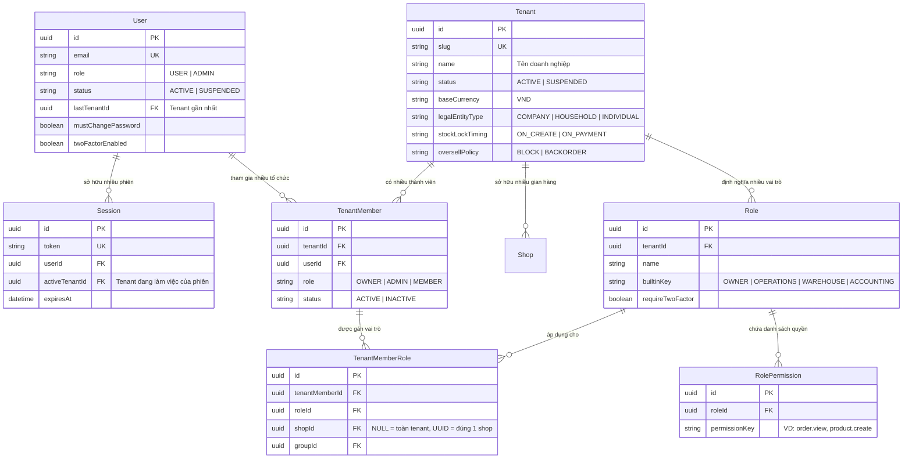
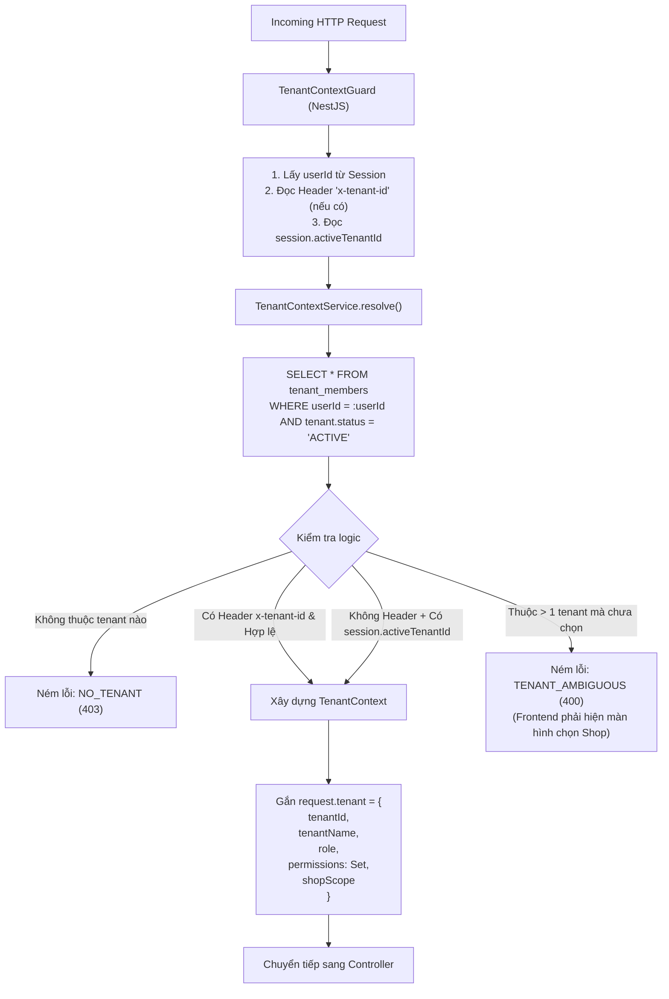

# Tài liệu Tham chiếu Kiến trúc Dự án Gốc (Source Project Reference: `api-vishop`)

Tài liệu này lưu trữ phân tích chuyên sâu về kiến trúc, mô hình dữ liệu (Database Schema), cơ chế xác thực (Authentication), giải quyết ngữ cảnh tổ chức (Tenant Context) và phân quyền (RBAC) từ dự án gốc:
* **Đường dẫn thư mục gốc**: `C:\Users\ndquynh\Documents\vi-shop\api-vishop`
* **Mục đích**: Làm cơ sở tham chiếu chuẩn để thiết kế, chuyển đổi và đối chiếu khi xây dựng nền tảng microservices Java Spring Boot trên **ViShop Platform** (`vishop-platform`).

---

## 1. Tổng quan Kiến trúc Dự án Gốc (`api-vishop`)

Dự án gốc là một hệ thống **Modular Monolith** được tổ chức theo chuẩn **DDD (Domain-Driven Design) + CQRS** trong một **Nx Monorepo**:

* **Runtime & Framework**: Node.js 24, NestJS 11/12, Fastify 5, TypeScript 6.
* **Cơ sở dữ liệu**: **1 Database PostgreSQL duy nhất** dùng chung cho toàn bộ các module, quản lý bằng **Prisma 7 ORM** (`prisma/schema.prisma`).
* **Hạ tầng hỗ trợ**: Redis 8 (Pub/Sub, rate limiting, session caching), BullMQ (Queue nền & outbox relay).
* **4 Ứng dụng Runtime (Apps)**:
  1. `api`: Cổng HTTP REST (OpenAPI/Swagger), GraphQL (Mercurius) và WebSocket (Socket.io).
  2. `worker`: Xử lý job nền bất đồng bộ (sync TikTok Shop, tồn kho, xuất nhập file).
  3. `scheduler`: Chạy cron định kỳ (dọn dẹp phiên hết hạn, kiểm toán kho, tính toán chỉ số).
  4. `migration`: Chạy Prisma migration deploy và seed dữ liệu khởi tạo.

---

## 2. Mô hình Dữ liệu Đa người thuê & Phân quyền (Prisma Schema)

Trong `api-vishop`, vì toàn bộ bảng nằm chung trong 1 Database PostgreSQL, quan hệ giữa **User - Session - Tenant - Membership - Roles** được bảo vệ bằng các ràng buộc khóa ngoại (Foreign Keys) nguyên khối:



### Chi tiết các thực thể cốt lõi trong `prisma/schema.prisma`:

#### A. Thực thể `User` (`model User` — Dòng 14-73)
* Đại diện cho **Danh tính toàn cầu (Global Identity)**.
* **`lastTenantId`**: Lưu ID của Tenant mà user thao tác gần đây nhất. Khi tạo Session mới, giá trị này tự động điền vào `Session.activeTenantId` để người dùng không phải chọn lại shop sau mỗi lần đăng nhập.

#### B. Thực thể `Session` (`model Session` — Dòng 75-99)
* Quản lý phiên làm việc dạng Cookie Session (Better Auth).
* **`activeTenantId`**: Điểm mấu chốt giải quyết bài toán đa gian hàng:
  > *Ghi chú từ source code*: "Which tenant this session acts for. Kept on the session, not the user, so the same account can sit in two tenants in two browsers."
  > *(Tenant đang active được gắn trên Session chứ KHÔNG gắn trên User. Nhờ đó, cùng một tài khoản có thể mở 2 tab trình duyệt làm việc trên 2 shop khác nhau cùng lúc mà không bị xung đột).*

#### C. Thực thể `TenantMember` (`model TenantMember` — Dòng 460-479)
* Quan hệ nhiều-nhiều (N:M) giữa User và Tenant:
  * Ràng buộc: `@@unique([tenantId, userId], where: { deletedAt: null })`. Một người dùng chỉ có 1 bản ghi thành viên còn hoạt động trong một tổ chức.
  * Cấp vai trò: `role` (`OWNER`, `ADMIN`, `MEMBER`).

#### D. Thực thể `Role` & `RolePermission` (`model Role` — Dòng 481-522)
* **4 Vai trò mặc định (Built-in Roles)**:
  1. `OWNER`: Chủ tổ chức (toàn quyền trên toàn bộ hệ thống).
  2. `OPERATIONS`: Nhân viên vận hành (xử lý đơn, quản lý thông tin sản phẩm).
  3. `WAREHOUSE`: Thủ kho (quản lý tồn kho, đóng gói, quét mã xuất nhập kho).
  4. `ACCOUNTING`: Kế toán (đối soát doanh thu sàn TMĐT, xem sao kê tài chính).
* **Custom Roles**: Cho phép Chủ shop tự tạo vai trò mới và chọn danh mục quyền tùy ý lưu tại bảng `role_permissions (roleId, permissionKey)`.

---

## 3. Cơ chế Giải quyết Ngữ cảnh (Tenant Context Resolution)

Trong `api-vishop`, module [libs/infra/tenancy](file:///C:/Users/ndquynh/Documents/vi-shop/api-vishop/libs/infra/tenancy) chịu trách nhiệm tự động xác định người dùng đang thao tác trên Tenant nào:



### Mã nguồn xử lý lõi tại `TenantContextService`:
```typescript
// Trích xuất từ libs/infra/tenancy/src/lib/tenant-context.service.ts
async resolve(userId: string, requestedTenantId?: string, sessionTenantId?: string | null): Promise<TenantContext> {
  const memberships = await this.listMemberships(userId);
  if (memberships.length === 0) throw this.noTenant();

  // Ưu tiên 1: Client truyền tường minh qua header x-tenant-id
  if (requestedTenantId) {
    const match = memberships.find((m) => m.tenantId === requestedTenantId);
    if (!match) throw this.noTenant();
    return this.toContext(match);
  }

  // Ưu tiên 2: Lấy theo activeTenantId của phiên Session hiện tại
  if (sessionTenantId) {
    const match = memberships.find((m) => m.tenantId === sessionTenantId);
    if (match) return this.toContext(match);
  }

  // Nếu user thuộc nhiều tenant nhưng chưa chỉ định -> Bắt buộc chọn
  if (memberships.length > 1) throw this.tenantAmbiguous();

  return this.toContext(memberships[0]);
}
```

---

## 4. Cơ chế Phân quyền (RBAC & Permission Guard)

Hệ thống tuân thủ nguyên tắc: **Backend kiểm tra Permission tĩnh, Giao diện quản lý theo Role**.

* **Bộ lọc phân quyền (`PermissionGuard`)**:
  ```typescript
  // libs/infra/tenancy/src/lib/permission.guard.ts
  @Injectable()
  export class PermissionGuard implements CanActivate {
    canActivate(context: ExecutionContext): boolean {
      const required = this.reflector.get<string>(PERMISSION_KEY, context.getHandler());
      const { tenant } = request;
      
      // Role OWNER tự động bypass mọi kiểm tra quyền
      if (tenant.role === TENANT_ROLES.OWNER) return true;
      
      // Kiểm tra xem Set<string> permissions có chứa quyền này không
      return tenant.permissions.has(required);
    }
  }
  ```
* **Khai báo trên Controller API**:
  ```typescript
  @RequirePermission('order.package.ship')
  @Post(':id/ship')
  async shipOrder(@Param('id') orderId: string, @CurrentTenant() tenant: TenantContext) {
    ...
  }
  ```

---

## 5. Bảng Đối chiếu Ánh xạ sang Java Spring Boot (`vishop-platform`)

Dưới đây là bảng đối chiếu trực tiếp giữa giải pháp trong dự án gốc NestJS và giải pháp đang triển khai trên Java Spring Boot Microservices:

| Thành phần kiến trúc | Dự án gốc: `api-vishop` (NestJS) | Dự án đích: `vishop-platform` (Java Microservices) |
| :--- | :--- | :--- |
| **Kiểu kiến trúc** | Modular Monolith (1 repo, 1 database). | Distributed Microservices (`api-gateway`, `identity-service`, `tenant-service`, `order-service`...). |
| **ORM / Migration** | Prisma 7 (`prisma/schema.prisma`). | Spring Data JPA / Hibernate + Flyway SQL Migration (`db/migration/V*`). |
| **Cơ chế Xác thực** | Better Auth Cookie Session (`better-auth.session_token`). | **Dual-Mode**: Opaque Session Cookie tại Gateway kết hợp Stateless Signed JWT Bearer. |
| **Tenant Context Ingestion** | NestJS `TenantContextGuard` truy vấn DB `tenant_members` in-flight. | **API Gateway Biên** bóc `tenantId` từ JWT $\rightarrow$ forward header nội bộ `X-Tenant-Id`. |
| **Quản lý Context trong Service** | `request.tenant` (Fastify Request property). | [TenantContext.java](../../platform-common/common-security/src/main/java/io/github/coreplatform/common/security/context/TenantContext.java) (`ThreadLocal<UUID>`) tự động dọn dẹp ở `finally`. |
| **Bảo vệ API / Kiểm tra Quyền** | Decorator `@RequirePermission('key')` + `PermissionGuard`. | Annotation Spring Security `@PreAuthorize("hasAuthority(CommonPermissions....)")`. |
| **Nhận diện Người dùng** | Decorator `@CurrentUser()`. | Parameter `@AuthenticationPrincipal CommonUserDetails user`. |
| **Transactional Outbox** | Bảng `outbox_events` + BullMQ Relay. | Bảng `outbox_events` + Kafka Publisher Relay ([common-persistence](../../platform-common/common-persistence)). |
| **Xử lý 1 User - Nhiều Tenant** | Nằm chung 1 DB PostgreSQL, `JOIN` trực tiếp Prisma. | Gom thành Bounded Context **`iam-service`** để giữ trọn vẹn quan hệ ACID & Foreign Keys (xem [tenancy.md Mục 4](tenancy.md#L55-L184)). |

---

## 6. Bài học & Quy tắc Kế thừa quan trọng cho `vishop-platform`

1. **Giữ nguyên 75 Danh mục Quyền tĩnh (`CommonPermissions`)**:
   * Toàn bộ mã định danh quyền (như `order.view`, `order.package.ship`, `product.view_cost_price`) trong Java [CommonPermissions.java](../../platform-common/common-security/src/main/java/io/github/coreplatform/common/security/constants/CommonPermissions.java) được chuẩn hóa $100\%$ theo mã quyền gốc của `api-vishop` để đảm bảo API contract với Frontend không bị xáo trộn.
2. **Kế thừa 4 Role chuẩn (`OWNER`, `OPERATIONS`, `WAREHOUSE`, `ACCOUNTING`)**:
   * Khi khởi tạo Tenant mới, hệ thống tự động sinh 4 vai trò này để người dùng có thể sử dụng ngay mà không cần cấu hình thủ công.
3. **Ý tưởng `activeTenantId` trên Session**:
   * Token cấp phát cho client luôn phải phản ánh **ngữ cảnh gian hàng đang chọn** (`activeTenantId`). Khi người dùng bấm đổi Shop trên giao diện, Client gọi `/switch-tenant` để cấp Token mới mang `tenantId` tương ứng.
