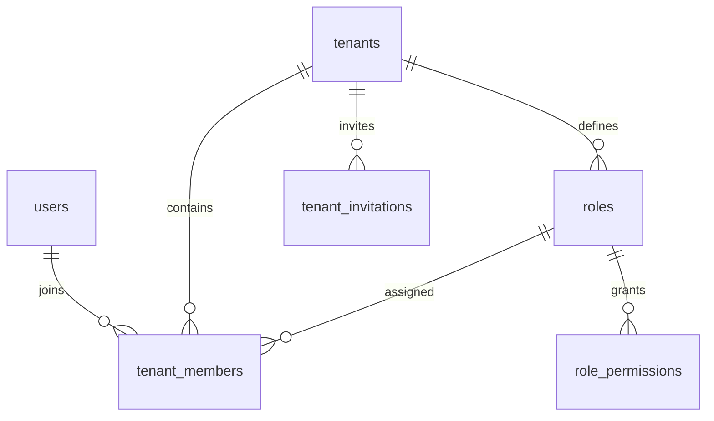

# Kiến trúc Đa người thuê (Multi-Tenancy)

## 1. Quyết định kiến trúc

ViShop chọn **`iam-service`** (Identity & Access Management) để quản lý danh tính,
quyền quản trị nền tảng, tổ chức và quyền thành viên. Database đích là **`vishop_iam`**.
User là danh tính toàn cục; dữ liệu nghiệp vụ thuộc tenant. Một user có thể tham gia
nhiều tenant và có role khác nhau ở mỗi tenant.

Tách module Identity và Tenant Access trong cùng service/database để tạo user,
tenant, OWNER membership và quyền trong một transaction khi onboarding yêu cầu.
Không gọi HTTP giữa hai service để hoàn tất transaction này.

**Trạng thái triển khai:** runtime IAM đã thay hai service cũ trong Gradle, gateway
và Docker. Repository JPA dùng schema IAM mới. Đã có API tài khoản, tenant, membership,
role, invitation, CMS và JWT access/refresh. Dữ liệu từ database cũ chưa tự động chuyển.
Xem [hướng dẫn runtime và chuyển dữ liệu](../../services/iam-service/README.md).

## 2. Thuật ngữ và phạm vi dữ liệu

* Dùng `tenant` trong tên bảng, biến và API; trên giao diện là **tổ chức**.
* `shop` là **gian hàng** thuộc tổ chức: Shopee, TikTok Shop, cửa hàng offline…
* Phân quyền ở cấp tenant, chưa phân quyền riêng từng shop. Quyền như `order.update`
  áp dụng cho tài nguyên trong tenant hiện tại, không cho mọi tenant.
* Dữ liệu nghiệp vụ shop/order/inventory thuộc bounded context nghiệp vụ tương ứng.
  Nếu khác database với IAM thì `tenant_id` là tham chiếu logic, không có foreign key
  xuyên database sang bảng `tenants`.

## 3. Hai cấp role độc lập

| Cấp | Lưu trữ | Phạm vi |
| --- | --- | --- |
| System role | `users.system_role`: `USER`, `PLATFORM_ADMIN` | Quản trị nền tảng qua CMS |
| Tenant role | `tenant_members.role_id` → `roles` → `role_permissions` | Quyền nghiệp vụ trong một tổ chức |

Không có bảng permission cho system role. API CMS kiểm tra system role do backend
cấp; không lấy từ payload đăng ký. Tenant OWNER không phải PLATFORM_ADMIN.
PLATFORM_ADMIN không mặc nhiên có membership hay quyền thao tác nghiệp vụ trong
mọi tenant. Nếu cần hỗ trợ truy cập tenant, phải thiết kế luồng riêng có audit.

Mỗi membership có một role. Role mặc định là `OWNER`, `OPERATIONS`, `WAREHOUSE`,
`ACCOUNTING`; cho phép custom role. Không giữ thêm một enum role song song trên
membership vì sẽ tạo hai nguồn quyền không nhất quán.

## 4. Schema IAM

* `users`: global identity, email, password hash, system role và trạng thái tài khoản.
  Đăng ký chỉ nhận email/password; `full_name` là dữ liệu hồ sơ tùy chọn, ban đầu null.
  Không có `tenant_id` hoặc tenant role. `last_tenant_id` nullable chỉ ghi nhớ lựa chọn
  đăng nhập; không thay thế membership hay tenant trong JWT. Email unique không phân biệt hoa thường.
* `tenants`: định danh, code, tên và trạng thái `ACTIVE`, `SUSPENDED`, `ARCHIVED`.
* `roles`: role thuộc một tenant; tên và built-in key unique trong tenant đó.
* `role_permissions`: danh sách permission tĩnh của tenant role. Hiện code có **34**
  key trong `CommonPermissions`; schema và kiểm thử bám theo danh mục thực tế.
* `tenant_members`: unique `(tenant_id, user_id)`, có `role_id`, trạng thái
  `ACTIVE`/`INACTIVE`. Khi tái gia nhập thì kích hoạt lại membership cũ.
* `tenant_invitations`: email, role, người mời, thời hạn, trạng thái và hash token.
* `outbox_events`, `consumed_messages`: event publication và idempotent consumption.

Composite foreign keys keep membership/invitation roles in the same tenant. Invitation
participants must have the expected membership. JWT tenant selection is validated in IAM;
there is no session table or persisted active tenant. There are no shop-scoped role grants.

Insert tenant tự sinh bốn built-in role và permission mặc định trong cùng transaction.
Application phải tạo OWNER membership trong transaction onboarding; trigger không tự
chọn user làm owner. Backend phải bảo vệ owner cuối cùng, xác minh email nhận lời mời
và kiểm tra status/MFA/permission. Foreign key không thay thế các kiểm tra này.

## 5. Luồng HTTP và chọn tenant

Gateway reads the access cookie and verifies JWTs locally; downstream uses verified Bearer access.
Authentication does not read
session state, Redis or IAM introspection. Client-supplied tenant headers confer no authority.

1. Login/register set HttpOnly access/refresh cookies and return grants without tokens;
   tenant can be null. Login prefers
   `users.last_tenant_id` if its membership and tenant are ACTIVE, otherwise auto-selects
   the only active membership or returns null when zero/multiple memberships remain.
   The selected tenant is authorized before tokens are issued and the preference is saved;
   stale preferences are replaced or cleared. Null tenant plus an empty/nonempty tenant
   list lets the frontend choose `/no-tenant` or `/select-tenant`.
2. List active memberships, create a tenant or accept an invitation.
3. Switch tenant with auth cookies plus `{tenantId}`. IAM checks active
   membership and grants before setting cookies carrying the selected tenant and saving
   `last_tenant_id` for future logins. Rejected switches leave the preference unchanged.
4. Business APIs require tenant context and permission; CMS checks system role separately.
5. Refresh with the refresh cookie and no body even after access expiry. IAM reads current account/grants.

Browser tabs share auth cookies and the selected tenant. Tenant selection is carried in
signed claims, with no mutable session selection. The remembered tenant is a login
preference, not authorization state; refresh does not read or overwrite it. Access defaults to 15 minutes and refresh
to seven days. Refresh preserves the absolute refresh expiry. Logout records audit and the
browser clears cookies; existing JWTs remain valid until expiry. Unsafe requests require
`X-Requested-With: XMLHttpRequest`, and frontend fetch uses `credentials: 'include'`. MFA is not implemented;
roles requiring MFA remain blocked until the appropriate verification flow exists.
See [security architecture](security-architecture.md).

## 6. Cô lập dữ liệu nghiệp vụ và messaging

* [InternalHeaderAuthFilter](../../libs/common-security/src/main/java/io/github/coreplatform/common/security/filter/InternalHeaderAuthFilter.java)
  xác minh token và dựng principal/TenantContext, dọn context trong `finally`.
* [TenantContext](../../libs/common-security/src/main/java/io/github/coreplatform/common/security/context/TenantContext.java)
  chỉ mang context; repository vẫn phải lọc tenant, kể cả truy vấn theo ID.
  Cột `tenant_id` trên entity không tự ngăn truy vấn chéo tenant. Schema IAM hiện
  chưa bật PostgreSQL RLS.
* Event nghiệp vụ mang tenant context. Consumer phải thiết lập context trong phạm vi
  xử lý record, dọn sau khi xử lý, và kiểm tra tính nhất quán giữa tenant trong
  envelope/header. Event danh tính toàn cục có thể không có tenant.
* `outbox_events` phải được ghi trong cùng transaction với thay đổi nghiệp vụ;
  consumer xử lý trùng theo `consumed_messages`.

## 7. Trình tự chuyển đổi

1. Chuẩn bị `vishop_iam` bằng bộ migration riêng của `iam-service` và kiểm thử ràng buộc.
2. Lập mapping dữ liệu/role cũ; kiểm tra user tham chiếu tenant không tồn tại và email
   trùng khi bỏ phân biệt hoa thường. Không biến legacy OWNER/ADMIN thành system admin.
3. Runtime mới đã dùng repository, onboarding, membership, RBAC, JWT access/refresh và CMS của IAM.
4. Dừng writer cũ, backup/import dữ liệu với ID giữ nguyên, xác minh owner/quyền/outbox.
5. Source đã đổi cấu hình và route sang IAM. Khi triển khai, vô hiệu hóa token cũ và ngừng container cũ.

Giữ nguyên Flyway history và database cũ để chuyển dữ liệu/rollback. Không trỏ hai service
cũ vào IAM hoặc xóa volume để áp dụng schema mới.

Tham khảo thêm [kiến trúc dự án gốc](source-project-architecture-reference.md).
