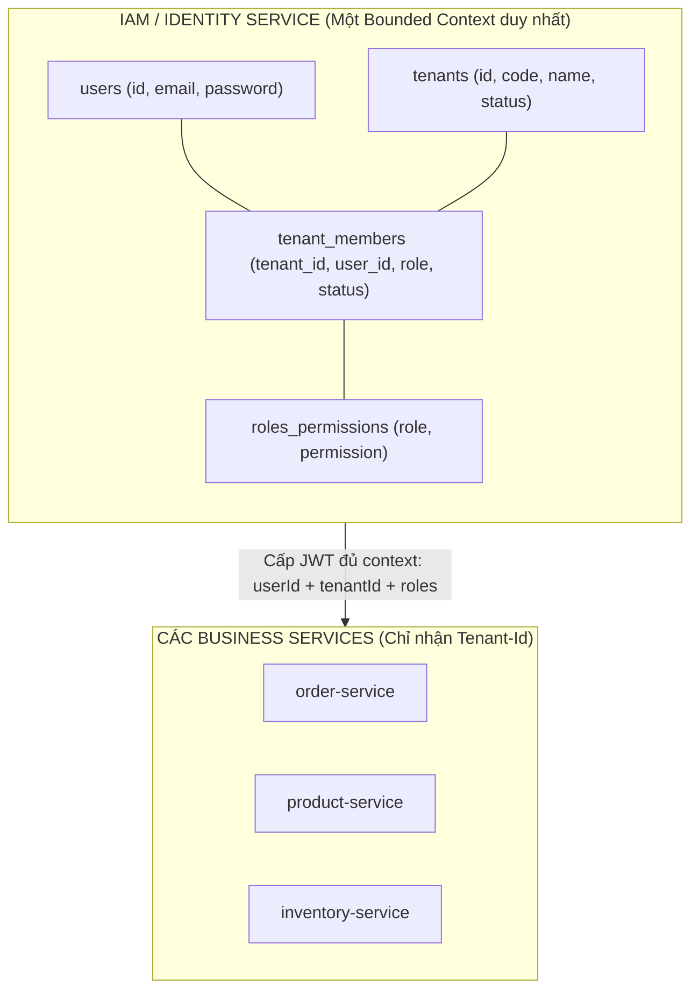
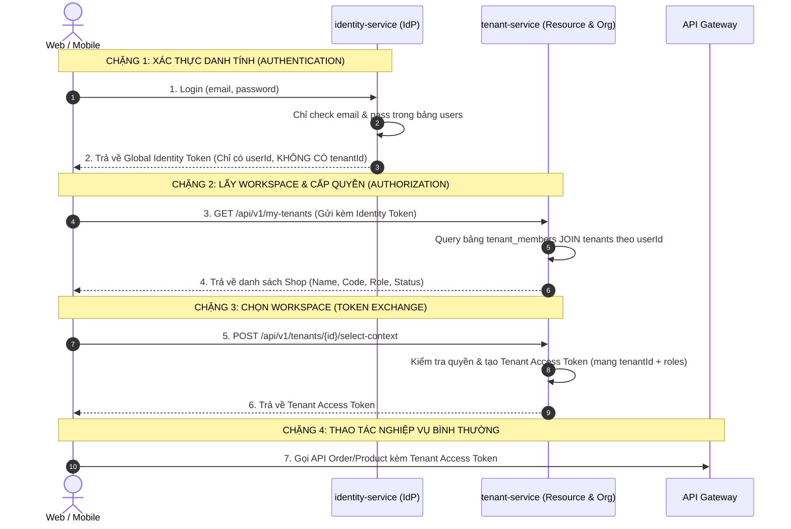

# Kiến trúc Đa người thuê (Multi-Tenancy)

Mọi dữ liệu nghiệp vụ trong nền tảng **ViShop Platform** đều thuộc về một **Tenant** (tổ chức / doanh nghiệp), không trực thuộc trực tiếp một User đơn lẻ. Một người dùng có thể là thành viên của nhiều Tenant khác nhau.

---

## 1. Thuật ngữ chuẩn (Naming Convention)

Khái niệm này có tên gọi duy nhất trong toàn bộ mã nguồn: **`tenant`**.
* Không sử dụng các từ thay thế như `workspace`, `organization` hay `company` trong tên bảng, cột, biến hoặc API path.
* Trên giao diện tiếng Việt, `tenant` được dịch là **"tổ chức"**; `shop` là **"gian hàng"**. Một tổ chức có thể sở hữu và liên kết nhiều gian hàng.

---

## 2. Mô hình phân cấp dữ liệu (Hierarchical Data Model)

Quy tắc cốt lõi: **Một Tenant sở hữu nhiều Shops (Gian hàng đa kênh: Shopee, TikTok Shop, Lazada...). Tất cả nhân viên của Tenant có quyền quản lý toàn bộ các Shop trực thuộc.** Do đó, `shops` được gắn trực tiếp với `tenants`, không phân quyền vi mô theo từng shop.

```text
users ──< tenant_members >── tenants ──< shops (Shopee, TikTok, Lazada...)
                                │
                                ├──< roles ──< role_permissions
                                │
                                └──< tenant_invitations
```

### 2.1. Giải nghĩa các thực thể & mối quan hệ
1. **`users`**: Danh tính toàn cầu của người dùng (email, password băm, system role).
2. **`tenant_members`**: Quan hệ N:M giữa User và Tenant. Lưu trữ vai trò của thành viên trong tổ chức (`role`: `OWNER`, `STAFF`, `ACCOUNTANT`).
3. **`tenants`**: Tổ chức / Doanh nghiệp kinh doanh. Là ranh giới cô lập dữ liệu tuyệt đối (Data Isolation Boundary).
4. **`shops`**: Các gian hàng bán lẻ trên từng kênh/sàn (Shopee, TikTok Shop, Lazada, Cửa hàng offline...).
   * Khóa ngoại trực tiếp: `shops.tenant_id REFERENCES tenants(id)`.
   * **Toàn quyền truy cập nội bộ**: Bất kỳ thành viên nào thuộc Tenant đều thao tác được trên toàn bộ các Shop của Tenant đó (dựa trên quyền hạn chức vụ, ví dụ: `STAFF` được sửa đơn trên mọi sàn; `ACCOUNTANT` được xem doanh thu của mọi shop).
5. **`roles` & `role_permissions`**: Danh mục vai trò và danh sách quyền tĩnh cấp tổ chức.
6. **`tenant_invitations`**: Quản lý lời mời tham gia tổ chức qua email.

### 2.2. Lợi ích kiến trúc của việc gắn trực tiếp `shops` vào `tenants`
* **Loại bỏ bảng phức tạp**: Không cần bảng trung gian `tenant_member_roles` để phân quyền chéo từng shop.
* **Tối ưu hóa Token & Gateway**:
  * Token JWT không cần mang mảng `accessibleShopIds`.
  * API Gateway không cần inject header `X-User-Shops`. Gateway chỉ cần kiểm soát duy nhất `X-Tenant-Id`.
* **Phù hợp bản chất Omnichannel**: Nền tảng ViShop sinh ra để quản lý bán hàng đa kênh tập trung (quản lý tồn kho chung, gom đơn hàng loạt từ TikTok/Shopee về một màn hình), nhân viên cần tầm nhìn xuyên suốt mọi gian hàng của doanh nghiệp.

---

## 3. Cơ chế cô lập Tenant trong Microservices

### 3.1. Luồng HTTP Request (REST API)
1. Client gửi request kèm header `X-Tenant-Id: <uuid>`.
2. [TenantContextFilter.java](../../platform-common/common-security/src/main/java/io/github/coreplatform/common/security/TenantContextFilter.java) (Spring OncePerRequestFilter) tự động:
   * Trích xuất giá trị UUID từ header `X-Tenant-Id`.
   * Gán vào [TenantContext.java](../../platform-common/common-security/src/main/java/io/github/coreplatform/common/security/TenantContext.java) (`ThreadLocal<UUID>`).
   * Thực thi request chain.
   * Gọi `TenantContext.clear()` trong khối `finally` để giải phóng thread an toàn.

### 3.2. Luồng Kafka Event (Asynchronous Messaging)
1. Khi phát hành event ra Kafka, [KafkaEventPublisher.java](../../platform-common/common-events/src/main/java/io/github/coreplatform/common/events/publisher/KafkaEventPublisher.java) tự động đính kèm header Kafka `X-Tenant-Id`.
2. Khi Consumer nhận record, [TenantRecordInterceptor.java](../../platform-common/common-events/src/main/java/io/github/coreplatform/common/events/consumer/TenantRecordInterceptor.java) trích xuất header này và thiết lập vào `TenantContext` trước khi `@KafkaListener` xử lý, sau đó giải phóng context khi hoàn tất.

### 3.3. Tầng lưu trữ (Database Persistence)
* Toàn bộ Entity JPA của dữ liệu phân tán theo tenant kế thừa từ [BaseTenantJpaEntity.java](../../platform-common/common-persistence/src/main/java/io/github/coreplatform/common/persistence/BaseTenantJpaEntity.java):
  ```java
  @MappedSuperclass
  public abstract class BaseTenantJpaEntity {
      @Column(name = "tenant_id", nullable = false, updatable = false)
      private UUID tenantId;
      ...
  }
  ```
* Bất kỳ câu truy vấn lọc theo tenant đều sử dụng `TenantContext.requiredTenantId()` hoặc tham số `tenantId` từ Query object để đảm bảo tuyệt đối không rò rỉ dữ liệu chéo giữa các tenant.

---

## 4. Bài toán 1 User thuộc nhiều Tenant & Phân định Ranh giới Dịch vụ (Service Decomposition & Bounded Contexts)

Đây chính là **"The Million-Dollar Question"** kinh điển nhất trong kiến trúc Microservices: **Vấn đề ranh giới Bounded Context giữa Xác thực (Identity) và Quản lý Tổ chức (Tenant/Organization).**

Khi chuyển sang mô hình 1 User thuộc nhiều Tenant, nếu máy móc tách thành 2 database độc lập (`identity_db` và `tenant_db`), hệ thống sẽ ngay lập tức đối mặt với **3 mâu thuẫn nhức nhối**:

### 4.1. 3 Mâu thuẫn cốt tử khi tách Service & Database

```text
       [identity-service] (DB 1)                 [tenant-service] (DB 2)
     ┌─────────────────────────┐               ┌─────────────────────────┐
     │ Bảng: users             │               │ Bảng: tenants           │
     │ - id, email, password   │               │ - id, code, name        │
     └────────────┬────────────┘               └────────────┬────────────┘
                  │                                         │
                  └──────────────► ??? ◄────────────────────┘
                          BẢNG "tenant_members" 
                          NẰM Ở SERVICE NÀO?
```

1. **Nếu đặt `tenant_members` ở `identity-service`:**
   * Làm sao lấy được Tên shop, Logo, Gói cước để hiển thị cho User chọn lúc login? (Không thể `JOIN` với bảng `tenants` vì khác Database!).
   * Chẳng lẽ mỗi lần user login, `identity-service` phải gọi HTTP sang `tenant-service` để hỏi: *"Lấy cho tôi tên của các tenant_id này"*? (Tạo ra network hop, coupling cao).
2. **Nếu đặt `tenant_members` ở `tenant-service`:**
   * Khi user login vào `identity-service`, `identity-service` **hoàn toàn mù tịt** không biết user này có shop nào để cấp JWT chứa `tenantId` hay danh sách quyền!
3. **Mất toàn bộ Foreign Key (Ràng buộc toàn vẹn):**
   * Nếu user bị xóa ở DB 1, ai dọn dẹp quan hệ ở DB 2?
   * Khi tạo mới 1 Tenant ở DB 2, ai gán quyền `OWNER` cho user ở DB 1? (Rơi vào bẫy Distributed Transaction / Saga).

---

### 4.2. Các Giải pháp Kiến trúc Thực tế trong Ngành

Có **2 trường phái kiến trúc chuẩn** để giải quyết triệt để bài toán này:

#### Hướng 1: Gộp Bounded Context thành `iam-service` (Identity & Access Management)
*(Mô hình thực dụng nhất — Được đa số hệ thống SaaS vừa và lớn áp dụng)*

Bản chất nghiệp vụ: **"User là ai" (Identity)**, **"Tổ chức là gì" (Tenant)** và **"User làm gì trong tổ chức" (Membership & Role)** thực chất đều thuộc cùng một Domain lớn là **IAM (Identity & Access Management)**. Việc xé nhỏ chúng ra 2 microservices từ đầu là biểu hiện của **Over-engineering (Tách sai Bounded Context)**.



* **Cơ chế hoạt động:**
  * Toàn bộ: `users`, `tenants`, `tenant_members`, `roles` nằm chung trong DB của `identity-service` (hoặc đổi tên thành `iam-service`).
  * `tenant-service` nếu còn tồn tại thì chỉ đóng vai trò quản lý các nghiệp vụ thương mại của Shop (Subscription, Hạn mức gói cước, Cài đặt giao diện, Hồ sơ thuế KYC).
* **Ưu điểm:**
  * **Trọn vẹn quan hệ (ACID):** `JOIN` bình thường giữa user - membership - tenant - role trong 1 query duy nhất.
  * Đăng nhập, chọn shop, phân quyền, cấp JWT xử lý mượt mà trong 1 transaction, tốc độ dưới 5ms.
  * Không cần gọi HTTP nội bộ, không cần Saga phân tán khi tạo shop.

---

#### Hướng 2: Tách Rời Hoàn Toàn theo chuẩn IdP / OAuth2 (Kiểu Auth0, Clerk, Keycloak)
*(Mô hình phân tán chuẩn Enterprise — Áp dụng khi tách biệt Auth độc lập)*

Nếu nhất quyết giữ `identity-service` và `tenant-service` là 2 microservices riêng biệt, ta phải áp dụng mô hình **2-Step Authentication (Token Exchange)**:



* **Phân chia Database:**
  * `identity-service` DB: Chỉ có bảng `users (id, email, password_hash, status)` $\rightarrow$ Chức năng duy nhất là cấp phát danh tính (Identity Provider - IdP).
  * `tenant-service` DB: Chứa bảng `tenants` và bảng `tenant_members (tenant_id, user_id, role, status)` $\rightarrow$ Toàn quyền quản lý phân quyền và nhân sự trong shop.
* **Ưu điểm:** Tách biệt tuyệt đối về trách nhiệm. `identity-service` có thể dùng cho nhiều ứng dụng khác nhau mà không dính tới logic tenant.
* **Nhược điểm:** Phức tạp hóa luồng đăng nhập (Handshake 2 bước), phải quản lý chia sẻ Private/Public Key ký JWT giữa 2 services.

---

### 4.3. Bảng So sánh & Khuyến nghị Lựa chọn cho ViShop

| Tiêu chí | Hướng 1: Gộp thành `iam-service` (Khuyên dùng) | Hướng 2: Tách IdP & Tenant Membership |
| :--- | :--- | :--- |
| **Độ phức tạp hệ thống** | **Thấp**: Rất trực quan, code gọn gàng, ít lỗi phát sinh. | **Cao**: Cần token exchange, distributed event, quản lý key. |
| **Hiệu năng Đăng nhập** | **Cực nhanh**: 1 câu `SELECT ... JOIN` lấy xong user + danh sách tenant + roles. | **Chậm hơn**: Phải gọi 2-3 chặng mạng mới có được token làm việc. |
| **Độ tin cậy dữ liệu** | **Tuyệt đối**: Dùng Foreign Key của PostgreSQL bảo vệ toàn vẹn. | **Eventually Consistent**: Dễ bị mồ côi dữ liệu nếu đồng bộ lỗi. |
| **Khả năng mở rộng** | Dư sức chịu tải hàng triệu user / shop. | Thích hợp cho tập đoàn có hàng chục sản phẩm dùng chung 1 cổng ID. |

> [!IMPORTANT]
> **Khuyến nghị hành động cho Dự án ViShop:**
> 
> **Giải pháp tối ưu nhất cho ViShop hiện tại là Hướng 1:**
> 1. Chuyển bảng `tenants` và tạo bảng `tenant_members` về chung DB với `users` (trong `identity-service` — hoặc đổi tên thành **`iam-service`**).
> 2. `tenant-service` hiện tại nếu giữ thì chuyển hướng thành **`store-service` / `billing-service`** (chuyên lo cấu hình kênh bán Shopee/TikTok, gói cước, cài đặt kho bãi).
> 3. Như vậy sẽ giải quyết sạch sẽ bài toán `1 User - Nhiều Tenant`, vừa có Foreign Key toàn vẹn, vừa giúp API Gateway bóc tách context một cách nhẹ nhàng nhất.

---

> [!TIP]
> Để đối chiếu chi tiết cách dự án gốc NestJS (`api-vishop`) tổ chức schema Prisma, Better Auth Session và NestJS Guards, xem tài liệu: **[Source Project Architecture Reference](./source-project-architecture-reference.md)**.
