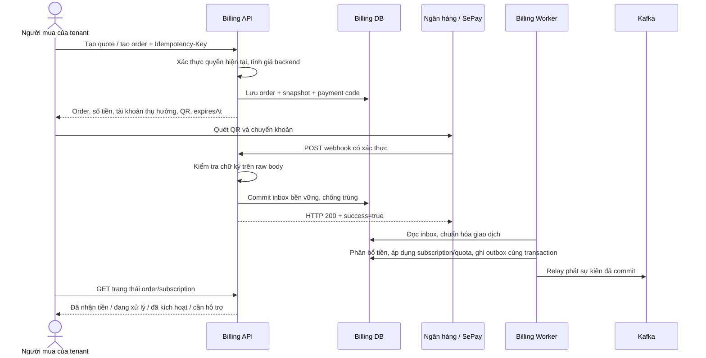

# Thiết kế gói trả phí và thanh toán QR qua SePay

Ngày đối chiếu: 29/10/2026. Trạng thái: đã có runtime đầu tiên tại
[`subscription-service`](../../services/subscription-service/README.md) cho catalog giá,
mua/gia hạn QR, webhook inbox, payment ledger, subscription terms và outbox.
Các phần quote nâng/hạ gói, add-on/quota enforcement, hóa đơn, hoàn tiền và đối soát
API ngân hàng trong tài liệu này vẫn là thiết kế lộ trình.

Schema runtime hiện là [Database V2](../../services/subscription-service/docs/database-design.md):
9 bảng với catalog plan/price, subscription/order/term, canonical payment, allocation
ledger, webhook inbox và outbox. Tên bảng trong các phần lộ trình bên dưới là mô hình
dự kiến cho nghiệp vụ mở rộng, không thay thế schema runtime V2.

**Đã chốt:** khách chuyển khoản bằng QR và chủ động mua/gia hạn; không lưu thẻ, không tự trừ tiền.
**Đơn vị mua gói:** tenant. User là người thao tác/thanh toán, không phải chủ thể sở hữu gói.
Đây là tiền dịch vụ ViShop thu từ tenant; không phải tiền mua hàng của khách tại shop hoặc đối soát sàn M12.

Thiết kế kế thừa M15 và BR-15-01 đến BR-15-06 trong
[PRD](vishop-prd-v1.0.md#m15--gói-cước--billing) và [build spec](vishop-build-spec-v1.2.md#m15--gói-cước--billing).
Các mặc định kỹ thuật và lựa chọn thương mại mới bên dưới là đề xuất; không phải tính năng đã có trong code.

## 1. Phạm vi và ranh giới

- Mua gói lần đầu, gia hạn cùng gói, nâng cấp giữa kỳ, hạ gói kỳ sau, mua quota đơn bổ sung.
- Tạo yêu cầu thanh toán, hiển thị QR, tiếp nhận tiền, đối soát, cấp thời hạn/quota và tra cứu lịch sử.
- Xử lý tiền thiếu/thừa, nhiều lần chuyển khoản, webhook trùng, thanh toán muộn và hoàn tiền thủ công.
- Ghi nhận thông tin xuất hóa đơn; phát hành hóa đơn là quy trình riêng với xác nhận thanh toán.
- Tự thu tiền định kỳ, thẻ, affiliate và hoàn tiền tự động chưa thuộc tích hợp này.

Chọn **SePay Webhooks + QR chuyển khoản**, không trộn hợp đồng với SePay Payment Gateway/IPN.
Nếu bổ sung thẻ sau này, tạo adapter và quy trình checkout riêng cho sản phẩm gateway đó.

Billing là nghiệp vụ riêng, runtime tại `services/subscription-service` gồm module
`subscription` và `payment`, nối qua interface công khai và composition trong cùng transaction.
Không đưa giá gói, giao dịch ngân hàng hay subscription vào IAM. Billing sở hữu DB của mình;
`tenantId`/`actorId` là external reference, không join hoặc tạo foreign key sang IAM DB.

| Thành phần | Sở hữu |
| --- | --- |
| IAM `identity` | User, mật khẩu/JWT, system role |
| IAM `tenant` | Tenant, membership, role và permission |
| Billing | Catalog giá, đơn mua gói, khoản tiền nhận, subscription, quota, hóa đơn/hoàn tiền |
| Audit | Bản ghi sự kiện nghiệp vụ đã phát qua Kafka |
| Các service nghiệp vụ | Quyết định cho thao tác của mình chạy dựa trên quyền IAM và entitlement/quota |

Không cần tách payment, subscription, quota thành ba microservice: giữ chung Billing DB để
ghi nhận thanh toán và cấp gói trong một transaction. Trong service dùng các package use case
`catalog`, `checkout`, `payment`, `subscription`, `quota`, không tạo chuỗi API nội bộ cho mỗi hàm.

## 2. Catalog gói và quyền sử dụng

Giữ các hạn mức định hướng của PRD, chưa tự đặt giá bán:

| Plan code | Tên | Shop | Đơn/tháng | Thành viên bổ sung |
| --- | --- | ---: | ---: | ---: |
| FREE | Miễn phí | 1 | 300 | 1 |
| BASIC | Cơ bản | 3 | 3.000 | 3 |
| PRO | Chuyên nghiệp | 10 | 15.000 | 10 |
| BUSINESS | Doanh nghiệp | 30 | 50.000 | 30 |
| CUSTOM | Thỏa thuận | Cấu hình | Cấu hình | Cấu hình |

Đề xuất làm rõ cách đếm: `additionalMembers = max(0, activeMembershipCount - 1)`.
Chỉ trừ một suất chủ tenant; không miễn phí tất cả user mang role OWNER. Invitation chưa accept
chưa chiếm suất. Giá trị này cần được xác nhận khi công bố bảng giá cho khách.

- Mỗi lần thay đổi giá/quyền tạo `plan_version` mới; không sửa ngược phiên bản đã bán.
- Price có `currency=VND`, chu kỳ `MONTHLY`/`YEARLY`, trạng thái và thời gian hiệu lực.
- Số tiền dùng số nguyên VND (`long`/`BIGINT`), không dùng float/double. Phép prorate dùng `BigDecimal`.
- Đơn lưu snapshot plan, chu kỳ, giá, chiết khấu, thuế, hạn mức, công thức và phiên bản chính sách.
- Backend tính giá; client chỉ chọn `priceId`, loại mua và số lượng. Không tin `amount` gửi từ client.
- Quote/order đã phát hành giữ giá trong thời hạn thanh toán. Thay catalog không đổi số tiền của đơn cũ.
- CUSTOM được CMS cấu hình sau phê duyệt thương mại; không cho khách tự nhập giá/hạn mức.

`Permission` và `entitlement` khác nhau: user có `order.print` chưa đủ để in nếu tenant đang bị
khóa thao tác ghi do hết hạn hoặc vượt quota. Ngược lại, mua gói không cấp role/permission IAM.

## 3. Quy tắc mua, gia hạn và đổi gói

### Mua và gia hạn

- Tenant mới có FREE không có hạn paid term; thanh toán thành công mới kích hoạt paid plan.
- Còn hạn, gia hạn cùng gói: thêm kỳ bắt đầu tại cuối thời hạn đã mua, không mất ngày còn lại.
- Đã hết hạn: kỳ mới bắt đầu lúc được kích hoạt, không truy thu khoảng gián đoạn.
- Kỳ có dạng `[startsAt, endsAt)`. Lưu UTC; tính tháng/năm theo `Asia/Ho_Chi_Minh`.
- Chu kỳ là tháng/năm lịch, không mặc định tháng = 30 ngày hoặc năm = 365 ngày.
- Giữ anchor ngày/thời điểm ban đầu; tháng thiếu ngày thì lấy ngày cuối tháng đó, không làm trôi
  anchor cho các kỳ sau. Ví dụ anchor 31: tháng 2 dùng ngày cuối tháng, tháng 3 quay về 31.
- `subscription_terms` lưu từng kỳ đã mua; một đơn không được cộng thêm thời hạn hai lần.

### Nâng cấp giữa kỳ

Không sửa gói chỉ vì đã tạo QR. Backend phát quote theo subscription/version hiện tại:

```text
unusedCredit = floor(giá thực trả của phần dịch vụ chưa dùng)
targetValue  = ceil(giá phần thời gian tương ứng của gói mới)
amountDue    = max(0, targetValue - unusedCredit)
```

Tỷ lệ thời gian tính bằng giây trên độ dài thực của từng term. Nếu có các kỳ đã trả trước,
quote bao gồm toàn bộ các đoạn chưa sử dụng trong paid horizon; hiển thị rõ ngày kết thúc mới,
không bỏ quên hoặc âm thầm làm mất kỳ đã mua. Nâng cấp giữ paid horizon, thay plan cho các đoạn đó.
Giá cũ dùng snapshot thực trả, không dùng giá catalog hiện tại. Thuế và cách làm tròn được snapshot.

Credit này là khấu trừ dịch vụ chưa dùng, không phải tiền mặt hay ví cho khách rút.
Nếu amountDue = 0, xử lý bằng đơn điều chỉnh nội bộ có căn cứ quote; không tạo giao dịch SePay giả.
Mua thêm thời hạn đồng thời đổi cycle là quote riêng, không suy diễn từ endpoint nâng cấp.

### Hạ gói và mua quota

- Theo BR-15-04: chỉ hạ ở kỳ gia hạn, khi số shop/thành viên đáp ứng giới hạn mới.
- Yêu cầu hạ gói là thay đổi có lịch. Kiểm tra lại giới hạn tại thời điểm hiệu lực; nếu không còn
  đáp ứng, chuyển `BLOCKED_REVIEW`, không xóa shop/user hoặc coi lịch đã áp dụng thành công.
- Nếu đã thu tiền kỳ hạ gói nhưng chưa thể áp dụng, hiển thị đã nhận tiền/chờ xử lý và thông báo vận hành.
- Gói quota bổ sung chỉ tăng allowance của cycle đã chỉ định; không tự gia hạn subscription.
- Nâng gói không reset số đơn đã dùng trong tháng; quota đã mua thêm vẫn có hiệu lực đến cuối cycle.

## 4. Quote, đơn mua và tiền đã nhận

Tách ba khái niệm: **thỏa thuận mua**, **sự thật tiền vào**, **kết quả cấp quyền**.

| Đối tượng/trạng thái | Ý nghĩa |
| --- | --- |
| Quote | Giá và tác động dự kiến, có `expiresAt` và `expectedSubscriptionVersion` |
| Order `AWAITING_PAYMENT` / `PARTIALLY_PAID` | Chưa nhận đủ tiền cho đơn |
| Order `FULFILLED` | Đã áp dụng đầy đủ tác động dịch vụ |
| Order `EXPIRED` / `CANCELLED` | Không còn tự động chấp nhận theo đề nghị ban đầu |
| Order `REQUIRES_REVIEW` | Tiền/giá/trạng thái không đủ điều kiện tự cấp |
| `paymentState` UNPAID/PARTIAL/PAID | Dựa trên tổng tiền đã được phân bổ hợp lệ, độc lập fulfillment |
| Fulfillment PENDING/APPLIED/REVIEW | Đơn đã được cấp gói/quota hay còn chờ xử lý |

Đề xuất thời hạn thanh toán 30 phút, cấu hình được. Quote upgrade có thể ngắn hơn; checkout
phải xác nhận lại giá nếu quote hết hạn. Đây là chính sách ViShop, không phải hạn chuyển tiền do QR áp đặt.

- Một tenant chỉ có một đơn thay đổi subscription đang chờ tiền; dùng unique partial index để chặn race.
- Tạo lại cùng `Idempotency-Key` và cùng payload trả đơn cũ; khác payload trả 409.
- Khóa idempotency có scope `(tenantId, actorId, operation, key)`, lưu cùng request hash/orderId.
- Các đơn khác key vẫn phải tuân thủ quy tắc đơn đang mở. Add-on có thể tách riêng theo cycle.
- Mỗi order có payment code duy nhất, không tái sử dụng kể cả sau hủy/hết hạn.
- Mã đề xuất: tiền tố `VS` + hậu tố ngẫu nhiên đủ mạnh; cấu hình pattern tương ứng trên SePay.
- Không chứa tenantId, userId hoặc email trong nội dung chuyển khoản.
- Xóa QR khỏi UI hoặc hủy order không ngăn được ngân hàng nhận một khoản chuyển đến sau đó.

Pattern nhận diện code phải được bật và kiểm thử với nội dung chuyển khoản thực tế.
[Nguồn SePay: cấu hình mã thanh toán](https://developer.sepay.vn/vi/sepay-webhooks/cau-hinh-ma-thanh-toan).

## 5. Luồng thanh toán



Frontend polling trạng thái order, đề xuất mỗi 3 giây rồi giãn dần. SSE là tối ưu về sau.
Không dùng việc quét QR, quay về trang thành công, ảnh biên lai hoặc client callback để đánh dấu PAID.
Trang checkout chỉ hiển thị “đã kích hoạt” khi fulfillment APPLIED, không chỉ khi nhận tiền.

## 6. Đối chiếu SePay và hợp đồng adapter

### QR

Tài liệu QR hiện mô tả URL ảnh `https://vietqr.app/img` với `acc`, `bank`, `amount`, `des`.
Backend dựng các giá trị từ order và tài khoản nhận tiền đã cấu hình, URL-encode nội dung.
QR chỉ điền sẵn lệnh chuyển tiền; không phải bằng chứng thanh toán.
[Nguồn SePay: tạo QR](https://developer.sepay.vn/vi/tien-ich-khac/tao-qr-code).

### Webhook

Các trường cần adapter chuẩn hóa:

| SePay Webhooks | Dữ liệu nội bộ |
| --- | --- |
| `id` | provider webhook transaction ID, lưu dạng chuỗi |
| `gateway`, `accountNumber`, `subAccount` | Danh tính tài khoản nhận |
| `code`, `content` | Mã order và nội dung gốc |
| `transferType`, `transferAmount` | Chiều tiền, số nguyên VND |
| `transactionDate` | Giờ Việt Nam, chuyển sang Instant |
| `referenceCode` | Tham chiếu ngân hàng, có thể rỗng |

ID webhook giữ nguyên khi retry/replay. ACK dùng HTTP 200 với `{"success":true}`;
SePay yêu cầu phản hồi hợp lệ trong 30 giây. Chỉ ACK sau commit inbox, không chờ worker.
[Nguồn SePay: tích hợp webhook](https://developer.sepay.vn/vi/sepay-webhooks/tich-hop-webhook).

### Xác thực và HTTP boundary

Chọn HMAC-SHA256 cho production. SePay dùng `X-SePay-Signature: sha256=...` và
`X-SePay-Timestamp`; dữ liệu ký là `{timestamp}.{raw_body}`. So sánh constant-time,
kiểm tra cửa sổ timestamp 5 phút, đồng bộ clock. Không parse/serialize lại JSON trước khi xác thực.
[Nguồn SePay: xác thực](https://developer.sepay.vn/vi/sepay-webhooks/xac-thuc).

- Gateway chỉ miễn JWT đúng route POST webhook; Billing xác thực HMAC riêng. Các route người dùng vẫn cần JWT.
- Không dùng lại secret IAM/JWT làm SePay secret. Giữ raw body không đổi khi proxy qua gateway.
- Body vượt giới hạn hoặc JSON không hợp lệ: 400/413; sai xác thực: 401; DB chưa commit được: 503.
- Payload xác thực hợp lệ nhưng không khớp order: lưu UNMATCHED/REVIEW rồi ACK, không để retry thay nghiệp vụ.
- Duplicate đã lưu bền vững: ACK lại, không tạo grant mới. Cùng ID nhưng dữ liệu tài chính khác: cảnh báo, không ghi đè.
- Không nhận header tenant/user của webhook làm identity. Tenant được suy ra từ order đã lưu.
- Test và live dùng connection, secret và tập dữ liệu tách biệt; không cho dữ liệu test cấp gói production.
- Payload gửi thử có ID mock như `0` chỉ được ghi nhận kiểm tra kết nối, không cấp gói hoặc tạo khoản tiền thật.
  [Nguồn SePay: gửi thử](https://developer.sepay.vn/vi/sepay-webhooks/xu-ly-loi).
- Job xử lý lại inbox dùng record đã được xác thực, không tái gửi một request công khai với timestamp cũ.
- Cửa sổ timestamp là tuổi chữ ký request, không phải giới hạn tuổi của giao dịch ngân hàng khi đối soát.

## 7. Chuẩn hóa và chống trùng tiền nhận

Webhook `id` là số, nhưng transaction API v2 có ID UUID và `reference_number`.
Không coi hai ID đó là một và không deduplicate bằng số tiền/thời gian/nội dung gần giống.
[Nguồn SePay: transaction API v2](https://developer.sepay.vn/vi/sepay-api/v2/giao-dich/danh-sach).

Hai lớp chống trùng:

1. Inbox: unique `(providerConnectionId, sourceKind, sourceTransactionId)` cho từng nguồn webhook/API.
2. Bank transaction chuẩn hóa: unique canonical transaction identity; nhiều source alias có thể trỏ cùng transaction.

Khi có tham chiếu ngân hàng đầy đủ, đối chiếu khóa theo receiving account và reference đã chuẩn hóa.
Phải kiểm thử mapping `referenceCode` ↔ `reference_number` trên tài khoản tích hợp thực tế.
Nếu thiếu reference và không có mapping ID đã được chứng minh, giữ `IDENTITY_UNRESOLVED`,
tra cứu thêm hoặc xử lý thủ công; không tự coi bản ghi API là khoản tiền mới.

Alias và nguồn gốc phải lưu được cả provider ID số lẫn UUID. Cần kiểm tra nhất quán tài khoản,
chiều tiền, amount và thời điểm trước khi hợp nhất alias. Xung đột dữ liệu đi vào REVIEW.
Dedup scope theo connection/company, không theo webhook-config ID: nhiều cấu hình có thể gửi cùng giao dịch.

Mỗi canonical bank transaction chỉ phân bổ cho tối đa một order trong V1. Một order nhận được nhiều
bank transaction. `billing_fulfillments.order_id` unique bảo vệ cấp quyền một lần, độc lập số lần nhận webhook.
Không dùng riêng bảng `consumed_messages` để thay các invariant tài chính này.

## 8. Khớp tiền và xử lý ngoại lệ

Chỉ tự phân bổ giao dịch tiền vào, đúng receiving account đã cấu hình, amount dương, một payment code
khớp chính xác một order. Kiểm tra code SePay trả và các code nhận diện trong content; nhiều mã hoặc
xung đột mã phải review. Không khớp theo “order gần nhất có cùng số tiền”.

| Tình huống | Xử lý |
| --- | --- |
| Đúng mã, đủ tiền, order còn hiệu lực | PAID và áp dụng fulfillment nếu snapshot còn hợp lệ |
| Chuyển thiếu | PARTIALLY_PAID; cho chuyển bổ sung cùng mã trong hạn; chưa cấp gói |
| Nhiều giao dịch cộng đủ | Cộng các khoản canonical chưa phân bổ trùng; cấp đúng một lần |
| Chuyển thừa | Chỉ phân bổ phần phải trả; phần dư là khoản cần xử lý/hoàn, không tự mua thêm kỳ |
| Chuyển lại sau khi đã đủ/fulfilled | Ghi nhận tiền dư; không gia hạn thêm từ cùng order |
| Sai/thiếu mã | UNMATCHED, tra soát; không tự suy đoán tenant |
| Sai tài khoản/chiều tiền | Không cấp gói; lưu dấu bất thường hoặc bỏ qua nghiệp vụ sau khi ghi inbox |
| Order hủy hoặc tiền phát sinh sau expiresAt | Nhận diện tiền thật nhưng REQUIRES_REVIEW, không tự hồi sinh đơn |
| Tiền vào trước hạn, webhook đến muộn | Có thể xử lý theo bank occurredAt và snapshot; không dựa riêng receivedAt |
| Order cũ nhưng subscription/version đã đổi | REVIEW; không áp lại quote cũ hoặc ghi đè gói mới |
| Tenant bị khóa/lưu trữ | Ghi nhận tiền; giữ fulfillment để review, không tự mở khóa tenant |

Mốc thanh toán phải xét `bankOccurredAt < expiresAt`. TransactionDate thiếu/không đáng tin, ngày
bất thường hoặc không thể xác định các khoản bổ sung đều đã vào trước hạn thì review.
Tại ranh giới giây/millisecond giữ nguyên bằng chứng thời gian nguồn, không giả định clock tuyệt đối chính xác.

Tiền nhận sau hạn không đồng nghĩa được từ chối ghi nhận. Không xóa order đã có tiền hoặc đổi amount
lịch sử để “khớp”. CMS gắn giao dịch chưa khớp phải có căn cứ, quyền hạn, lý do và audit.

## 9. Transaction và xử lý đồng thời

Webhook ingress chỉ xác thực và lưu inbox. Worker dùng lease hoặc `FOR UPDATE SKIP LOCKED` để nhận việc;
job chết được nhận lại sau lease. Không ACK rồi chỉ giữ payload trong RAM.

Chuẩn hóa giao dịch có thể chạy trước transaction cấp gói. Khi biết order, thứ tự lock thống nhất:
`billing_accounts(tenant)` → `billing_orders` → subscription/term/grant liên quan.
Khóa account giúp hai đơn hoặc hai webhook không thay đổi cùng subscription song song.

Trong **một transaction Billing DB**:

1. Đọc lại order, các allocation và expected subscription version dưới lock.
2. Phân bổ phần tiền hợp lệ; cập nhật paid amount/payment state.
3. Nếu đủ tiền và hợp lệ, insert fulfillment unique theo order.
4. Ghi term/subscription hoặc add-on grant; tăng version account/subscription.
5. Ghi outbox, đánh dấu xử lý hoàn tất rồi commit.

Lỗi ở bất kỳ bước nào rollback toàn bộ tác động của transaction. Khoản tiền đã chuẩn hóa vẫn có thể
tồn tại ở trạng thái chưa phân bổ để worker thử lại. Duplicate conflict phải được xử lý có chủ đích;
không `catch` mọi lỗi rồi trả thành công. Không gọi IAM, SePay hoặc nhà cung cấp hóa đơn trong lúc giữ lock.

Nếu cần gọi bên ngoài để kiểm tra điều kiện, thực hiện trước khi vào transaction hoặc giữ fulfillment
PENDING/REVIEW có thể phục hồi. Không có distributed transaction giữa ngân hàng, IAM và Billing.
Khách không có quyền tự gọi endpoint “confirm paid”.

## 10. Subscription hết hạn và quota

Giữ BR-15-03/05/06:

```text
ACTIVE_PAID → READ_ONLY_GRACE (15 ngày sau endsAt) → SYNC_PAUSED
                     thanh toán lại → ACTIVE_PAID
```

- Hết hạn không tự rơi về FREE và không khóa user/tenant bằng IAM status.
- Trong grace: chặn thao tác ghi thương mại, tiếp tục đồng bộ theo PRD; sau 15 ngày ngừng sync.
- Export dữ liệu của tenant vẫn được phép kể cả sau hết hạn, nếu user còn quyền truy cập dữ liệu đó.
- Giữ dữ liệu ít nhất 90 ngày theo PRD; chính sách giữ chứng từ/giao dịch có lịch riêng, không dùng cleanup audit chung.
- `effectiveAccess(now)` dựa trên thời gian thực, không chờ cron mới hết quyền; job chỉ chuyển trạng thái và phát sự kiện.

Đề xuất quota đơn tính theo tháng lịch Việt Nam, tách với chu kỳ mua tháng/năm:
gói năm vẫn cấp allowance theo từng tháng, không cộng toàn bộ quota 12 tháng ngay lập tức.
Tenant kích hoạt giữa tháng nhận allowance tháng đó; nâng cấp thay base allowance, không reset used count.
Add-on gắn đúng quota cycle và hết hiệu lực cuối cycle, không tự carry sang tháng sau.
Đây là chính sách cần chốt cùng bảng giá trước triển khai.

Quota dựa trên lần sync đầu theo BR-15-01/02: lưu điều kiện đủ/không đủ quota ở snapshot đầu;
đơn hủy/chưa thanh toán lúc đó không tính. Không tự đổi thành “tính ở lần đủ điều kiện đầu tiên”
nếu chưa sửa PRD. Khi đã tính, re-sync và thay trạng thái không tạo lượt dùng mới.

Khóa semantic của usage phải bao gồm tenant, nguồn, shop, external order và metric, **không bao gồm cycle**:
nếu thêm cycle vào khóa chống trùng, re-sync tháng sau có thể bị tính lại. Cycle lấy theo first-sync time
đã ghi ở service nguồn, không theo lúc Kafka đến Billing. Event đến muộn được gán đúng cycle lịch sử.
Insert ledger và tăng counter cùng transaction; điều chỉnh có ledger riêng, không sửa mất dấu.

Vượt quota không chặn nhập đơn: used có thể lớn hơn allowance. Chặn RTS/in tem/đẩy tồn và các thao tác
ghi đã quy định; cho phép mua quota/nâng gói. Hạn mức shop/member cần reservation idempotent nếu thao tác
đồng thời ở service khác, không chỉ đọc counter rồi cùng cho tạo vượt giới hạn.

## 11. Mô hình dữ liệu dự kiến

Tên bảng là đề xuất để viết migration khi triển khai, không phải schema đã tồn tại.

| Bảng | Nội dung và invariant |
| --- | --- |
| `billing_accounts` | Một row/tenant, lock và version điều phối thay đổi subscription |
| `billing_plan_versions`, `billing_prices` | Catalog immutable sau publish, feature/quota snapshot |
| `billing_quotes` | Loại mua, breakdown, expected version, policy version, expiry |
| `billing_orders`, `billing_order_items` | Buyer, tenant, snapshot, code unique, amount/currency, trạng thái |
| `billing_request_keys` | Scope/key unique, request hash, orderId |
| `provider_connections` | Merchant/company/account/env reference; secret ở secret store |
| `payment_inbox` | Source ID unique, raw payload, received/verified metadata, lease, retry, error |
| `bank_transactions`, `bank_transaction_aliases` | Khoản tiền canonical và các provider ID/source alias |
| `payment_allocations` | Link order/transaction, applied amount; không phân bổ vượt tiền nhận |
| `billing_fulfillments` | Unique orderId, loại tác động, appliedAt, resulting version |
| `tenant_subscriptions`, `subscription_terms` | Unique subscription/tenant, kỳ đã mua và lịch thay đổi |
| `quota_cycles`, `quota_grants`, `quota_usage_ledger`, `quota_reservations` | Allowance, add-on, usage semantic unique, reservation và adjustment history |
| `billing_invoice_requests`, `refund_cases` | Tác vụ ngoài hệ thống, trạng thái và tham chiếu kết quả |
| `outbox_events` | Event commit cùng thay đổi nghiệp vụ, relay Kafka sau commit |

Unique source transaction/alias và allocation được enforce bằng DB, không chỉ `exists()` trước insert.
`applied_amount >= 0`, tổng allocation không vượt bank amount, fulfilled order không được apply lại.
Các invariant liên row cần lock/transaction, không giả định CHECK constraint tự kiểm tra SUM của bảng khác.

Các trường chuẩn gồm UUID, createdAt/updatedAt, version khi có mutation, correlationId, actorId.
Khởi tạo account/FREE bằng insert-if-absent theo tenantId, qua TenantCreated hoặc lazy initialization
sau khi đã xác minh tenant. Event tạo tenant đến muộn/replay không được ghi đè subscription đã trả phí.
Không soft-delete chứng cứ tiền nhận. Dữ liệu raw có access control/retention riêng; không đưa raw webhook
vào Kafka/audit payload hoặc log console. Checkout được hiển thị đầy đủ tài khoản thụ hưởng của ViShop;
thông tin người chuyển và secret/signature không được phát tán theo cách đó.

## 12. Phân quyền và API

Đã thêm `billing.view`, `billing.manage` vào CommonPermissions cho runtime đầu tiên.
OWNER mặc định có quyền billing; các role khác chỉ có khi được cấp hợp lệ. `PLATFORM_ADMIN` chỉ dùng
CMS, không mặc nhiên là thành viên tenant. Không dùng `tenant.manage` thay cho quyền chi tiền.

IAM migration V8 đã cập nhật constraint permission DB, trigger seed role và grants OWNER
hiện có, cùng kiểm thử tương ứng. Token cũ cần refresh/login để nhận các quyền mới.

Billing kiểm tra chữ ký, issuer, audience, loại token và hạn JWT tại chỗ; tenantId lấy từ verified
context. Controller kiểm tra `billing.view`/`billing.manage` trong authorities và ràng buộc dữ liệu
với tenant trong JWT. CMS kiểm tra claim `systemRole=PLATFORM_ADMIN`. Không gọi IAM hoặc đọc
database để dựng lại quyền của người gọi trên từng request; không có introspection hay
IAM_INTERNAL_SECRET. IAM không sẵn sàng không chặn request có access JWT còn hiệu lực.

Quyền trong access JWT là snapshot đến khi token hết hạn. Thu hồi quyền hoặc khóa tài khoản có
hiệu lực khi cấp token mới; login/refresh/switch tenant kiểm tra dữ liệu hiện tại tại IAM. Các
kiểm tra giá, phiên bản quote, trạng thái đơn, idempotency và hạn mức vẫn dùng dữ liệu Billing DB.
Catalog công khai chỉ trả giá public; giá CUSTOM theo hợp đồng cần scope tenant.

| API đề xuất | Quyền/mục đích |
| --- | --- |
| `GET /api/v1/billing/plans` | Catalog công khai hoặc authenticated theo chính sách UI |
| `GET /api/v1/billing/subscription` | `billing.view`, tenant trong context |
| `GET /api/v1/billing/usage` | `billing.view`, cycle hiện tại/lịch sử |
| `POST /api/v1/billing/quotes` | `billing.manage`, backend báo giá NEW/RENEW/UPGRADE/DOWNGRADE/ADD_ON |
| `POST /api/v1/billing/orders` | `billing.manage`, quoteId + Idempotency-Key |
| `GET /api/v1/billing/orders` | `billing.view`, phân trang/filter/sort chung |
| `GET /api/v1/billing/orders/{id}` | Cùng tenant, trả payment/fulfillment state và checkout instructions |
| `POST /api/v1/billing/orders/{id}/cancel` | `billing.manage`; đơn có tiền cần review, không xóa tiền |
| `POST /api/v1/webhooks/sepay/transactions` | HMAC SePay, không dùng user JWT |
| `/api/v1/cms/billing/...` | PLATFORM_ADMIN: catalog, giao dịch chưa khớp, đối soát, refund cases |

POST/PATCH của browser giữ `X-Requested-With` theo chuẩn hệ thống. Chỉ webhook được miễn cơ chế
browser này và phải có xác thực provider riêng. Mọi ID phải được kiểm tra tenant scope; không có
API status công khai chỉ dựa vào payment code. Request mua không nhận tenantId/amount tùy ý.

Refund hoặc gắn tiền vào đơn thủ công phải có lý do và audit; đề xuất cơ chế người lập/người duyệt
cho nghiệp vụ hoàn tiền. Không cấp nút CMS tùy ý gán PAID mà không có nguồn tiền/điều chỉnh hợp lệ.

## 13. CQRS, sự kiện và enforce entitlement

```text
BillingController → CommandBus / QueryBus → application handler
  → domain BillingOrder / Subscription / Quota
  → repository/read/provider ports
  → Spring Data JPA + SePay adapters

SePayWebhookController → VerifyWebhookPort → payment_inbox
InboxWorker → ApplyPaymentCommand → transaction cấp gói + outbox
OutboxRelay → Kafka → Audit / entitlement projections / notifications
```

Use case chính: CreateQuote, CreateBillingOrder, CancelBillingOrder, ReceiveBankTransaction,
ApplyPayment, FulfillSubscriptionOrder, ExpireSubscription, ApplyQuotaUsage, ReconcileTransactions.
Domain/application không import SePay DTO, HTTP hay JPA entity. Provider adapter chịu trách nhiệm
HMAC, time zone và mapping ID; domain chỉ nhận giao dịch đã chuẩn hóa/xác thực.

Topic đề xuất `vishop.billing.events` và `.DLT`, theo envelope/outbox chung.
Event có thể gồm `BillingPaymentReceived`, `SubscriptionActivated`, `SubscriptionRenewed`,
`SubscriptionPlanChanged`, `QuotaGranted`, `SubscriptionExpired`, `RefundRecorded`.
Các event entitlement dùng aggregate `TenantBillingAccount`, key accountId gắn với tenant để
giữ thứ tự trong cùng account; version tăng đơn điệu. Event giao dịch chưa khớp có aggregate riêng,
không giả định toàn topic có một thứ tự toàn cục. Payload audit tối thiểu: tenant/order/plan,
amount/currency, actor và outcome; không chứa raw dữ liệu ngân hàng/secret.

Event không tự cấp role IAM. Consumer cập nhật projection idempotent theo eventId/version;
gap version thì refresh từ Billing. Gateway không phải nơi duy nhất enforce: worker và service
thực hiện hành động phải kiểm tra entitlement/quota. Khi expired, so endsAt bằng clock tại nơi
enforce, không tiếp tục cho dùng chỉ vì chưa nhận Kafka event. Cache/projection có TTL và cơ chế
refresh; khi chưa xác định được quyền thương mại, fail closed cho thao tác ghi nhưng giữ export/read.

## 14. Đối soát, job và vận hành

SePay mô tả 7 lần retry sau lần đầu, kết thúc khoảng 33 phút khi bật tự gửi lại; không bảo đảm
thứ tự giao dịch. Không dựa vào retry provider như cơ chế duy nhất để thu nhận tiền.
[Nguồn SePay: xử lý lỗi](https://developer.sepay.vn/vi/sepay-webhooks/xu-ly-loi).

Job đối soát gọi transaction API, đọc đủ trang và đưa dữ liệu qua cùng pipeline chuẩn hóa/payment.
Dùng time window có overlap, lưu checkpoint và kiểm tra lại các khoản chưa khớp; checkpoint chỉ
tiến sau khi dữ liệu đã lưu bền vững. Reconcile cũng phải idempotent khi chạy song song webhook.
[Nguồn SePay: đối soát](https://developer.sepay.vn/vi/sepay-webhooks/doi-soat-giao-dich).

Lịch đề xuất, cấu hình được:

| Job | Lịch khởi điểm |
| --- | --- |
| Inbox worker | Liên tục, lease + retry có backoff |
| Đơn hết hạn / entitlement expiry | Mỗi phút; request vẫn tự kiểm tra thời gian |
| Đối soát tiền mới | Mỗi 5 phút, overlap 24 giờ, tôn trọng rate limit provider |
| Kiểm toán lệch hàng ngày | So giao dịch, allocation, fulfillment, outbox và hóa đơn |
| Nhắc gia hạn | Các mốc trước hạn được cấu hình; thông báo không phải auto debit |

Chạy nhiều instance phải có cơ chế claim job/lock, không chỉ `@Scheduled` trên mọi instance.
Theo dõi: tuổi inbox chưa xử lý, lỗi chữ ký, unmatched/overpayment, PAID nhưng chưa APPLIED,
độ trễ cấp gói, sai lệch đối soát, quota-event lag, outbox/DLT và lỗi phát hành hóa đơn.

Hóa đơn là tác vụ riêng sau settlement, có idempotency theo order và tra cứu trạng thái khi timeout.
Lỗi hóa đơn không làm mất khoản thanh toán hoặc thu hồi gói đã cấp. Thông tin thuế/VAT và kỳ xuất
được cấu hình theo chính sách đã được bộ phận kế toán xác nhận; biên nhận tiền không tự là hóa đơn VAT.
Hoàn tiền V1 do vận hành thực hiện có chứng cứ; không mặc định webhook tiền ra là một refund của order.
Hoàn phần tiền thừa không đổi thời hạn gói. Hoàn tiền dịch vụ cần một phương án được duyệt về các
term/grant bị ảnh hưởng; khi xác nhận hoàn, ghi refund và thay đổi bù trừ có version, không xóa lịch sử
tiền nhận/fulfillment hoặc thu hồi nhầm kỳ được mua bằng order khác. Nếu trạng thái đã đổi sau khi báo
giá hoàn, review lại trước khi thực hiện. Điều chỉnh hóa đơn đi qua quy trình kế toán riêng.

## 15. Kiểm thử bắt buộc và lộ trình

1. Quyền mua đúng tenant, role bị thu hồi, user bị khóa, admin không có membership.
2. Đổi amount/price/tenant từ client, reuse idempotency key khác payload, hai checkout đồng thời.
3. HMAC đúng/sai, raw body bị đổi, timestamp cũ, test connection không cấp gói live.
4. Duplicate retry/replay đồng thời; cùng provider ID nhưng amount khác; webhook và reconcile cùng khoản tiền.
5. Webhook ID số và API UUID được hợp nhất đúng; thiếu reference phải unresolved, không tăng tiền hai lần.
6. Chuyển thiếu rồi bù đủ, thừa tiền, sai mã, nhiều mã, tiền ra và sai tài khoản.
7. Ngân hàng ghi nhận trước hạn nhưng webhook muộn; giao dịch sau hạn; order hủy; stale subscription quote.
8. Chết sau commit inbox trước ACK, sau cấp gói trước Kafka, hoặc giữa các bước allocation/fulfillment.
9. Hai worker không cộng kỳ/quota hai lần; rollback không để lại nửa tác động; paid/review vẫn có thể phục hồi.
10. Gia hạn sớm, đã hết hạn, anchor ngày 31/năm nhuận; nâng gói có thời hạn trả trước; hạ gói vượt giới hạn.
11. Quota lần đầu, đơn không đủ điều kiện, re-sync qua tháng, event đến muộn, concurrent addon/usage.
12. Grace 15 ngày, pause sync, export sau hết hạn, restart khi cron chưa chạy, invoice/refund timeout.

Trình tự triển khai: catalog/quyền và quote → checkout/inbox → payment/fulfillment và outbox →
đối soát/CMS ngoại lệ → quota/enforcement → hóa đơn và vận hành. Hạ gói/nâng gói/add-on là P0
trong PRD nên cần hoàn tất hoặc công bố rõ phạm vi giảm trước khi gọi đây là M15 hoàn chỉnh.

Cần chốt trước khi viết migration/seed: giá và thuế, chu kỳ được bán, chính sách anchor/quota tháng,
cách tính suất phụ, tuổi quote/order, giới hạn số kỳ trả trước, SLA cấp gói và quy trình hoàn tiền.
HMAC, tài khoản merchant và mapping transaction ID phải được xác nhận bằng test mode rồi một luồng
production có kiểm soát trên tài khoản thực; chưa giả định mọi tài khoản SePay có cùng tính năng.
