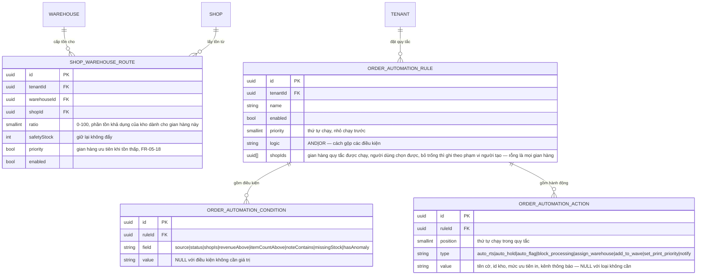
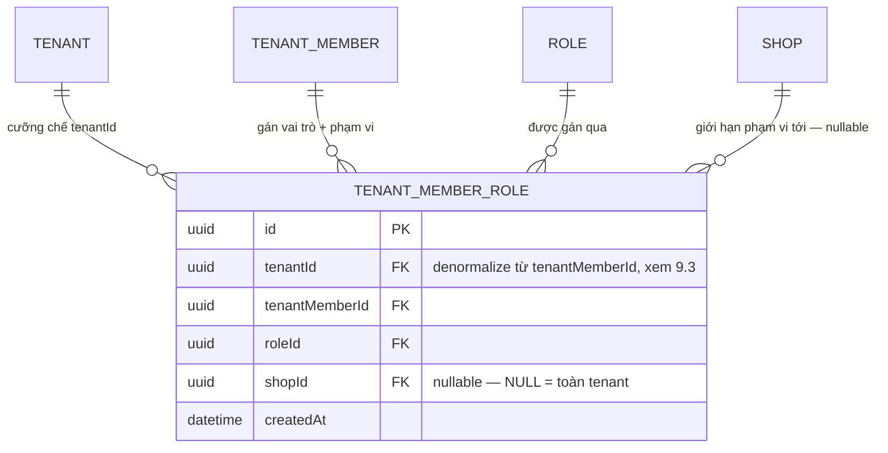
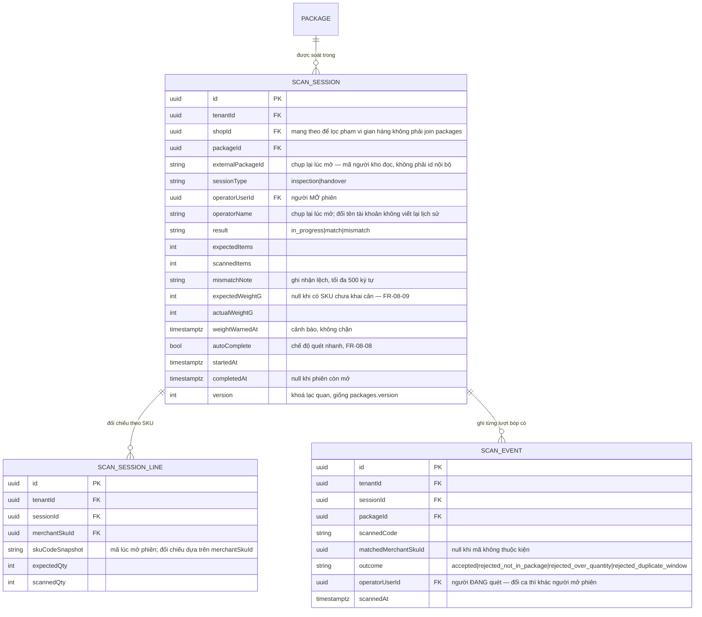

# ViShop — ERD & Mô hình dữ liệu lõi

**Nguồn:** Build Spec v1.2, §2 (Quyết định kiến trúc bắt buộc) và §3 (Mô hình dữ liệu lõi) cho phần nghiệp vụ; repo backend `api-vishop` (`prisma/schema.prisma`) cho quy ước schema ở mục 0. FR-ID đối chiếu với Function List (249 FR, 16 module).
**Phạm vi tài liệu:** ERD cho Phase 1. Trường Phase 2 được tạo sẵn nhưng không xây logic — đánh dấu riêng ở mục 6.
**Cập nhật 07/08/2026:** bản dựng UI đưa đa kho, lô hàng, sóng nhặt, theo dõi vận chuyển và điểm sức khoẻ gian hàng vào phạm vi Phase 1. Phần schema mở rộng nằm ở **mục 7**, tách riêng khỏi sơ đồ lõi để thấy rõ đâu là thiết kế gốc, đâu là phần thêm sau.

---

## 0. Quy ước schema — lấy từ repo, không phải đề xuất

Bản ERD trước dùng `bigint` tự tăng và tên cột snake_case. Repo không làm như vậy, nên toàn bộ sơ đồ đã được viết lại theo bốn quy ước dưới đây. Đây là điều kiện để code sinh ra chạy được, không phải sở thích trình bày.

- **Khoá chính là UUID v7**, sinh ở database: `@default(dbgenerated("uuidv7()")) @db.Uuid`. Không dùng `bigint` tự tăng. UUID v7 sắp được theo thời gian, nên nó vừa là id vừa là khoá sắp xếp — đây chính là thứ mà con trỏ phân trang của API dựa vào (`base64url(sortField:id)`, xem `vishop-api-contract.md` §0.2). Đổi sang id tự tăng là phá luôn cơ chế phân trang.
- **Tên cột là camelCase.** Prisma trong repo không đặt `@map` cho từng field, nên tên cột vật lý trong Postgres đúng bằng tên field trong model: `createdAt`, `userId`, `ipAddress`. Viết `created_at` trong migration là tạo ra một cột thứ hai chứ không phải cùng một cột.
- **Tên bảng là snake_case số nhiều**, khai báo qua `@@map`: `users`, `audit_logs`, `outbox_events`. Sơ đồ dưới đây viết hoa tên thực thể theo cú pháp Mermaid — bảng thật là dạng số nhiều tương ứng (`ORDER` → `orders`, `ORDER_LINE` → `order_lines`). Phần văn bản của tài liệu gọi thực thể ở dạng số ít (`order_line`, `merchant_sku`) cho khớp với build-spec; tên bảng vật lý luôn là số nhiều của tên đó.
- **Ràng buộc FK và index đi kèm mọi cột `*Id`.** Bảng nhật ký (`event_log`, `stock_movement`, `inventory_push_log`, `audit_logs`) phải có index dẫn đầu bằng cột lọc chính rồi tới `createdAt`, vì mọi màn đọc chúng đều lọc theo khoảng thời gian.

Kiểu ghi trên sơ đồ: `uuid` là `@db.Uuid`, `int` là số nguyên (tiền lưu bằng **đơn vị nhỏ nhất của loại tiền theo ISO 4217**, không dùng số thực; cột tiền là `BigInt`), `datetime` là `timestamptz`, `json` là `jsonb`.

---

## 1. Sơ đồ ERD

```mermaid
erDiagram
    TENANT ||--o{ TENANT_MEMBER : "có thành viên"
    USER ||--o{ TENANT_MEMBER : "tham gia qua"
    TENANT ||--o{ ROLE : "định nghĩa"
    ROLE ||--o{ ROLE_PERMISSION : "cấp quyền"
    TENANT_MEMBER ||--o{ TENANT_MEMBER_ROLE : "gán vai trò + phạm vi"
    ROLE ||--o{ TENANT_MEMBER_ROLE : "được gán qua"
    SHOP ||--o{ TENANT_MEMBER_ROLE : "giới hạn phạm vi tới — nullable"
    TENANT ||--o{ AUTHORIZATION : "sở hữu"
    AUTHORIZATION ||--o| SHOP : "một bản ghi mỗi gian hàng"
    TENANT ||--o{ MERCHANT_SKU : "sở hữu"
    SKU_CATEGORY ||--o{ SKU_CATEGORY : "danh mục cha"
    SKU_CATEGORY ||--o{ MERCHANT_SKU : "phân loại"
    MERCHANT_SKU ||--o{ SKU_UOM_CONVERSION : "quy đổi đơn vị"
    MERCHANT_SKU ||--o{ SKU_MAPPING : "ghép nối qua"
    SKU_MAPPING }o--|| PLATFORM_SKU : "trỏ tới"
    SHOP ||--o{ PLATFORM_SKU : "niêm yết"
    MERCHANT_SKU ||--o{ COMBO_COMPONENT : "là combo của"
    MERCHANT_SKU ||--|| INVENTORY : "có tồn tại"
    SHOP ||--o{ ORDER : "phát sinh"
    ORDER ||--o{ ORDER_LINE : "gồm"
    ORDER ||--o{ PACKAGE : "tách thành"
    PACKAGE ||--o{ PACKAGE_LINE : "gồm"
    PACKAGE ||--o{ PACKAGE_NOTE : "được ghi chú"
    TENANT ||--o{ ORDER_FLAG : "tự đặt cờ"
    ORDER_FLAG |o--o{ ORDER : "gắn trên"
    ORDER_LINE ||--o{ PACKAGE_LINE : "phân bổ vào"
    ORDER ||--o{ ORDER_FEE : "phát sinh phí"
    PACKAGE ||--o{ ORDER_FEE : "có thể gắn phí"
    ORDER ||--o| SETTLEMENT : "được đối soát bởi"
    MERCHANT_SKU ||--o{ ORDER_LINE : "được bán qua"
    MERCHANT_SKU ||--o{ STOCK_MOVEMENT : "biến động"
    MERCHANT_SKU ||--o{ INVENTORY_PUSH_LOG : "đẩy tồn qua"
    SHOP ||--o{ INVENTORY_PUSH_LOG : "là đích đẩy"
    TENANT ||--o{ EVENT_LOG : "ghi log"
    USER ||--o{ AUDIT_LOG : "thao tác"
    TENANT ||--o{ AUDIT_LOG : "phạm vi tra soát"

    TENANT {
        uuid id PK
        string name
        string slug UK "immutable sau khi tạo — dùng trong đường dẫn và tên tệp kết xuất; tự sinh nếu không truyền lúc tạo"
        string baseCurrency "ISO 4217 — tiền hạch toán của tenant, avgCost tính theo đây; immutable sau khi tạo"
        string companyName "FR-00-10 — hồ sơ pháp nhân, tách biệt với name (tên workspace)"
        string taxCode "FR-00-10"
        string businessAddress "FR-00-10"
        string representativeName "FR-00-10"
        string contactEmail "FR-00-10"
        string contactPhone "FR-00-10"
        string logoUrl "FR-00-10 — lưu storage key (POST /upload/confirm), resolve thành signed URL mỗi lần đọc"
        string reportTimezone "FR-00-10 — chỉ dùng định dạng báo cáo xuất, không đụng baseCurrency"
        string reportDateFormat "FR-00-10 — dd/mm/yyyy | mm/dd/yyyy | yyyy-mm-dd"
        string reportCurrency "FR-00-10 — chỉ dùng định dạng báo cáo xuất, không phải baseCurrency"
        datetime createdAt
    }
    USER {
        uuid id PK
        string email UK
        string role "USER|ADMIN — vai trò cấp platform"
        string status "ACTIVE|DISABLED"
        bool mustChangePassword "OWNER vừa cấp mật khẩu tạm; chặn API/WS tới khi user tự đổi"
    }
    TENANT_MEMBER {
        uuid id PK
        uuid tenantId FK
        uuid userId FK
        string role "OWNER|ADMIN|MEMBER — quyền quản trị membership"
        string status "ACTIVE|INACTIVE — chỉ có hiệu lực trong tenant này"
        datetime deletedAt "nullable — xoá mềm, giữ lịch sử và giải phóng seat"
        datetime createdAt
    }
    ROLE {
        uuid id PK
        uuid tenantId FK
        string name
        string builtinKey "OWNER|OPERATIONS|WAREHOUSE|ACCOUNTING, NULL với vai trò tuỳ chỉnh — quyền của 3 vai trò không phải OWNER tính lúc đọc, không lưu role_permission (mục 9)"
    }
    ROLE_PERMISSION {
        uuid id PK
        uuid roleId FK
        string permissionKey "khoá trong danh mục quyền, vd orders.package.ship — rỗng với vai trò dựng sẵn khác OWNER (mục 9)"
    }
    TENANT_MEMBER_ROLE {
        uuid id PK
        uuid tenantId FK "denormalize từ tenantMemberId — cưỡng chế FR-00-06, mục 9.3"
        uuid tenantMemberId FK
        uuid roleId FK
        uuid shopId FK "nullable — NULL nghĩa là toàn tenant, có giá trị nghĩa là chỉ gian hàng đó"
        datetime createdAt
    }
    AUTHORIZATION {
        uuid id PK
        uuid tenantId FK
        string externalId "shop_id"
        json grantedScopes
        json capabilities "suy ra, cache"
        string shopCipher "TikTok-specific, nullable"
        string accessToken
        string refreshToken
        datetime expiresAt
    }
    SHOP {
        uuid id PK
        uuid tenantId FK
        uuid authorizationId FK
        string platform
        string externalShopId
        string nickname
        string status "connected|reconnect_required|syncing_initial|disconnected"
        datetime lastSyncedAt "lần sync cuối, FR-02-03"
        int syncedOrderCount "số đơn đã sync, FR-02-03"
        int syncedSkuCount "số SKU/tồn đã sync, FR-02-03"
    }
    PLATFORM_SKU {
        uuid id PK
        uuid shopId FK
        string externalProductId
        string externalSkuId
        string name
        bigint price
        string currency "ISO 4217 — sàn trả price.currency kèm giá"
    }
    MERCHANT_SKU {
        uuid id PK
        uuid tenantId FK
        string skuCode
        string name
        string imageUrl "ảnh, FR-03-05"
        uuid categoryId FK "trỏ SKU_CATEGORY — đa cấp, FR-03-14"
        string note "ghi chú, FR-03-05"
        bigint avgCost "đơn vị nhỏ nhất của tiền, số nguyên"
        string baseUom "đơn vị gốc, FR-03-16"
        string status "đang bán|ngừng bán"
        bool isCombo "combo không có tồn vật lý riêng, FR-03-11"
        string_array gtins "tối đa 10 mã/SKU, CHECK ở DB, FR-03-07"
        int weightG "cân nặng, gram, FR-03-08"
        json dimensionsCm "{length,width,height}, FR-03-08"
        int lowStockThreshold "ngưỡng cảnh báo tồn theo SKU, FR-03-09"
        bool batchEnabled "Phase 2"
        bool serialEnabled "Phase 2"
        datetime deletedAt "xoá mềm — unique (tenantId, skuCode) là index bán phần theo cột này"
    }
    SKU_CATEGORY {
        uuid id PK
        uuid tenantId FK
        uuid parentId FK "null ở cấp gốc — cây nhiều cấp, FR-03-14"
        string code
        string name
    }
    SKU_UOM_CONVERSION {
        uuid id PK
        uuid tenantId FK
        uuid merchantSkuId FK
        string uom
        int conversionRatio "số nguyên 2..1000000, FR-03-16"
    }
    SKU_MAPPING {
        uuid id PK
        uuid merchantSkuId FK
        uuid platformSkuId FK
        int quantity "SKU sàn = N × SKU kho"
    }
    COMBO_COMPONENT {
        uuid id PK
        uuid comboSkuId FK
        uuid componentSkuId FK
        int quantity
    }
    INVENTORY {
        uuid id PK
        uuid merchantSkuId FK
        uuid warehouseId FK "đã kích hoạt 07/08/2026 — khoá cùng merchantSkuId, xem mục 7"
        int onHand
        int locked
        int available
        int incoming "đang về, ngoài onHand — chỉ tham khảo (§4.3 build-spec), FR-05-01"
        int reserved "Phase 2, có sẵn"
        int defectiveQty "VIS-168: hàng hoàn bị đánh giá lỗi, trong onHand, ngoài available; chỉ khác 0 ở kho type=RETURN"
    }
    ORDER {
        uuid id PK
        uuid tenantId FK
        uuid shopId FK
        string platform
        string externalOrderId
        string status
        datetime orderedAt "thời gian đặt hàng, FR-06-08"
        datetime paidAt "thời gian thanh toán, null nếu đơn Chưa thanh toán (BR-06-02), FR-06-08"
        string buyerName "người nhận, PII — không bị field-level permission chặn (khác 2 dòng dưới), FR-06-08"
        string buyerPhone "SĐT người nhận, PII cấp trường FR-01-06 — có thể đã bị TikTok che một phần khi đơn dùng platform logistics, lưu nguyên văn không tự unmask"
        string buyerFullAddress "địa chỉ nhận hàng, PII cấp trường FR-01-06 — lưu nguyên chuỗi từ sàn, không tách thành phần (lý do ở dưới sơ đồ)"
        string paymentMethod "phương thức thanh toán, giá trị nguyên văn từ sàn, FR-06-08"
        uuid parentOrderId "Phase 2, có sẵn"
    }
    ORDER_LINE {
        uuid id PK
        uuid orderId FK
        string externalSkuId "sku_id của sàn — unique cùng orderId, là định danh dòng qua mỗi lần đồng bộ; null với dòng nhập tay"
        uuid merchantSkuId FK
        uuid platformSkuId FK "liên kết catalog nội bộ, null khi listing chưa đồng bộ — không phải định danh"
        string externalLineIds "text[] — một id sàn cho mỗi đơn vị hàng, số phần tử = quantity"
        string skuName "tên biến thể sàn trả về tại thời điểm đặt"
        string source "content_type nguyên văn của TikTok: SHOP|VIDEO|LIVE|PRE_LIVE|PROMOTION_PAGE|LINKSHARE — sàn trả theo từng SKU nên nguồn nằm ở dòng, NULL = chưa xác định nguồn, FR-06-11"
        int quantity
        bigint unitPrice
        bigint discountAmount "chiết khấu theo dòng — FR-06-09"
        bigint costSnapshot "giá vốn SKU đóng băng tại orderedAt, null nếu chưa tra được — VIS-393"
    }
    PACKAGE {
        uuid id PK
        uuid orderId FK
        string platform
        string externalPackageId
        string shippingType "TIKTOK|SELLER — token gốc của sàn"
        string status
    }
    PACKAGE_LINE {
        uuid id PK
        uuid packageId FK
        uuid orderLineId FK
        string externalLineIds "text[] — tập con của order_line.externalLineIds nằm trong package này"
        int quantity
    }
    PACKAGE_NOTE {
        uuid id PK
        uuid tenantId FK
        uuid packageId FK "cấp KIỆN, không phải cấp đơn — BR-06-06, FR-06-13"
        string type "PICKING|INTERNAL — PICKING in ra phiếu đóng gói (FR-07-04), INTERNAL không bao giờ lọt vào luồng in"
        string content "tối đa 500 ký tự, cắt khoảng trắng hai đầu, không được rỗng"
        uuid createdByUserId FK
        uuid updatedByUserId FK "null khi chưa từng sửa"
    }
    ORDER_FLAG {
        uuid id PK
        uuid tenantId FK
        string name "unique trong tenant sau khi gom khoảng trắng"
        string color "hex 6 chữ số có dấu #"
    }
    ORDER_FEE {
        uuid id PK
        uuid orderId FK
        uuid packageId FK "nullable"
        uuid orderLineId FK "nullable"
        string feeType "enum mở rộng"
        int amount
        string source "estimated|settlement"
        string currency
        datetime createdAt
    }
    SETTLEMENT {
        uuid id PK
        uuid orderId FK
        string externalSettlementId
        string status "chưa quyết toán|đã quyết toán|lệch"
    }
    STOCK_MOVEMENT {
        uuid id PK
        uuid merchantSkuId FK
        string eventType
        int onHandBefore
        int onHandAfter
        string reason
        uuid actorId "người thao tác, null nếu actor=system, FR-05-05"
        string referenceId "chứng từ — mã phiếu nhập/xuất/kiểm kho liên quan, FR-05-05"
        datetime createdAt
    }
    INVENTORY_PUSH_LOG {
        uuid id PK
        uuid merchantSkuId FK
        uuid shopId FK
        int pushedQty
        string result
        string errorReason "lý do lỗi, giữ mã lỗi gốc từ sàn khi result=failed — FR-05-15, §6.5"
        datetime createdAt
    }
    EVENT_LOG {
        uuid id PK
        uuid tenantId FK
        string entityType "polymorphic — không FK cứng"
        uuid entityId
        string eventType
        json payloadBefore
        json payloadAfter
        string actorType "user|system|platform"
        uuid actorId
        string source
        datetime createdAt
    }
    AUDIT_LOG {
        uuid id PK "PK là (id, createdAt) — bảng chia phân vùng theo tháng"
        datetime createdAt PK
        uuid tenantId FK
        uuid userId FK "nullable"
        string action
        string resource "nullable"
        json metadata
        string ipAddress "nullable"
        string userAgent "nullable"
    }
```



`EVENT_LOG` chỉ nối với `TENANT` trên sơ đồ. `entityType` + `entityId` là tham chiếu polymorphic tới order, package, inventory, v.v. — cố tình không đặt FK cứng, lý do nêu ở mục 3.5.

`USER` là tài khoản toàn platform, không thuộc riêng tenant nào. Quan hệ User ↔ Tenant là N–N qua `TENANT_MEMBER`: một user có thể có nhiều membership, một tenant có nhiều member, và `@@unique([tenantId, userId])` ngăn trùng đúng ở cấp cặp. `TenantMember.role` quản trị membership (`OWNER|ADMIN|MEMBER`) — riêng biệt với vai trò nghiệp vụ, giờ gán qua `TENANT_MEMBER_ROLE` chứ không còn cột `roleId` trên chính `TenantMember` (đổi 19/08/2026, xem mục 9); không trường nào trong `USER` thay thế hai khái niệm này.

`TENANT`, `TENANT_MEMBER`, `ROLE`, `ROLE_PERMISSION` và `TENANT_MEMBER_ROLE` ở trên phản ánh các model đã có trong `prisma/schema.prisma`, không phải thiết kế quan hệ dự kiến. Sơ đồ vẫn chứa cả phần đã hiện thực hoá và phần thiết kế sản phẩm; trạng thái triển khai của entity khác phải đối chiếu schema thay vì suy từ việc nó xuất hiện trong ERD.

`AUDIT_LOG` cũng đã có `tenantId` trong repo. Khoá chính là **cặp** `(id, createdAt)` vì bảng được chia phân vùng theo tháng (migration `20260501000000_init`); mọi truy vấn phải kèm điều kiện thời gian, nếu không Postgres quét toàn bộ phân vùng.

### Vá lỗ hổng FR-06-08 trên `ORDER` — và audit lại toàn bộ bảng ánh xạ FR ở mục 2

Bản ERD trước chỉ có 8 cột trên `ORDER`, không có bất kỳ cột nào lưu dữ liệu người nhận, dù chính mục 2 dưới đây tuyên bố `order`/`order_line` đã phủ FR-06-08 (mã đơn sàn, shop, thời gian đặt/thanh toán, trạng thái, người nhận, địa chỉ, phương thức thanh toán). `buyerName`/`buyerPhone`/`buyerFullAddress`/`paymentMethod`/`orderedAt`/`paidAt` bổ sung ở trên để lấp đúng phần thiếu đó. Hai quyết định thiết kế đi kèm:

- **Cột riêng, không snapshot JSON:** dữ liệu người nhận có hình dạng cố định — TikTok luôn trả tên/SĐT/địa chỉ theo cùng cấu trúc cho mọi đơn, khác hẳn `event_log.payloadBefore`/`payloadAfter` (payload biến thiên theo loại entity, lý do JSON ở đó là bắt buộc). Cột rời còn là điều kiện để hai việc P0 khác chạy được: phân quyền cấp trường FR-01-06 (`buyerPhone`/`buyerFullAddress` bị chặn theo quyền, `buyerName` thì không — cắt bằng mapping DTO tường minh, xem `vishop-api-contract.md` §0.2 và §3) và tìm kiếm/lọc FR-06-02/FR-06-03 (lọc, tìm nhanh theo SĐT/tên người nhận) — cả hai cần cột index được, JSON blob không đáp ứng tốt bằng.
- **`buyerFullAddress` là một chuỗi, không tách thành phần:** BR-06-05 cấm sửa dữ liệu gốc từ sàn; tem và phiếu giao hàng (M07) cần in đúng nguyên văn địa chỉ TikTok trả về. Tách thành tỉnh/huyện/xã đòi hỏi tự suy luận cấu trúc mà spec chưa xác nhận TikTok Order API trả nhất quán — rủi ro sai lệch khi in tem lớn hơn lợi ích chuẩn hoá lúc này. Nhu cầu phân tích theo khu vực giao hàng (nếu có) là quyết định Phase 2 riêng, **cần Tech Lead xác nhận** trước khi đổi.

`buyerPhone`/`buyerName` lưu nguyên văn giá trị TikTok trả, kể cả khi đã bị che một phần (mask) do đơn dùng platform logistics (vd `(+1)213-***-1234`) — không có cột đánh dấu "đã che", vì giá trị masked bản thân nó vẫn là dữ liệu hợp lệ, không phải lỗi (xem `vishop-api-contract.md` §3).

Từ phát hiện này, đã rà lại **toàn bộ 16 dòng** của bảng ánh xạ FR ở mục 2 — với từng dòng, đối chiếu cột của entity được nêu với đúng nội dung các FR-ID mà chính dòng đó dẫn chiếu. Tìm thêm 7 trường hợp cùng loại (entity tuyên bố phủ FR nhưng thiếu cột FR đó yêu cầu), đã vá thẳng vào entity tương ứng ở sơ đồ trên:

| Entity               | Cột bổ sung                                                                                                                                                                                                                               | FR dẫn chiếu (đã có sẵn trong dòng của entity ở mục 2) |
| -------------------- | ----------------------------------------------------------------------------------------------------------------------------------------------------------------------------------------------------------------------------------------- | ------------------------------------------------------ |
| `order_line`         | `discountAmount` (chiết khấu)                                                                                                                                                                                                             | FR-06-09                                               |
| `merchant_sku`       | `imageUrl`, `category`, `note`                                                                                                                                                                                                            | FR-03-05                                               |
| `inventory`          | `incoming`                                                                                                                                                                                                                                | FR-05-01                                               |
| `shop`               | `lastSyncedAt`, `syncedOrderCount`, `syncedSkuCount`                                                                                                                                                                                      | FR-02-03                                               |
| `stock_movement`     | `actorId`, `referenceId`                                                                                                                                                                                                                  | FR-05-05                                               |
| `inventory_push_log` | `errorReason`                                                                                                                                                                                                                             | FR-05-15                                               |
| `tenant_member_role` | toàn bộ — dòng `user`/`tenant_member`/`role`/`role_permission` dẫn `FR-01-02 → FR-01-06`; model hiện đã có trong `prisma/schema.prisma`, với mặc định không có bản ghi = toàn tenant — xem mục 9 (thay `user_shop_scope`, đổi 19/08/2026) | FR-01-05                                               |

9 dòng còn lại của mục 2 (`tenant`, `authorization`, `sku_mapping`/`platform_sku`, `combo_component`, `package`/`package_line`, `order_fee`, `settlement`, `event_log`, `audit_logs`) đối chiếu khớp — không phát hiện thiếu cột. Hai điểm phát hiện thêm trong lúc đối chiếu chéo với `vishop-api-contract.md` nhưng **cố tình không vá** vì nằm ngoài đúng FR mà dòng entity đó dẫn chiếu (không phải lỗi "tuyên bố sai", mà là FR chưa từng được mục 2 nhắc tới — mức độ khác, cần quyết định riêng):

- `merchant_sku` còn thiếu `gtin`, `weightG`, `dimensionsCm`, `lowStockThreshold` — các trường này đã xuất hiện sẵn trong ví dụ `POST /api/v1/merchant-skus` ở `vishop-api-contract.md` §2, ứng với FR-03-07/08/09, nhưng dòng `merchant_sku` ở mục 2 chỉ dẫn FR-03-05/06, không dẫn ba FR này.
- `package` còn thiếu `trackingNumber` — đã dùng trong ví dụ response của `POST /api/v1/packages/batch-ship` (`vishop-api-contract.md` §4.1), ứng với FR-06-16, nhưng dòng `package`/`package_line` ở mục 2 chỉ dẫn FR-06-15a.

Hai điểm này nên đưa vào một lượt audit riêng cho M03/M06, **cần Tech Lead xác nhận phạm vi** trước khi vá.

### Ràng buộc mặc định của phạm vi gian hàng — đã chốt 12/08/2026: mặc định mở

Build spec (FR-01-05, AC M01) xác nhận cơ chế tồn tại ("vai trò Vận hành gán Shop A → chỉ thấy đơn Shop A") nhưng không nói hành vi khi một thành viên **không có** binding nào giới hạn gian hàng.

**Chốt: không có binding nào giới hạn = thấy toàn bộ gian hàng của tenant.** Mặc định đóng an toàn hơn về lý thuyết nhưng sai về vận hành: Chủ tài khoản vừa tạo tenant sẽ không thấy gì, và mọi gian hàng kết nối sau đó trở nên vô hình với tất cả mọi người cho tới khi có người nhớ cấp lại — một lỗi im lặng, xảy ra đúng lúc onboarding, và người dùng không có cách nào tự đoán ra nguyên nhân. Quy tắc này giữ nguyên sau khi gộp bảng ở mục 9 — chỉ đổi chỗ lưu (`user_shop_scope` → `tenant_member_role.shopId`), không đổi hành vi mặc định.

Giao diện đã dựng theo đúng quy ước này: công tắc "Toàn bộ gian hàng" bật sẵn, tắt đi mới hiện danh sách chọn.

---

## 2. Thực thể chính

| Thực thể                       | Vai trò                                                                                                                                                                                                                                                       | Ghi chú thiết kế              |
| ------------------------------ | ------------------------------------------------------------------------------------------------------------------------------------------------------------------------------------------------------------------------------------------------------------- | ----------------------------- |
| `tenant`                       | Gốc phân vùng dữ liệu. Mọi bảng khác đều treo `tenantId`                                                                                                                                                                                                      | FR-00-06, BR-00               |
| `user` / `tenant_member`       | Quan hệ N–N User ↔ Tenant. `User` là tài khoản platform; membership duy nhất theo `(tenantId, userId)` giữ tier quản trị (`OWNER\|ADMIN\|MEMBER`) — vai trò nghiệp vụ và phạm vi gian hàng gán qua `tenant_member_role`, không còn cột trên chính bảng này    | FR-01-02, FR-01-12 → FR-01-14 |
| `role` / `role_permission`     | Phân quyền theo danh mục quyền nguyên tử: 4 vai trò dựng sẵn + vai trò tuỳ chỉnh; quyền cấp trường là ba khoá trong cùng danh mục. Ba vai trò dựng sẵn không phải OWNER tính quyền lúc đọc (`effectivePermissionKeys()`), không lưu `role_permission` — mục 9 | FR-01-03 → FR-01-06           |
| `tenant_member_role`           | Gộp gán vai trò nghiệp vụ + phạm vi gian hàng vào một dòng mỗi cặp (vai trò, gian hàng) — một thành viên có thể giữ nhiều vai trò ở nhiều gian hàng khác nhau. `shopId = NULL` nghĩa là toàn tenant                                                           | FR-01-05                      |
| `authorization`                | Một lượt seller cấp quyền cho Public App của ViShop, ứng với đúng một gian hàng. Giữ `grantedScopes` để gate tính năng                                                                                                                                        | §2.2, FR-02-12                |
| `shop`                         | Sinh ra cùng lúc với `authorization`. Là đơn vị vận hành seller nhìn thấy hằng ngày                                                                                                                                                                           | FR-02-02, FR-02-03            |
| `merchant_sku`                 | SKU kho — đơn vị giá vốn và tồn thật, độc lập với SKU sàn                                                                                                                                                                                                     | FR-03-05, FR-03-06            |
| `sku_mapping` / `platform_sku` | Ghép nối SKU sàn ↔ SKU kho, hỗ trợ tỉ lệ N:1 (listing dạng combo)                                                                                                                                                                                             | FR-04-06                      |
| `combo_component`              | Tự tham chiếu trên `merchant_sku` — combo không có tồn vật lý riêng                                                                                                                                                                                           | FR-03-11, BR-03-02            |
| `inventory`                    | Tồn theo cặp `(merchant_sku, warehouse)` — `warehouseId` đã kích hoạt, `reserved` vẫn dự phòng Phase 2                                                                                                                                                        | §3.3, FR-05-01, FR-05-22      |
| `order` / `order_line`         | Đơn vị thương mại — giữ nguyên dữ liệu gốc từ sàn                                                                                                                                                                                                             | FR-06-08, FR-06-09            |
| `package` / `package_line`     | Đơn vị fulfillment thật — xem mục 3.3                                                                                                                                                                                                                         | §2.3, FR-06-15a               |
| `order_fee`                    | Phí dạng dòng động, không cột cứng                                                                                                                                                                                                                            | §2.4, FR-10-01                |
| `settlement`                   | Kết quả đối soát payout, đối chiếu với `order_fee.source = settlement`                                                                                                                                                                                        | FR-12-01, FR-12-02            |
| `stock_movement`               | Sổ biến động tồn append-only, phục vụ FR-05-05                                                                                                                                                                                                                | FR-05-05                      |
| `inventory_push_log`           | Nhật ký đẩy tồn ra từng shop, append-only                                                                                                                                                                                                                     | FR-05-15                      |
| `event_log`                    | Nhật ký bất biến toàn hệ thống — nền tảng audit/debug lệch tồn                                                                                                                                                                                                | §2.5, FR-00-01                |
| `audit_logs`                   | Nhật ký thao tác người dùng (khác `event_log` — xem mục 3.5)                                                                                                                                                                                                  | FR-00-04                      |

---

## 3. Sáu quyết định kiến trúc bắt buộc — lý do và đánh đổi

### 3.1 ChannelAdapter — core không được biết TikTok là gì

`AuthProvider`, `ProductProvider`, `OrderProvider`, `FulfillmentProvider`, `InventoryProvider`, `FinanceProvider` là interface định nghĩa trước; TikTok là implementation đầu tiên, không phải implementation duy nhất được giả định.

Lý do chọn hướng này ngay từ Phase 1 dù roadmap chỉ có một sàn: §1.3 đã ghi rõ "sàn khác ngoài TikTok Shop — Phase 2, nhưng kiến trúc phải sẵn sàng". Chi phí làm đúng ngay từ đầu là một lớp interface mỏng; chi phí làm sai là viết lại toàn bộ `order`, `package`, `inventory` service khi thêm Shopee hay Lazada ở Phase 2, vì lúc đó business logic đã import thẳng SDK TikTok ở hàng trăm chỗ. Quy tắc chặn cứng: không một dòng logic nghiệp vụ nào được import trực tiếp SDK/HTTP client của TikTok — mọi lời gọi đi qua adapter, kể cả gọi nội bộ giữa các service.

Đánh đổi chấp nhận: thêm một lớp gián tiếp (interface → implementation) cho một hệ thống hiện chỉ có một adapter thật. Đổi lại, `platform` xuất hiện như một cột dữ liệu (`order.platform`, `package.platform`) chứ không phải một nhánh if/else rải rác trong code — đây là điều kiện để unique constraint `(platform, shopId, externalOrderId)` ở §3.2 có ý nghĩa từ Phase 1, không phải thêm sau.

### 3.2 Feature gating theo scope đã cấp

> **Sửa 07/08/2026.** Mục này trước đây mô tả mô hình "multi-authorization 3 role" với cột `authorization.role ∈ {seller, creator, partner}`. Mô hình đó không có thật — TikTok Shop không cho một Public App chọn vai trò khi uỷ quyền. Cột `role` đã bị bỏ khỏi sơ đồ. Xem [vishop-build-spec-v1.2.md](./vishop-build-spec-v1.2.md) §2.2.

Một tenant vẫn không map 1-1 với một tài khoản TikTok: một tenant giữ **nhiều** bản ghi `authorization`, mỗi bản ghi ứng với **một gian hàng**. Điều đã bỏ là chiều "nhiều loại vai trò", không phải chiều "nhiều gian hàng".

Capability không gán theo gói cước, không theo flag tenant thủ công. Công thức: `featureGate(feature) = feature.requiredScopes ⊆ shop.grantedScopes`, với `grantedScopes` lấy thẳng từ response khi đổi authorization code, và `capabilities` là bản suy ra đã cache trên chính bản ghi `authorization`.

Vì sao vẫn phải tách `grantedScopes` ngay Phase 1 thay vì giả định mọi gian hàng có đủ quyền: gian hàng uỷ quyền từ một phiên bản app cũ hơn sẽ thiếu scope mới thêm sau. Nếu code giả định "đã kết nối nghĩa là có đủ quyền" thì lỗi hiện ra dưới dạng 403 giữa job đồng bộ, không phải dưới dạng một màn hình khoá có lý do rõ ràng.

Ràng buộc UX đi kèm không phải tuỳ chọn: tính năng thiếu scope phải hiện trạng thái khoá kèm lý do và hành động cụ thể ("Gian hàng chưa cấp quyền Affiliate — uỷ quyền lại để xem dữ liệu creator"). Không ẩn tính năng, không hiện số 0 hoặc bảng rỗng thay cho dữ liệu bị khoá — hiện số 0 khiến seller đọc nhầm thành "không có phát sinh" thay vì "chưa đủ quyền xem".

### 3.3 Package là đơn vị fulfillment, không phải Order

TikTok Shop không có endpoint "confirm order". Luồng thật của sàn là order → package → Ship Package (RTS) → label, và một order tách được nhiều package. Nếu ViShop mô hình hoá fulfillment ở cấp order — cách trực giác nhất với người mới — thì đơn tách 2 package sẽ không có chỗ để giữ 2 mã vận đơn, 2 trạng thái RTS độc lập.

Hệ quả thiết kế bắt buộc đi kèm, không phải tuỳ chọn:

- Mọi thao tác RTS, lấy tem, in, quét, bàn giao đều ở cấp `package` — không có endpoint hay UI thao tác fulfillment ở cấp `order` (BR-06-06, FR-06-15a/b/c).
- Trừ tồn neo theo `package`, không theo `order`. Order tách 2 package, package 1 RTS trước → chỉ trừ tồn dòng hàng thuộc package 1, order vẫn ở trạng thái "Đang xử lý" (BR-06-07).
- Giao diện mặc định gộp theo order để không làm rối mắt seller 1 SKU/đơn, bung package khi cần — FR-06-26 là yêu cầu UX bắt buộc đi kèm, không phải "nice to have" sau khi có dữ liệu.
- `package.shippingType` phân biệt TikTok Shipping và Seller Shipping ngay ở cấp package vì luồng tem khác hoàn toàn: Seller Shipping không có tem từ TikTok, phải nhập mã vận đơn thủ công (BR-06-08, FR-06-27).

`package_line` tồn tại độc lập với `order_line` (không phải copy) chính vì lý do phân bổ số lượng: một `order_line` số lượng 3 có thể chia vào 2 `package_line` ở 2 package khác nhau.

**`externalLineIds` là điều kiện để việc chia đó gọi được lên sàn.** TikTok trả `line_items[]` **một dòng cho mỗi đơn vị hàng**, không có trường `quantity` — 3 cái cùng SKU là 3 phần tử, mỗi phần tử có `id`, `package_id`, `tracking_number`, `display_status` riêng. `POST /fulfillment/202309/packages` nhận `order_line_item_ids`, và package detail trả về đúng mảng đó. Nếu `order_line` chỉ giữ một id thì SKU số lượng > 1 không tạo được package, và callback của sàn không map ngược được về dòng nào.

ViShop vẫn gộp theo SKU (một `order_line` cho 3 cái, `quantity = 3`) thay vì đẻ 3 dòng: FE hiển thị theo SKU, và với khối lượng đơn dự kiến thì nhân ba số dòng là cái giá không đáng trả. Mảng id giữ lại toàn bộ khả năng thao tác của mô hình per-unit mà không trả giá đó. Ràng buộc đi kèm: số phần tử phải bằng `quantity`, hoặc bằng 0 với đơn nhập tay không có id sàn — thiếu một id là mất khả năng fulfil dòng đó, nên chặn ngay lúc ghi.

`shippingType` dùng thẳng token `TIKTOK`/`SELLER` của sàn. Bản trước của tài liệu này ghi `tiktok_shipping|seller_shipping`, không khớp cả API thật lẫn FE đã code (`shippingType === 'TIKTOK'`).

### 3.4 order_fee là dòng động, không phải cột cố định

`order_fee` không có cột `commissionAmount`, `paymentFeeAmount` v.v. cứng trên bảng `order`. Mỗi phí là một bản ghi độc lập: `feeType` (enum mở rộng được), `amount`, `source` (`estimated` | `settlement`), gắn tuỳ chọn vào `packageId` hoặc `orderLineId`.

Hai lý do, cả hai đều thật chứ không phải phòng xa lý thuyết:

Thứ nhất, mỗi sàn có cấu trúc phí khác nhau — cột cứng thiết kế theo TikTok sẽ vỡ ngay khi thêm sàn thứ hai ở Phase 2, đúng tinh thần ChannelAdapter ở mục 3.1. Thứ hai — và đây là lý do quan trọng hơn cho chính Phase 1: cùng một đơn tồn tại **hai bộ phí song song theo thời gian** — bộ ước tính trước payout và bộ thực tế sau payout — và cả hai phải cùng tồn tại trong hệ thống, không cái này ghi đè cái kia. `order_fee.source` chính là cột phân biệt đó. FR-10-03 (nhãn Ước tính/Đã đối soát) và toàn bộ M12 (đối soát tài chính, so sánh dự kiến vs thực nhận) không thể xây trên schema cột cứng vì cột cứng chỉ giữ được một giá trị tại một thời điểm.

Ràng buộc đi kèm bắt buộc: hoa hồng affiliate là dòng phí độc lập, không gộp vào hoa hồng sàn (BR-10-05) — nếu gộp, FR-11-03a (tổng chi phí hoa hồng affiliate theo kỳ) không tách được nguồn.

### 3.5 event_log bất biến — append-only, không sửa không xoá

Mọi biến động tồn kho, chuyển trạng thái order/package, thay đổi giá vốn ghi một bản ghi append-only vào `event_log`, gồm `payloadBefore`/`payloadAfter` đầy đủ, không chỉ delta.

`event_log` cố tình không có FK cứng tới `order`, `package`, `inventory` — dùng `entityType` + `entityId` dạng polymorphic. Đánh đổi ở đây là bỏ tính toàn vẹn tham chiếu (referential integrity) ở tầng database để đổi lấy khả năng ghi log cho **bất kỳ** loại thực thể nào phát sinh sau này mà không phải sửa schema `event_log` mỗi lần thêm bảng nghiệp vụ mới — đúng tinh thần "không sửa, không xoá" áp dụng luôn cho chính schema của log.

Đây không phải bảng tiện ích thêm cho có. Không có nó thì không có cách nào truy được vì sao tồn sai khi seller báo cáo lệch số — đây là câu hỏi vận hành sẽ xảy ra hàng tuần một khi có đẩy tồn đa shop tự động (FR-05-14) chạy nền không có người theo dõi trực tiếp từng lệnh.

Phân biệt với `audit_logs`: `audit_logs` trả lời "ai bấm gì" (FR-00-04, phục vụ compliance/bảo mật), `event_log` trả lời "hệ thống đã đổi cái gì" kể cả khi actor là `system` hoặc `platform` (webhook TikTok bắn về) — hai câu hỏi khác nhau, hai bảng khác nhau, không gộp.

Hội thoại với trợ lý ViAI ghi vào `audit_logs`, không mở bảng mới. Bảng này đã tồn tại trong repo với đúng bốn cột dùng được ở đây, nên một lượt hội thoại xếp vào đó như sau:

| Cột `audit_logs` | Giá trị cho một lượt hội thoại                                           |
| ---------------- | ------------------------------------------------------------------------ |
| `action`         | `assistant.ask`                                                          |
| `resource`       | tên tool đã gọi (`prepare_pick_wave`, …), `null` khi không khớp tool nào |
| `metadata`       | câu hỏi, kết quả trả về và đề xuất kèm theo (FR-14-10, BR-14-04)         |
| `userId`         | người hỏi                                                                |

Bản ERD trước ghi bảng này là `audit_logs` với cột `entity_type = 'assistant_turn'` — **sai**: không có cột `entityType` trong `AuditLog`, và tên bảng là số nhiều. Cách xếp ở trên mới chạy được trên schema thật.

**Bổ sung 07/08/2026 — `audit_logs` cần cột `tenantId`; trạng thái hiện tại: đã có trong schema.** `userId` không suy ra được tenant vì một user có thể có nhiều `TenantMember`, nên audit row phải chụp `tenantId` tại thời điểm thao tác. Index `(tenantId, createdAt)` cho phép trả lời trực tiếp "tenant X đã làm những gì trong kỳ này" và thực thi tenant isolation (FR-00-06) trên chính màn tra cứu audit.

Phạm vi ghi của `audit_logs` cũng cần nói rõ để tránh hiểu nhầm: bảng này **không** ghi mọi sự kiện của hệ thống. Nó chỉ ghi thao tác do người dùng chủ động thực hiện. Biến động do sàn đẩy về hoặc do job nền sinh ra đi vào `event_log` — hiện thực trong repo mới nghe đúng luồng `users.*`, phần mở rộng ra các thao tác nghiệp vụ chính là nội dung của FR-00-04.

Trợ lý không tự ghi dữ liệu nghiệp vụ nên không có gì để `event_log` ghi nhận; khi người dùng bấm xác nhận ở màn thực hiện thì thao tác đó đi theo đường của module tương ứng và sinh bản ghi `event_log` như mọi thao tác tay khác. Không có tên, số điện thoại hay địa chỉ người mua trong `metadata` của lượt hội thoại (BR-14-05). Bối cảnh: [vishop-ai-automation-roadmap.md](./vishop-ai-automation-roadmap.md).

### 3.6 Idempotency theo (platform, shopId, externalId)

Mọi bản ghi kéo về từ sàn khoá theo bộ ba `(platform, shopId, externalId)` — cụ thể hoá thành `(platform, shopId, externalOrderId)` unique trên `order` và `(platform, shopId, externalPackageId)` unique trên `package` (§3.2, FR-00-03).

Lý do chọn bộ khoá 3 phần thay vì chỉ `externalOrderId`: `externalOrderId` một mình không đủ vì tổ chức ID là theo platform, và trên hết một seller có thể vận hành nhiều shop cùng platform — thiếu `shopId` trong khoá thì re-sync đồng thời 2 shop có khả năng đụng ID (dù hiếm, nhưng đây là loại bug không được phép chấp nhận rủi ro). Thiếu `platform` thì khoá không mở được cho sàn thứ hai ở Phase 2.

Hệ quả trực tiếp lên vận hành: FR-02-07 (kết nối lại không mất dữ liệu lịch sử, kéo bù đơn phát sinh lúc gián đoạn) và AC "đồng bộ lại từ sàn → không tạo bản ghi trùng, chỉ cập nhật trạng thái + ghi log" (M06) chỉ đúng được nhờ ràng buộc unique này ở tầng database, không phải nhờ logic kiểm tra trùng ở tầng application — kiểm tra ở application code có thể bị race condition khi 2 job sync chạy đồng thời (initial sync + webhook), unique constraint ở DB thì không.

---

## 4. `shopCipher` — trường đặc thù TikTok, vòng đời gắn với re-auth

TikTok Shop Partner API yêu cầu tham số `shop_cipher` — một định danh shop đã mã hoá, khác `shopId`/`externalShopId` — kèm theo trên hầu hết lời gọi Shop API (Product, Order, Fulfillment, Inventory). ViShop lưu nó ở cột `shopCipher`. Đây không phải access token và không dùng chung cơ chế hết hạn với token.

Trường này **không xuất hiện trên `shop`** — cố tình đặt trên `authorization` (nullable, chỉ có giá trị khi `platform = tiktok`). Lý do đi thẳng từ quyết định 3.1: `shop` là thực thể core, phải trung lập với mọi sàn; `shopCipher` là chi tiết vận hành riêng của TikTok connector. Đặt nó lên `shop` là đặt một trường TikTok-only lên bảng lẽ ra phải sẵn sàng cho Shopee/Lazada ở Phase 2 — vi phạm đúng nguyên tắc "core không được biết TikTok là gì" mà quyết định đó đặt ra.

> **Cập nhật 26/08/2026 — trạng thái thật của code, chưa khớp hoàn toàn mục tiêu trên.** Bảng vật lý
> đã đổi tên `tiktok_shops` → `shops` (Prisma model `TikTokShop` → `Shop`) và có thêm cột `platform`
> (mặc định không đặt `DEFAULT`, mọi insert bắt buộc truyền tường minh — xem
> `libs/shared/src/lib/platform.ts`), cộng `avatarUrl` (storage key, cùng convention
> `TenantSettings.logoUrl`). **Nhưng `shopCipher`/`accessToken`/`refreshToken`/`openId`/`grantedScopes`
> vẫn nằm chung trên bảng `shops`**, chưa tách sang một bảng `authorization` riêng như đoạn trên mô
> tả — việc tách đó là bước tiếp theo, cố tình để ngoài phạm vi lần đổi tên này (chỉ chuẩn bị phần nền
> dữ liệu — cột `platform` — chưa động vào phần xác thực). `tiktok_webhook_events` cũng đổi tên thành
> `platform_webhook_events` cùng đợt, cùng lý do.

Vòng đời:

- **Cấp lần đầu:** trả về cùng lúc với `accessToken`/`refreshToken` khi hoàn tất OAuth (FR-02-01), lưu vào `authorization.shopCipher`.
- **Không đổi khi refresh token thông thường:** luồng tự gia hạn token (FR-02-05) không kéo theo đổi cipher trong đa số trường hợp.
- **Đổi khi re-authorize:** seller deauthorize rồi authorize lại (kết nối lại sau khi rơi trạng thái "Cần kết nối lại", FR-02-05/FR-02-07) có thể trả về `shopCipher` mới. Đây là điểm phải xử lý tường minh: **ghi đè, không cộng dồn**, và bản thân việc ghi đè phải qua `event_log` (`payloadBefore`/`payloadAfter` chứa cipher cũ/mới) — vì nếu một job nền còn giữ cipher cũ trong bộ nhớ đệm hoặc trong một request đang bay, lỗi trả về từ TikTok sẽ là lỗi xác thực chung chung, dễ bị chẩn đoán nhầm thành token hết hạn trong khi token vẫn còn hạn.
- **Hệ quả vận hành bắt buộc:** nhật ký đồng bộ (FR-02-08) và danh sách Bất thường (FR-06-21) phải phân biệt được "lỗi do token hết hạn" với "lỗi do `shopCipher` không khớp" — gộp chung vào một loại lỗi "kết nối lỗi" sẽ khiến vận hành thử sai hướng (nhắc seller re-auth trong khi token còn hạn, cipher mới chưa được đồng bộ tới toàn bộ job đang chạy).

---

## 5. Ràng buộc dữ liệu áp dụng lên ERD này

| Phạm vi                                                                             | Ràng buộc                                                                                                                                             |
| ----------------------------------------------------------------------------------- | ----------------------------------------------------------------------------------------------------------------------------------------------------- |
| Mọi bảng thuộc tenant                                                               | Có `tenantId`, là index đầu tiên. Không truy vấn tenant-scoped nào được thiếu điều kiện `tenantId`; `user` là tài khoản platform nên không có cột này |
| `tenant_member`                                                                     | `(tenantId, userId)` unique; một user có thể có nhiều dòng nếu các dòng thuộc các tenant khác nhau                                                    |
| `merchant_sku`                                                                      | `(tenantId, skuCode)` unique                                                                                                                          |
| `order`                                                                             | `(platform, shopId, externalOrderId)` unique                                                                                                          |
| `package`                                                                           | `(platform, shopId, externalPackageId)` unique                                                                                                        |
| `inventory`                                                                         | Có `warehouseId` từ Phase 1 dù thực tế chỉ 1 kho; `available >= 0` luôn đúng                                                                          |
| `tenant_member_role`                                                                | `(tenantMemberId, roleId, shopId)` unique · `(tenantMemberId, roleId)` unique bán phần khi `shopId IS NULL` — chặn 2 dòng "toàn tenant" trùng vai trò |
| `order.buyerName` / `buyerPhone` / `buyerFullAddress`                               | PII người mua — ẩn danh hoá khi xoá tài khoản theo yêu cầu (§6.4 build-spec); vẫn áp ràng buộc không xoá cứng bản ghi `order` ở dòng dưới             |
| Tiền tệ                                                                             | Số nguyên `BigInt`, đơn vị nhỏ nhất theo ISO 4217 — không dùng float ở bất kỳ trường tiền nào                                                         |
| Thời gian                                                                           | Lưu UTC, hiển thị UTC+7                                                                                                                               |
| Bản ghi giao dịch (`order`, `package`, `stock_movement`, `event_log`, `audit_logs`) | Không xoá cứng — chỉ đánh dấu huỷ/vô hiệu                                                                                                             |

**Vì sao tiền là `BigInt` theo đơn vị nhỏ nhất, không phải "đồng".** OpenAPI của TikTok tham chiếu 12 loại tiền tệ (USD nhiều nhất, rồi GBP, IDR, VND…) và trả tiền dưới dạng **chuỗi** kèm `payment.currency`, không cam kết số chữ số thập phân. Giả định VND là khoá cứng sản phẩm vào một thị trường. Quy ước đúng: số nguyên theo mũ ISO 4217 — `1234` với `USD` là $12.34, còn VND mũ 0 nên con số chính là số tiền, **giá trị lưu cho thị trường VN không đổi một chữ số nào**.

Phải là `BigInt` chứ không phải `int`: `int4` trần 2.147.483.647, tức khoảng **21,4 triệu IDR (~$1.300)** — một đơn hàng bình thường ở thị trường Indonesia đã tràn. VND thì trần 2,1 tỷ nên không lộ ra, và đó chính là lý do lỗi này dễ lọt tới tận lúc mở thị trường mới. Ràng buộc đi kèm: `currency` phải khớp `^[A-Z]{3}$`.

Hệ quả cho code: adapter đọc `"12.34"` của sàn **phải nhân theo mũ của loại tiền**. `parseInt("12.34")` ra `12` — mất tiền âm thầm, không có exception nào.

**Vì sao không có cột `rawPayload` trên bảng nghiệp vụ.** Payload thô đi vào `event_log` (`payloadAfter`), không nằm cùng hàng với `order`/`package`. Lý do là chi phí đọc: Prisma mặc định `SELECT` mọi cột scalar, nên một cột `jsonb` 5–10 KB trên `order` sẽ bị kéo theo ở _mọi_ truy vấn danh sách đơn — màn hình nóng nhất của sản phẩm. `event_log` vốn đã partition theo tháng, append-only có trigger chặn sửa/xoá, và xoá dữ liệu cũ là `DROP PARTITION` chứ không phải `DELETE`, nên nó vừa rẻ hơn vừa giữ được _lịch sử_ payload thay vì chỉ bản cuối.

---

## 6. Trường dành sẵn cho Phase 2 — đã có trong ERD, chưa xây logic

| Trường                        | Đã xuất hiện trên                           | Trạng thái                                                                 |
| ----------------------------- | ------------------------------------------- | -------------------------------------------------------------------------- |
| `warehouseId`                 | `inventory`                                 | **Đã kích hoạt 07/08/2026** — không còn là trường dự phòng, xem mục 7      |
| `batchEnabled`                | `merchant_sku`                              | **Đã kích hoạt 07/08/2026** — bật thì SKU bắt buộc xuất theo lô, xem mục 7 |
| `reserved` (dự trữ campaign)  | `inventory`                                 | Phase 2                                                                    |
| `parentOrderId` (tách đơn)    | `order`                                     | Phase 2                                                                    |
| `serialEnabled`               | `merchant_sku`                              | Phase 2                                                                    |
| `channel`/`platform` (đa sàn) | `order`, `package`, `shop`, `authorization` | Phase 2                                                                    |

Các trường còn ở trạng thái Phase 2 tồn tại trong schema nhưng không có UI/service đi kèm — mục đích duy nhất là tránh migration thêm cột trên bảng đã có dữ liệu sản xuất khi Phase 2 bắt đầu.

---

## 7. Mở rộng schema từ bản dựng UI (07/08/2026)

Năm nhóm thực thể dưới đây phát sinh khi dựng UI. Chúng không nằm trong spec v1.2 vì spec giả định một kho duy nhất và giả định trạng thái kiện hàng đọc thẳng từ sàn — cả hai giả định đều vỡ khi ngồi dựng màn thật cho người kho.

### 7.1 Sơ đồ mở rộng

```mermaid
erDiagram
    TENANT ||--o{ WAREHOUSE : "sở hữu"
    WAREHOUSE ||--o{ WAREHOUSE_BIN : "chia vị trí"
    WAREHOUSE ||--o{ INVENTORY : "giữ tồn"
    MERCHANT_SKU ||--o{ INVENTORY : "tồn tại ở nhiều kho"
    WAREHOUSE_BIN ||--o{ INVENTORY : "định vị"
    MERCHANT_SKU ||--o{ STOCK_BATCH : "chia lô"
    WAREHOUSE ||--o{ STOCK_BATCH : "chứa lô"
    WAREHOUSE ||--o{ INVENTORY_TRANSFER : "kho đi"
    INVENTORY_TRANSFER ||--o{ INVENTORY_TRANSFER_LINE : "gồm"
    MERCHANT_SKU ||--o{ INVENTORY_TRANSFER_LINE : "được chuyển"

    WAREHOUSE ||--o{ PICK_WAVE : "phát sinh trong"
    PICK_WAVE ||--o{ PICK_WAVE_ITEM : "gồm"
    PACKAGE ||--o| PICK_WAVE_ITEM : "được nhặt qua"

    PACKAGE ||--o| SHIPMENT_TRACKING : "được theo dõi bởi"
    SHIPMENT_TRACKING ||--o{ SHIPMENT_TRACKING_EVENT : "ghi mốc"
    SHIPMENT_TRACKING ||--o{ SHIPMENT_ISSUE : "phát sinh sự vụ"
    USER ||--o{ SHIPMENT_ISSUE : "phụ trách"


    TENANT ||--o{ REPORT_SCHEDULE : "đặt lịch"
    REPORT_SCHEDULE ||--o{ REPORT_RUN : "sinh lần chạy"

    WAREHOUSE {
        uuid id PK
        uuid tenantId FK
        string code "unique trong tenant"
        string name
        string fullAddress
        string province "tỉnh/TP — chữ tự do, không có bảng tham chiếu"
        string ward "phường/xã/đặc khu — VN bỏ cấp huyện từ 01/07/2025"
        string managerName "người trực kho — không phải tài khoản ViShop"
        string phone
        string type "SALES | RETURN — RETURN chỉ giữ hàng lỗi (VIS-168), không đẩy tồn, không làm mặc định"
        bool isDefault "đúng một kho mặc định mỗi tenant, và phải là SALES"
        string status "active | disabled"
    }
    WAREHOUSE_BIN {
        uuid id PK
        uuid warehouseId FK
        string binCode "unique trong kho — quyết định thứ tự nhặt hàng"
        string zone "khu vực, dùng để gom sóng nhặt"
    }
    STOCK_BATCH {
        uuid id PK
        uuid merchantSkuId FK
        uuid warehouseId FK
        string batchNo "unique theo (merchantSkuId, warehouseId)"
        date manufacturedOn
        date expiresOn "null nếu SKU không quản hạn"
        int qtyRemaining
        string expiryState "EXPIRED | BLOCKED | WARNING | OK — tính lại mỗi ngày, không nhập tay"
        int salesCutoffDays "số ngày trước hạn thì ngừng bán"
        string thresholdSource "platform_fbt | vishop_default — quyết định UI được nói gì"
    }
    INVENTORY_TRANSFER {
        uuid id PK
        uuid tenantId FK
        string code
        uuid fromWarehouseId FK
        uuid toWarehouseId FK "khác fromWarehouseId"
        string status "draft | in_transit | received | cancelled"
        int createdBy FK
        datetime shippedAt
        datetime receivedAt
    }
    INVENTORY_TRANSFER_LINE {
        uuid id PK
        uuid transferId FK
        uuid merchantSkuId FK
        uuid batchId FK "nullable — bắt buộc khi merchant_sku.batchEnabled"
        int quantity
        int receivedQuantity "nullable tới khi nhận"
    }
    PICK_WAVE {
        uuid id PK
        uuid tenantId FK
        uuid warehouseId FK
        string code
        string status "draft | picking | picked | cancelled"
        int assignedTo FK "nullable"
        datetime startedAt
        datetime completedAt
    }
    PICK_WAVE_ITEM {
        uuid id PK
        uuid waveId FK
        uuid packageId FK "unique — một kiện chỉ thuộc một sóng đang mở"
        uuid binId FK "nullable — quyết định thứ tự trong sóng"
        int sortOrder "sinh từ binCode, không nhập tay"
        string state "pending | picked | short"
    }
    SHIPMENT_TRACKING {
        uuid id PK
        uuid packageId FK
        string trackingNumber
        string providerId "id đơn vị vận chuyển từ sàn, không nhập tay"
        string milestone "picked_up | in_transit | out_for_delivery | delivered | returning | failed"
        datetime lastEventAt "mốc để phát hiện kiện đứng im quá lâu"
        datetime deliveredAt
    }
    SHIPMENT_TRACKING_EVENT {
        uuid id PK
        uuid trackingId FK
        string milestone
        string description "nguyên văn từ sàn, không dịch lại"
        string location
        datetime occurredAt
    }
    SHIPMENT_ISSUE {
        uuid id PK
        uuid trackingId FK
        string issueType "stalled | delivery_failed | returning | lost"
        string status "open | handling | resolved"
        int assignedTo FK "nullable"
        string resolutionNote
        datetime openedAt
        datetime resolvedAt
    }
    REPORT_SCHEDULE {
        uuid id PK
        uuid tenantId FK
        string reportKind "sales | inventory | orders | profit"
        string frequency "daily | weekly | monthly"
        string sendAtLocal "giờ gửi theo UTC+7"
        json filters "bộ lọc kèm theo, cùng cấu trúc với bộ lọc trên UI"
        json recipients "danh sách email"
        bool isActive
    }
    REPORT_RUN {
        uuid id PK
        uuid scheduleId FK
        datetime ranAt
        string result "success | failed"
        string errorReason "giữ nguyên văn lỗi, không nuốt"
        datetime nextRunAt
    }
```



**Điểm sức khoẻ gian hàng (SPS) đã gỡ khỏi ERD — 27/08/2026.** Bản trước khai hai bảng `shop_performance_snapshot` và `shop_performance_metric` để lưu điểm sàn chấm. Kiểm chứng trên Partner Center docv2 cho thấy cả năm endpoint SPS (version 202606, module `analytics`, scope `data.shop_analytics.public.read`) đều ghi "Available only for US-region shops". ViShop phục vụ seller Việt Nam nên không có nguồn dữ liệu để đổ vào hai bảng đó. Chưa migration nào dựng chúng nên gỡ sạch, không nợ schema. FR-02-14 và FR-02-16 đã đóng. Khi nào ViShop có khách vận hành gian hàng US thì dựng lại theo đúng thiết kế cũ — nó không sai, chỉ là chưa dùng được.

Đừng nhầm SPS với **sức khoẻ kết nối** (FR-02-11): điểm SPS do sàn chấm, còn đèn xanh/vàng/đỏ là chỉ số nội bộ ViShop suy từ hạn token, tỉ lệ lỗi đồng bộ và scope đã cấp. Cái sau vẫn làm bình thường, dùng cột `connectionHealth` trên `shop`.

### 7.2 Năm quyết định đi kèm

**Tồn khoá theo cặp `(merchantSkuId, warehouseId)`, và đẩy lên sàn theo từng kho sàn.** `inventory` chuyển từ 1-1 với `merchant_sku` sang 1-N theo kho. [Update Inventory](https://partner.tiktokshop.com/docv2/page/6503068fc20ad60284b38858) nhận `inventory[]` với `warehouse_id` bắt buộc trên từng phần tử, nên payload là **một dòng cho mỗi kho sàn**, không phải một con số tổng. Số của mỗi dòng lấy `available` của kho ViShop nối tới kho sàn ấy qua `shop_warehouse_route`, áp `ratio` rồi trừ `safetyStock` của tuyến; nhiều kho ViShop trỏ chung một kho sàn thì cộng dồn. Nhu cầu nghiệp vụ "giao từ bất kỳ kho nào tuỳ hàng còn ở đâu" đạt được bằng cách nối nhiều tuyến vào cùng một gian hàng — mỗi kho đẩy phần của nó và sàn cộng lại — chứ không bằng cách gộp số trước khi gửi.

**Ánh xạ kho ViShop ↔ kho sàn nằm trên `shop_warehouse_route.platformWarehouseId`, khoá theo cặp `(shopId, warehouseId)` — không nằm trên `warehouse`.** Một kho ViShop bán cho ba gian hàng thì khớp với ba kho sàn khác nhau, nên "kho sàn của một kho ViShop" không phải khái niệm biểu diễn được. Kho phía sàn đọc từ [Get Warehouse List](https://partner.tiktokshop.com/docv2/page/650aa418defece02be6e66b6) và [Inventory Search](https://partner.tiktokshop.com/docv2/page/650a9191c16ffe02b8eec161) chỉ dùng để đối chiếu — **kho ViShop không map 1-1 với kho TikTok**.

**`expiryState` là giá trị tính, không phải giá trị nhập.** Bốn trạng thái suy ra từ `expiresOn` và `salesCutoffDays`. `BLOCKED` là lô còn hạn nhưng dưới ngưỡng ngừng bán — vẫn nằm trong tồn kho vật lý, nhưng không được ghép vào đơn. Lưu ngưỡng xuống bảng vì ngưỡng đổi được, mà báo cáo cũ phải giải thích được vì sao lúc đó lô bị chặn.

**`thresholdSource` tồn tại vì nguồn ngưỡng không đồng nhất.** Ngưỡng của sàn đọc từ `exp_base_info` trong [Search Goods Hazmat And Expiration Info](https://partner.tiktokshop.com/docv2/page/69e7252e795c140490ac8ef4) — nhưng endpoint này thuộc nhóm **Fulfilled by TikTok (FBT)**, tức chỉ phủ hàng nằm trong kho TikTok. Phần lớn hàng ViShop quản là hàng seller tự giữ, chưa xác minh được có nguồn ngưỡng tương đương từ sàn (xem mục 2 dòng #5 của Capability Matrix). Nên: `platform_fbt` là ngưỡng lấy từ sàn, hệ thống chặn cứng và UI được phép nói "sàn không cho bán"; `vishop_default` là mặc định nội bộ, seller sửa được và UI chỉ được nói đây là cảnh báo của ViShop. Không có cột này thì code không còn cách nào phân biệt, và sẽ nói với seller rằng sàn cấm bán trong khi sàn không cấm.

**`PackageStage` không phải một cột enum mới trên `package`.** Chín bước nội bộ suy ra tại thời điểm đọc, từ `package.status` (sàn), sự tồn tại của `pick_wave_item`, cờ đã in tem và bản ghi phiên quét. Cố tình không lưu thành cột: một cột stage lưu sẵn sẽ lệch với thực tế ngay lần đầu webhook sàn về trước khi job nội bộ chạy xong, và lúc đó không có cách nào biết cột hay dữ liệu nguồn mới đúng. Bộ chốt chặn thứ tự (đã ghép SKU → vào sóng nhặt · quét khớp → gọi lệnh giao · RTS xong → có tem · có tem → in được · in xong → bàn giao được) là hệ quả của cách suy này, không phải luật rời rạc gắn thêm. Hai điểm dễ ghi sai: **thiếu tồn không chặn gì cả** (BR-06-03) — điều kiện vào sóng nhặt là đã ghép SKU, không phải đủ tồn; và **quét đứng trước RTS**, nên tem không phải điều kiện để quét.

**`pick_wave_item.packageId` unique trên các sóng đang mở.** Một kiện không thể nằm trong hai sóng cùng lúc, nếu không hai người kho cùng đi nhặt một kiện. Ràng buộc đặt ở tầng database (partial unique index theo `status IN ('draft','picking')`), không ở tầng application — cùng lý do với mục 3.6: hai người bấm gom sóng cùng lúc là chuyện xảy ra thật trong ca cao điểm.

### 7.3 Ràng buộc bổ sung cho mục 5

| Phạm vi                | Ràng buộc                                                                                                                                                                                                                                                                                                                                                                                                                                                                                          |
| ---------------------- | -------------------------------------------------------------------------------------------------------------------------------------------------------------------------------------------------------------------------------------------------------------------------------------------------------------------------------------------------------------------------------------------------------------------------------------------------------------------------------------------------- |
| `warehouse`            | `(tenantId, code)` unique. Đúng một bản ghi `isDefault = true` mỗi tenant. `warehouses_type_chk` giới hạn `type` ở `SALES`/`RETURN`; `warehouses_default_is_sales_chk` chặn kho hoàn làm kho mặc định ngay ở CSDL, không chỉ ở tầng ứng dụng                                                                                                                                                                                                                                                       |
| `warehouse_bin`        | `(warehouseId, binCode)` unique                                                                                                                                                                                                                                                                                                                                                                                                                                                                    |
| `inventory`            | `(merchantSkuId, warehouseId)` unique. `available >= 0` đúng ở **từng kho**, không chỉ đúng ở tổng                                                                                                                                                                                                                                                                                                                                                                                                 |
| `stock_batch`          | `(merchantSkuId, warehouseId, batchNo)` unique. `qtyRemaining >= 0`. `thresholdSource` bắt buộc, chỉ nhận `platform_fbt` hoặc `vishop_default`. Chỉ `platform_fbt` mới được chặn cứng không cho ghép đơn                                                                                                                                                                                                                                                                                           |
| `inventory_transfer`   | `fromWarehouseId <> toWarehouseId`. Chuyển trạng thái một chiều `draft → in_transit → received`, không lùi                                                                                                                                                                                                                                                                                                                                                                                         |
| `package_note`         | `type ∈ {PICKING, INTERNAL}` (CHECK) · `content` không rỗng sau khi cắt khoảng trắng (CHECK) · xoá kiện thì cascade xoá ghi chú                                                                                                                                                                                                                                                                                                                                                                    |
| `order_flag`           | `(tenantId, name)` unique · `orders.flagId` là `ON DELETE SET NULL`, nhưng xoá cờ còn đang gắn bị ứng dụng chặn bằng 409 `order_flag_in_use`                                                                                                                                                                                                                                                                                                                                                       |
| `pick_wave_item`       | `packageId` unique trong phạm vi sóng còn mở (`status IN ('draft','picking')`)                                                                                                                                                                                                                                                                                                                                                                                                                     |
| `shipment_tracking`    | `packageId` unique. `trackingNumber` không sinh nội bộ — luôn lấy từ sàn                                                                                                                                                                                                                                                                                                                                                                                                                           |
| `shipment_issue`       | Nhiều nhất **một** vụ việc đang mở mỗi kiện (partial unique theo `closedAt IS NULL`); đã đóng thì không giới hạn, nhưng job chỉ mở vụ mới khi hãng đã quét sau `closedAt` của vụ gần nhất. `packageId` là cột thường, **không** khoá ngoại — luồng đồng bộ xoá cứng kiện bị sàn gộp/tách, và vụ việc phải sống tiếp vì hàng vẫn đang đi. `closedAt` có giá trị mà `closedByUserId` NULL nghĩa là hệ thống tự đóng. `nextReviewAt` là hàng đợi xoay vòng của job soát, không phải dữ liệu nghiệp vụ |
| `shipment_issue_event` | Append-only, bảo đảm bằng trigger (`enforce_shipment_issue_event_immutability`) chứ không bằng tầng ứng dụng — cùng khuôn `print_logs`. `actorUserId` NULL = job nền ghi. `createdAt` mặc định `clock_timestamp()` để hai dòng ghi trong cùng một transaction không trùng mốc                                                                                                                                                                                                                      |
| `report_schedule`      | `isActive = true` thì `recipients` không rỗng                                                                                                                                                                                                                                                                                                                                                                                                                                                      |

---

## 8. Mở rộng schema từ vòng dựng luồng (12/08/2026)

Ba nhóm thực thể bổ sung cho phân quyền theo danh mục quyền (M01), cấu hình đẩy tồn theo tuyến kho (M05) và quy tắc tự động nhiều bước (M06). Hợp đồng API tương ứng: [vishop-api-contract.md](./vishop-api-contract.md) mục 3.4 và 5.3.

### 8.1 Sơ đồ mở rộng



### 8.2 Quyết định thiết kế

| Quyết định                                                       | Lý do                                                                                                                                                                                                                    |
| ---------------------------------------------------------------- | ------------------------------------------------------------------------------------------------------------------------------------------------------------------------------------------------------------------------ |
| `shop_warehouse_route` là bảng riêng, không phải cột trên `shop` | FR-05-26 định nghĩa quan hệ N–N: một kho cấp tồn cho nhiều gian hàng, một gian hàng lấy tồn từ nhiều kho. Tỉ lệ phân bổ (FR-05-12) và tồn an toàn (FR-05-13) là thuộc tính của cặp kho–gian hàng                         |
| Điều kiện và hành động là bảng con, không phải cột JSON          | Tập giá trị hữu hạn, cần lọc và thống kê theo loại, cần ràng buộc unique ở tầng database. JSON dành cho payload biến thiên theo loại entity như `event_log.payloadBefore`                                                |
| `role_permission` thay `permission`                              | Bản cũ lưu `(module, action, fieldScope)` là ba chuỗi tự do, không ràng buộc được giá trị hợp lệ. Mô hình module × CRUD gộp chung các hành động khác mức rủi ro: bàn giao vận chuyển và sửa ghi chú đơn cùng thuộc "Sửa" |

### 8.3 Ràng buộc

| Phạm vi                      | Ràng buộc                                                                                             |
| ---------------------------- | ----------------------------------------------------------------------------------------------------- |
| `role`                       | `(tenantId, name)` unique · `(tenantId, builtinKey)` unique · vai trò có `builtinKey` là chỉ đọc      |
| `role_permission`            | `(roleId, permissionKey)` unique · `permissionKey` thuộc danh mục quyền, kiểm ở tầng ứng dụng (8.4)   |
| `tenant_member_role`         | Xem mục 9 — thay `user_shop_scope`, đổi 19/08/2026                                                    |
| `shop_warehouse_route`       | `(warehouseId, shopId)` unique · `ratio ∈ [0, 100]` · tổng `ratio` các tuyến `enabled` cùng kho ≤ 100 |
| `order_automation_rule`      | `(tenantId, name)` unique · `priority` unique trong tenant · `shopIds` trong phạm vi người sửa        |
| `order_automation_condition` | `(ruleId, field)` unique                                                                              |
| `order_automation_action`    | `(ruleId, type)` unique · tổ hợp xung đột bị chặn ở tầng ứng dụng (8.5)                               |

Ràng buộc tổng `ratio` ≤ 100 là bất biến trên nhiều dòng, `CHECK` không diễn đạt được. Kiểm ở command handler trong cùng transaction với lệnh ghi, theo cách xử lý đã áp dụng ở mục 3.6. Vi phạm dẫn tới bán quá tồn: hai gian hàng cùng nhận 100% tồn của một kho đều hiển thị đủ hàng.

### 8.3a Chuẩn hoá — hai chỗ cố ý lệch chuẩn

Toàn bộ bảng ở mục này đạt 3NF, trừ hai điểm dưới đây, cả hai đều có ràng buộc bù để dữ liệu không mâu thuẫn được.

| Điểm                                                                                                                                                  | Vì sao lệch                                                                                                                             | Ràng buộc bù                                                                                                    |
| ----------------------------------------------------------------------------------------------------------------------------------------------------- | --------------------------------------------------------------------------------------------------------------------------------------- | --------------------------------------------------------------------------------------------------------------- |
| `tenant_member_role.tenantId` (thay `user_shop_scope.tenantId`, mục 9) và `shop_warehouse_route.tenantId` phụ thuộc hàm vào `shopId`/`tenantMemberId` | FR-00-06 buộc mọi truy vấn trên bảng thuộc tenant phải mang bộ lọc `tenantId`; lấy qua join làm mất khả năng cưỡng chế ở tầng extension | Khoá ngoại ghép `(shopId, tenantId)` → `shop(id, tenantId)`: dòng không thể trỏ tới gian hàng thuộc tenant khác |
| `role_permission` không có `tenantId`                                                                                                                 | Không phải lệch chuẩn — bảng con của `role`, thừa hưởng tenant từ đó                                                                    | Truy cập luôn đi qua `role` (đã đăng ký trong `TENANT_SCOPED_MODELS`)                                           |

Hai cột đã bị loại vì suy được từ cột khác, tránh mâu thuẫn nội tại:

- `role.isBuiltin` — suy từ `builtinKey IS NOT NULL`. Tầng ứng dụng vẫn phơi ra `isBuiltin` như thuộc tính tính toán để client dùng.
- `permission.fieldScope` — biến mất cùng mô hình `(module, action, fieldScope)`; quyền cấp trường nay là ba khoá bình thường trong danh mục.

### 8.4 `permissionKey` không có bảng master

Khoá quyền phát sinh cùng endpoint mới, mà endpoint mới luôn đi kèm deploy. Bảng master khiến mỗi tính năng kéo theo một migration và cho phép database chứa khoá mà code không khai báo.

Ràng buộc thay thế: command handler từ chối khoá ngoài danh mục (`422`); một test đối chiếu danh mục với metadata route chặn chiều ngược lại — khoá không endpoint nào dùng, hoặc endpoint nghiệp vụ không có khoá gác.

### 8.5 Tổ hợp hành động bị chặn

| Tổ hợp                             | Lý do                                     |
| ---------------------------------- | ----------------------------------------- |
| `auto_rts` + `auto_hold`           | Đẩy đi và giữ lại loại trừ nhau           |
| `auto_rts` + `block_processing`    | Chặn xử lý mâu thuẫn với bàn giao tự động |
| `block_processing` + `add_to_wave` | Đơn bị chặn không vào sóng nhặt           |

Kiểm tra ở thời điểm lưu quy tắc. `auto_rts` ghi sang sàn và không hoàn tác được, nên xung đột phải chặn trước khi quy tắc có hiệu lực.

---

## 9. Gộp vai trò và phạm vi gian hàng — `tenant_member_role` (19/08/2026)

Thay `TenantMember.roleId` (một vai trò cho cả tenant) và `user_shop_scope` (phạm vi gian hàng, độc
lập với vai trò) bằng một bảng duy nhất: **một thành viên có thể giữ nhiều vai trò khác nhau ở nhiều
gian hàng khác nhau** — điều mô hình cũ không diễn đạt được ("A là kế toán ở gian hàng O nhưng chỉ là
nhân viên kho ở gian hàng P"). Quyết định đầy đủ, kèm bảng chuyển đổi dữ liệu và bài kiểm tra so khớp:
[vishop-quyen-theo-gian-hang.md](./vishop-quyen-theo-gian-hang.md).

### 9.1 Sơ đồ



### 9.2 Vì sao gộp thay vì thêm bảng scope riêng theo vai trò

Mô hình cũ: `TenantMember.roleId` (1 vai trò/tenant) + `user_shop_scope` (phạm vi/tenant, không gắn
với vai trò nào) — hai trục **độc lập nhau**, nên không diễn đạt được "vai trò X ở gian hàng A, vai
trò Y ở gian hàng B" cho cùng một người. Gộp thành một dòng mỗi cặp `(vai trò, gian hàng)` giải đúng
việc đó bằng một bảng, không phải hai bảng liên kết chéo.

`shopId` nullable thay vì một bảng `TENANT_MEMBER_ROLE_SHOP` con: phạm vi "toàn tenant" (`shopId =
NULL`) là trường hợp phổ biến nhất (mặc định mở, mục 1), và Postgres `MATCH SIMPLE` cho khoá ngoại
composite tự loại trừ dòng có `shopId = NULL` khỏi ràng buộc — không cần bảng riêng cho ca đó.

### 9.3 `tenantId` denormalize khỏi `tenantMemberId` — cùng lý do đã dùng cho `user_shop_scope`

`tenant_member_role.tenantId` **suy được** từ `tenantMemberId → tenant_member.tenantId`, nên vi phạm
3NF (phụ thuộc bắc cầu qua khoá ngoài). Giữ lại có chủ đích, cùng lý do đã áp cho `user_shop_scope`
trước khi bảng này thay thế nó (mục 8.3a): FR-00-06 buộc mọi truy vấn trên bảng thuộc tenant phải
mang bộ lọc `tenantId` ngay trong `WHERE`, và tenant-guard extension của Prisma chỉ cưỡng chế được
điều đó khi `tenantId` là cột trực tiếp trên bảng — lấy qua join tới `tenant_member` làm mất khả năng
cưỡng chế ở tầng extension. Ràng buộc bù: `tenantId` bắt buộc khớp `tenant_member.tenantId` ở tầng
ứng dụng khi ghi (không có `CHECK` liên bảng ở Postgres cho việc này).

### 9.4 Ràng buộc

| Phạm vi              | Ràng buộc                                                                                                          |
| -------------------- | ------------------------------------------------------------------------------------------------------------------ |
| `tenant_member_role` | `(tenantMemberId, roleId, shopId)` unique · `(tenantMemberId, roleId)` unique bán phần khi `shopId IS NULL`        |
| `tenant_member_role` | Khoá ngoại ghép `(shopId, tenantId)` → `shop(id, tenantId)` — dòng không thể trỏ gian hàng thuộc tenant khác       |
| `tenant_member_role` | `onDelete: Cascade` từ `tenant_member`, `role`, `shop` — xoá cứng dòng nguồn thì dọn theo, không để lại rác        |
| `tenant_member`      | Xoá mềm không cascade tới `tenant_member_role` qua FK — cần dọn tường minh ở tầng ứng dụng khi `softDelete()` chạy |

Xoá cứng (`onDelete: Cascade`) không xung đột với xoá mềm của `tenant_member`/`shop`: cả hai model đó
xoá bằng `UPDATE deletedAt`, không phải `DELETE` — FK cascade chỉ kích hoạt trên `DELETE` thật, nên
một gian hàng bị ngắt kết nối (xoá mềm) không kéo theo mất `tenant_member_role` đang trỏ tới nó.

## 10. Bốn mốc SLA của sàn và ba cờ đơn hàng — bổ sung 27/08/2026

Đọc từ [Order API overview](https://partner.tiktokshop.com/docv2/page/order-api-overview) và schema `GET /order/202507/orders`. Trước ngày này, `order` chỉ giữ **một** trong năm mốc SLA mà sàn cấp, và mốc quan trọng nhất — mốc sàn tự huỷ đơn — không được lưu ở đâu cả.

### 10.1 Vì sao phải lưu

TikTok đặt bốn mốc thời gian lên mỗi đơn. Hai mốc đầu ảnh hưởng điểm shop, mốc thứ tư làm mất đơn:

| Trường của sàn              | Ý nghĩa                                                                    | Hậu quả khi quá hạn                        |
| --------------------------- | -------------------------------------------------------------------------- | ------------------------------------------ |
| `rts_sla_time`              | Hạn seller phải sắp xếp vận chuyển (đơn chuyển sang `AWAITING_COLLECTION`) | Tính là giao trễ, tăng tỉ lệ late dispatch |
| `tts_sla_time`              | Hạn hãng phải lấy hàng (đơn chuyển sang `IN_TRANSIT`)                      | Tính là giao trễ, tăng tỉ lệ late dispatch |
| `delivery_sla_time`         | Hạn giao tới tay người mua                                                 | Ảnh hưởng chỉ số giao đúng hạn             |
| **`cancel_order_sla_time`** | Hạn cuối để đơn có mã vận đơn hợp lệ                                       | **Sàn tự huỷ đơn và hoàn tiền cho khách**  |

Nguyên văn chính sách: _"If the Seller is not able to fulfil an Order with a valid shipping ID before `cancel_order_sla`, the Order will be cancelled and the Buyer refunded."_ Và sàn cũng tự huỷ khi _"the tracking ID has not progressed for over 7 days"_.

Đây là mất doanh thu trực tiếp, xảy ra mà seller không thấy tín hiệu nào từ phía ViShop. `fulfillmentDueAt` hiện có chỉ ánh xạ `rts_sla_time` — nó cảnh báo được việc giao trễ, không cảnh báo được việc mất đơn.

### 10.2 Cột bổ sung trên `order`

```
ORDER {
    datetime fulfillmentDueAt  "đã có — rts_sla_time"
    datetime carrierPickupDueAt "tts_sla_time — hạn hãng lấy hàng"
    datetime deliveryDueAt      "delivery_sla_time — hạn giao tới khách"
    datetime autoCancelAt       "cancel_order_sla_time — quá mốc này sàn huỷ đơn và hoàn tiền"
    boolean  isCod              "is_cod — thu hộ, ảnh hưởng đối soát tiền về"
    boolean  isDangerousGood    "is_dangerous_good — ràng buộc đóng gói và chọn hãng"
    string   orderKind          "thường | đổi hàng | thay thế | hàng mẫu — gộp từ is_exchange_order, is_replacement_order, is_sample_order"
}
```

`autoCancelAt` là cột đáng giá nhất trong nhóm. Hàng đợi vận hành nên sắp theo nó, không phải theo `fulfillmentDueAt` — đơn trễ giao còn cứu được, đơn quá `autoCancelAt` thì mất hẳn.

`orderKind` gộp ba cờ vì chúng loại trừ nhau và đều chỉ đổi cách xử lý chứ không đổi cấu trúc. Đơn đổi hàng và đơn thay thế không tính doanh thu mới; đơn hàng mẫu không tính vào chỉ số bán. Ba loại này lẫn vào báo cáo doanh thu là sai số không ai truy ra được.

### 10.3 Thông tin người nhận bị che ở luồng chính của ViShop

Nguyên văn Order API overview — địa chỉ và thông tin cá nhân người nhận **bị che** trong hai trường hợp:

- `fulfillment_type = FULFILLMENT_BY_TIKTOK`
- `fulfillment_type = FULFILLMENT_BY_SELLER` **và** `shipping_type = TIKTOK`

Trường hợp thứ hai chính là luồng chính của ViShop. Thêm nữa, đơn ở trạng thái `ON_HOLD` cũng không trả địa chỉ và thông tin người mua.

Hệ quả phải thiết kế theo, không phải chú thích cho vui:

- Màn chi tiết đơn phải phân biệt ba trạng thái của một ô: **có dữ liệu / sàn che / chưa đồng bộ**. Để trống cả ba như nhau thì vận hành tưởng lỗi đồng bộ.
- Tìm nhanh theo **số điện thoại và tên người nhận** (FR-06-03) **không tìm được đơn TikTok Shipping** — đúng luồng chiếm phần lớn đơn. Ô tìm kiếm phải nói rõ điều đó thay vì trả về rỗng.
- In tem không cần địa chỉ: tem do sàn sinh, ViShop chỉ tải về.

### 10.4 `district_info_list` — sàn có sẵn địa chỉ phân cấp

Mục 1 của tài liệu này ghi `buyerFullAddress` là một chuỗi không tách thành phần, và cấm suy luận cấu trúc từ chuỗi đó. **Phần cấm vẫn đúng** — đừng parse chuỗi.

Nhưng sàn có sẵn `district_info_list`: địa chỉ đã tách theo đúng cấp hành chính của từng quốc gia. Không cần parse gì cả, chỉ cần đọc và lưu.

Điều này mở lại chiều phân tích theo khu vực (FR-06-35) vốn bị xếp là "quyết định Phase 2 cần Tech Lead xác nhận". Căn cứ để xếp như vậy là "không có trường khu vực chuẩn hoá" — căn cứ đó sai.

## 11. Máy trạng thái hoàn, trả và huỷ của sàn — bổ sung 27/08/2026

Đọc từ [Return, refund, and cancel API overview](https://partner.tiktokshop.com/docv2/page/return-refund-and-cancel-api-overview). Toàn bộ M09 (10 ticket) được viết mà chưa tài liệu nội bộ nào mô tả các trạng thái này, và `schema.prisma` chưa có bảng nào cho chúng.

### 11.1 Ai làm được gì, ở trạng thái đơn nào

Sàn quy định rõ. Ngoài ô `Y` thì API từ chối, không phải chuyện UI ẩn nút:

| Hành động | Người khởi tạo | UNPAID | ON_HOLD                  | AWAITING_SHIPMENT | AWAITING_COLLECTION | IN_TRANSIT     | DELIVERED      |
| --------- | -------------- | ------ | ------------------------ | ----------------- | ------------------- | -------------- | -------------- |
| Huỷ       | Buyer          | Y      | Y (chỉ UK, sàn tự duyệt) | Y                 | N                   | N              | N              |
| Huỷ       | Seller         | N      | Y                        | tuỳ thị trường    | Y                   | N              | N              |
| Hoàn tiền | Buyer          | N      | N                        | N                 | Y                   | tuỳ thị trường | Y              |
| Hoàn tiền | Seller         | N      | N                        | N                 | Y                   | tuỳ thị trường | N              |
| Trả hàng  | Buyer          | N      | N                        | N                 | N                   | —              | Y              |
| Trả hàng  | Seller         | N      | N                        | N                 | N                   | —              | tuỳ thị trường |

Chỉ đơn **chưa giao cho hãng** mới huỷ được. `Y` ở cột `AWAITING_COLLECTION` cho seller chỉ áp dụng thị trường US.

### 11.2 Hai loại huỷ, và một loại tự chuyển thành loại kia

- `BUYER_CANCEL` — khách yêu cầu, **seller phải duyệt**
- `CANCEL` — huỷ trực tiếp, do Seller, SYSTEM hoặc OPERATOR

Ngoại lệ quan trọng: đơn đang `ON_HOLD` mà khách huỷ thì **sàn tự duyệt thay seller**, và bản ghi mang loại `CANCEL` chứ không phải `BUYER_CANCEL`. Đừng đếm ca này vào tỉ lệ huỷ do seller.

Bốn tác nhân huỷ: `BUYER`, `SELLER`, `SYSTEM`, `OPERATOR`. `SYSTEM` tự huỷ khi _"the tracking number has not changed for over 7 days"_. Cột `cancelledBy` hiện có đã đủ chỗ, nhưng phải nhận đủ bốn giá trị chứ không phải hai.

### 11.3 Hạn 24 giờ là có điều kiện, không phải luôn luôn

Đây là chỗ backlog đang mô tả sai. Nguyên văn:

- Yêu cầu huỷ đến **trước** mốc 2 ngày làm việc (Standard Shipping SLA tính từ ngày đặt): seller có **24 giờ** để xử lý. Không làm gì thì **sàn tự duyệt huỷ và hoàn tiền**.
- Yêu cầu huỷ đến **sau** mốc 2 ngày làm việc nhưng trước khi đơn `IN_TRANSIT`: **sàn tự duyệt luôn**, seller không có 24 giờ nào cả.

Và seller có **ba** cách đóng một yêu cầu huỷ, không phải hai:

1. Duyệt huỷ
2. Từ chối huỷ
3. **Upload mã vận đơn vào chính yêu cầu huỷ** (`Upload Shipping Document And Tracking Info`) — tức chứng minh hàng đã đi

Nguyên văn cảnh báo: _"Shipping the item or taking no other action will result in the cancellation being approved."_ Gửi hàng mà không đính mã vận đơn vào yêu cầu huỷ thì vẫn mất đơn.

**Huỷ một phần đơn** chỉ có ở US và UK, và chỉ cho tình huống hết hàng. Ở SEA không có — khách không huỷ lẻ từng dòng được.

### 11.4 Trạng thái hoàn tiền — 5 giá trị

`RETURN_OR_REFUND_REQUEST_PENDING` → `REQUEST_SUCCESS` → `RETURN_OR_REFUND_REQUEST_COMPLETE` là đường thuận. Hai nhánh khác: `REQUEST_REJECTED` (seller từ chối) và `RETURN_OR_REFUND_CANCEL` (khách rút yêu cầu).

Phân biệt `REQUEST_SUCCESS` với `RETURN_OR_REFUND_REQUEST_COMPLETE`: cái đầu là đã duyệt, cái sau là tiền đã thực trả. Đối soát tiền phải bám cái sau.

### 11.5 Trạng thái trả hàng — 8 giá trị

Thêm ba trạng thái mà luồng hoàn tiền không có:

- `AWAITING_BUYER_SHIP` — đã duyệt trả, chờ khách gửi hàng. **Khách quá hạn gửi thì tự chuyển `RETURN_OR_REFUND_CANCEL`** — seller được lợi, nhưng phải theo dõi để không giữ chỗ tồn vô ích.
- `BUYER_SHIPPED_ITEM` — khách đã gửi hoặc đã nhập mã vận đơn
- `RECEIVE_REJECTED` — seller đã nhận hàng, kiểm tra xong và **từ chối hoàn tiền**

Bước `BUYER_SHIPPED_ITEM → REQUEST_SUCCESS` là lúc seller kiểm hàng xong và xác nhận hoàn. Đây chính là chỗ FR-09-03 (nhập kho hàng hoàn) cắm vào.

### 11.6 Hoàn tiền không cần trả hàng

Sàn cho phép seller đổi một yêu cầu **trả hàng** thành **hoàn tiền thẳng**: duyệt qua `Approve Return` với tuỳ chọn cho khách giữ hàng. Với món giá trị thấp thì cước trả về còn đắt hơn giá trị hàng, nên đây là lựa chọn vận hành thật.

Hệ quả cho kho: ca này **không có hàng về**, nên không được sinh phiếu nhập kho hàng hoàn. Phân biệt được nó với ca trả hàng bình thường là điều kiện để tồn kho không lệch.

## 12. Trạng thái sản phẩm sàn và tuỳ chọn giao hàng — bổ sung 27/08/2026

Đọc từ [Products API overview](https://partner.tiktokshop.com/docv2/page/products-api-overview) và [Logistic API overview](https://partner.tiktokshop.com/docv2/page/logistic-api-overview). Hai nhóm dữ liệu này chưa có chỗ trong ERD, trong khi cả hai đều là dữ liệu sàn trả về sẵn trên luồng đang xây.

### 12.1 Sản phẩm sàn có tám trạng thái, không phải hai

Bảng trạng thái nội bộ `merchant_sku` chỉ cần Đang bán / Ngừng bán — đó là dữ liệu của ViShop. Nhưng bản sao sản phẩm **của sàn** phải giữ đủ tám giá trị sàn dùng, vì ba trong số đó là tín hiệu mất doanh thu mà seller cần thấy ngay:

| Trạng thái sàn         | Ý nghĩa                                                                   | Ai gỡ được                                                                        |
| ---------------------- | ------------------------------------------------------------------------- | --------------------------------------------------------------------------------- |
| `DRAFT`                | Nháp, người mua không thấy                                                | Seller                                                                            |
| `PENDING`              | Đang chờ sàn duyệt                                                        | —                                                                                 |
| `FAILED`               | Sàn duyệt trượt                                                           | Seller sửa và gửi lại                                                             |
| `ACTIVATE`             | Đang bán. **Có thể đang bán mà hết hàng** — hết hàng không đổi trạng thái | —                                                                                 |
| `SELLER_DEACTIVATED`   | Seller tự gỡ khỏi kệ                                                      | Seller, bật lại bất cứ lúc nào                                                    |
| `PLATFORM_DEACTIVATED` | **Sàn gỡ khỏi kệ**                                                        | Seller sửa thông tin rồi gửi lại → về `PENDING`                                   |
| `FREEZE`               | **Sàn đóng băng do vi phạm chính sách**                                   | Seller khiếu nại; gỡ băng xong về `PLATFORM_DEACTIVATED`, **không về `ACTIVATE`** |
| `DELETED`              | Seller đã xoá                                                             | Không gỡ được                                                                     |

Ba điều phải đi vào thiết kế:

- `PLATFORM_DEACTIVATED` và `FREEZE` là **sàn chủ động gỡ hàng**. Seller thường biết muộn vì phải tự vào Seller Center xem. Đây là ứng viên cảnh báo tốt hơn hẳn "điểm sức khoẻ gian hàng" mà API không cấp (xem §12.3).
- Gỡ băng **không** trả sản phẩm về kệ. Luồng phục hồi là hai bước: gỡ băng → sửa và gửi duyệt lại. Màn hình nói "đã gỡ băng, sản phẩm đã bán lại" là sai.
- `DELETED` xoá vĩnh viễn cả lịch sử bán và dữ liệu đối soát tài chính phía sàn. ViShop đồng bộ một chiều nên không tạo ra ca này, nhưng bản sao trong ViShop phải **giữ lại** dữ liệu lịch sử khi thấy sản phẩm chuyển `DELETED` — nếu không, xoá một sản phẩm bên sàn sẽ thổi bay số liệu lợi nhuận lịch sử bên ViShop.

**Không lấy được hai trạng thái đó bằng `Get Product Detail`.** Nguyên văn mô tả endpoint: _"Retrieve all properties of a product, except those in the `FREEZE` or `DELETED` status."_ Đúng hai trạng thái cần cảnh báo nhất lại là hai trạng thái endpoint đó im lặng. Sản phẩm bị đóng băng sẽ biến mất khỏi luồng đồng bộ theo `product_id` mà không có lỗi nào — nhìn từ ViShop thì giống hệt sản phẩm không tồn tại.

Hai nguồn dùng được:

- `POST /product/202502/products/search` có tham số lọc `status`, nhận đủ chín giá trị (`ALL`, `DRAFT`, `PENDING`, `FAILED`, `ACTIVATE`, `SELLER_DEACTIVATED`, `PLATFORM_DEACTIVATED`, `FREEZE`, `DELETED`), mặc định `ALL`.
- Webhook `PRODUCT_STATUS_CHANGE` — đường nhanh, nhưng chỉ chạy sau khi gian hàng đã được đăng ký webhook (xem FR-00-13).

Một cái bẫy của chính bộ lọc đó: nó áp trên **bản gốc** của sản phẩm, không áp cho bản nháp hay bản sửa sau khi đã live. `status=DRAFT` trả về sản phẩm chưa từng publish, **không** trả sản phẩm đang bán mà có bản nháp đang chờ.

Thêm một điểm lệch dữ liệu ít ai để ý: sản phẩm đang bán mà seller sửa rồi **trượt duyệt** thì bản đang bán vẫn là bản cũ, còn bản đang chờ duyệt nằm riêng, chỉ lấy được khi gọi `Get Product Detail` với `need_audit_version = true`. ViShop đọc mặc định nên luôn thấy bản cũ. Không sai, nhưng phải nói rõ trên màn hình là "bản đang bán", để seller sửa bên Seller Center xong quay sang ViShop không tưởng là đồng bộ hỏng.

### 12.2 `delivery_option` — sàn quyết cách giao, không phải seller

Người mua chọn **tuỳ chọn giao hàng** lúc đặt đơn. Tuỳ chọn đó gói sẵn một tập hãng vận chuyển và dịch vụ, kèm ràng buộc về kích thước và cân nặng, và seller **phải fulfil đúng theo nó**. Nguyên văn: _"Seller needs to fulfill order under delivery option requirement, including shipping providers, shipping services, dimension, weight, etc."_

Cái bẫy nằm ở chỗ tên trùng nhau: _"Express Shipping for Seller Shipping, and Express Shipping for TikTok Shipping are in fact two different delivery options."_ Đối chiếu theo tên hiển thị sẽ ghép nhầm hai luồng vận chuyển khác hẳn nhau. Chỉ khoá theo `delivery_option_id`.

`delivery_option_id` đọc từ `Get Order Detail` / `Get Order List`, và chính nó là tham số bắt buộc để gọi `Get Shipping Providers` ở luồng Seller Shipping. Hiện ERD không có chỗ nào giữ nó, nên bước chọn hãng của M06/M07 đang thiếu đầu vào.

```
ORDER {
    string deliveryOptionId   "delivery_option_id — khoá để tra hãng vận chuyển hợp lệ"
    string deliveryOptionName "tên hiển thị, CHỈ để hiện lên UI — không dùng để đối chiếu"
}
```

Tên để hiện, id để đối chiếu. Ghi rõ như vậy ngay trong schema vì đây đúng là chỗ người viết code sau sẽ chọn nhầm.

Không cần thêm bảng danh mục hãng vận chuyển: danh sách hãng hợp lệ phụ thuộc từng `delivery_option_id` và do sàn trả theo thời điểm gọi, giữ bản sao chỉ tạo ra dữ liệu cũ.

### 12.3 Kho toàn cầu — có trong API, không áp dụng cho ViShop

Logistic API phân biệt hai loại kho: kho thường (`Get Warehouse List`, dùng khi đăng sản phẩm) và **kho toàn cầu** (`Get Global Warehouse List`, chỉ dùng khi tạo sản phẩm toàn cầu). Ghi lại để lần sau không ai tưởng đây là thiếu sót: ViShop phục vụ seller nội địa Việt Nam, không tạo sản phẩm toàn cầu, nên `Warehouse` không cần cột phân loại và ERD không cần thực thể riêng cho kho toàn cầu.

Một câu của tài liệu cần đọc kỹ vì dễ hiểu ngược: _"One seller can have multiple warehouses for one shop."_ Nhiều kho cho một gian hàng là chuyện của **phía sàn**, và `ShopWarehouseRoute.platformWarehouseId` đã phủ. Nó không mở đường cho một seller nội địa có nhiều gian hàng — xem ràng buộc một gian hàng nội địa ở `vishop-capability-matrix.md` §3, M02.

## 13. Phiên quét kho — bổ sung 28/08/2026 (M08, VIS-297)

### 13.1 Sơ đồ mở rộng



### 13.2 Quyết định thiết kế

**Không có cột `durationSec`.** Suy từ `startedAt`/`completedAt` lúc đọc. Lưu sẵn thì phiên đang mở đứng yên trong khi người ta vẫn đang quét.

**Ba cột chụp lại (`shopId`, `externalPackageId`, `operatorName`) là cố ý denormalize.** Phiên quét là bằng chứng khi khách khiếu nại thiếu hàng, nên nó phải đọc được đúng như lúc soát — đổi tên tài khoản về sau không được viết lại lịch sử, cùng lý do đã dùng cho `skuCodeSnapshot`. `shopId` thì thuần hiệu năng: mọi lượt bóp cò đều đọc phiên dưới phạm vi gian hàng của người quét, join `packages` ở đó không mua được gì.

**`operatorUserId` xuất hiện ở hai bảng và mang hai nghĩa khác nhau.** Trên `scan_session` là người **mở** phiên; trên `scan_event` là người **đang quét**. Đổi ca giữa phiên là chuyện thường trong kho, và BR-08-03 hỏi ai đã quét chứ không hỏi ai bắt đầu.

**`scan_event` chỉ ghi thêm, không sửa không xoá** — cùng nguyên tắc của `event_log` (§3.5). Lượt bị từ chối cũng ghi: đó chính là dữ liệu cần khi truy vết khiếu nại, và bàn quét im lặng bỏ qua mã sai thì không trả lời được "họ đã quét cái gì".

### 13.3 Ràng buộc

- `UNIQUE (packageId, sessionType) WHERE completedAt IS NULL` — mỗi kiện chỉ có **một** phiên đang mở cho mỗi loại việc. Hai bàn quét mở hai phiên là đếm hai lần cùng một đống hàng. Vị từ riêng phần vẫn cho phép bao nhiêu phiên đã chốt cũng được, đó là trường hợp soát lại sau khi lệch.
- `UNIQUE (sessionId, merchantSkuId)` — một SKU kho là một dòng đối chiếu. Hai dòng đơn cùng SKU gộp lại thành một đống trước mặt người soát.
- `merchantSkuId` trên `scan_session_line` **NOT NULL**: kiện còn dòng chưa ghép SKU không mở được phiên (nằm ngoài phạm vi BR-08-01), nên mọi dòng vào được đây đều đã ghép.
- Ngưỡng chống quét trùng và ngưỡng lệch cân là cột cấp `tenant` (`scanDuplicateWindowMs`, `scanWeightTolerancePercent`), cùng khuôn với `returnAutoCloseDays`.
