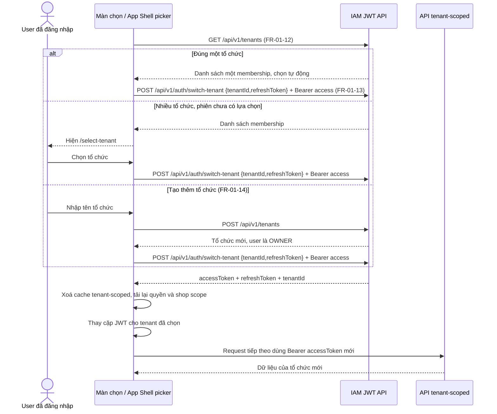
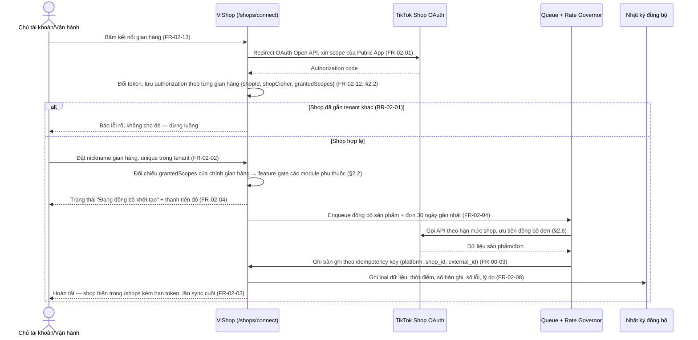
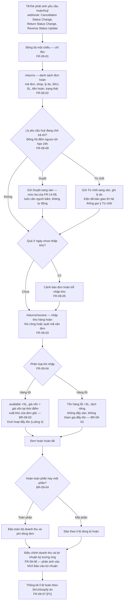
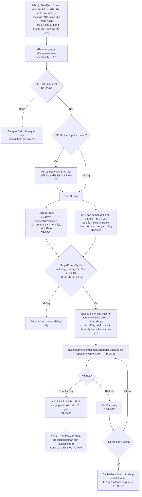
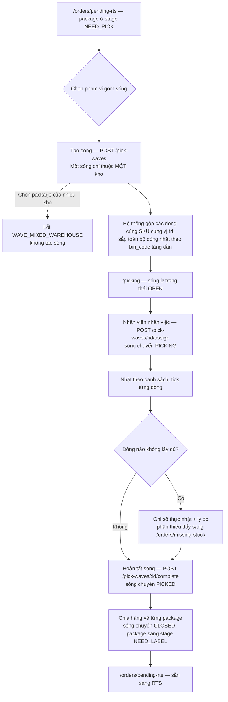
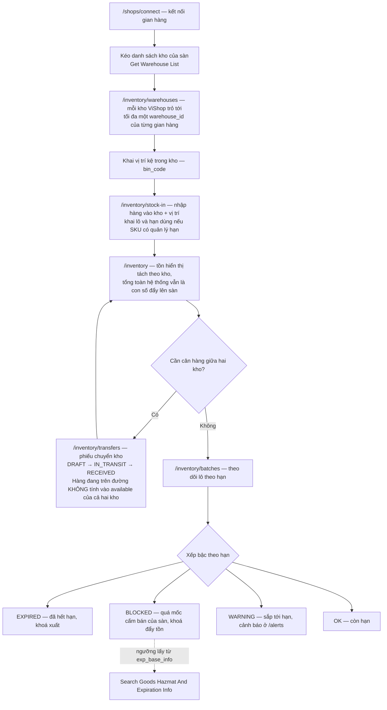

# ViShop — Sitemap & Luồng nghiệp vụ trọng yếu

**Nguồn:** `vishop-build-spec-v1.2.md` (spec đã chốt) + `vishop-function-list.md` (249 FR, đã audit — nguồn chân lý FR-ID/module/priority) + cây route thực tế trong `vishop-next/apps/app/app/[locale]/(app)`. Ký hiệu priority giữ nguyên theo Function List: P0 = bắt buộc GA · P0\* = P0 trong phạm vi có gate (chờ kết luận Legal về ToS §3.8), không chặn GA · P1 = fast-follow · P2 = chỉ thiết kế schema.

Sitemap dưới đây là cây **trang/màn hình đã dựng**, cộng màn chọn tổ chức được đánh dấu là khoảng trống bắt buộc phải bổ sung. Đây không phải cây FR — mỗi trang gom các FR cùng thực hiện một tác vụ người dùng, có ghi FR-ID để trace ngược. M00 (Nền tảng hệ thống) không có mặt vì các FR hạ tầng backend không sinh màn hình.

**Cập nhật 07/08/2026:** sitemap đã được viết lại theo 48 route thực tế của bản dựng UI, thay cho cây route dự kiến của spec v1.2. Phần §1.2 liệt kê từng chỗ lệch và lý do — đọc phần đó trước khi dùng tài liệu này để estimate.

---

## 1. Sitemap

### 1.1 Cây trang theo nhóm menu

Nhóm menu là nhóm thật trong `nav-config.ts`, không phải nhóm theo mã module — người vận hành tìm màn theo việc họ đang làm, không theo số hiệu module.

```mermaid
graph TD
  ROOT["ViShop"]

  ROOT --> G1
  ROOT --> G2
  ROOT --> G3
  ROOT --> G4
  ROOT --> G5
  ROOT --> G6

  subgraph G1["Tổng quan"]
    WORK["/work — Việc hôm nay, hàng đợi gộp theo mức gấp\nM13 · FR-13-11"]
    DASH["/dashboard — Số liệu tổng quan\nM13 · FR-13-01, FR-13-09"]
    REP_SALES["/reports/sales — Doanh thu · FR-13-03"]
    REP_INV["/reports/inventory — Tồn kho · FR-13-04"]
    REP_ORD["/reports/orders — Đơn hàng · FR-13-05"]
    REP_STAFF["/reports/staff-productivity — Năng suất nhân viên · FR-13-08"]
    REP_SCHED["/reports/schedules — Gửi báo cáo tự động · FR-13-10"]
    DASH --> REP_SALES
    DASH --> REP_INV
    DASH --> REP_ORD
    DASH --> REP_STAFF
    DASH --> REP_SCHED
  end

  subgraph G2["Vận hành đơn"]
    ORD["/orders — Danh sách hợp nhất, 6 tab lọc\nM06 · FR-06-01..07, FR-06-26, FR-06-27"]
    ORD_DETAIL["/orders/:id — Chi tiết đơn · FR-06-08..14"]
    ORD_RTS["/orders/pending-rts — Chờ RTS, gom theo bước đóng gói\nFR-06-15a..c, FR-06-16"]
    ORD_MISS["/orders/missing-stock — Thiếu tồn · FR-06-20, FR-06-22"]
    ORD_EXC["/orders/exceptions — Bất thường · FR-06-21"]
    ORD_HOLD["/orders/hold-flags — Tạm giữ & gắn cờ · FR-06-18, FR-06-19"]
    ORD_AUTO["/orders/automation-rules — Quy tắc tự động · FR-06-23, FR-06-24"]
    PICK["/picking — Nhặt hàng theo sóng\nM07 · sắp theo bin_code"]
    PRINT["/print — In tem & chứng từ\nM07 · FR-07-01a..e, FR-07-02..09, FR-07-14"]
    SCAN["/scan — Quét kiểm hàng, có chế độ toàn màn hình\nM08 · FR-08-01..09"]
    SHIP["/shipping — Theo dõi vận đơn · M06"]
    SHIP_EXC["/shipping/exceptions — Kiện cần xử lý"]
    SHIP_FEE["/shipping/fees — Đối soát cước"]
    RET["/returns — Hoàn hàng\nM09 · FR-09-01..08"]
    RET_DETAIL["/returns/:id — Chi tiết yêu cầu hoàn"]
    ORD --> ORD_DETAIL
    ORD --> ORD_RTS
    ORD --> ORD_MISS
    ORD --> ORD_EXC
    ORD --> ORD_HOLD
    ORD --> ORD_AUTO
    SHIP --> SHIP_EXC
    SHIP --> SHIP_FEE
    RET --> RET_DETAIL
  end

  subgraph G3["Hàng hoá & tồn kho"]
    PROD["/products — Sản phẩm sàn, chỉ đọc\nM03 · FR-03-01..04"]
    SKU["/skus — SKU kho · FR-03-05..13"]
    SKU_DETAIL["/skus/:id — Chi tiết SKU"]
    MAP["/sku-mapping — Ghép nối SKU\nM04 · FR-04-01..10"]
    INV["/inventory — Bảng tồn\nM05 · FR-05-01"]
    INV_WH["/inventory/warehouses — Kho & vị trí kệ · FR-05-09"]
    INV_BATCH["/inventory/batches — Lô & hạn dùng"]
    INV_IN["/inventory/stock-in — Nhập kho · FR-05-02, FR-05-07"]
    INV_OUT["/inventory/stock-out — Xuất kho · FR-05-03"]
    INV_TRF["/inventory/transfers — Chuyển kho"]
    INV_COUNT["/inventory/stocktake — Kiểm kho · FR-05-04, FR-05-08"]
    INV_LOG["/inventory/movements — Sổ biến động · FR-05-05, FR-05-06"]
    INV_PUSH["/inventory/push-settings — Cấu hình đẩy tồn · FR-05-11..13, FR-05-18/19"]
    INV_PUSHLOG["/inventory/push-logs — Nhật ký đẩy tồn · FR-05-15..17"]
    SKU --> SKU_DETAIL
    INV --> INV_WH
    INV --> INV_BATCH
    INV --> INV_IN
    INV --> INV_OUT
    INV --> INV_TRF
    INV --> INV_COUNT
    INV --> INV_LOG
    INV --> INV_PUSH
    INV_PUSH --> INV_PUSHLOG
  end

  subgraph G4["Tài chính"]
    PROFIT["/profit — Chi phí & lợi nhuận\nM10 · FR-10-01..09"]
    RECON["/reconciliation — Đối soát\nM12 · FR-12-01..09"]
  end

  subgraph G5["Tăng trưởng"]
    AFF["/affiliate — Affiliate & Live, 3 tab: creator / livestream / SKU theo kênh\nM11 · FR-11-01a..06a, FR-11-10c..17c"]
  end

  subgraph G6["Hệ thống"]
    WORKSPACE_SELECT["/select-tenant — Chọn tổ chức\nM01 · FR-01-12, FR-01-13"]
    WORKSPACE_PICKER["App Shell — Bộ chọn tổ chức\nM01 · FR-01-12..14"]
    SHOP["/shops — Danh sách gian hàng\nM02 · FR-02-03, FR-02-11"]
    SHOP_HEALTH["/shops/health — Sức khoẻ gian hàng, SPS thật của sàn"]
    SHOP_CONNECT["/shops/connect — Kết nối gian hàng · FR-02-01, FR-02-12, FR-02-13"]
    ALERT["/alerts — Trung tâm cảnh báo\nM14 · FR-14-01..07"]
    MEMBERS["/settings/members — Thành viên\nM01 · FR-01-07, FR-01-08, FR-01-11"]
    ROLES["/settings/roles — Vai trò & danh mục quyền
M01 · FR-01-03, FR-01-04, FR-01-06"]
    AUDIT["/settings/audit-log — Nhật ký thao tác"]
    BILLING["/billing — Gói cước\nM15 · FR-15-01..09"]
    SETTINGS["/settings — Cấu hình chung · M00"]
    WORKSPACE_SELECT --> WORKSPACE_PICKER
    WORKSPACE_PICKER --> SHOP
    SHOP --> SHOP_HEALTH
    SHOP --> SHOP_CONNECT
    MEMBERS --> ROLES
    MEMBERS --> AUDIT
  end

  %% Liên kết chéo thật trong IA — hàng đợi việc trỏ thẳng vào màn xử lý
  WORK -.->|hàng đợi| ORD_RTS
  WORK -.->|hàng đợi| PICK
  WORK -.->|hàng đợi| PRINT
  WORK -.->|hàng đợi| SCAN
  WORK -.->|hàng đợi| ORD_MISS
  WORK -.->|hàng đợi| MAP
  DASH -.->|FR-13-02| SHOP_HEALTH
  ORD_RTS -.->|gom sóng| PICK
  PICK -.->|nhặt xong| PRINT
  PRINT -.->|có tem| SCAN
  SCAN -.->|quét đủ| SHIP
  RET -.->|nhập kho hàng hoàn| INV_IN
  MAP -.->|BR-04-02 chặn bật đẩy tồn nếu ghép nối chưa 100%| INV_PUSH
  INV_WH -.->|bin_code| PICK
```

### 1.1a Màn chọn và bộ chọn tổ chức

`/select-tenant` là màn chặn trước App Shell khi phiên đăng nhập có nhiều membership nhưng chưa có tổ chức hiện hành. Mỗi dòng chỉ hiển thị tên tổ chức và vai trò của user trong tổ chức đó; không hiển thị shop như một cấp ngang hàng, vì một tổ chức chứa nhiều shop. Chọn một dòng gọi endpoint switch, nhận và lưu cặp JWT mang tenant context mới ở client rồi mới đi vào `/work`.

Bộ chọn thường trực nằm ở đầu sidebar của App Shell, ngay trên menu nghiệp vụ, và luôn hiển thị tên tổ chức hiện hành. Với đúng một membership, App Shell vào thẳng tổ chức đó; bộ chọn chỉ hiển thị tên cùng hành động **Tạo tổ chức**, không mở một danh sách một phần tử. Với từ hai membership trở lên, bấm vào bộ chọn mở danh sách tên tổ chức, vai trò và dấu chọn hiện hành, kèm hành động **Tạo tổ chức**.

Khi switch thành công, FE xoá toàn bộ cache mang phạm vi tenant, tải lại quyền, shop scope và dữ liệu của route hiện tại. Nếu user không có quyền vào route đó ở tổ chức mới, điều hướng về `/work`; không giữ dữ liệu cũ trong lúc tải. Request đã gửi trước thời điểm switch vẫn thuộc tổ chức cũ theo context đã resolve khi nhận request, nên UI khoá thao tác tenant-scoped cho tới khi lần tải lại hoàn tất.

**Quyết định sản phẩm 14/08/2026:** user đã đăng nhập được tạo thêm tổ chức từ bộ chọn. Form chỉ yêu cầu tên; tạo thành công không tự chuyển hoặc sao chép shop/dữ liệu, và UI thực hiện lệnh switch riêng để đưa user vào tổ chức vừa tạo.

### 1.2 Chỗ lệch giữa spec v1.2 và bản dựng

| Spec v1.2                                           | Bản dựng                                                              | Lý do                                                                                                 |
| --------------------------------------------------- | --------------------------------------------------------------------- | ----------------------------------------------------------------------------------------------------- |
| `/login`, `/register`                               | Không dựng                                                            | Bản demo bỏ toàn bộ màn xác thực theo yêu cầu; vai trò đang dùng chọn bằng công tắc trong `/settings` |
| `/scan/delivery`, `/scan/inspection` tách hai trang | Gộp về `/scan`, chọn chế độ trong màn                                 | Người kho làm hai việc trên cùng một máy quét, chuyển trang giữa chừng là mất nhịp                    |
| `/print/history`, `/print/templates`                | Gộp thành tab trong `/print`                                          | Cùng một ngữ cảnh; tách trang chỉ tăng số lần bấm                                                     |
| `/returns/receive`                                  | Thao tác trong `/returns/:id`                                         | Nhập kho hàng hoàn luôn bắt đầu từ một yêu cầu cụ thể, không có lối vào độc lập                       |
| `/affiliate/creators`, `/live`                      | Ba tab trong `/affiliate`                                             | Ba lát cắt của cùng một tập dữ liệu affiliate                                                         |
| `/profit/other-costs`, `/profit/compare`            | Chưa dựng                                                             | P1, chưa vào phạm vi bản này                                                                          |
| `/settings/billing`                                 | `/billing`                                                            | Gói cước là mục cấp một trong nhóm Hệ thống, không nằm sâu trong cấu hình                             |
| `/settings/users`                                   | `/settings/members`                                                   | Đặt tên theo "thành viên tổ chức", khớp với `/settings/roles`                                         |
| `/settings/shop-groups`, `/settings/security`       | Chưa dựng                                                             | P1                                                                                                    |
| `/skus/import-export`                               | Nhập/xuất tệp là hành động trong `/skus`                              | Không đủ nội dung cho một trang riêng                                                                 |
| `/alerts/settings`                                  | Tab trong `/alerts`                                                   | —                                                                                                     |
| Không có                                            | `/work`                                                               | Màn hàng đợi việc trong ngày, thêm sau khi rà lại nhu cầu vận hành                                    |
| Không có                                            | `/picking`                                                            | Sóng nhặt hàng — xem §7                                                                               |
| Không có                                            | `/shipping`, `/shipping/exceptions`, `/shipping/fees`                 | Module theo dõi vận chuyển, thêm ở lô A1                                                              |
| Không có                                            | `/shops/health`                                                       | Điểm SPS thật của TikTok thay cho ngưỡng tự đặt                                                       |
| Không có                                            | `/reports/schedules`                                                  | Hiện thực hoá FR-13-10 thành trang riêng                                                              |
| Không có                                            | `/inventory/warehouses`, `/inventory/batches`, `/inventory/transfers` | Nâng M05 thành quản lý kho thật — xem §7                                                              |
| Không có                                            | `/settings/audit-log`                                                 | Nhật ký thao tác nội bộ                                                                               |
| Không có                                            | `/select-tenant` + bộ chọn trong App Shell                            | Khoảng trống của bản dựng: bắt buộc để user có nhiều membership chọn và switch tổ chức                |

**FR không có trang trong sitemap (đúng theo priority P2 = chỉ thiết kế schema, không có UI ở Phase 1):** FR-00-08 (webhook receiver, kiến trúc sẵn), FR-03-16 (đa đơn vị tính), FR-05-10 (dự trữ chương trình — `reserved`), FR-06-25 (tách đơn — `parent_order_id`), FR-12-10 (đối chiếu sao kê ngân hàng, còn chờ xác nhận khả dụng thị trường SEA). Loại khỏi cây trang có chủ đích, không phải bỏ sót.

**Trợ lý ViAI không có trang riêng và sẽ không có.** Khung hội thoại (FR-13-14) mở đè bên phải từ thẻ trợ lý ở sidebar, giữ nguyên màn đang làm việc phía sau. Cho nó một route là bắt người dùng rời việc đang làm để đi hỏi, đúng cái mà nó sinh ra để tránh. Mọi nút trên thẻ trả lời đều dẫn về một trang đã có trong cây trên — `/work`, `/orders/pending-rts`, `/inventory`, `/inventory/batches`, `/shipping/exceptions`, `/shops/health`, `/picking`, `/print` — nên trợ lý là một lối vào IA, không phải một nhánh IA mới. Bối cảnh: [vishop-ai-automation-roadmap.md](./vishop-ai-automation-roadmap.md).

**FR-05-09 (đa kho) đã ra khỏi danh sách P2.** Đa kho không còn là một cột `warehouse_id` để dành mà là một module có màn hình: `/inventory/warehouses` (kho + vị trí kệ), `/inventory/transfers` (chuyển kho), tồn tách theo kho trong `/inventory`. Cơ sở phía sàn là [Get Warehouse List](https://partner.tiktokshop.com/docv2/page/650aa418defece02be6e66b6) — TikTok trả danh sách kho của gian hàng, và [Inventory Search](https://partner.tiktokshop.com/docv2/page/650a9191c16ffe02b8eec161) trả tồn theo từng `warehouse_id`. Ranh giới giữa kho ViShop và kho TikTok ghi tại §5.1 của `vishop-api-contract.md`.

### 1.3 Luồng 0 — Chọn hoặc chuyển tổ chức

`X-Tenant-Id` từ client không override context đã ký. Tenant lấy từ access JWT; đổi tenant không thay context của JWT đã cấp cho tab khác.

---

## 2. Luồng 1 — Kết nối gian hàng lần đầu → Đồng bộ khởi tạo

**Ghi chú luồng:**

- Module mở khoá theo scope gian hàng đã cấp, không theo vai trò: nhóm `seller.product.info`/`order.info`/`fulfillment`/`finance.info` mở tồn kho, đơn, package, RTS, tem và tài chính sau payout; `seller.affiliate_collaboration.read` mở các bảng affiliate; `data.shop_analytics.public.read` mở livestream. Màn hình thiếu scope hiển thị trạng thái khoá kèm lý do và nút uỷ quyền lại — không ẩn, không trả bảng rỗng (§2.2).
- Kết nối lại sau gián đoạn dùng lại chính luồng này nhưng rẽ theo FR-02-07: giữ dữ liệu lịch sử, kéo bù đơn phát sinh trong lúc mất kết nối, không tạo trùng.
- Shop rơi vào "Cần kết nối lại" (gia hạn token thất bại — FR-02-05) tự động dừng đẩy tồn theo BR-02-03 cho đến khi kết nối lại thành công.

---

## 3. Luồng 2 — Xử lý đơn: nhận đơn → ghép SKU → nhặt hàng → RTS → in tem → quét kiểm → bàn giao

Luồng này đi qua chín bước đóng gói (`PackageStage`) và **các bước không được nhảy cóc**. Bảng đầy đủ từng bước, điều kiện vào và mã lỗi khi làm sai thứ tự nằm ở §4.3 của `vishop-api-contract.md`.

```mermaid
flowchart TD
    A["Đơn về từ TikTok Shop\nGet Order List, khoá idempotent (platform, shop_id, external_id)\nFR-00-03"] --> B["/orders — vào danh sách hợp nhất\nFR-06-01, FR-06-26"]
    B --> C["Tạo package cho đơn\nFR-06-15a"]
    C --> D{"SKU đã ghép nối?\nstage = NEED_MAPPING"}
    D -- Chưa --> E["/sku-mapping — Cần ghép nối\nFR-04-09, BR-04-01: KHÔNG trừ tồn\nnhưng vẫn cho RTS và in tem"]
    E --> F["Gợi ý tự động: mã trùng → mã vạch trùng → tên tương đồng\nFR-04-02, chấp nhận hàng loạt FR-04-03\nhoặc ghép thủ công FR-04-04 / tự tạo SKU FR-04-05"]
    F --> G["Ghép nối lưu lại, áp cho đơn hiện tại nếu chọn áp ngược\nBR-04-03"]
    D -- Rồi --> H["Trừ tồn locked theo package\nBR-06-07"]
    G --> H
    H --> I{"Đủ available?"}
    I -- Thiếu --> J["/orders/missing-stock — ghi tồn âm ảo + cảnh báo\nFR-06-20, BR-06-03: KHÔNG chặn RTS/in tem"]
    I -- Đủ --> PK
    J --> PK["/picking — gom vào sóng nhặt\nstage NEED_PICK → PICKING\ndòng nhặt sắp sẵn theo bin_code — §7"]
    PK --> S["/scan — mở kiện bằng MÃ KIỆN, quét từng mã vạch SP\nstage NEED_SCAN · FR-08-02"]
    S --> T{"Đối chiếu đủ/thiếu/sai?"}
    T -- Sai/Thiếu --> U["Cảnh báo âm thanh + màu, không ghi nhận\nchặn hoàn tất — FR-08-03, FR-08-04"]
    U --> S
    T -- Đủ --> K["/orders/pending-rts — Batch Ship Packages\nstage NEED_SHIP · FR-06-15b"]
    K --> L["Hàng đợi RTS retry riêng từng package\npackage lỗi không chặn lô — FR-06-15c"]
    L --> M{"RTS thành công?"}
    M -- Thất bại --> L
    M -- Thành công --> N["Get Package Shipping Document trả về\ndoc_url + tracking_number trong CÙNG một lần gọi\nstage NEED_LABEL → NEED_PRINT · FR-06-16, FR-07-14"]
    N --> P["/print — merge PDF theo thứ tự chọn,\nmặc định sắp theo bin_code, chuẩn hoá khổ giấy\nFR-07-01a..c"]
    P --> V["In xong — đánh dấu Đã in\nstage READY_TO_HANDOVER · FR-07-06"]
    V --> W["Bàn giao carrier — quét mã vận đơn hoặc đánh dấu hàng loạt\nstage SHIPPED · FR-06-17, FR-08-01"]
    W --> X["/shipping — theo dõi hành trình\nFR-06-14"]
```

**Ghi chú luồng:**

- Hai nhánh miễn trừ (`BR-04-01` SKU chưa ghép nối, `BR-06-03` thiếu tồn) đều theo cùng nguyên tắc: không chặn dòng tiền của khách, xử lý bù trừ ở hậu kỳ chứ không chặn ở cửa vào.
- **Ba chốt chặn thứ tự** (chi tiết và mã lỗi tại §4.3 `vishop-api-contract.md`): chỉ quét kiểm kiện đang ở `NEED_SCAN`, mở bằng mã kiện (`422 scan_stage_not_reached`); không gọi lệnh giao cho kiện chưa quét kiểm; tem và mã vận đơn về cùng lúc **sau** `Ship Package`, nên không có trạng thái "có mã nhưng chưa có tem". Quét kiểm đứng trước lệnh giao vì Việt Nam không huỷ lại được sau `AWAITING_COLLECTION` — phát hiện thiếu hàng sau khi đã cam kết với hãng là không gỡ được.
- Bước đóng gói của **đơn** = bước chậm nhất trong các package của đơn đó. Đơn hai kiện, một kiện đã in tem một kiện chưa, thì đơn vẫn ở `NEED_PRINT`.
- Package Seller Shipping tách khỏi toàn bộ nhánh in tem TikTok từ bước lọc (`FR-07-01e`, `BR-07-07`) — không có tem TikTok, nhập mã vận đơn thủ công theo `BR-06-08`.
- Quét kiểm hàng chỉ chạy được khi 100% SKU trong package đã ghép nối và có mã vạch (`BR-08-01`) — package còn SKU chưa ghép nối ở bước D thì buộc đi qua nhánh E trước khi tới được bước S.
- API liên quan: [Ship Package](https://partner.tiktokshop.com/docv2/page/650aa4f1defece02be6e7cb1) · [Batch Ship Packages](https://partner.tiktokshop.com/docv2/page/650aa3ebbace3e02b75d8bd4) · [Get Package Shipping Document](https://partner.tiktokshop.com/docv2/page/650aa5fac16ffe02b8f112ca) · [Get Package Detail](https://partner.tiktokshop.com/docv2/page/650aa39fbace3e02b75d8617) · [Get Shipping Providers](https://partner.tiktokshop.com/docv2/page/650aa48d4a0bb702c06d85cd).

---

## 4. Luồng 3 — Xử lý hoàn hàng

**Ghi chú luồng:**

- Chỗ này trước đây là một nút GAP: ViShop chỉ đọc được yêu cầu hoàn mà không trả lời được, trong khi TikTok tự duyệt sau 24h. Đã chốt ngày 07/08/2026 bằng `FR-09-09` — Duyệt/Từ chối nằm ngay trên danh sách `FR-09-02`, không mở màn mới. Đồng hồ tính từ mốc phát sinh yêu cầu do webhook trả về, không tính từ lúc ViShop nhận được, để không ăn gian mất vài phút hàng đợi.
- `BR-09-01` áp dụng xuyên suốt: hàng hoàn không tự cộng lại tồn ở bất kỳ bước nào trước khi qua `/returns/receive` — kể cả khi trạng thái trên sàn đã "Đã hoàn".
- Nhập tay đơn hoàn khi sàn không đẩy về (`FR-09-08`, P1) là lối vào thay thế cho bước C, dùng khi webhook lỗi hoặc đơn phát sinh hoàn ngoài luồng TikTok.

---

## 5. Luồng 4 — Đẩy tồn kho tự động

**Ghi chú luồng:**

- Tỉ lệ đẩy (`FR-05-12`) và tồn an toàn (`FR-05-13`) là tham số cấu hình theo shop hoặc theo SKU tại `/inventory/push-settings` — nhánh G chỉ áp công thức `BR-05-01`, không phải nơi đặt giá trị.
- Đẩy tồn là một chiều ViShop → sàn (`BR-05-04`) — sửa tồn trực tiếp trên Seller Center sẽ bị ghi đè ở lần đẩy kế tiếp, phải cảnh báo rõ khi seller bật tính năng lần đầu (`FR-05-19`, P1).
- Nhánh H là SKU sàn dạng combo ghép nối của ViShop (`FR-04-06`) — một SKU sàn thường, sàn không chặn ghi tồn; đích đẩy là chính SKU sàn đó, gọi thẳng Update Inventory API như nhánh G, chỉ khác công thức tính SL (`BR-05-03` thay vì `BR-05-01`).
- Khác với nhánh H là SKU combo native TikTok (`COMBINED_PRODUCT`) — Update Inventory API từ chối sửa tồn trực tiếp cho loại này (lỗi 12052849/12052850, ghi chú kỹ thuật tại `FR-05-16`); ViShop không gọi API cho SKU đó, các SKU thành phần được đẩy qua luồng đẩy tồn thông thường của chính chúng (qua nhánh G), không phải một bước "resolve combo về SKU con" riêng.
- Lưu ý: `BR-05-03` trong build-spec không phân biệt hai loại combo này; tách bạch ở trên là diễn giải dựa trên ghi chú audit `FR-05-16`/`FR-04-10`, cần Tech Lead xác nhận trước khi implement.
- Gian hàng ưu tiên (`FR-05-18`, P1) là biến thể của nhánh G: khi tồn dưới ngưỡng, shop được đánh dấu ưu tiên giữ nguyên SL đẩy, các shop còn lại nhận SL đẩy = 0 thay vì chia đều.
- Đích gọi là [Update Inventory](https://partner.tiktokshop.com/docv2/page/6503068fc20ad60284b38858). Với gian hàng nhiều kho, một lần gọi cập nhật được nhiều `warehouse_id` nhưng **không thêm/bớt được kho** cho SKU — danh sách kho của một SKU do TikTok quyết định, ViShop chỉ ghi số lượng vào các kho đã có.

---

## 6. Luồng 5 — Sóng nhặt hàng

Trước lô này, người kho nhận một tập package rời và tự quyết định đi lấy hàng theo thứ tự nào. Với kho có kệ đánh mã, thứ tự đi lại quyết định phần lớn thời gian đóng gói — nên bước gom sóng được tách thành một màn riêng.

**Ghi chú luồng:**

- Ràng buộc một sóng một kho là ràng buộc vật lý, không phải quy ước phần mềm: người nhặt không đi được hai kho trong một vòng.
- `/print` mặc định sắp tem theo `bin_code` chứ không theo mã đơn, để thứ tự chồng tem trùng thứ tự chồng hàng vừa nhặt. Ai muốn sắp theo mã đơn vẫn đổi được ở bộ chọn thứ tự.
- Danh sách endpoint và ví dụ payload ở §4.4 của `vishop-api-contract.md`.

---

## 7. Luồng 6 — Đa kho, vị trí kệ và hạn sử dụng

**Ghi chú luồng:**

- **Kho ViShop ≠ kho TikTok.** Kho trong ViShop là kho vật lý có kệ, có người nhặt hàng; kho TikTok là một `warehouse_id` để ghi tồn. Một kho ViShop ánh xạ tới nhiều `warehouse_id` (mỗi gian hàng một cái), không phải quan hệ một–một. Chi tiết ở §5.1 của `vishop-api-contract.md`.
- Mốc cấm bán theo hạn dùng **không do ViShop tự đặt**: lấy từ `exp_base_info` trả về bởi [Search Goods Hazmat And Expiration Info](https://partner.tiktokshop.com/docv2/page/69e7252e795c140490ac8ef4). Đặt ngưỡng riêng thì hàng vẫn bị sàn chặn mà ViShop báo "còn bán được".
- Nguồn dữ liệu tồn theo kho: [Inventory Search](https://partner.tiktokshop.com/docv2/page/650a9191c16ffe02b8eec161) trả `inventory[].warehouse_id` cho từng SKU.
- Số đẩy lên sàn vẫn là **tổng available toàn hệ thống**, không phải tồn từng kho — trừ khi seller bật chế độ đẩy theo kho trong `/inventory/push-settings`. Lý do: đa số seller Việt Nam giao hàng từ bất kỳ kho nào, chia tồn theo kho chỉ làm mất đơn.
