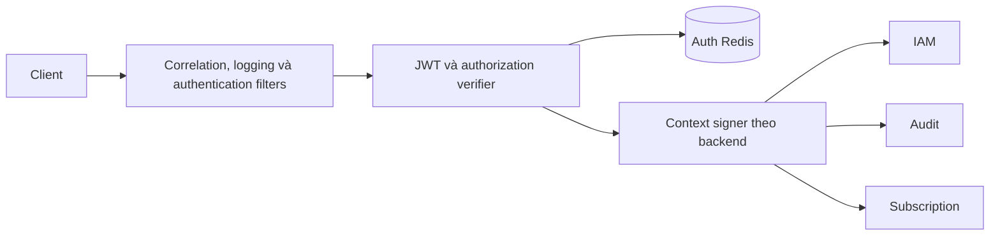

# Thiết kế API Gateway

Dùng Spring Cloud Gateway. Route khai báo trong
[application.yml](../src/main/resources/application.yml); route CMS Audit phải được
match trước route CMS tổng quát tới IAM. OpenAPI được định tuyến riêng cho từng service.

`LocalAuthenticationVerifier` phối hợp kiểm tra claims và projection;
`GatewayRequestPolicy` quản lý policy HTTP;
`GatewayRequestForwarder` và `GatewayContextSigners` chuẩn bị request nội bộ.
Gateway chưa có route/runtime Notification trong cấu hình hiện tại.

Contract dùng chung: [API Gateway](../../../docs/core-architecture/api-gateway.md)
và [Gateway authorization](../../../docs/core-architecture/gateway-authorization.md).
