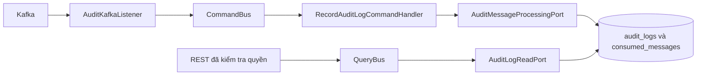

# Thiết kế Audit

Service có một bounded context `modules.auditlog`, phân lớp domain, application,
infrastructure và presentation.

Listener chuyển event sang command; adapter persistence đảm bảo ghi nhật ký và marker
chống trùng nguyên tử. Lỗi propagate về cơ chế retry/DLT Kafka dùng chung.
Query trả projection, không ghi dữ liệu. Runtime không scan các producer outbox component
và không cần scheduler cho luồng consumer-only này.

Chi tiết module và kiểm chứng: [README service](../README.md).
