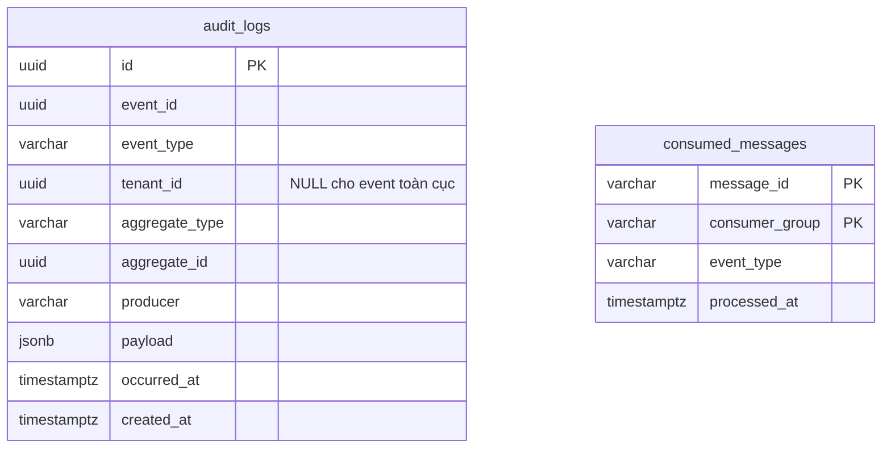

# Database Audit

PostgreSQL riêng: `vishop_audit`. Có hai bảng; service hiện không có producer outbox.

Hai bảng không có FK với nhau. `consumed_messages` đảm bảo idempotency theo
`(message_id, consumer_group)`; không coi index `audit_logs.event_id` là unique constraint.
Index hỗ trợ tìm theo event, tenant/thời gian và aggregate/thời gian.

[V1](../src/main/resources/db/migration/V1__init_audit_schema.sql) tạo schema;
[V2](../src/main/resources/db/migration/V2__rename_audit_recorded_at_to_created_at.sql)
đổi `recorded_at` thành `created_at`, giữ dữ liệu.
Lệnh migrate và cấu hình: [README service](../README.md).
