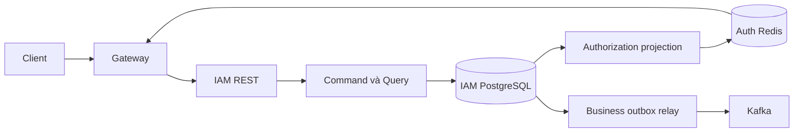

# Thiết kế IAM

Runtime tổ chức nghiệp vụ trong các module identity và tenant; phần composition nối
các contract công khai của module. Domain không phụ thuộc entity/repository của module khác.

API đăng nhập kiểm tra credential; API nghiệp vụ kiểm tra context nội bộ và trạng thái
hiện hành theo thiết kế IAM. PostgreSQL là nguồn dữ kiện bền vững; Redis là projection
ủy quyền. Thay đổi DB và outbox cùng transaction; không phát dữ liệu chưa commit.

Xem [README service](../README.md), [Gateway authorization](../../../docs/core-architecture/gateway-authorization.md)
và [Authentication flow](../../../docs/core-architecture/authentication-flow.md) cho contract chi tiết.
