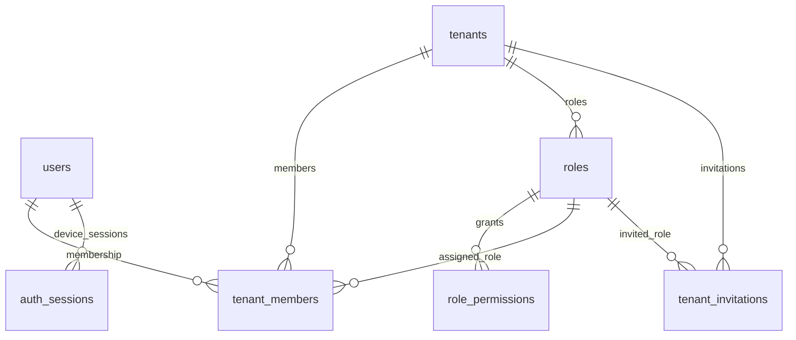

# Database IAM

PostgreSQL riêng: `vishop_iam`. Schema được quản lý tại
[db/migration](../src/main/resources/db/migration); Hibernate chỉ validate, migration chạy riêng.

| Nhóm | Bảng hiện hành |
| --- | --- |
| Tài khoản và tenant | `users`, `tenants` |
| Phân quyền | `roles`, `role_permissions`, `tenant_members` |
| Lời mời | `tenant_invitations` |
| Phiên thiết bị | `auth_sessions` |
| Projection quyền | `authorization_outbox` |
| Messaging | `outbox_events`, `consumed_messages` |

ERD thể hiện các quan hệ chính. FK role theo tenant và các ràng buộc invitation được
định nghĩa đầy đủ trong migration. Không join/FK sang database service khác.

`sessions` và `security_states` lịch sử đã bị xóa ở V4; `auth_sessions` được thêm ở V12.
Không dùng schema cũ để mô tả phiên hiện tại. `authorization_outbox` lưu projection theo
key/revision; `outbox_events` lưu business event, hai bảng có mục đích khác nhau.

Lệnh migrate, credentials và yêu cầu nâng cấp: [README service](../README.md).
Quy chuẩn: [Persistence](../../../docs/core-architecture/persistence.md).
