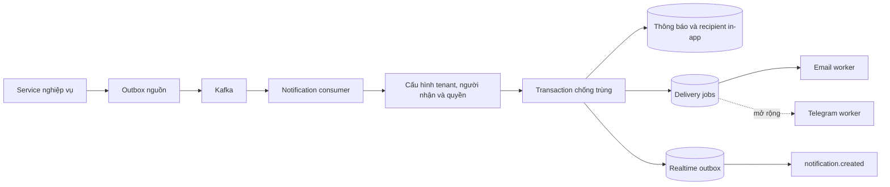

# Thiết kế Notification

Hiện có module database-only và CLI Flyway. Luồng dưới đây là thiết kế runtime,
chưa phải thành phần đang chạy.

Consumed marker, thông báo, recipient, delivery job, dedup state và outbox phải được ghi
nguyên tử. Email worker dùng lease/token để claim và fence kết quả; retry có giới hạn.
Không đảm bảo exactly-once với SMTP khi kết quả provider không xác định.

Realtime chỉ phát `{ notificationId, tenantId }`; client lấy nội dung bằng API được
kiểm tra quyền. Telegram cần sender và mở rộng queue/dedup trước khi hoạt động.
Secrets storage và API test kết nối bot chưa được triển khai.

Cấu hình, migration và giới hạn chi tiết: [README service](../README.md).
