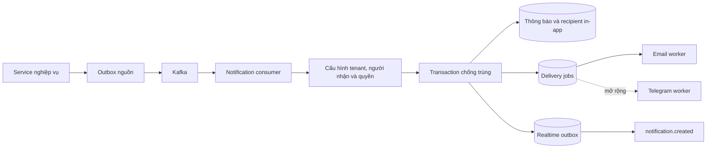
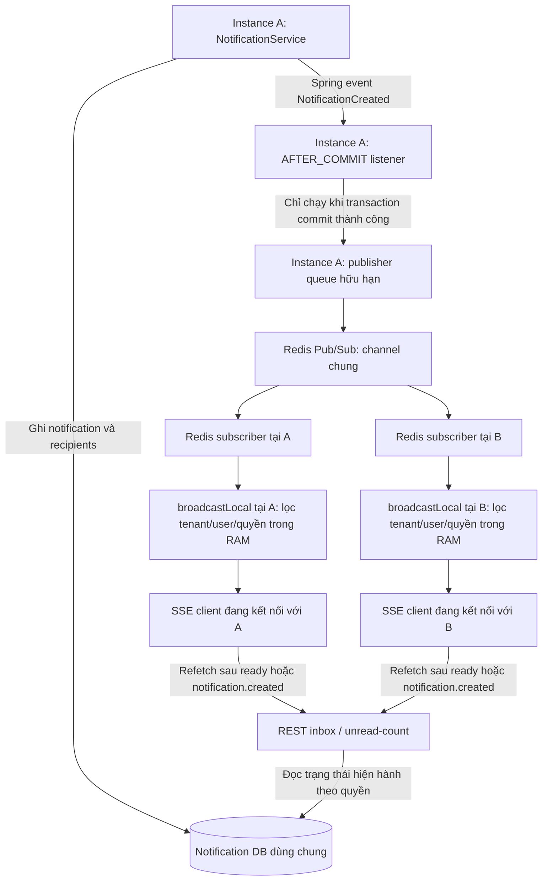
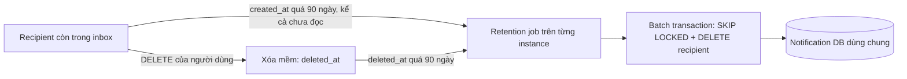

# Thiết kế Notification

Hiện có 3 module `notification`, `setting`, `announcement`, composition contract và CLI Flyway.
Module `notification` thống nhất nội dung, inbox và external delivery; các trách nhiệm này
được phân biệt bằng service/API bên trong module.
Module [notification-setting](setting.md) chỉ có HTTP, transaction service và JPA cho
notification_settings. Policy feature/type/recipient/preference chờ triển khai sau.
[Thiết kế module](module-design.md) ghi rõ code đã có và adapter còn thiếu.
Danh mục nằm trong [shared constants](constants.md); không còn module/API catalog.
PostgreSQL kiểm tra schema dữ liệu cấu hình/history. Main runtime và Gateway context
verifier vẫn chưa triển khai.
Adapter realtime đã có luồng sau commit → Redis Pub/Sub → SSE cục bộ trên từng instance.

## Luồng nghiệp vụ dự kiến

Luồng dưới đây là thiết kế runtime, chưa phải thành phần đang chạy.

Consumed marker, thông báo, recipient, delivery job, dedup state và outbox phải được ghi
nguyên tử. Email worker dùng lease/token để claim và fence kết quả; retry có giới hạn.
Không đảm bảo exactly-once với SMTP khi kết quả provider không xác định.

Realtime chỉ phát `{ notificationId, tenantId }`; client lấy nội dung bằng API được
kiểm tra quyền. Telegram cần sender và mở rộng queue/dedup trước khi hoạt động.
Secrets storage và API test kết nối bot chưa được triển khai.

## Realtime SSE giữa các instance

Sơ đồ dưới mô tả adapter Redis/SSE đã có trong code. Ví dụ notification được tạo tại instance A;
các instance khác cũng có thể tạo và publish theo cùng luồng. Chúng dùng chung Notification DB,
Redis và channel; registry và socket SSE nằm riêng trong RAM của từng instance.

`NotificationRedisRelay.publishAfterCommit()` giữ `@TransactionalEventListener(AFTER_COMMIT)`.
Publisher chỉ gửi Redis; cả A và B nhận qua subscriber rồi gọi `NotificationSseStreams.broadcastLocal()`.
Subscriber không ghi lại notification vào DB hoặc republish event. Payload Redis nội bộ có thông tin
định tuyến; payload SSE xuống frontend chỉ gồm `{notificationId, tenantId}`.

Redis Pub/Sub không có replay. Khi resubscribe, adapter yêu cầu phát lại `ready` trên các SSE đang mở
để frontend đồng bộ REST. Frontend cũng đồng bộ khi reconnect, quay lại tab và đối soát định kỳ.
Luồng hiện tại là best-effort; realtime outbox trong sơ đồ nghiệp vụ phía trên vẫn là phần dự kiến.
Chi tiết cấu hình, hàng chờ và các ca kiểm chứng: [Redis fan-out SSE](realtime-redis.md).

## Vòng đời recipient

Job đã có code, mặc định tắt; giữ notification chung, khóa chống trùng sự kiện và delivery.
Mỗi batch commit riêng, có giới hạn số dòng và số batch mỗi lượt. Chi tiết hai mốc hết hạn,
cấu hình và ảnh hưởng đồng bộ frontend: [retention recipient](retention.md).

Cấu hình, migration và giới hạn chi tiết: [README service](../README.md).
