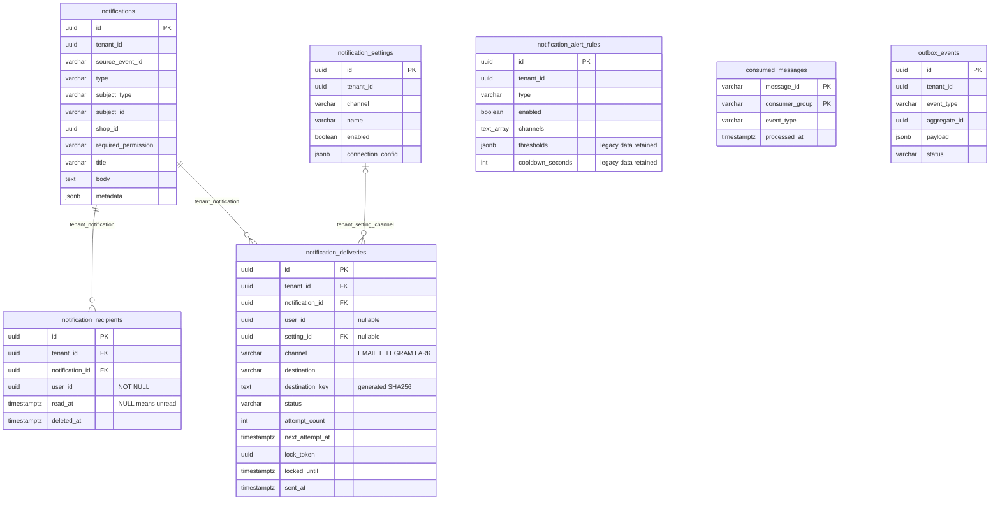

# Database Notification

Schema V19 có **7 bảng nghiệp vụ**, nâng cấp nhiều nhóm Lark bằng [migration V19](../src/main/resources/db/migration/V19__allow_multiple_lark_group_settings.sql).
Database riêng: `vishop_notification`. V1–V17 giữ nguyên checksum. V18 xóa archive cooldown
và bảng attempt history không dùng; giữ nội dung, recipient, setting, rule, delivery, consumed marker và outbox.

## Trách nhiệm từng bảng

| Bảng | Trách nhiệm |
| --- | --- |
| `notifications` | Nội dung chung, sự kiện nguồn, đối tượng nghiệp vụ, quyền và phạm vi shop |
| `notification_recipients` | Inbox in-app của từng user; trạng thái đọc/ẩn riêng |
| `notification_settings` | Kết nối provider theo tenant/kênh, tên, bật/tắt và connection_config |
| `notification_alert_rules` | Bật/tắt loại thông báo và tập kênh channels |
| `notification_deliveries` | Hàng đợi EMAIL/TELEGRAM/LARK, đích gửi, retry và lease |
| `consumed_messages` | Chống xử lý lặp sự kiện |
| `outbox_events` | Phát sự kiện sau khi transaction thành công |

Danh mục feature/type nằm trong code. Không khôi phục các bảng catalog, personal preferences hoặc danh sách user theo rule đã được loại bỏ trước đây.

## Người nhận và đích gửi

In-app luôn có một dòng `notification_recipients` cho mỗi user nhận thông báo.
Khóa chính là `id` UUIDv7; unique `(tenant_id, notification_id, user_id)` ngăn tạo trùng inbox.
API lấy danh sách bằng tenant/user từ principal, join nội dung theo tenant/notification và đọc `read_at` của recipient đó. Đánh dấu đọc chỉ sửa dòng recipient.

Kênh ngoài dùng `notification_deliveries`. `user_id` có thể có khi gửi cho một người, hoặc NULL khi gửi nhóm Telegram, webhook Lark hay email ngoài hệ thống.
`destination` bắt buộc, tối đa 2048 ký tự, là snapshot đích gửi lúc tạo job.
Queue không nhận IN_APP; trạng thái đã đọc không thuộc queue.

`setting_id` tùy chọn để tương thích job cũ và gửi giao dịch không gắn cấu hình tenant.
Khi có ID, FK `(tenant_id, setting_id, channel)` bảo đảm đúng tenant và đúng kênh.
JPA ánh xạ `delivery.notification` và `recipient.notification` bằng `@ManyToOne`
với cặp tenant/notification; `delivery.setting` join theo tenant/setting/channel.
Các association dùng LAZY và join chỉ đọc; cột UUID/channel là nguồn ghi duy nhất.
Chiều ngược dùng `@OneToMany(mappedBy=...)`: `notification.recipients`,
`notification.deliveries` và `setting.deliveries`. Collection tải LAZY; việc lưu/xóa delivery
và recipient đi qua repository của chúng, không cascade từ collection cha.
Tắt/xóa mềm setting không xóa lịch sử job. Không dùng cascade delete.

Không có FK tới user/tenant/shop của service khác. Quyền xem dữ liệu và audience của nhóm ngoài hệ thống vẫn do RecipientDirectory/adapter tin cậy kiểm tra.

## Cấu hình và kênh

LARK có nhiều setting mỗi tenant, mỗi nhóm được chọn bằng settingId.
V19 thay unique `(tenant_id, channel)` bằng partial unique index chỉ áp dụng với kênh khác LARK.
Unique `(tenant_id, id, channel)` được giữ để bảo vệ FK của delivery.
connection_config chứa cấu hình và tham chiếu secret; API không trả secret.
IN_APP/EMAIL/TELEGRAM vẫn dùng một kết nối cho mỗi tenant/kênh.

Rule unique `(tenant_id, type)`. V16 chuyển bốn boolean thành `channels TEXT[]`,
ví dụ `['IN_APP','TELEGRAM']`; tập rỗng hợp lệ.
DB chặn mã lạ, NULL, phần tử trùng và mảng nhiều chiều. Entity/JPA adapter dùng trường mới; API vẫn trả tập kênh.

thresholds và cooldown_seconds cũ được giữ để không mất dữ liệu. API setting hiện chưa sử dụng hai trường này; không tự coi chúng là policy dispatch đã có hiệu lực.

## Chống trùng và lịch sử

V17 từng đổi tên bảng dedup cũ thành `notification_deduplication_archive`.
V18 xóa archive này và `notification_delivery_attempts` theo yêu cầu dọn bảng không dùng.
Chi tiết lỗi và từng lần gọi provider thuộc logging; trạng thái và số lần thử nằm ở delivery.
Phần khóa dưới đây chỉ mô tả lịch sử schema V16–V17, không còn trong DB hiện tại.
Các khóa lịch sử gồm tenant, type, subject, channel và recipient_key do DB sinh:

- Route user: `USER:<userId>`. In-app bắt buộc có user và không có destination.
- Route có destination: `DESTINATION:<SHA256(destination chuẩn hóa)>`, kể cả khi kèm userId. Nhiều user trỏ cùng nhóm dùng cùng khóa cooldown.
- EMAIL cũ chưa có destination giữ khóa user; không suy đoán địa chỉ để backfill.

Các khóa trên chỉ mô tả dữ liệu lưu trữ, không còn quyết định có gửi thông báo hay không.
Hai sự kiện khác ID cho cùng đối tượng vẫn được xử lý độc lập.

Destination được trim; riêng EMAIL chuyển về chữ thường. Telegram/Lark giữ phân biệt hoa thường.
Quy tắc này cũng dùng cho unique delivery `(tenant_id, notification_id, channel, destination_key)`.
Hash SHA256 giữ kích thước index ổn định với webhook URL dài.
Hàm notification_destination_key dùng chuyển đổi UTF-8 cố định, không cần extension.

Chống xử lý lại sự kiện dựa trên consumed marker/source event; unique delivery chống
trùng đích nhận trong cùng thông báo. Schema không tự tạo worker hoặc gọi provider.
Queue giữ nguyên attempts, retry, lease, trạng thái và dữ liệu template.
Job mới không chỉ định template dùng GENERIC_NOTIFICATION; template cũ không đổi.

## Index và audit

Giữ index inbox theo tenant/user và unread; bổ sung idx_notifications_feed cho tenant/created_at/id khi nội dung chưa xóa.
Giữ index pending, lease hết hạn và lịch sử delivery. Index của bảng attempt bị xóa cùng bảng ở V18.

Các bảng nội dung, inbox và setting giữ created_at, updated_at, deleted_at, version.
Queue giữ audit/version, hủy bằng status. Các bảng sự kiện dùng timestamps chuyên biệt.
ID mới do ứng dụng cấp bằng UuidV7.nextId(), không có runtime UUID default.

## Nâng cấp và giới hạn

V16 backfill channels từ các cờ cũ, backfill ID dedup từ last_notified_at.
Giữ bản ghi xóa mềm, type legacy, metadata, read/archive state, template, job, attempt,
cooldown, consumed-message và outbox. Test nâng cấp V15 so sánh dữ liệu cả 9 bảng trước/sau và kiểm tra migrate lần hai không thay đổi gì.

Triển khai code JPA mới cùng đợt migration: code cũ còn đọc các cột boolean đã thay thế.
Không chạy lẫn phiên bản cũ/mới trong lúc đổi schema. Các thay đổi đã yêu cầu ở V14/V15 giữ nguyên lịch sử migration.

Delivery đã có JPA entity, mapper/repository adapter và cấu hình Spring.
Provider worker và audience resolver vẫn cần tích hợp; schema và JPA hỗ trợ các kênh
không đồng nghĩa hệ thống đã gửi được Telegram/Lark.
Xem [README](../README.md) để chạy CLI migrate cho đúng database.
