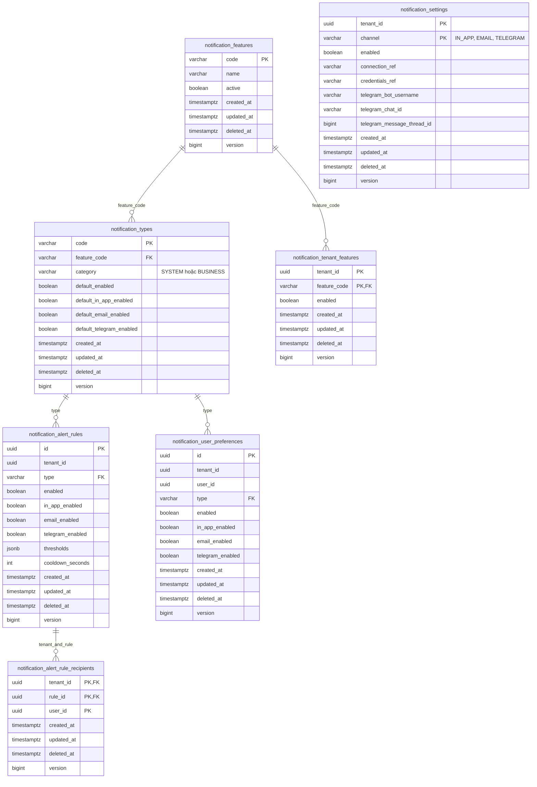
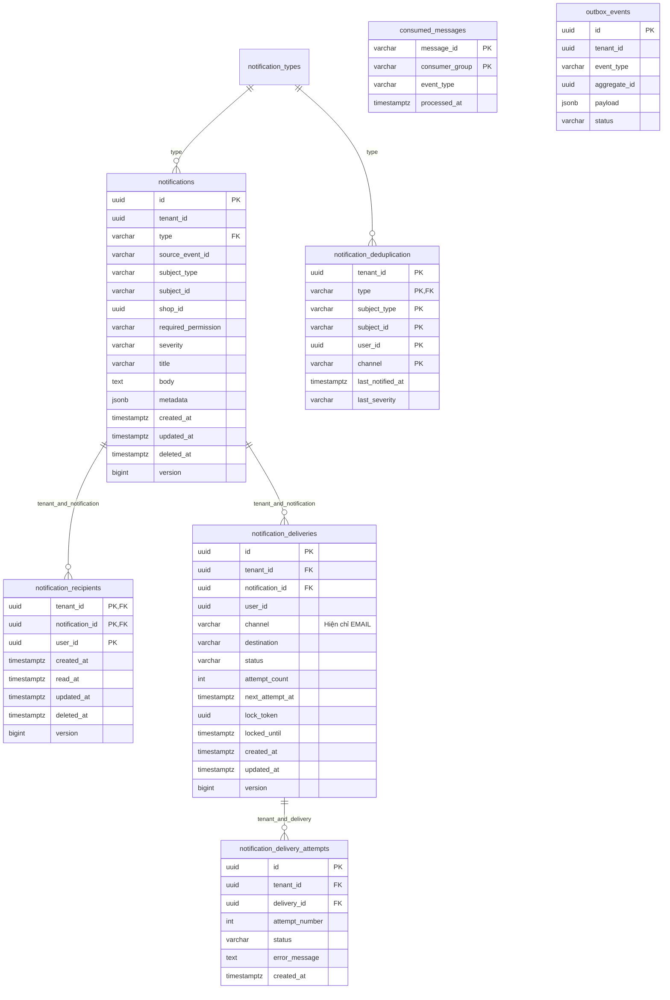

# Database Notification

Database riêng: `vishop_notification`. Schema hiện hành sau V5 gồm 14 bảng.
[Migration SQL](../src/main/resources/db/migration) là nguồn kiểm chứng DDL;
[README service](../README.md) chứa lệnh migrate và cấu hình môi trường.

## Cấu hình

`notification_settings` unique theo tenant/channel. Bật Telegram yêu cầu chat ID và
`credentials_ref` không rỗng; token thật được lưu ngoài schema, không lưu plaintext tại đây.
`connection_ref` trỏ cấu hình provider ngoài DB. Secret storage chưa triển khai.

Tenant rule unique theo `(tenant_id, type)`; personal preference unique theo
`(tenant_id, user_id, type)`. Catalog loại/tính năng dùng chung toàn platform;
các lựa chọn và kết nối được tách tenant.

## Thông báo và giao nhận

Các trường trong ERD là trường chính; toàn bộ cột, CHECK và index nằm trong migration.
FK nội bộ giữa dữ liệu tenant luôn kèm tenant ID. User/tenant/shop là external reference;
không tạo FK hoặc join DB của service khác.

- In-app inbox/read state unique theo tenant/notification/user; index riêng cho chưa đọc.
- Thông báo chống trùng theo tenant/source event/type/subject.
- Email destination chống trùng theo tenant/notification/channel sau chuẩn hóa chữ thường.
- Delivery attempts unique theo tenant/delivery/attempt number.
- Dedup khóa theo tenant/type/subject/user/channel; consumer phải lock/upsert và kiểm tra
  cooldown/mức độ trong transaction, bảng không tự chạy policy thời gian.
- `consumed_messages` và `outbox_events` tương thích common-persistence.
- Telegram hiện mới có cấu hình và switch; queue delivery chỉ nhận EMAIL, dedup channel
  chỉ nhận IN_APP/EMAIL. Cần migration mở rộng và worker trước khi gửi Telegram.

## Cột chung và giá trị mặc định

| Cột | Kiểu và mặc định | Ý nghĩa |
| --- | --- | --- |
| `created_at` | `TIMESTAMPTZ NOT NULL DEFAULT now()` | Thời điểm tạo |
| `updated_at` | `TIMESTAMPTZ NOT NULL DEFAULT now()` | Thời điểm sửa lần cuối |
| `deleted_at` | `TIMESTAMPTZ DEFAULT NULL` | Chưa xóa mềm khi NULL |
| `version` | `BIGINT NOT NULL DEFAULT 0 CHECK (version >= 0)` | Optimistic locking |

Bộ bốn cột áp dụng cho `notification_features`, `notification_types`,
`notification_settings`, `notification_tenant_features`, `notification_alert_rules`,
`notification_alert_rule_recipients`, `notification_user_preferences`, `notifications`
và `notification_recipients`. Các trường này là một phần của từng bảng trong ERD ở trên.
UUID và khóa kép vẫn do ứng dụng cung cấp; không thêm UUID mặc định vào DB.

`notification_deliveries` giữ timestamps và thêm version; hủy job bằng status, không xóa
mềm job đang chờ. `notification_delivery_attempts` là lịch sử bất biến, chỉ thêm
`created_at`, backfill từ `finished_at`. Outbox giữ thời điểm event/gửi, consumed marker
giữ `processed_at`, dedup giữ `last_notified_at`; các bảng kỹ thuật này không có bộ cột
xóa mềm/version của entity nghiệp vụ.

V5 backfill `updated_at` từ `created_at` hiện có. Catalog trước V5 chưa lưu thời điểm tạo,
nên được gán thời điểm migration. DEFAULT chỉ khởi tạo khi INSERT, không tự cập nhật khi
UPDATE. Runtime sau này phải dùng callback JPA và `@Version`; native/bulk SQL phải tự ghi
timestamp/version và kiểm tra version cũ. Hiện module chưa có runtime/entity thực thi việc này.

Truy vấn in-app phải lọc `deleted_at IS NULL` trên cả notification và recipient; lọc chưa
đọc áp dụng thêm `read_at IS NULL`. Index inbox/chưa đọc chỉ chứa recipient chưa xóa.
Policy lookup cũng phải lọc bản ghi chưa xóa, kể cả catalog và liên kết người nhận.
Xóa mềm cấu hình sẽ quay về policy kế thừa của dòng vắng mặt; dùng `enabled=false` để
tắt nhận một cách tường minh. Unique/FK giữ nguyên cả với dòng đã xóa mềm: khi tạo lại
cùng khóa nghiệp vụ, khôi phục/cập nhật dòng cũ thay vì INSERT dòng trùng. Marker chống
trùng không bị xóa theo thao tác xóa mềm thông báo.

## Lịch sử schema

| Version | Nội dung |
| --- | --- |
| V1 | Thông báo, recipient, tenant rules, dedup, email queue, attempts, consumed và outbox |
| V2 | Thêm personal preferences dưới tên cũ notification_settings |
| V3 | Catalog feature/type, tenant feature và tenant channel settings; backfill loại cũ |
| V4 | Đổi personal table thành notification_user_preferences; tenant channel thành notification_settings; thêm cấu hình bot và switch Telegram |
| V5 | Bổ sung cột audit/xóa mềm/version, backfill timestamps và cập nhật index inbox |

Không sửa migration đã chạy. Thay đổi schema phải có migration tiếp theo và cập nhật ERD.
