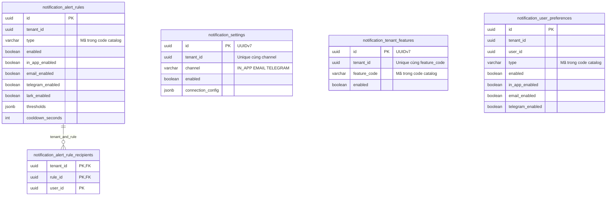
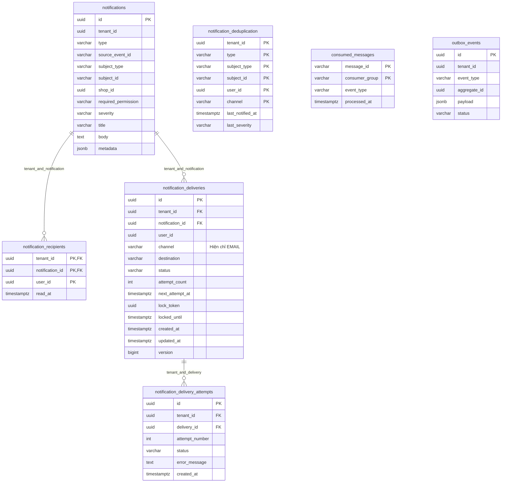

# Database Notification

Database riêng: `vishop_notification`. Schema hiện hành sau V13 gồm **12 bảng**.
[Migration SQL](../src/main/resources/db/migration) là nguồn kiểm chứng DDL;
[README service](../README.md) chứa hướng dẫn migrate.

Code setting ánh xạ notification_settings và notification_alert_rules. Các bảng feature,
recipient selection và personal preference vẫn có schema/migration, chờ adapter triển khai sau.
Đợt rút gọn module không xóa bảng hay dữ liệu hiện có.
Inbox đã ánh xạ notifications và notification_recipients; nội dung chung bất biến,
read_at/deleted_at chỉ cập nhật trên recipient của user hiện tại. Xem [inbox](inbox.md).

Danh mục feature/type nằm trong [shared constants](constants.md), không phải module/bảng DB.
Các mã feature_code/type lưu trong cấu hình và lịch sử; app kiểm tra hỗ trợ qua enum fromCode.

## Cấu hình tenant và cá nhân

notification_settings unique theo tenant/channel; Telegram enable cần chat ID và
connection_config.credentialsRef không rỗng. Token thật nằm ngoài schema, không lưu plaintext.
connection_config.connectionRef trỏ cấu hình provider ngoài DB. Secrets adapter chưa triển khai.

Rule unique tenant/type; personal preference unique tenant/user/type. Rule recipients có
FK tenant/rule. Feature/type code không còn FK tới catalog DB; NOT NULL/nonblank và unique
vẫn được giữ. API ghi cấu hình phải kiểm tra mã qua NotificationTypeCode/NotificationFeatureCode,
không chấp nhận loại tùy ý.

## Thông báo và giao nhận

ERD nêu trường chính; bộ cột chung bên dưới cũng thuộc mỗi bảng nghiệp vụ/cấu hình.
FK nội bộ dữ liệu tenant giữ tenant_id. User/tenant/shop thuộc service khác, không có FK
hay JOIN xuyên DB.

- Inbox/read state unique tenant/notification/user; read_at NULL nghĩa chưa đọc.
- Notification chống trùng tenant/source event/type/subject.
- EMAIL destination unique tenant/notification/channel sau trim/lowercase.
- Attempts unique tenant/delivery/attempt number.
- Dedup key theo tenant/type/subject/user/channel; application phải lock/upsert và kiểm tra
  cooldown/mức độ. DB không tự chạy policy thời gian.
- consumed_messages/outbox_events tương thích common-persistence.
- Telegram mới có cấu hình/switch; queue vẫn chỉ EMAIL, dedup channel IN_APP/EMAIL.
  Cần migration mở rộng và worker trước khi gửi Telegram.
- Các mã legacy trong lịch sử/config được giữ sau V7, không tự biến thành loại được code hỗ trợ.

## Cột chung và giá trị mặc định

| Cột | Kiểu và mặc định | Ý nghĩa |
| --- | --- | --- |
| `id` | `UUID NOT NULL PRIMARY KEY`; ứng dụng cấp bằng `UuidV7.nextId()`, không có DEFAULT tại DB | Định danh UUIDv7 của bản ghi |
| `created_at` | `TIMESTAMPTZ NOT NULL DEFAULT now()` | Thời điểm tạo |
| `updated_at` | `TIMESTAMPTZ NOT NULL DEFAULT now()` | Thời điểm sửa lần cuối |
| `deleted_at` | `TIMESTAMPTZ DEFAULT NULL` | Chưa xóa mềm khi NULL |
| `version` | `BIGINT NOT NULL DEFAULT 0 CHECK (version >= 0)` | Optimistic locking |

id áp dụng cho bảng có khóa chính đơn UUID; bảng khóa ghép giữ thiết kế khóa hiện tại.
Bốn cột audit áp dụng cho notification_settings, notification_tenant_features,
notification_alert_rules, notification_alert_rule_recipients, notification_user_preferences,
notifications và notification_recipients. Các cột này bị lược bớt trong ERD để dễ đọc.

Delivery queue có timestamps/version, hủy bằng status thay vì xóa mềm job đang chờ.
Attempts là lịch sử bất biến chỉ có created_at. Outbox/consumed/dedup giữ các timestamps
chuyên biệt, không áp bộ cột xóa mềm/version của entity nghiệp vụ.

V5 backfill updated_at từ created_at. DEFAULT chỉ áp dụng INSERT, không tự đổi khi UPDATE.
JPA/runtime khi có adapter phải dùng callback và @Version; native/bulk SQL tự cập nhật
timestamps/version và kiểm tra version cũ.

Truy vấn inbox phải lọc deleted_at IS NULL trên cả notification/recipient; unread thêm
read_at IS NULL. Index recipient feed/unread bỏ dòng đã xóa mềm. Policy lookup cũng lọc
setting/rule/recipient link chưa xóa. Xóa mềm cấu hình quay về policy kế thừa của dòng vắng;
dùng enabled=false để tắt rõ ràng. Unique/FK vẫn tính cả dòng xóa mềm; tạo lại cùng natural
key phải restore/update dòng cũ. Không xóa marker chống trùng khi ẩn thông báo.

## Lịch sử schema

| Version | Nội dung |
| --- | --- |
| V1 | Notification, recipient, rules, dedup, email jobs/attempts, consumed/outbox |
| V2 | Personal preferences dưới tên cũ notification_settings |
| V3 | Catalog DB feature/type, tenant feature/channel settings; backfill mã legacy |
| V4 | Rename personal thành notification_user_preferences, channel thành notification_settings; bot Telegram |
| V5 | Audit/xóa mềm/version và index inbox |
| V6 | UUIDv7 PK cho hai bảng catalog, code unique và FK theo code |
| V7 | Chuyển catalog sang enum, bỏ hai bảng/FK catalog, giữ cấu hình/history và local FKs |
| V8 | notification_tenant_features dùng id UUIDv7, giữ unique tenant_id/feature_code; backfill không thay đổi cấu hình/audit |
| V9 | notification_settings dùng id UUIDv7 và unique tenant_id/channel; giữ dữ liệu kết nối/audit, bỏ composite PK |

V1–V6 được giữ nguyên checksum. V7 không sửa type/feature_code trong dữ liệu tenant và
history; chỉ metadata hai bảng catalog bị bỏ. Không phát lại event hay gửi provider khi migrate.

V10: `connection_config` JSONB groups `connectionRef`, `credentialsRef`, `telegramBotUsername`, `telegramChatId`, `telegramMessageThreadId`; existing data and validation constraints are preserved.

V11 bổ sung kênh LARK; V12 thêm tên cấu hình kênh; V13 thêm `lark_enabled` cho alert rule.
