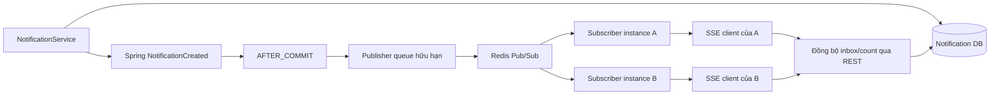

# Fan-out SSE bằng Redis Pub/Sub

`NotificationModuleConfiguration` import `NotificationRealtimeConfiguration`. Transport mặc định
là `redis`; runtime Spring Boot cung cấp Redis connection và `ObjectMapper` qua auto-configuration.
Module chưa có standalone HTTP server hoặc route gateway; xem [Inbox](inbox.md#sse-realtime)
cho phần wiring runtime còn lại.



## Phát và nhận

- `NotificationService` phát `NotificationCreated` khi tạo notification mới có recipient in-app.
- `NotificationRedisRelay.publishAfterCommit()` dùng `@TransactionalEventListener(AFTER_COMMIT)`.
  Rollback, replay idempotent và publish ngoài transaction không phát tín hiệu Redis.
- Listener sau commit chỉ xếp việc vào publisher pool một thread với queue hữu hạn; JSON và Redis
  I/O chạy ở đó. Publisher không gửi trực tiếp SSE cục bộ.
- Mọi replica subscribe cùng channel bằng `RedisMessageListenerContainer` và nhận cả các event
  do chính mình phát. `onMessage()` giải mã và gọi `NotificationSseStreams.broadcastLocal()`.
  Hàm này tra registry RAM theo tenant và user trong danh sách người nhận rồi xếp việc gửi SSE.
- Subscriber không ghi lại notification vào DB và không republish Spring event/Redis message;
  nhờ vậy không có vòng lặp hoặc hai đường gửi trùng tại instance tạo notification.

Bản tin Redis nội bộ chứa `notificationId`, `tenantId`, snapshot `recipients`, `requiredPermission`.
Đây là channel tin cậy giữa các service instance. Chỉ payload SSE `{notificationId, tenantId}`
được gửi tới trình duyệt; không gửi recipient IDs hoặc permission.

## Cấu hình runtime

Các replica dùng chung Notification DB, Redis và tên channel. Ví dụ cấu hình ngoài ứng dụng:

```yaml
spring:
  data:
    redis:
      host: ${NOTIFICATION_REDIS_HOST:localhost}
      port: ${NOTIFICATION_REDIS_PORT:6379}
      password: ${NOTIFICATION_REDIS_PASSWORD:}
      connect-timeout: 2s
      timeout: 2s
notification:
  realtime:
    transport: redis
    channel: ${APP_ENV:dev}:vishop:notification:created:v1
    publisher-queue-capacity: 256
    listener-queue-capacity: 256
    max-message-bytes: 1048576
```

Đặt tên channel khác nhau theo môi trường: Redis Pub/Sub không được cách ly bằng Redis database
number. Dùng cùng channel cho tất cả replica trong cùng môi trường. Publisher/subscriber queue
và giới hạn kích thước phải dương. Redis listener dùng một worker với queue hữu hạn; đây là
tín hiệu best-effort, không phải hàng đợi lưu sự kiện bền vững.

Chỉ dùng `notification.realtime.transport=local` cho dev/test hoặc triển khai một instance không
dùng Redis. Chế độ này gọi SSE trực tiếp sau commit và không khởi tạo Redis publisher/subscriber.
Hai transport loại trừ nhau; không có tự động fallback từ Redis sang local khi Redis lỗi.

## Phục hồi và giới hạn

Khi Redis xác nhận subscribe/resubscribe, relay đánh dấu cần đồng bộ lại các SSE đang mở.
Heartbeat tick gộp nhiều yêu cầu thành một `ready` cho mỗi kết nối cũ. Kết nối mới sau yêu cầu
chỉ cần `ready` ban đầu. `ready` có thể lặp lại trên cùng HTTP stream; frontend phải refetch
inbox/count mỗi lần nhận, không đăng ký listener với `{once: true}`.

Publisher queue đầy, Redis publish lỗi hoặc payload quá giới hạn không làm hỏng transaction DB
đã commit. Tín hiệu đó bị bỏ và instance phát yêu cầu refresh các client cục bộ. Replica khác
có thể không biết tín hiệu đã mất; frontend vẫn cần đồng bộ sau reconnect, trở lại tab và đối soát
REST định kỳ với thời điểm rải giữa client. Không suy ra badge từ số lượng SSE event.

Listener queue đầy hoặc payload Redis không hợp lệ được bỏ, đồng thời gộp yêu cầu refresh cục bộ.
Redis reconnect không tự replay event; phát lại `ready` yêu cầu client đọc trạng thái hiện hành.
Các giới hạn kết nối, FIFO per-connection, lifetime xác thực 60 giây và timeout ghi tại runtime/proxy
vẫn áp dụng như [contract SSE](inbox.md#sse-realtime).
Hạn mức kết nối tổng và theo user/tenant đều áp dụng trên từng instance; chưa có quota toàn cluster.

Không có outbox/retry bền vững trong adapter này. Process có thể dừng giữa DB commit và publish,
Redis subscriber có thể bỏ lỡ tín hiệu khi mất kết nối. DB/REST là nguồn chuẩn. Khả năng phục vụ
phải được xác nhận bằng load test cả Redis, gateway, SSE và tải REST/DB sau refetch.

## Kiểm chứng

`NotificationRedisFanoutTest` chạy hai Spring application context độc lập, chung PostgreSQL và Redis
thật: kiểm tra sau commit, rollback, không phát ngoài transaction, nhiều tab ở cả hai instance,
cách ly theo tenant và người nhận, không gửi trùng, lỗi publish giữ nguyên dữ liệu đã commit,
và resubscribe yêu cầu REST refresh ngay trên SSE còn mở. Test persistence inbox giữ kiểm tra
idempotent replay của luồng tạo notification thật.
