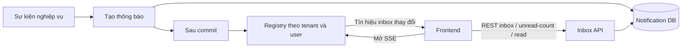

# Thiết kế thông báo realtime bằng SSE

## Trạng thái và mục tiêu

Đây là **thiết kế đề xuất**, chưa phải mô tả toàn bộ tính năng đã triển khai.
Code hiện tại và cách sử dụng endpoint được mô tả tại [Inbox](inbox.md#sse-realtime).

Phần tối ưu đã triển khai: index theo tenant/user, mailbox FIFO hữu hạn và tối đa một tác vụ
ghi cho mỗi kết nối, heartbeat theo lần ghi gần nhất có jitter, cấu hình hạn mức và cleanup khi
shutdown. Fan-out giữa replica dùng [Redis Pub/Sub sau commit](realtime-redis.md), có yêu cầu đồng bộ
REST sau resubscribe. Giữ `notification.created` và lifetime 60 giây; thu hồi session, tín hiệu
inbox-changed và kiểm chứng 10.000 kết nối vẫn thuộc thiết kế tiếp theo.

Phạm vi ban đầu: một server `notification-service`, thông báo realtime trên web,
định hướng kiểm chứng với khoảng 10.000 người dùng hoạt động đồng thời.
Một người dùng có thể mở nhiều tab nên số người dùng không bằng số kết nối SSE.

Mục tiêu:

- Giữ kết nối lâu, giảm reconnect không cần thiết.
- Tìm đúng kết nối người nhận mà không quét toàn bộ registry cho mỗi thông báo.
- Giới hạn bộ nhớ và cô lập kết nối chậm.
- Lưu thông báo bền vững trong DB; frontend đồng bộ lại khi mất tín hiệu.
- Xác thực kết nối và xử lý hết hạn, thu hồi session, thay đổi quyền.
- Xác định khả năng phục vụ bằng load test, không suy ra từ giới hạn cấu hình.

## Kiến trúc một server



DB lưu nội dung, người nhận và trạng thái đọc/ẩn. SSE gửi tín hiệu để frontend lấy
trạng thái hiện hành qua REST. Kết nối SSE và registry được giữ trong RAM của server.

Một server chưa cần thêm broker chỉ để quản lý kết nối SSE. Nếu sự kiện nghiệp vụ
đã đến qua broker hiện có, giữ tích hợp đó; không cần thêm một broker thứ hai.

## Contract và vòng đời kết nối

Endpoint: `GET /api/v1/notifications/stream`.

Response dùng `text/event-stream`, không cache, không buffer các chunk trên proxy.
Tenant, user, session và quyền lấy từ danh tính đã được xác thực.
Không cho client chọn user nhận thông báo qua query hoặc body.

Luồng vòng đời:

```text
Mở request và xác thực
    → Kiểm tra hạn mức, đăng ký kết nối
    → Gửi ready
    → Gửi tín hiệu thay đổi / heartbeat
    → Đóng do client rời đi, lỗi, session hết hạn, thu hồi hoặc shutdown
    → Client reconnect nếu session vẫn hợp lệ
    → Gửi ready và đồng bộ lại inbox/count
```

`ready` phải được gửi trước các sự kiện nghiệp vụ trên cùng kết nối.
Heartbeat là comment SSE, không làm frontend tải lại inbox.
Frontend không reload trang để tạo stream mới.

Không bắt buộc đóng mỗi 60 giây. Thời gian sống của stream phải phù hợp với
session và giới hạn của hạ tầng. Nếu hạ tầng yêu cầu xoay vòng kết nối, dùng thời gian
có độ lệch ngẫu nhiên để tránh nhiều client reconnect cùng lúc.

Client dùng cookie có thể dùng native `EventSource`. Client dùng bearer header cần
SSE client hỗ trợ header, parse stream và reconnect; không đưa token vào URL.
Client tùy chỉnh phải có retry với backoff và jitter, dừng retry khi logout hoặc
không còn quyền truy cập. Native `EventSource` không cung cấp đầy đủ khả năng kiểm soát
HTTP status/backoff như client qua `fetch`, cần tính đến khi thiết kế frontend.

## Registry theo người nhận và session

Cấu trúc chính đề xuất:

```java
Map<TenantUserKey, Map<ConnectionId, Connection>> connectionsByUser;
```

Thông tin mỗi kết nối:

| Trường | Mục đích |
| --- | --- |
| `connectionId` | Phân biệt từng tab hoặc thiết bị |
| `tenantId`, `userId` | Định tuyến đến đúng người nhận |
| `sessionId` | Đóng các kết nối thuộc session bị thu hồi |
| `authorization` | Quyền và phiên bản quyền đã xác minh |
| `sessionExpiresAt` | Hạn session lấy từ nguồn xác thực tin cậy |
| `transport` | Emitter hoặc kênh ghi SSE |
| `lastWriteAt` | Xác định lúc cần heartbeat |
| `pendingRefresh` | Đánh dấu có thay đổi cần báo |
| `writeInProgress` | Ngăn nhiều tác vụ ghi đồng thời trên một kết nối |
| `state` | Đang mở hoặc đã đóng |

Có thể thêm index `sessionId → connectionIds` để ngắt session nhanh.
Không lưu access token thô trong registry.

Khi thông báo có danh sách người nhận, tra cứu trực tiếp từng cặp tenant/user rồi
gửi tới các kết nối của họ. Chi phí định tuyến phụ thuộc người nhận và số tab của họ,
thay vì tổng số kết nối của hệ thống. Broadcast toàn tenant vẫn cần duyệt người nhận
hoặc kết nối thuộc tenant đó; index không loại bỏ chi phí broadcast thực tế.

Thao tác thêm/xóa phải bảo đảm concurrency: kiểm tra hạn mức và đăng ký nguyên tử,
không xóa nhầm bucket vừa được thêm kết nối, và cleanup chỉ thực hiện một lần.
Concurrent map tự nó không bảo đảm các thao tác ghép này nguyên tử.

## Xử lý gửi và client chậm

Không tạo một tác vụ mới không giới hạn cho mỗi sự kiện tới mỗi client.
Mỗi kết nối chỉ được có tối đa một tác vụ ghi đang chạy và trạng thái chờ hữu hạn.

Vì contract là tín hiệu làm mới inbox, có thể gộp nhiều thay đổi:

```text
Chưa gửi xong, nhận thêm nhiều sự kiện
    → Đặt pendingRefresh = true
    → Sau lần gửi hiện tại, gửi thêm tín hiệu nếu còn thay đổi
```

Việc kiểm tra và reset cờ phải nguyên tử, tránh mất tín hiệu khi sự kiện tới đúng lúc
writer kết thúc. Frontend cũng cần gộp refetch; nếu event tới trong lúc REST đang chạy,
đánh dấu để tải thêm một lần sau request hiện tại.

Để gộp sự kiện có ID khác nhau, đề xuất thêm event `notification.inbox-changed`
chỉ mang `tenantId`. Đây là thay đổi contract cần triển khai đồng bộ với frontend.
Không gộp thành một ID tùy ý nếu frontend vẫn coi `notification.created` là danh sách
đầy đủ các thông báo mới. Có thể giữ `notification.created` cho tín hiệu riêng lẻ
trong giai đoạn chuyển tiếp.

Các thao tác đọc, đọc tất cả và ẩn cũng phát tín hiệu sau commit để các tab của cùng
người dùng cập nhật trạng thái. Chỉ phát khi có thay đổi thực tế để tránh refetch thừa.

Client vượt ngưỡng chờ hoặc thời gian gửi được đóng để reconnect và đồng bộ REST.
Cần cấu hình timeout ghi tại server/proxy. Timeout request của `SseEmitter` không
thay thế timeout của từng lần ghi socket. Chính sách quá tải phải phân biệt kết nối
chậm với nghẽn tạm thời của toàn server, tránh ngắt hàng loạt rồi tạo đợt reconnect mới.

## Heartbeat

- Chọn chu kỳ nhỏ hơn idle timeout ngắn nhất trên đường truyền; ví dụ khởi đầu 20–30 giây,
  sau đó điều chỉnh theo gateway/proxy thực tế.
- Rải thời điểm gửi giữa các kết nối, không xếp toàn bộ heartbeat cùng một đợt.
- Nếu vừa gửi dữ liệu thành công thì chưa cần heartbeat mới.
- Không xếp thêm heartbeat khi kết nối đang có tác vụ ghi hoặc heartbeat chờ.
- Khi lỗi ghi hoặc client đóng, hủy lịch và dọn các index liên quan.

Heartbeat phục vụ giữ kết nối và phát hiện kết nối chết; không dùng làm event nghiệp vụ.

## Xác thực, quyền và tenant

Xác thực request lúc mở kết nối là cần thiết nhưng chưa đủ cho stream sống lâu.
Thiết kế đề xuất cần thêm:

- Lấy hạn session từ nguồn tin cậy và đóng stream khi hết hạn. Nếu cần giới hạn theo
  hạn access token, nguồn xác thực phải cung cấp hạn đó và thống nhất chính sách refresh.
- Nhận tín hiệu logout/thu hồi session để ngắt kết nối tương ứng.
- Khi quyền hoặc tư cách thành viên tenant thay đổi, cập nhật authorization hoặc đóng
  kết nối để client xác thực lại. Đóng stream phải đi kèm cập nhật nguồn quyền để lần
  reconnect không tiếp tục dùng dữ liệu cũ.
- Nếu chưa có tín hiệu thu hồi đáng tin cậy, dùng kiểm tra lại có chu kỳ hoặc lifetime
  hữu hạn làm phương án dự phòng và công bố rõ độ trễ thu hồi.
- Đổi tenant phải đóng stream cũ và mở stream theo tenant mới.

Không query DB để xác minh toàn bộ session ở mỗi heartbeat. Tách kiểm tra session/quyền
thành cơ chế có cache và thời hạn phù hợp. REST vẫn kiểm tra quyền hiện hành khi trả nội dung.

Code hiện tại mới giữ snapshot quyền lúc subscribe; các cơ chế thu hồi và metadata
hết hạn nêu trên cần adapter/wiring bổ sung, chưa có chỉ nhờ việc bỏ lifetime 60 giây.

## Độ tin cậy và phục hồi

Spring event sau commit không phải hàng đợi bền vững. Process có thể chết sau khi DB
commit và trước khi gửi SSE. Kết nối đứt cũng có thể làm mất tín hiệu.

Phương án mặc định cho chuông thông báo:

- DB/REST là nguồn chuẩn; không cam kết frontend nhận đủ mọi event.
- Refetch inbox/count sau `ready`, khi nhận tín hiệu và khi trở lại ứng dụng sau thời gian nền.
- Cân nhắc đối soát REST định kỳ với tần suất thấp và rải thời điểm giữa client để bù
  tín hiệu bị mất trong khi stream vẫn mở.
- Không tự tăng/giảm badge chỉ dựa vào số event đã nhận.

Nếu yêu cầu giao sự kiện bền vững hơn: ghi outbox cùng transaction notification,
worker retry có idempotency và publish qua kênh phù hợp. Nếu cần replay tới frontend,
phải bổ sung event ID, lịch sử có giới hạn, kiểm tra quyền replay và xử lý cursor hết hạn.
Outbox hoặc broker đơn thuần không bảo đảm trình duyệt đã nhận và xử lý sự kiện.

## Spring MVC hay WebFlux

| Phương án | Điều kiện áp dụng |
| --- | --- |
| Giữ MVC + `SseEmitter` | Giữ stack hiện tại; cải thiện scheduling, hạn mức, timeout ghi và kiểm chứng bằng tải thực tế |
| Endpoint SSE trên runtime WebFlux | Dùng non-blocking I/O cho nhiều kết nối; cần quản lý backpressure và tách mọi thao tác blocking khỏi event loop |

Không chuyển framework chỉ bằng việc thêm dependency hoặc trả `Flux` từ controller MVC.
Nếu chọn WebFlux cần thiết kế runtime thực sự chạy WebFlux, xác thực và tích hợp dữ liệu
tương ứng. JPA/JDBC vẫn là blocking và cần được tách sang executor phù hợp nếu còn sử dụng.

Với mục tiêu 10.000 kết nối, có thể thử nghiệm WebFlux và so sánh với MVC đã tối ưu.
Không coi lựa chọn framework là bằng chứng hệ thống đã đáp ứng tải.

## Hạ tầng và đo tải

Cấu hình gateway/proxy phải hỗ trợ response streaming, tắt buffering/cache gây giữ chunk,
đặt idle timeout phù hợp heartbeat, kiểm tra ảnh hưởng compression và hỗ trợ shutdown có kiểm soát.
Server cần đủ giới hạn file descriptor/socket, bộ nhớ, băng thông và tài nguyên gateway/DB.

Đưa các ngưỡng thành cấu hình: tổng kết nối, kết nối/user/session, heartbeat, lifetime,
thời gian gửi, lượng việc chờ và tài nguyên executor. Hạn mức là biện pháp bảo vệ,
không phải số người dùng đã được bảo đảm phục vụ.

Load test tăng dần 100 → 500 → 1.000 → 3.000 → 5.000 → 10.000 kết nối, gồm:

- Kết nối nhàn rỗi chỉ có heartbeat và kết nối duy trì lâu qua nhiều chu kỳ.
- Thông báo riêng lẻ và broadcast nhiều người nhận; đo theo lượt gửi/giây.
- Client mạng chậm, mất mạng, mở nhiều tab và reconnect đồng loạt.
- Logout, hết hạn session, thu hồi quyền và đổi tenant khi stream đang mở.
- Restart server, graceful shutdown và lỗi proxy.
- Tải REST tăng sau sự kiện hoặc reconnect, không chỉ đo SSE độc lập.

Theo dõi số kết nối, lỗi gửi, độ trễ từ commit tới client (p95/p99), tác vụ chờ,
reconnect/giây, lý do đóng, CPU, RAM/GC, thread, socket và độ trễ REST/DB.
Trước mỗi lần đo phải chốt cấu hình máy, workload và tiêu chí chấp nhận; chỉ kết luận
khả năng phục vụ sau khi đạt các tiêu chí đó.

## Khi mở rộng nhiều instance

Mỗi instance vẫn giữ socket của chính nó; không đưa `SseEmitter` hoặc socket vào Redis.
Adapter Redis Pub/Sub đã phân phối tín hiệu sau commit tới mọi instance; mỗi instance lọc registry
cục bộ và không ghi lại DB. Xem [Redis fan-out](realtime-redis.md) cho cấu hình và phạm vi kiểm chứng.
Quy mô lớn hơn có thể bổ sung định tuyến theo vị trí kết nối và xử lý index hết hạn.

Redis Pub/Sub phù hợp với tín hiệu chấp nhận mất và có REST đối soát, nhưng không có
replay. Nếu cần bền vững hơn phải chọn cơ chế lưu/retry thích hợp.
Không dùng một consumer group chia việc giữa các SSE instance rồi mặc định mọi instance
đều nhận được sự kiện. Sticky sessions cũng không thay thế phân phối sự kiện.

## Hiện trạng và bước tiếp theo

| Đã triển khai | Bước tiếp theo |
| --- | --- |
| Index theo tenant/user, không quét toàn bộ khi có event | Thêm index session khi có adapter thu hồi |
| Đóng sau 60 giây để làm mới snapshot xác thực | Lifetime theo session/hạ tầng sau khi bổ sung thu hồi và kiểm tra quyền |
| Heartbeat dựa trên lần ghi gần nhất, jitter 20%, không xếp chồng | Chọn interval theo idle timeout thực tế |
| Một writer/kết nối, mailbox hữu hạn; pool và hạn mức có cấu hình | Load test và chọn tài nguyên/I/O phù hợp |
| Bỏ heartbeat thừa; mailbox đầy chỉ đóng client tương ứng | Bổ sung tín hiệu có thể gộp sau khi thống nhất contract frontend |
| Giữ `notification.created` và từng notification ID | Bổ sung tín hiệu thay đổi inbox để đồng bộ các tab |
| Redis fan-out sau commit; resubscribe yêu cầu REST refresh | Outbox nếu cần publish bền vững; đo tải broadcast và REST |
| Mặc định 1.000 kết nối, hạn mức cấu hình | Chọn hạn mức dựa trên load test và tài nguyên |
| Chưa có runtime notification/gateway đầy đủ | Wiring server, xác thực, async/streaming và proxy trước khi nghiệm thu |

Thứ tự thực hiện: thống nhất contract → registry và lifecycle → gửi/heartbeat →
session/quyền → frontend và runtime/proxy → load test và điều chỉnh.
Không chỉ tăng ngưỡng kết nối hoặc xóa timeout 60 giây mà bỏ qua các phần phụ thuộc.

## Tài liệu tham khảo

- [Inbox và SSE hiện tại của dự án](inbox.md#sse-realtime).
- [MDN: Using server-sent events](https://developer.mozilla.org/en-US/docs/Web/API/Server-sent_events/Using_server-sent_events).
- [Spring: Asynchronous Requests](https://docs.spring.io/spring-framework/reference/web/webmvc/mvc-ann-async.html).
- [Spring WebFlux](https://docs.spring.io/spring/reference/web/webflux.html).
- [Redis Pub/Sub và ngữ nghĩa giao nhận](https://redis.io/docs/latest/develop/pubsub/).
