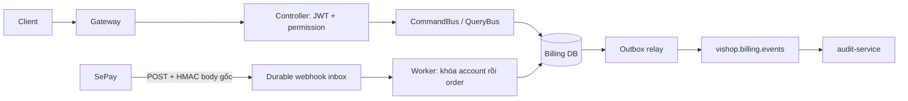

# Subscription service

Service thu phí sử dụng ViShop theo **tenant**, cổng mặc định **8083**, database
`vishop_billing`. Triển khai hiện tại hỗ trợ mua gói mới và chủ động gia hạn bằng QR
chuyển khoản SePay, chu kỳ tháng/năm lịch. Không tự thu tiền gia hạn.

Thiết kế bảng, ERD, khóa và transaction: [Database Billing](docs/database-design.md).

## Kiến trúc và dữ liệu



```text
com/vishop/subscription/
|-- modules/
|   |-- subscription/  # Giá, đơn mua, subscription và lịch sử cấp kỳ
|   `-- payment/       # SePay QR/HMAC, webhook inbox, payment ledger và review
|-- composition/
|   |-- checkout/     # Nối checkout với PaymentApi để lấy QR
|   `-- payment/      # Nối payment với SubscriptionApi để áp dụng khoản tiền
|-- shared/           # Actor và port ghi business event
`-- infra/            # Security, clock, migration CLI, inbox worker và outbox relay
```

Mỗi module có application, infrastructure và presentation riêng; domain của
subscription chứa giá/đơn/kỳ, domain của payment chứa dữ kiện chuyển khoản.
Module không import trực tiếp module kia hoặc repository/entity của nhau.
Composition chỉ nối các interface trong `application/api`; controller ở module
sở hữu nghiệp vụ. Hai module dùng cùng transaction manager và cùng Billing DB.

`SubscriptionApi.applyPayment` bắt buộc tham gia transaction của payment handler;
ghi tiền, cấp kỳ, cập nhật inbox và outbox rollback cùng nhau. QR đi qua
`CheckoutPaymentPort`/`PaymentApi` bằng DTO độc lập, không truyền domain entity qua module.
Service không phụ thuộc source, repository hay database của IAM.
`tenantId` và `actorId` là external reference.

API `/api/v1/billing/**`, quyền `billing.*`, DB `vishop_billing` và topic
`vishop.billing.events` tiếp tục là các hợp đồng nghiệp vụ đang dùng. Producer là
`subscription-service`. Schema mới dùng Flyway V2; V1 giữ nguyên checksum.
V2 rename/backfill các bảng cũ, không đổi tên database.

| Bảng | Mục đích |
| --- | --- |
| `subscription_plans` | Catalog FREE/BASIC/PRO/BUSINESS |
| `subscription_prices` | Phiên bản giá và hạn mức, snapshot bất biến, số nguyên VND |
| `subscriptions` | Gói, calendar anchor, paid horizon và revision theo tenant |
| `subscription_orders` | Snapshot mua, mã thanh toán, idempotency; trạng thái đơn/tiền/cấp kỳ riêng |
| `subscription_terms` | Kỳ được cấp, unique theo order để chống cộng hạn hai lần |
| `sepay_webhook_inbox` | Body gốc và liên kết giao dịch canonical; worker phục hồi sau restart |
| `payment_transactions` | Giao dịch canonical UUID riêng, giữ ID SePay và sự thật tiền nhận |
| `payment_allocations` | Tiền thực sự phân bổ cho đơn; DB chống phân bổ vượt tiền nhận |
| `outbox_events` | Event ghi cùng transaction với thay đổi nghiệp vụ |

Billing hiện chỉ publish Kafka, không cần `consumed_messages`. Inbox chống trùng
webhook theo SePay transaction ID; bank reference không rỗng được chống trùng thêm
theo ngân hàng/tài khoản. Cùng ID nhưng khác số tiền, account, code hoặc dữ kiện
giao dịch trả 409. Thay đổi format JSON không làm xử lý lại giao dịch.

Order trả thêm `orderStatus`, `paymentStatus`, `fulfillmentStatus`; trường `status`
cũ vẫn được suy ra để tương thích. Order đã cấp kỳ nhận thêm tiền vẫn giữ APPLIED,
chỉ đánh dấu review khoản phát sinh. `payment_transactions.allocated_vnd` được DB
duy trì từ allocation ledger; JPA không ghi đè counter này.

## Quyền truy cập

Gateway chuyển tiếp Bearer JWT; service xác minh chữ ký, issuer, audience, token use
và expiry tại chỗ. `@PreAuthorize` dùng permission từ token; không gọi IAM/Redis/DB
để dựng lại quyền người gọi. Mọi đơn và subscription được ràng buộc tenant trong JWT.

- `billing.view`: catalog, subscription và lịch sử đơn của tenant.
- `billing.manage`: tạo/hủy đơn.
- `systemRole=PLATFORM_ADMIN`: cấu hình giá và xem hàng đợi cần kiểm tra của CMS.

IAM migration `V8__add_billing_permissions.sql` mở rộng permission catalog và cấp
hai quyền cho OWNER hiện tại/tương lai. Chạy migration IAM và refresh/login lại để
token có quyền mới. Access JWT cũ giữ quyền đến khi hết hạn, mặc định 15 phút.

## API

| Method/path | Quyền |
| --- | --- |
| `GET /api/v1/billing/plans` | `billing.view` |
| `GET /api/v1/billing/subscription` | `billing.view` |
| `POST /api/v1/billing/orders` | `billing.manage`, header `Idempotency-Key` |
| `GET /api/v1/billing/orders/{id}` | `billing.view` |
| `GET /api/v1/billing/orders?page=1&limit=20` | `billing.view`, phân trang hệ thống |
| `POST /api/v1/billing/orders/{id}/cancel` | `billing.manage` |
| `POST /api/v1/cms/billing/prices` | `PLATFORM_ADMIN` |
| `PUT /api/v1/cms/billing/prices/{id}/availability` | `PLATFORM_ADMIN` |
| `GET /api/v1/cms/billing/payments/review?page=1&limit=20` | `PLATFORM_ADMIN` |
| `GET /api/v1/cms/billing/webhooks/review?page=1&limit=20` | `PLATFORM_ADMIN` |
| `POST /api/v1/billing/webhooks/sepay` | HMAC SePay, không dùng JWT/CSRF browser |

History/review dùng `PaginationRequest` và `ListEnvelope`. Chưa hỗ trợ cursor cho
các endpoint này. Swagger qua gateway: `/docs?service=subscription`.

Ví dụ cấu hình **giá thử nghiệm** qua CMS (không phải bảng giá bán được chốt):

```json
{
  "planCode": "BASIC",
  "name": "Basic monthly",
  "cycle": "MONTHLY",
  "amountVnd": 100000,
  "shopLimit": 3,
  "monthlyOrders": 3000,
  "additionalMembers": 3
}
```

`planCode` hỗ trợ BASIC/PRO/BUSINESS; cycle MONTHLY/YEARLY. Giá không được seed tùy
tiện. Muốn thay giá thì tạo price ID mới và ngừng bán giá cũ bằng `{"active":false}`;
đơn đã tạo giữ snapshot cũ và vẫn có thể thanh toán trong hạn.

Tạo đơn: body `{"priceId":"<uuid>"}`, header `Idempotency-Key: <unique-key>`.
Response chứa `order`, `qrUrl`, ngân hàng, tài khoản, chủ tài khoản và `transferMemo`.
Client polling GET order; không có API cho client tự đánh dấu đã thanh toán.

Khóa idempotency có scope tenant/user. Cùng key và price ID trả đơn cũ; đổi payload
trả 409. Mỗi tenant chỉ có một đơn thay đổi subscription đang chờ tiền. Tiền thiếu
được cộng dồn; chỉ đúng tổng tiền mới tự cấp gói. Tiền thừa, đến muộn, sai đích,
không xác định code hoặc gửi cho đơn đã đóng được lưu để kiểm tra. Hủy đơn không
thể ngăn ngân hàng nhận tiền sau đó.

Mua lần đầu bắt đầu khi xử lý cấp gói; còn hạn thì gia hạn nối vào cuối thời hạn đã
mua. Ngày anchor không trôi: 31/01 → cuối tháng 2 → 31/03. Subscription chưa mua là
FREE; gói trả phí hết hạn có trạng thái EXPIRED.

## Chạy local và production

Tạo database `vishop_billing` trước khi chạy migration. `infra/postgres/init-db.sql`
chỉ tự tạo trên volume PostgreSQL mới; volume hiện có cần tạo thêm DB, không xóa dữ liệu.

```powershell
$env:SUBSCRIPTION_DB_URL = 'jdbc:postgresql://localhost:5432/vishop_billing'
$env:SUBSCRIPTION_DB_USER = 'vishop'
$env:SUBSCRIPTION_DB_PASSWORD = '<database-password>'
$env:JWT_SECRET = '<cùng JWT secret của IAM và gateway>'
.\gradlew.bat migrateSubscription
.\gradlew.bat runSubscription
```

Lệnh riêng service: `:services:subscription-service:commands`, `dev`, `start`, `migrate`,
`test`, `bootJar`, `spotlessApply`, `spotlessCheck`. `start` chọn profile prod và yêu
cầu khai báo DB/JWT qua environment. JPA chỉ validate; ứng dụng không tự migrate.

Nếu production chỉ có JAR, dùng cùng biến `SUBSCRIPTION_DB_*` để migrate riêng rồi mới chạy:

```powershell
java -Dloader.main=com.vishop.subscription.infra.database.SubscriptionDatabaseMigration -cp services/subscription-service/build/libs/subscription-service-0.1.0-SNAPSHOT.jar org.springframework.boot.loader.launch.PropertiesLauncher
java -jar services/subscription-service/build/libs/subscription-service-0.1.0-SNAPSHOT.jar --spring.profiles.active=prod
```

Dev/prod Compose, image build scripts, Prometheus và gateway đã có subscription-service.
Chạy migration IAM và Billing trên đúng môi trường trước khi khởi động service.
Production chỉ expose gateway; subscription-service chạy trong network nội bộ.

Triển khai V2 cần dừng runtime/writer V1 trước khi migrate rồi chạy JAR mới vì có
rename bảng. Migration giữ dữ liệu hiện có và rollback nếu vi phạm ràng buộc mới;
xem [hướng dẫn nâng schema](docs/database-design.md#8-nâng-từ-v1-và-triển-khai).

Các biến `BILLING_DB_URL/USER/PASSWORD` cũ vẫn được đọc làm fallback cho app/CLI.
Canonical name mới là `SUBSCRIPTION_DB_*`, `SUBSCRIPTION_PORT`,
`SUBSCRIPTION_DEBUG_PORT` và `SUBSCRIPTION_SERVICE_URL`. Cấu hình riêng của service
dùng prefix `vishop.subscription`; SePay vẫn lấy biến `SEPAY_*` như trước.
Swagger mới ở `/docs?service=subscription` và `/v3/api-docs/subscription-service`;
đường dẫn docs cũ được giữ làm alias.

## Cấu hình SePay

Mặc định `SEPAY_ENABLED=false`; service vẫn chạy nhưng không nhận/tạo thanh toán.
Để bật cần liên kết tài khoản trên SePay và đặt:

```dotenv
SEPAY_ENABLED=true
SEPAY_WEBHOOK_SECRET=<secret riêng, tối thiểu 32 ký tự>
SEPAY_BANK=Vietcombank
SEPAY_ACCOUNT_NUMBER=<tài khoản gốc trong webhook>
SEPAY_ACCOUNT_HOLDER=<tên chủ tài khoản>
SEPAY_QR_ACCOUNT_NUMBER=
SEPAY_SUB_ACCOUNT=
SEPAY_MEMO_PREFIX=
```

Webhook URL: `https://<gateway>/api/v1/billing/webhooks/sepay`, method POST, JSON,
HMAC-SHA256. Cấu hình payment-code prefix `VS`, nhận cả các giao dịch không có code
để vận hành có thể tìm tiền chưa khớp. `SEPAY_BANK` phải khớp `gateway` trong payload
(không phân biệt hoa/thường). Secret HMAC riêng với JWT secret.

QR dùng `vietqr.app/img`. Nếu ngân hàng yêu cầu VA, cấu hình tài khoản QR và
`SEPAY_SUB_ACCOUNT` đúng hợp đồng; `SEPAY_MEMO_PREFIX` dành cho chuỗi bắt buộc như
`SEVQR` hoặc `TKP<VA>`. Kiểm thử bằng test mode trước, rồi đối chiếu một giao dịch thật.

Service kiểm tra `sha256=HMAC_SHA256(secret, timestamp + '.' + raw_body)` và lệch
timestamp tối đa 5 phút. Chỉ trả `{"success":true}` sau khi inbox commit. Worker cấp
gói, ghi term/payment/outbox và đánh dấu inbox trong cùng transaction; lỗi rollback
để worker thử lại. Raw payload nằm trong Billing DB, không đưa lên log/Audit.

Nguồn đối chiếu: [HMAC](https://developer.sepay.vn/vi/sepay-webhooks/xac-thuc),
[payload/ACK](https://developer.sepay.vn/vi/sepay-webhooks/tich-hop-webhook),
[QR và quy tắc VA/ngân hàng](https://developer.sepay.vn/vi/tien-ich-khac/tao-qr-code).

## Phạm vi tiếp theo

Đây là luồng đầu tiên của [thiết kế billing](../../docs/product/vishop-billing-sepay-design.md).
Nâng/hạ gói khi còn hạn cần quote riêng; hiện trả 409 nếu đổi plan/cycle đang active.
Chưa triển khai prorate, add-on/quota enforcement ở service nghiệp vụ, hóa đơn,
hoàn tiền, tự đối soát qua API ngân hàng hoặc thao tác CMS phân bổ lại tiền review.
V2 đã có allocation ledger và tự ghi phân bổ hợp lệ; chưa có API chia/điều chuyển
phân bổ thủ công giữa nhiều đơn.
Review hiện cung cấp dữ liệu tra cứu; cần xử lý vận hành có kiểm soát. Webhook bị mất
cần replay từ SePay; tiền review không tự cấp gói. Không đưa luồng tiền thật vào vận
hành trước khi cấu hình, kiểm thử tài khoản SePay thực tế và quy trình đối soát.
