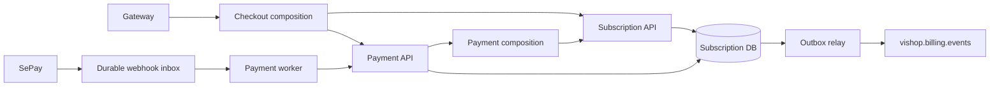

# Thiết kế Subscription

Hai module `subscription` và `payment` dùng cùng DB/transaction manager. Composition
nối contract `application/api`, không truy cập trực tiếp repository/entity của module kia.

`SubscriptionApi.applyPayment` tham gia transaction của payment handler để thay đổi tiền,
cấp kỳ và outbox rollback cùng nhau. QR đi qua port/DTO độc lập.
Service nhận context Gateway ký riêng, không truy vấn DB của IAM.
Subscription API dùng `/api/v1/subscriptions/**`; webhook dùng `/api/v1/billing/webhooks/sepay`,
CMS dùng `/api/v1/cms/billing/**`. Quyền `billing.*` và topic billing tiếp tục được giữ.

Chi tiết hiện hành: [README service](../README.md);
thiết kế quan hệ/khóa: [Database](database-design.md).
