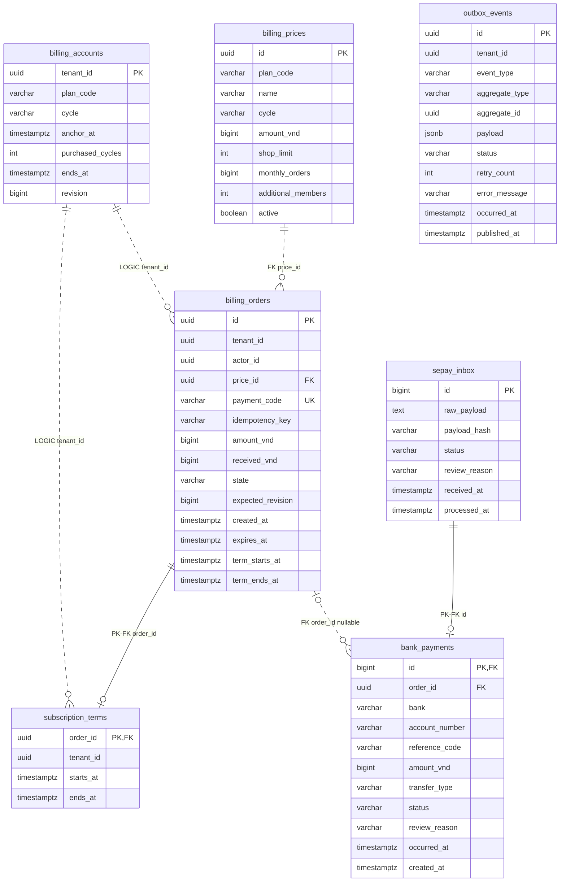

# Thiết kế database Billing

Database: **`vishop_billing`**, PostgreSQL. Phạm vi hiện tại là mua mới và gia hạn
gói theo tenant bằng QR SePay, một kỳ tháng/năm cho mỗi đơn. Tài liệu này mô tả
schema đã có trong [Flyway V1](../src/main/resources/db/migration/V1__create_billing_schema.sql),
đồng thời ghi riêng các thay đổi đề xuất cho bước tiếp theo.

Runtime hiện là `subscription-service`, gồm hai module cùng DB/transaction:
`subscription` sở hữu `billing_prices`, `billing_accounts`, `billing_orders`,
`subscription_terms`; `payment` sở hữu `sepay_inbox`, `bank_payments`.
`outbox_events` là hạ tầng chung của service. Tên bảng và Flyway V1 giữ nguyên.

## 1. Ranh giới dữ liệu

- Billing sở hữu giá, đơn mua, tiền nhận, subscription và lịch sử cấp kỳ.
- `tenant_id`, `actor_id` tham chiếu định danh bên ngoài; không tạo FK hoặc join IAM DB.
- Một tenant có tối đa một `billing_accounts`; đây là hồ sơ subscription, không phải tài khoản ngân hàng hay ví tiền.
- Xác thực/phân quyền dùng JWT đã xác minh. Các bảng dưới đây phục vụ nghiệp vụ, không phải session hay permission store.
- Tiền dùng `BIGINT` theo đơn vị VND. Thời gian dùng `TIMESTAMPTZ`, lưu instant UTC;
  tính tháng/năm theo `Asia/Ho_Chi_Minh`.

## 2. ERD hiện tại

Nhãn **FK** là quan hệ được DB enforce. Nhãn **LOGIC** là liên kết theo tenant mà
application đang duy trì, chưa có foreign key trong V1. Đường nét đứt biểu diễn
quan hệ không định danh; phải đọc nhãn để phân biệt FK và liên kết logic.



ERD rút gọn các cột snapshot của order; danh sách đầy đủ nằm ở mục 3.3.
`outbox_events` không có FK sang từng bảng nghiệp vụ vì chứa nhiều loại aggregate.

## 3. Các bảng và vai trò

### 3.1. `billing_prices` — phiên bản giá được bán

| Cột | Ý nghĩa |
| --- | --- |
| `id` | Price ID; tạo ID mới khi đổi giá/hạn mức |
| `plan_code` | BASIC, PRO hoặc BUSINESS |
| `name` | Tên hiển thị của phiên bản giá |
| `cycle` | MONTHLY hoặc YEARLY |
| `amount_vnd` | Tổng tiền phải chuyển cho một kỳ, lớn hơn 0 |
| `shop_limit` | Số shop của phiên bản gói |
| `monthly_orders` | Hạn mức đơn tháng của phiên bản gói |
| `additional_members` | Số thành viên bổ sung |
| `active` | Còn cho tạo đơn mới hay đã ngừng bán |

Ví dụ BASIC tháng và BASIC năm là **hai price ID**. Một giá mới của BASIC tháng
cũng có ID mới. Không cập nhật ngược số tiền/hạn mức của giá đã phát hành; API hiện
chỉ cho thay availability. Đây là quy tắc application, chưa có trigger cấm UPDATE
các cột giá trong DB.

FREE không cần price có tiền bằng 0: tenant chưa mua gói được trả subscription FREE.
Chưa có bảng `plans` riêng trong V1; khi cần quản lý mô tả/tính năng gói độc lập với
phiên bản giá mới tách catalog đó.

### 3.2. `billing_accounts` — subscription tổng hợp theo tenant

| Cột | Ý nghĩa |
| --- | --- |
| `tenant_id` | PK, một dòng cho mỗi tenant có hồ sơ Billing |
| `plan_code` | Gói của subscription, mặc định FREE |
| `cycle` | Chu kỳ đang sử dụng; null khi FREE |
| `anchor_at` | Mốc lịch gốc của chuỗi kỳ trả phí liên tục |
| `purchased_cycles` | Tổng số kỳ đã mua trong chuỗi hiện tại |
| `ends_at` | Cuối thời hạn đã trả tiền, exclusive |
| `revision` | Phiên bản nghiệp vụ; tăng khi cấp thêm kỳ |

`revision` là phiên bản do application cập nhật, không phải Hibernate `@Version`.
Worker so với `billing_orders.expected_revision` để phát hiện subscription đã thay
đổi sau khi tạo đơn. Khóa pessimistic trên account bảo vệ các thay đổi đồng thời.

Ví dụ anchor 31/01, mua một kỳ tháng → cuối tháng 2; mua tiếp trước khi hết hạn →
31/03. Luôn tính từ anchor gốc để không trôi sang ngày 28 ở các tháng sau.

Chưa mua gói có thể chưa tồn tại dòng account; query trả FREE. Checkout tạo dòng
bằng `INSERT ... ON CONFLICT DO NOTHING` rồi khóa dòng đó. Hết hạn không xóa hồ sơ;
API suy ra EXPIRED từ `ends_at`. Khi mua lại sau gián đoạn, chuỗi anchor được đặt lại.

### 3.3. `billing_orders` — thỏa thuận mua và snapshot

| Nhóm cột | Ý nghĩa |
| --- | --- |
| `id`, `tenant_id`, `actor_id` | Đơn của tenant, user thao tác |
| `price_id` | FK tới price đã chọn |
| `plan_code`, `plan_name`, `cycle` | Snapshot định danh/tên/chu kỳ |
| `amount_vnd`, `shop_limit`, `monthly_orders`, `additional_members` | Snapshot tiền và hạn mức |
| `payment_code` | Mã chuyển khoản duy nhất, không tái sử dụng |
| `idempotency_key` | Khóa chống tạo lại đơn của cùng user trong tenant |
| `expected_revision` | Revision account khi tạo đơn |
| `received_vnd` | Tổng tiền nhận gắn với mã đơn đã được worker xử lý |
| `state`, `review_reason` | Trạng thái vận hành và lý do cần kiểm tra |
| `created_at`, `expires_at` | Thời điểm tạo và hạn thanh toán |
| `term_starts_at`, `term_ends_at` | Kỳ đã cấp, null nếu chưa cấp |

Snapshot là chủ ý: giá ngừng bán hoặc catalog thay đổi không sửa đơn đã phát hành.
`received_vnd` là số tổng hợp để đọc nhanh; không thay thế từng dòng `bank_payments`
và không đồng nghĩa toàn bộ tiền đã được chấp nhận để cấp gói.

Trạng thái hiện tại: AWAITING_PAYMENT, PARTIALLY_PAID, FULFILLED, EXPIRED, CANCELLED,
REQUIRES_REVIEW. `expires_at` là mốc thời gian, không tự làm DB đổi `state`; runtime
kiểm tra hạn khi nhận tiền hoặc tạo checkout tiếp theo. Tiền của đơn đã đóng vẫn
được lưu để kiểm tra.

### 3.4. `subscription_terms` — bằng chứng kỳ đã cấp

Mỗi dòng có `order_id` là **PK đồng thời là FK** tới order. Vì vậy một order có
0 hoặc 1 term; webhook retry không thể tạo thêm một term cho cùng đơn.

`starts_at`, `ends_at` là khoảng `[start, end)`, DB enforce `end > start`. Gia hạn
còn hiệu lực nối vào cuối paid horizon; mua sau hết hạn bắt đầu khi được kích hoạt.

Một account có nhiều term lịch sử. Giá và hạn mức của từng term có thể truy ngược
qua order snapshot; không lấy giá catalog hiện tại để tính lại lịch sử.

### 3.5. `sepay_inbox` — nhận bền vững trước khi ACK

`id` là **transaction ID số của SePay**, không phải UUID nội bộ hay Kafka event ID.
`raw_payload` giữ body gốc; `payload_hash` là SHA-256 của các dữ kiện giao dịch đã
parse, mã hóa có độ dài từng trường. Đây không phải hash nguyên chuỗi raw JSON:
đổi whitespace hoặc balance/description không biến một lần replay thành giao dịch mới.

- PENDING: đã lưu, chờ worker; lỗi transaction thì vẫn PENDING để thử lại.
- DONE: đã xử lý hoặc xác định là cùng giao dịch ngân hàng đã ghi nhận.
- REVIEW: cùng bank reference nhưng dữ kiện mâu thuẫn cần kiểm tra.

HMAC được xác minh trước khi ghi. HTTP trả success sau khi transaction inbox commit;
không chờ cấp gói. Không lưu chữ ký hoặc secret vào bảng.

### 3.6. `bank_payments` — tiền ngân hàng nhận được

| Cột | Ý nghĩa |
| --- | --- |
| `id` | PK/FK tới inbox đại diện cho giao dịch |
| `order_id` | Nullable: có thể nhận tiền chưa tìm được đơn |
| `bank`, `account_number`, `reference_code` | Dữ kiện nhận diện giao dịch ngân hàng |
| `amount_vnd`, `transfer_type` | Số tiền dương và chiều in/out |
| `status`, `review_reason` | ALLOCATED hoặc REVIEW trong runtime hiện tại |
| `occurred_at` | Lúc giao dịch tại ngân hàng |
| `created_at` | Lúc Billing ghi nhận bản ghi payment |

Một order có thể có nhiều payment: đơn 100.000đ nhận 40.000đ rồi 60.000đ. Chỉ khi
đủ đúng tổng tiền và thỏa điều kiện mới cấp kỳ. Tiền thừa, sai tài khoản, không có
code hoặc đến muộn vẫn có bản ghi để đối chiếu.

Quan hệ inbox → payment là **0..1**, không phải luôn 1: inbox còn chờ, hoặc một ID
khác được xác định cùng bank reference đã ghi nhận, sẽ chưa/cũng không sinh payment mới.
V1 đang gắn toàn bộ payment với tối đa một order; chưa có phân bổ một phần tiền.

### 3.7. `outbox_events` — phát sự kiện cùng transaction

Outbox chứa event ID UUID riêng, metadata aggregate/tenant, payload JSONB và trạng
thái PENDING/PUBLISHED/FAILED. `retry_count`, `error_message`, `published_at` phục vụ relay.

Payment handler gọi `SubscriptionApi` qua adapter composition để cập nhật order,
account và term. API bắt buộc tham gia transaction đang có. Worker ghi payment,
term, account, order, outbox và DONE inbox cùng transaction.
Relay phát `vishop.billing.events` sau commit; Audit nhận độc lập. Không có FK từ
Billing DB sang Kafka hay Audit DB. Kafka có thể giao lại event nên consumer vẫn
cần cơ chế idempotency của mình.

## 4. Ràng buộc và index đã có

| Ràng buộc/index | Bảo vệ hoặc phục vụ |
| --- | --- |
| PK `billing_accounts(tenant_id)` | Một hồ sơ/account theo tenant |
| UNIQUE `billing_orders(payment_code)` | Không tái sử dụng mã chuyển khoản |
| UNIQUE `(tenant_id, actor_id, idempotency_key)` | Không tạo hai đơn từ cùng request key |
| Partial UNIQUE `billing_orders(tenant_id)` khi AWAITING_PAYMENT/PARTIALLY_PAID | Một đơn đang chờ tiền theo tenant |
| PK/FK `subscription_terms(order_id)` | Mỗi order cấp tối đa một kỳ |
| PK `sepay_inbox(id)` | Chống nhận lặp cùng SePay transaction ID |
| PK/FK `bank_payments(id)` | Không tạo nhiều payment từ cùng inbox |
| Partial UNIQUE `(lower(bank), account_number, reference_code)` khi reference có giá trị | Chống ghi lại cùng bank reference |
| `(tenant_id, created_at DESC, id DESC)` trên orders | Lịch sử đơn theo tenant, thứ tự ổn định |
| Partial `(received_at, id)` trên inbox PENDING | Worker lấy các việc chưa xử lý |
| `(status, created_at)` trên bank payments | CMS lọc payment cần kiểm tra |
| Partial `(occurred_at, id)` trên outbox PENDING | Relay lấy event chưa phát |

Unique bank reference hiện giả định tham chiếu không bị tái sử dụng trong phạm vi
ngân hàng/tài khoản. Khi thêm nguồn đối soát/provider mới, phải xác định canonical
identity và alias nguồn; không coi ID số webhook và UUID của API khác là cùng một ID.

## 5. Transaction và khóa

```text
Tạo đơn:
  kiểm tra JWT → BEGIN → tạo/khóa billing_accounts
  → kiểm tra idempotency + đơn mở → lưu snapshot order + outbox → COMMIT

Nhận webhook:
  xác minh HMAC → BEGIN → insert inbox chống trùng → COMMIT → HTTP success

Xử lý tiền:
  BEGIN → khóa inbox → tra code bằng projection ID/tenant
  → khóa billing_accounts → khóa/đọc order mới nhất
  → ghi tiền + cấp term/account nếu đủ điều kiện + outbox + DONE inbox → COMMIT
```

Các luồng thay đổi account/order giữ thứ tự khóa account → order. Worker khóa inbox
trước, trong khi checkout/cancel không khóa inbox nên không tạo thứ tự ngược này.
Giao dịch không tìm được order được ghi REVIEW mà không cấp term/account.

Tra payment code dùng projection, không load order entity trước khi chờ khóa account;
nếu không, persistence context có thể giữ order cũ và ghi đè tổng tiền trong race.
Không gọi Kafka hoặc API ngân hàng để quyết định commit transaction cấp gói.

## 6. Các bổ sung đề xuất cho migration tiếp theo

**Chưa có trong V1.** Không sửa migration V1 đã được áp dụng; tạo migration mới và
cập nhật entity/adapter khi thực hiện các thay đổi dưới đây.

### Siết tính nhất quán ngay trong Billing DB

- Thêm FK nội bộ orders/terms → `billing_accounts(tenant_id)`; account được tạo trước order.
- Thêm UNIQUE `(tenant_id, id)` trên order và composite FK
  `subscription_terms(tenant_id, order_id)` → order để DB chặn gán term sai tenant.
- CHECK đồng bộ trạng thái FREE/paid của account: cycle, anchor, số kỳ và ends_at.
- CHECK order `expires_at > created_at`, giới hạn snapshot hợp lệ, revision không âm,
  hai cột term cùng null hoặc cùng có giá trị và `term_ends_at > term_starts_at`.
- CHECK payment status và transfer type; hiện hai cột này mới được application kiểm soát.
- Index `subscription_terms(tenant_id, starts_at, ends_at)` để tra kỳ có hiệu lực.
- Bổ sung metadata tạo giá/account và truy vết tác nhân khi cần quản trị catalog đầy đủ.

### Tách trạng thái tiền và kết quả cấp gói

Hiện `billing_orders.state` gom cả hai khía cạnh. Ví dụ đơn đã cấp gói nhưng nhận
thêm tiền sẽ chuyển REQUIRES_REVIEW, trong khi term đã cấp vẫn tồn tại. Khi mở rộng
CMS nên biểu diễn riêng:

| Trạng thái | Ví dụ |
| --- | --- |
| Vòng đời đơn | OPEN, EXPIRED, CANCELLED, COMPLETED |
| Thanh toán | UNPAID, PARTIAL, PAID, OVERPAID |
| Cấp dịch vụ | PENDING, APPLIED, REVIEW |

Không xóa term hoặc trừ hạn đã cấp chỉ vì một khoản tiền phát sinh cần review.

### Khi có phân bổ tiền, hoàn tiền và quote

| Bảng bổ sung | Khi nào cần |
| --- | --- |
| `payment_allocations` | Phân bổ một phần payment cho order, chuyển tiền chưa khớp sang đúng đơn, giữ số dư chưa phân bổ |
| `refunds` và lịch sử thực hiện | Theo dõi yêu cầu/duyệt/thực hiện hoàn tiền, khóa idempotency của giao dịch ra |
| `billing_quotes` | Snapshot prorate và expected revision cho nâng/hạ gói |
| Catalog plan/entitlement version | Tách thông tin gói khỏi price, quản lý thay đổi tính năng/hạn mức |
| `provider_transaction_aliases` | Đối soát nhiều API/provider có định danh giao dịch khác nhau |
| Quota cycle/usage ledger | Enforce quota và chống tính trùng sự kiện sử dụng |

Khi có allocations, `bank_payments` giữ nguyên sự thật số tiền nhận; không sửa số
tiền gốc để che phần thừa/hoàn. Tổng phân bổ và hoàn phải được kiểm tra trong cùng
transaction có khóa payment. V1 chưa có các bảng/quy trình này.

## 7. Migration và lưu trữ

JPA chạy `ddl-auto=validate`, không tự tạo/sửa schema. Chạy `migrateSubscription` trước
khi khởi động. IAM V8 chỉ thêm quyền Billing trong IAM DB, độc lập Billing V1.

Không cascade xóa chứng từ tài chính khi tenant/user bị xóa bên IAM. Chưa có job
tự xóa order, payment hoặc term. Retention/ẩn dữ liệu raw phải có chính sách riêng;
không xóa inbox trước khi lưu đủ dữ kiện phục vụ đối soát vì V1 còn dùng raw payload
để đọc các trường provider chưa có cột canonical riêng. Outbox còn PENDING/FAILED
và inbox chưa xử lý cũng không thuộc nhóm được xóa tùy tiện.

Tài liệu liên quan: [API và cách chạy](../README.md),
[nghiệp vụ và lộ trình SePay](../../../docs/product/vishop-billing-sepay-design.md).
