# Thiết kế database Subscription / Payment — V2

Runtime: `subscription-service`. Database PostgreSQL: **`vishop_billing`**.
Schema hiện tại gồm **9 bảng**, được nâng từ V1 bằng
[V2__redesign_subscription_and_payment_tables.sql](../src/main/resources/db/migration/V2__redesign_subscription_and_payment_tables.sql).
[Thiết kế V1](database-design-v1.md) được giữ làm tài liệu lịch sử.

## 1. Quyền sở hữu

| Module | Bảng |
| --- | --- |
| `subscription` | `subscription_plans`, `subscription_prices`, `subscriptions`, `subscription_orders`, `subscription_terms` |
| `payment` | `sepay_webhook_inbox`, `payment_transactions`, `payment_allocations` |
| Hạ tầng chung | `outbox_events` |

Hai module dùng cùng DB/transaction manager, phối hợp qua interface công khai và
composition. Mỗi module chỉ truy cập entity/repository của mình. FK nội bộ DB có
thể nối các bảng của hai module; không tạo FK hoặc join sang IAM DB.
`tenant_id`, `actor_id` là định danh ngoài service, không phải permission/session store.

Tiền là số nguyên VND (`BIGINT`), có cột `currency` và CHECK VND. Thời gian lưu
`TIMESTAMPTZ`; tháng/năm lịch tính theo `Asia/Ho_Chi_Minh`.

## 2. ERD

Các quan hệ dưới đây đều có FK trong V2. `matched_order_id` là đơn nhận diện từ
code chuyển khoản; `payment_allocations` mới thể hiện số tiền thực sự phân bổ.

```mermaid
erDiagram
    subscription_plans ||..o{ subscription_prices : plan_code
    subscription_plans ||..o{ subscriptions : plan_code
    subscriptions ||..o{ subscription_orders : tenant_id
    subscriptions ||..o{ subscription_terms : tenant_id
    subscription_prices ||..o{ subscription_orders : price_id_and_plan_code
    subscription_orders ||--o| subscription_terms : tenant_id_and_order_id
    subscription_orders o|..o{ payment_transactions : matched_tenant_and_order
    payment_transactions o|..o{ sepay_webhook_inbox : canonical_transaction
    payment_transactions ||..o{ payment_allocations : payment_id
    subscription_orders ||..o{ payment_allocations : tenant_id_and_order_id

    subscription_plans {
        varchar code PK
        varchar name
        timestamptz created_at
    }
    subscription_prices {
        uuid id PK
        varchar plan_code FK
        varchar name
        varchar cycle
        bigint amount_vnd
        varchar currency
        int shop_limit
        bigint monthly_orders
        int additional_members
        boolean active
        timestamptz created_at
    }
    subscriptions {
        uuid tenant_id PK
        varchar plan_code FK
        varchar cycle
        timestamptz anchor_at
        int purchased_cycles
        timestamptz ends_at
        bigint revision
        timestamptz created_at
        timestamptz updated_at
    }
    subscription_orders {
        uuid id PK
        uuid tenant_id FK
        uuid actor_id
        uuid price_id FK
        varchar plan_code FK
        varchar plan_name
        varchar cycle
        bigint amount_vnd
        bigint received_vnd
        varchar currency
        varchar payment_code UK
        varchar idempotency_key
        bigint expected_revision
        varchar order_status
        varchar payment_status
        varchar fulfillment_status
        varchar review_reason
        timestamptz created_at
        timestamptz expires_at
        timestamptz term_starts_at
        timestamptz term_ends_at
        timestamptz updated_at
    }
    subscription_terms {
        uuid order_id PK, FK
        uuid tenant_id FK
        timestamptz starts_at
        timestamptz ends_at
        timestamptz created_at
    }
    payment_transactions {
        uuid id PK
        varchar provider
        bigint provider_transaction_id
        uuid matched_tenant_id FK
        uuid matched_order_id FK
        varchar bank
        varchar account_number
        varchar sub_account
        varchar reference_code
        varchar payment_code
        varchar transfer_type
        bigint amount_vnd
        bigint allocated_vnd
        varchar currency
        varchar status
        varchar review_reason
        timestamptz occurred_at
        timestamptz created_at
    }
    payment_allocations {
        uuid id PK
        uuid payment_id FK
        uuid tenant_id FK
        uuid order_id FK
        bigint amount_vnd
        varchar currency
        timestamptz created_at
    }
    sepay_webhook_inbox {
        bigint id PK
        uuid payment_transaction_id FK
        text raw_payload
        varchar payload_hash
        varchar status
        varchar review_reason
        timestamptz received_at
        timestamptz processed_at
    }
    outbox_events {
        uuid id PK
        uuid tenant_id
        varchar event_type
        varchar aggregate_type
        uuid aggregate_id
        jsonb payload
        varchar status
        int retry_count
        varchar error_message
        timestamptz occurred_at
        timestamptz published_at
    }
```



Order còn có snapshot hạn mức `shop_limit`, `monthly_orders`, `additional_members`,
được lược bớt trong ERD. Outbox không có FK tới từng aggregate vì chứa nhiều loại event.

## 3. Catalog và subscription

### `subscription_plans`

Danh mục FREE/BASIC/PRO/BUSINESS, khóa chính là `code`. Seed tên gói, không seed
giá thương mại. FREE tồn tại trong catalog nhưng không cần price có số tiền bằng 0.
API hiện vẫn cung cấp catalog các phiên bản giá đang bán; chưa có API quản trị plan riêng.

### `subscription_prices`

Mỗi UUID là một phiên bản giá/hạn mức theo chu kỳ MONTHLY hoặc YEARLY. Đổi giá phải
tạo ID mới. DB trigger chặn sửa plan, tên, cycle, tiền, currency và hạn mức của giá
đã phát hành; chỉ availability có thể thay đổi qua API hiện tại.

Order tham chiếu price và lưu snapshot riêng. Ngừng bán price không sửa các đơn
đã phát hành hoặc kỳ đã mua. `created_at` của giá V1 được backfill tại thời điểm
migrate vì V1 chưa lưu thời điểm này.

### `subscriptions`

Một dòng theo `tenant_id`; đây là hồ sơ sử dụng gói, không phải ví/tài khoản ngân hàng.

- FREE: không có cycle/anchor/ends_at và số kỳ bằng 0.
- Paid: có cycle, anchor, số kỳ dương và ends_at sau anchor.
- `revision` là phiên bản nghiệp vụ do application tăng khi cấp kỳ, không phải JPA `@Version`.
- `created_at`/`updated_at` là metadata DB; trigger cập nhật updated_at khi thay đổi.

Checkout tạo/khóa dòng subscription trước khi ghi order. Gia hạn còn hạn nối từ
paid horizon; anchor giữ ngày gốc, ví dụ 31/01 → cuối tháng 2 → 31/03. Tài khoản
chưa mua có thể chưa có dòng persisted; query trả FREE. Hết hạn suy ra từ ends_at.

## 4. Đơn mua và kỳ đã cấp

### `subscription_orders`

Lưu người thao tác, tenant, snapshot giá/hạn mức, payment code, idempotency key,
expected revision và hạn thanh toán. DB trigger khóa snapshot mua sau khi tạo;
không sửa lại tiền/tên/hạn mức/mã thanh toán để thay lịch sử.

Ba trạng thái độc lập:

| Cột | Giá trị | Ý nghĩa |
| --- | --- | --- |
| `order_status` | OPEN, COMPLETED, EXPIRED, CANCELLED | Vòng đời đơn |
| `payment_status` | UNPAID, PARTIAL, PAID, OVERPAID | Tiền nhận khớp với mã đơn so với amount_vnd |
| `fulfillment_status` | PENDING, APPLIED, REVIEW | Đã cấp kỳ hay đang chờ/xử lý thủ công |

`payment_status` phải khớp phép so sánh `received_vnd`/`amount_vnd`, được CHECK tại DB.
`received_vnd` là tổng tiền đã nhận diện theo đơn, có thể bao gồm khoản đang review;
không thay thế ledger giao dịch hoặc tổng tiền đã phân bổ.

Ví dụ nhận đủ tiền sau khi đơn đã hủy: payment có thể PAID, nhưng order CANCELLED,
fulfillment REVIEW. Đơn đã APPLIED nhận thêm tiền sẽ giữ COMPLETED/APPLIED và kỳ
đã cấp; payment chuyển OVERPAID, review_reason mô tả vấn đề mới.

API bổ sung `orderStatus`, `paymentStatus`, `fulfillmentStatus`; trường `status` cũ
được suy ra để giữ tương thích với client hiện tại. Trạng thái EXPIRED không tự
đổi chỉ vì đồng hồ chạy; runtime kiểm tra expires_at khi xử lý nghiệp vụ.

### `subscription_terms`

Bằng chứng kỳ đã cấp, khoảng `[starts_at, ends_at)`. `order_id` là PK: một order
cấp tối đa một kỳ. Composite FK `(tenant_id, order_id)` chặn term sai tenant.

Các cột term trên order là snapshot đọc nhanh. Constraint trigger deferred kiểm
tra tại COMMIT: order APPLIED phải có term khớp tenant và hai mốc thời gian; order
chưa APPLIED không được có term. Application được ghi hai dòng theo thứ tự trong
cùng transaction mà không vi phạm ràng buộc tạm thời.

Lịch sử giá/hạn mức của một term truy ngược qua order snapshot. V2 chưa có cơ chế
nâng/hạ gói giữa kỳ; các term hợp lệ được application nối tiếp dưới khóa subscription.

## 5. Tiền nhận, phân bổ và webhook

### `payment_transactions`

Mỗi giao dịch ngân hàng có UUID nội bộ riêng, tách khỏi ID SePay và inbox.
`(provider, provider_transaction_id)` unique; provider hiện hỗ trợ SEPAY với ID số.
`id` của API review vẫn giữ ID SePay để tương thích, bổ sung `transactionId` UUID
và `allocatedVnd` để đối chiếu ledger.

Dữ kiện gốc gồm ngân hàng/tài khoản/sub-account, reference, payment code, số tiền,
currency, chiều in/out và thời điểm giao dịch. Trigger chặn sửa các dữ kiện này.
`matched_order_id` có thể null; khi có phải khớp tenant qua composite FK MATCH FULL.
Đây là nhận diện đơn từ code, không phải bằng chứng tiền đã được phân bổ.

Bank reference có giá trị được chống trùng theo ngân hàng/tài khoản. Phạm vi unique
này phải đúng với ngân hàng đã cấu hình; V2 chưa tích hợp API đối soát có định danh khác.

### `payment_allocations`

Một dòng phân bổ số tiền dương từ một transaction sang một order. Unique
`(payment_id, order_id)` chống ghi lại cùng phân bổ; composite FK kiểm tra tenant.
Schema có thể biểu diễn nhiều phân bổ, nhưng runtime hiện chỉ tự phân bổ toàn bộ
một khoản chuyển hợp lệ cho một đơn. Chưa có API CMS chia tiền/điều chuyển phân bổ.

`payment_transactions.allocated_vnd` là số tổng hợp do DB duy trì:

1. Trigger allocation cộng/trừ delta bằng UPDATE nguyên tử trên payment row.
2. CHECK buộc tổng nằm trong `[0, amount_vnd]` và chỉ giao dịch `in` được phân bổ.
3. Constraint deferred kiểm tra tổng bằng SUM ledger allocations tại COMMIT.

Hai allocation đồng thời không thể làm tổng vượt tiền nhận. JPA chỉ đọc counter
này, không tự ghi đè. Tiền còn chưa phân bổ = `amount_vnd - allocated_vnd`.

Ví dụ đơn 100.000đ nhận 40.000đ rồi 70.000đ: khoản đầu được phân bổ 40.000đ;
khoản sau review vì tổng nhận thừa, chưa tự cấp gói. Hai giao dịch vẫn được lưu đầy đủ.
Hủy đơn không tự xóa tiền hoặc allocation lịch sử; hoàn tiền là quy trình riêng chưa triển khai.

### `sepay_webhook_inbox`

Khóa `id` là SePay transaction ID của thông báo. HMAC xác minh trên raw body trước
khi lưu. `payload_hash` là fingerprint các dữ kiện giao dịch, không phụ thuộc format
JSON. ACK chỉ sau commit inbox; worker xử lý sau, trạng thái PENDING/DONE/REVIEW.

FK nullable `payment_transaction_id` liên kết thông báo với giao dịch canonical.
Nhiều thông báo có thể trỏ tới cùng payment khi nhận diện trùng bank reference.
Inbox chưa xử lý/chưa xác định được canonical có thể chưa có liên kết này. Raw body
được giữ cho kiểm tra/đối soát; không đưa lên event Audit hoặc log ứng dụng.

## 6. Khóa và transaction

```text
Nhận webhook:
  HMAC → BEGIN → INSERT inbox chống trùng → COMMIT → success

Checkout:
  BEGIN → khóa subscription → idempotency + kiểm tra đơn mở
  → snapshot order + outbox → COMMIT

Áp dụng payment:
  BEGIN → khóa inbox → tra code bằng projection ID/tenant
  → khóa subscription → khóa order → cập nhật trạng thái/kỳ
  → canonical transaction + allocation + liên kết inbox + DONE + outbox → COMMIT
```

Module payment gọi SubscriptionApi qua composition; API mutation bắt buộc có
transaction đang chạy. Lỗi allocation, term, outbox hoặc ghi tiền rollback toàn bộ
lần xử lý; inbox đã nhận từ trước vẫn PENDING để thử lại. Không có HTTP gọi IAM,
Kafka hoặc API ngân hàng trong transaction cấp gói.

Tra code không load order entity trước khi chờ khóa: tránh persistence context
giữ số tiền cũ khi nhiều khoản chuyển đến đồng thời. Các thay đổi cùng subscription
giữ thứ tự khóa subscription → order; allocation row update khóa payment để bảo vệ tổng.

## 7. Index chính

| Index/khóa | Phục vụ |
| --- | --- |
| PK subscriptions(tenant_id) | Một subscription theo tenant |
| UNIQUE payment_code | Mã chuyển khoản không tái sử dụng |
| UNIQUE (tenant_id, actor_id, idempotency_key) | Chống tạo lại đơn |
| Partial UNIQUE tenant_id khi OPEN/PENDING | Một đơn đang chờ tiền theo tenant |
| (tenant_id, created_at DESC, id DESC) | Lịch sử đơn |
| Partial (expires_at, id) khi OPEN/PENDING | Tra đơn hết hạn |
| (tenant_id, starts_at DESC, ends_at) | Tra lịch sử/kỳ đang có hiệu lực |
| UNIQUE (provider, provider_transaction_id) | Chống trùng giao dịch nguồn |
| Partial UNIQUE bank/account/reference | Chống giao dịch cùng bank reference |
| UNIQUE (payment_id, order_id) | Chống trùng phân bổ |
| (tenant_id, order_id, created_at) trên allocations | Tra tiền đã phân bổ cho đơn |
| Partial inbox PENDING/REVIEW | Worker và CMS |
| Partial outbox PENDING | Relay phát Kafka |

## 8. Nâng từ V1 và triển khai

| V1 | V2 |
| --- | --- |
| billing_prices | subscription_prices |
| billing_accounts | subscriptions |
| billing_orders | subscription_orders |
| sepay_inbox | sepay_webhook_inbox |
| bank_payments | payment_transactions |
| Chưa có | subscription_plans, payment_allocations |
| subscription_terms, outbox_events | Giữ tên, bổ sung ràng buộc cho terms |

V1 giữ nguyên checksum. V2 rename/backfill trong transaction PostgreSQL, giữ price
ID, order ID, tenant, số tiền, kỳ đã cấp, raw inbox và outbox chưa phát. Payment cũ
nhận UUID nội bộ xác định từ SePay ID; các dòng ALLOCATED cũ được chuyển thành
allocation tương ứng. Inbox đã có payment được nối canonical ID; alias lịch sử
không có đủ liên kết trước đây có thể còn nullable, raw vẫn được giữ.

Khi backfill ba trạng thái, term thực tế được ưu tiên làm bằng chứng APPLIED, kể cả
state V1 đã chuyển REVIEW sau khi nhận thêm tiền. V2 không tự suy diễn/cấp kỳ mới
cho đơn cũ chỉ vì số tiền có vẻ đủ.

Migration rename bảng là thay đổi không chạy song song được với runtime V1:
dừng writer/worker phiên bản cũ, backup theo quy trình triển khai, chạy
`migrateSubscription`, rồi khởi động JAR mới. Cấu hình vẫn dùng DB `vishop_billing`.
Nếu dữ liệu V1 vi phạm FK/constraint mới, migration thất bại và rollback; sửa dữ liệu
có căn cứ rồi chạy lại, không tự xóa hoặc sửa số tiền để vượt kiểm tra.

Test PostgreSQL bao gồm nâng V1 có dữ liệu, giữ term/money/outbox/inbox, rollback
khi dữ liệu cũ không hợp lệ, tenant FK, kỳ phải khớp fulfillment, snapshot bất biến,
allocation vượt tiền và hai phân bổ đồng thời. JPA vẫn chỉ validate; startup không migrate.

Refund, prorate/quote, add-on và quota usage ledger vẫn là bước mở rộng riêng;
V2 không tạo các bảng rỗng hoặc giả định các nghiệp vụ đó đã hoạt động.
